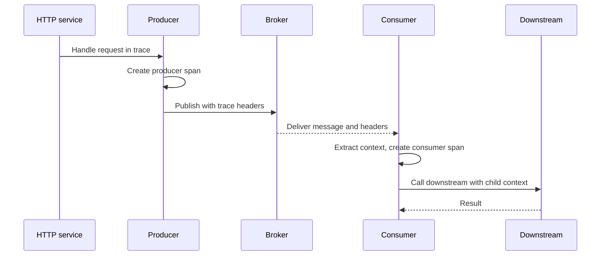
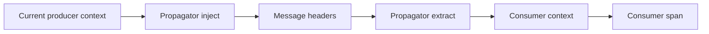

# Trace context via message headers in Spring Boot

**Trace context via message headers** is the mechanism for passing distributed tracing context from producer to consumer via message metadata. When a service publishes a message, tracing instrumentation can inject Trace ID, Span ID, and sampling flags into headers. The consumer extracts that metadata to create a consumer span linked to the original trace, enabling visibility across the broker and multiple services.

In the **SPRING_BOOT_OBSERVABILITY** module, trace context propagation connects HTTP, messaging, background tasks, and database operations into a single distributed trace. This lesson belongs to the **Messaging and task observability** chapter and focuses on W3C Trace Context, inject/extract over Kafka/Rabbit headers, producer/consumer span relationships, `tracestate`/baggage, async context, retries/redeliveries, security, and testing.

## 1. Why propagate trace context through messages?

In synchronous systems, trace context is typically transmitted via HTTP headers such as `traceparent`. With messaging, producer and consumer do not communicate directly within the same call stack. A message can sit in a broker for some time, be processed by another consumer, be retried, or be redelivered.

If context is not propagated, traces break into multiple independent traces. It then becomes hard to answer:
- Which initial HTTP request published the message?
- How long did the consumer take to process that message?
- Did the error happen during publish, broker delivery, or consumer processing?
- Does a retried message belong to the same business flow?
- Which trace do downstream database/API calls belong to?

Trace context in message headers connects operations across asynchronous boundaries. It does not replace message ID, correlation ID, or business identifiers.

### 1.1. Overview flow



Producers and consumers typically run in different processes/threads and do not share memory. Headers act as the carrier transporting context across the broker.

## 2. W3C Trace Context basics

W3C Trace Context defines standard fields for propagating tracing context across systems. The two primary headers are:

- **traceparent:** contains version, Trace ID, Parent ID, and trace flags.
- **tracestate:** carries vendor-specific tracing state in a standardized format.

Example `traceparent`:

```text
00-4bf92f3577b34da6a3ce929d0e0e4736-00f067aa0ba902b7-01
```

General structure:

```text
version-trace-id-parent-id-trace-flags
```

Trace ID identifies the trace across the system. Parent ID identifies the upstream span that the current operation attaches to. Trace flags can carry the sampled bit. Values in the example are illustrative, not fixed constants.

### 2.1. Trace ID and Span ID are different

- **Trace ID:** shared across all spans belonging to the same trace.
- **Span ID:** identifies one specific operation.
- **Parent Span ID:** points to the parent operation in the span tree hierarchy.
- **Trace flags:** transmits tracing control flags per protocol.

When a producer creates a new span, the producer span gets its own Span ID. After extracting context, the consumer creates a separate consumer span while keeping the Trace ID from the propagated context.

### 2.2. Tracestate

`tracestate` lets tracing vendors pass additional state. Do not manually parse or rewrite `tracestate` if instrumentation already manages it. Preserve W3C format compliance, limit header sizes, and keep secrets/PII out of vendor state.

## 3. Inject and extract are two separate operations

**Inject** writes the current context into a carrier—in messaging, message headers. **Extract** reads headers from a received message and reconstructs context so the consumer span continues the trace.



Do not copy an entire runtime context object from one process to another. Only transmit the propagation protocol representation over a supported carrier.

### 3.1. TextMapPropagator and carriers

OpenTelemetry uses a propagator to inject/extract key-value pairs across a carrier. For messaging, a carrier adapter maps the broker's header API to the interface used by the propagator.

In the Java SDK, the W3C Trace Context propagator is typically configured on the `OpenTelemetry` instance. The corresponding messaging instrumentation is responsible for calling inject/extract. If you write a custom carrier adapter, handle header names, encoding, duplicate values, and broker size limits.

### 3.2. Do not fabricate a new Trace ID when extraction fails

If a message has no trace headers or invalid headers, the consumer typically starts a new trace or processes under the default context. Do not derive a Trace ID from a message ID. Record missing/invalid propagation via controlled metrics/logs if needed.

## 4. Producer span and consumer span

A message publish normally creates a producer span. When the consumer receives the message, the consumer span can continue the trace via parent context or be connected using a span link, depending on messaging semantic conventions and instrumentation.

Concepts:
- **Producer span:** describes the message send operation.
- **Consumer span:** describes the message receive/process operation.
- **Span link:** represents relationships between spans when a parent-child relationship does not accurately reflect semantics or when multiple message contexts exist.
- **Trace ID:** connects spans in the same trace when using parent continuation.

Not every messaging integration picks the same parent/link strategy. Check your instrumentation version and the OpenTelemetry messaging semantic conventions in effect.

### 4.1. When to use parent-child

For a single message published during a request and processed by a single consumer, the consumer span can continue the producer context as parent-child. This fits when you want to represent processing as a continuation of the trace.

### 4.2. When to use span links

A consumer can receive a batch of many messages, each carrying a different context. A span can have only one parent, so span links are often more appropriate to link to multiple producer contexts. Some messaging conventions also use links to describe asynchronous processing or batch consumption.

Do not manually create multiple consumer spans just to attach each parent if the framework already provides appropriate batch semantics. Check the conventions of the instrumentation in use.

## 5. Kafka message headers

Kafka records support headers as key-value byte pairs. Trace context is typically written into headers such as `traceparent` and `tracestate` by the propagator/instrumentation.

Conceptual record example:

```text
topic: orders.created
key: order-key
headers:
  traceparent: 00-4bf92f3577b34da6a3ce929d0e0e4736-00f067aa0ba902b7-01
  tracestate: vendor=value
value:
  { "eventType": "OrderCreated" }
```

The payload merely illustrates structure; trace metadata lives in headers and does not need to be embedded into business JSON.

### 5.1. Kafka producer instrumentation

Spring Kafka/Kafka client provides instrumentation depending on version. When observation/tracing is enabled and supported, producer integration can inject context into record headers. If using `KafkaProducer` directly or custom serializers/interceptors, verify that instrumentation runs on the actual send path.

Do not assume adding a Micrometer Tracing bridge makes every `KafkaTemplate`/native producer inject headers automatically in every version. Verify configuration and message headers in integration tests.

### 5.2. Kafka consumer instrumentation

Consumer integration must extract context from record headers before creating the consumer span and invoking the handler. If the application uses a batch listener, context strategy may differ from a record listener. Check your Spring Kafka version, listener type, and conventions in use.

## 6. RabbitMQ message headers

RabbitMQ AMQP message properties include a `headers` table of metadata. Trace context can be injected into headers upon publish and extracted upon consume.

Conceptual example:

```text
exchange: orders.exchange
routing-key: order.created
headers:
  traceparent: 00-4bf92f3577b34da6a3ce929d0e0e4736-00f067aa0ba902b7-01
  tracestate: vendor=value
```

RabbitMQ also has properties such as `correlationId`, `messageId`, and `deliveryMode`. These fields are not automatically equivalent to W3C Trace ID or Span ID.

### 6.1. Spring AMQP integration

`RabbitTemplate` and listener containers can be instrumented depending on Spring AMQP/Micrometer version. Verify template/listener observation configuration and propagation support for your version.

If using custom `MessagePostProcessor` or custom converters, make sure they do not strip headers injected by tracing instrumentation. When receiving messages, preserve metadata across conversion and mapping.

## 7. Spring Boot and Micrometer Tracing integration

Spring Boot can configure `ObservationRegistry`, the Micrometer Tracing bridge, and propagators. Specific messaging integration depends on Spring Kafka, Spring AMQP, Micrometer, and OpenTelemetry bridge versions.

Integration checklist:
1. Choose the right messaging stack and dependency versions.
2. Confirm producer/consumer integration supports observation/tracing.
3. Configure the tracing bridge and propagator.
4. Enable observation using the API/properties for your integration version.
5. Verify header injection on the producer.
6. Verify header extraction on the consumer.
7. Confirm producer/consumer spans have the expected relationship.
8. Verify exporter/Collector/backend.

Do not add extra custom interceptors/Observations if the default integration already performs inject/extract. That can cause duplicate spans or double-written headers.

### 7.1. W3C propagator in the OpenTelemetry SDK

If the application manages the OpenTelemetry SDK directly, you can configure the W3C Trace Context propagator:

```java
OpenTelemetrySdk openTelemetry =
        OpenTelemetrySdk.builder()
                .setTracerProvider(tracerProvider)
                .setPropagators(
                        ContextPropagators.create(
                                W3CTraceContextPropagator.getInstance()))
                .build();
```

This is a general SDK configuration example. In a Spring Boot-managed setup, do not build a second `OpenTelemetrySdk` just to configure a propagator; use the extension points/auto-configuration supported by that version.

### 7.2. Micrometer Context Propagation

Messaging callbacks can execute on a different thread than the producer request. Micrometer Context Propagation helps bridge context across context mechanisms; messaging instrumentation must capture context at publish time and restore/extract context on the consumer per protocol.

Do not rely on `ThreadLocal` persisting across a broker. The broker only transports message metadata; runtime context must be reconstructed in the receiving process.

## 8. Baggage via message headers

Baggage is key-value context propagated alongside trace context. It is useful for metadata that needs to traverse multiple services, though it can increase header size and carry sensitive data.

Only propagate allowlisted baggage fields, for example:
- A finite-value tenant class or region code, if allowed by policy.
- A bounded, non-sensitive correlation hint.
- Well-designed routing/diagnostic metadata.

Do not propagate:
- Access tokens/API keys.
- Email addresses, phone numbers, physical addresses.
- Unnecessary raw user/customer identifiers.
- Authorization data or roles for the consumer to trust.
- Raw request headers or unfiltered baggage from clients.

Baggage is metadata carried with context, not an authorization mechanism. Consumers must authenticate/authorize using a separate trusted source.

## 9. Header size, encoding, and compatibility

Brokers and clients have limits on message/header or frame sizes. `tracestate` and baggage can enlarge total metadata. You should:
- Keep the number of baggage fields small.
- Bound value lengths.
- Never serialize large objects into a header.
- Avoid header names colliding with business metadata.
- Check encoding/byte conversion.
- Check broker quotas and maximum message/header sizes.

W3C `traceparent` has a standard format. Avoid altering casing, separators, or byte encoding in ways that break propagator parsing. Header names may be normalized by the broker; adapters must follow the broker API.

## 10. Retries, redelivery, and batch consumption

Messaging does not guarantee every message is processed exactly once. Consumers may retry, redeliver, requeue, or move messages to a dead-letter queue.

Trace topology should reflect semantics:
- One producer publish creates the initial context.
- Each delivery attempt can create its own consumer span/attempt span.
- Retries can create new spans, linked to the original context or previous attempt depending on integration.
- DLQ routing can be a separate publish operation.
- Batch consumers can link multiple producer contexts.

Do not reuse the same mutable span/observation across multiple delivery attempts. Each attempt is a distinct operation. Preserve original message headers if retry semantics require the initial context, while adding standardized attempt metadata if needed.

### 10.1. Redelivery is not producer retry

Producer retry is the client resending when a publish has not been acknowledged per policy. Consumer redelivery is the broker re-sending an unacknowledged or requeued message. The two processes have different telemetry; do not merge them into a single retry counter.

### 10.2. Dead-letter queues

When a message is routed to a DLQ, preserve the original context if needed for investigation, but do not indiscriminately copy untrusted baggage/headers. A DLQ consumer can start a new span and link to the initial producer/consumer context per appropriate conventions.

## 11. Security and trust boundaries

Message headers may be sent by internal services, external producers, or untrusted clients if broker access is broad. Never treat trace context as proof of identity.

Principles:
- Do not use Trace ID/Span ID to grant permissions.
- Do not use baggage to make tenant authorization decisions.
- Validate/limit header sizes and value lengths.
- Allowlist baggage fields.
- Do not dump all headers into logs.
- Never put secrets/PII into `tracestate` or baggage.
- Protect broker authentication and authorization independently.
- Govern message retention and dead-letter storage.

Trace context can be spoofed by untrusted producers. Tracing backends should be secured, and trace metadata must never serve as security input.

## 12. Testing trace propagation via message headers

Tests must verify both inject and extract. Unit testing a business handler alone does not prove the broker preserves headers across real transport.

### 12.1. Producer tests

Send a message via the producer integration and verify record/message headers contain a valid `traceparent` when a span is active. Verify `tracestate`/baggage only include permitted fields.

### 12.2. Consumer tests

Feed a message with `traceparent` into the consumer and verify the consumer span preserves the expected Trace ID and parent/link per instrumentation convention. Also test missing headers and malformed headers.

### 12.3. Broker integration tests

Use a Kafka/RabbitMQ test broker or appropriate Testcontainers to verify:
- Headers are preserved by the broker.
- The consumer receives the exact bytes/values.
- Converters/serializers do not drop headers.
- Retries/redeliveries preserve context per policy.
- Batch consumption links contexts accurately.
- Header limits are not exceeded.

### 12.4. Privacy tests

Send a message carrying a non-allowlisted baggage field and verify it is not propagated. Check that logs do not dump `Authorization`, `Cookie`, or full header maps.

## 13. Troubleshooting trace context propagation

| Symptom | Possible cause | How to check |
| --- | --- | --- |
| Producer span exists but headers lack traceparent | Producer instrumentation didn't inject or custom code overwrote headers | Check integration/config and record headers |
| Consumer starts a new trace | Extractor didn't run or header was lost/invalid | Inspect headers after broker and in consumer instrumentation |
| Producer and consumer Trace IDs differ | Context not propagated or consumer started a root span | Compare injected/extracted `traceparent` and sampler |
| Same Trace ID but wrong span relationship | Wrong parent/link strategy or span context | Check semantic conventions and span links |
| Tracestate lost | Propagator misconfigured or broker header adapter bug | Check propagator and header conversion |
| Baggage too large | Propagating too many fields/values | Allowlist and limit header size |
| Duplicate traces | Auto-instrumentation and custom interceptor both inject/create spans | Audit instrumentation ownership |
| Retries share the same span ID | Reusing a span/observation across attempts | Create a distinct operation/span per attempt |
| Batch consumer has an unsuitable single parent | Multiple message contexts with a single parent-child model | Check span links/batch conventions |
| Callback logs missing Trace ID | Async context not restored | Check context propagation inside callbacks |
| Header value encoding corrupted | Inconsistent string/byte conversions | Check broker API and carrier adapter |
| DLQ not linked to original trace | Headers stripped on republish | Check DLQ republish logic |
| Sensitive metadata appears | Unfiltered baggage/headers | Allowlist and redact at source |

### Investigation workflow

1. Identify the messaging technology and integration version.
2. Send a message from a request with an active trace.
3. Inspect raw `traceparent`/`tracestate` on the producer record before publishing.
4. Read headers after broker receipt and upon consumer receipt.
5. Verify consumer instrumentation extracts context before invoking the handler.
6. Compare Trace ID, parent Span ID, and links in the backend.
7. Check retry/redelivery/batch semantics.
8. Check async callbacks and Reactor Context if applicable.
9. Audit baggage, header sizes, and sensitive metadata.
10. Check exporter/sampling separately if spans do not show up.

## 14. Lab exercise: connecting traces over Kafka or RabbitMQ

The goal is to create a trace starting at an HTTP request, publish a message, and continue it in the consumer.

### Preparation

- Spring Boot producer and consumer applications.
- Lab Kafka or RabbitMQ broker.
- Micrometer Tracing bridge and exporter/test exporter.
- Messaging integration supporting observation/propagation for your version.
- Tracing backend or in-memory exporter.

### Step 1 — Instrument the HTTP entry point

Send an HTTP request to the producer service and confirm a server span is created.

### Step 2 — Enable producer observation

Enable observation/tracing per your integration version. Publish a message within the active request context.

### Step 3 — Inspect headers before the broker

Verify `traceparent` is injected into message headers. Record the Trace ID and producer Span ID for comparison.

### Step 4 — Send through the broker

Publish the message to a test topic/queue. Confirm the broker receives the message and preserves headers.

### Step 5 — Enable consumer instrumentation

Configure consumer integration to extract context. When the message is processed, confirm a consumer span is created.

### Step 6 — Inspect trace topology

In the backend, confirm Trace ID continuity and proper parent/link relationships per instrumentation semantics. Do not rely solely on timestamps.

### Step 7 — Test a message without context

Send a message without trace headers. Confirm the consumer processes it and creates a new trace/default context per policy.

### Step 8 — Test retry/redelivery

Trigger a controlled error so the broker redelivers or the consumer retries. Confirm each attempt has its own span and original context is preserved/linked properly.

### Step 9 — Test the baggage allowlist

Send an allowlisted baggage field and a non-allowlisted field. Confirm only the allowlisted field propagates.

### Step 10 — Check privacy and header limits

Confirm no tokens/PII appear in headers and total metadata stays within broker/client limits.

### Acceptance checklist

| What to demonstrate | Expected result |
| --- | --- |
| Protocol | Understand `traceparent`/`tracestate` |
| Inject | Producer writes trace context into headers |
| Extract | Consumer reconstructs context from headers |
| Trace ID | Producer and consumer correlate accurately |
| Parent/link | Span relationships fit single/batch messages |
| Kafka/Rabbit | Headers preserved and forwarded by broker |
| Async | Context accurate inside callbacks/consumer threads |
| Retry | Each attempt has an appropriate operation/span |
| Baggage | Only allowlisted fields propagate |
| Security | Trace metadata is not used for authorization |
| Privacy | No secrets/PII in headers |
| Export | Sampling/exporter issues not confused with propagation |

## 15. Principles to remember

1. **Trace context via message headers connects producers and consumers across brokers.** Business payloads do not need to contain Trace IDs.
2. **W3C `traceparent` carries Trace ID, parent Span ID, and flags; `tracestate` carries vendor state.** Keep the standard format intact.
3. **Inject and extract are two separate steps.** Check headers before publish, after the broker, and at the consumer.
4. **Producer acknowledgement does not mean the consumer has processed the message.** Trace topology must represent messaging milestones accurately.
5. **Parent-child and span links have distinct semantics.** Batch consumption or async processing may require links.
6. **Kafka and RabbitMQ have different header APIs and integrations.** Verify versions, serializers/converters, and auto-instrumentation.
7. **Reactor Context/async context must be restored in callbacks and consumers.** Do not rely on `ThreadLocal` across processes.
8. **Retries, redeliveries, and DLQs are distinct operations.** Never reuse one mutable span across multiple attempts.
9. **Baggage is not authorization.** Only propagate allowlisted fields containing no secrets/PII.
10. **Keep header sizes and cardinality controlled.** Do not use message IDs, user IDs, or raw payloads as metric tags.
11. **Verify end-to-end.** Producer spans, broker headers, consumer spans, exporters, and backends all need independent verification.

Trace context via message headers allows distributed tracing to cross the asynchronous boundaries of Kafka, RabbitMQ, and other messaging systems. By injecting and extracting according to protocol, choosing appropriate parent/link semantics, preserving context across callbacks, and governing baggage, operations teams can follow a message from the initial request to consumer processing while protecting metadata and keeping telemetry meaningful.
