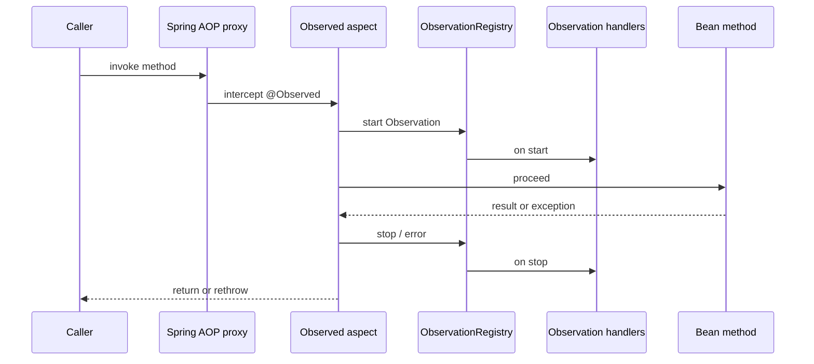

# @Observed in Spring Boot Observability

## 1. Objectives and Context

In a Spring Boot application, a business workflow may run across controllers, services, repositories, and clients calling external systems. If only HTTP endpoints are instrumented, internal operations such as fee calculation, inventory checks, or invoice creation are difficult to observe individually. Micrometer Observation lets you create an observation around an operation; the `@Observed` annotation applies instrumentation directly to a Spring bean method.

When enabled and the method call goes through a Spring AOP proxy, `@Observed` creates an observation around the method invocation. Observation handlers can convert the observation into metrics and/or tracing data depending on the registry configuration. The annotation does not guarantee that every method call will be intercepted.

This lesson belongs to the Annotation observability chapter of the `SPRING_BOOT_OBSERVABILITY` module. The module teaches how to set up observability for Spring Boot using Micrometer Observation, metrics, logs, and distributed tracing; you will learn context propagation, tags/cardinality, exporters, sampling, and signal correlation to investigate errors, latency, and application behavior in production environments.

After this lesson, you can:
1. Explain how `@Observed` creates an observation around a method invocation.
2. Enable annotation processing in Spring Boot.
3. Distinguish `name`, `contextualName`, and low/high-cardinality key values.
4. Understand AOP proxies, self-invocation, and interception limitations.
5. Distinguish `@Observed` from `@Timed`, `@Counted`, and `@MeterTag`.
6. Observe exceptions, metrics, spans, and related logs.
7. Handle async/reactive methods with the proper lifecycle.
8. Test observation handlers and cardinality.

Baseline: Spring Boot 3.5.x, Java 17+, Micrometer Observation, and Spring AOP. Package/API details depend on the Micrometer/Spring Boot version; use Boot's dependency management.

## 2. What Is @Observed?

`@Observed` is a Micrometer annotation used to mark a method or type that should be observed. When annotation processing is enabled, an AOP aspect/interceptor creates an `Observation` wrapping the invocation.

An observation can have a stable name, a contextual name, low-cardinality key values used for metrics, high-cardinality key values intended for tracing/diagnostics, and exception recording if the method throws an error out of the invocation. `ObservationRegistry` handlers determine which signals are produced.



This is a conceptual model. Actual configuration requires an aspect, a registry, and an appropriate Spring AOP proxy.

## 3. Enabling @Observed in Spring Boot

Annotation-driven observation needs to be enabled via a property:

```yaml
management:
  observations:
    annotations:
      enabled: true
```

Appropriate dependencies for Actuator/Micrometer Observation and Spring AOP are required. Use Spring Boot's dependency management instead of manually pulling in incompatible Micrometer versions.

Maven example:

```xml
<dependency>
    <groupId>org.springframework.boot</groupId>
    <artifactId>spring-boot-starter-actuator</artifactId>
</dependency>
<dependency>
    <groupId>org.springframework.boot</groupId>
    <artifactId>spring-boot-starter-aop</artifactId>
</dependency>
```

Actuator provides the observability infrastructure; the AOP starter provides the proxy infrastructure. Tracing backends/exporters require separate dependencies and configuration if you want to export spans.

Verify that the property is bound, the bean belongs to the Spring container, the method is called through a proxy, `ObservationRegistry` has the expected handlers, and the metric/span appears after invocation. Simply adding the annotation without the aspect/AOP/registry is not enough.

## 4. Using @Observed on a Method

Payment processing service example:

```java
import io.micrometer.observation.annotation.Observed;
import org.springframework.stereotype.Service;

@Service
public class PaymentService {
    @Observed(
        name = "payment.authorize",
        contextualName = "authorize payment"
    )
    public PaymentResult authorize(PaymentCommand command) {
        return new PaymentResult("APPROVED");
    }
}
```

`name` is the stable operation name; `contextualName` makes the trace/context easier to read. The method is wrapped by an observation when interception is active. If the method throws an exception out of the invocation, the observation lifecycle can record the error before the exception propagates.

Do not put order IDs, customer IDs, or dynamic URLs into `name`/`contextualName`. Names must be stable and must not generate a new observation name for each request.

## 5. Low-Cardinality and High-Cardinality Key Values

| Attribute | Purpose |
| --- | --- |
| lowCardinalityKeyValues | Tags with a bounded set of values, usable for metrics |
| highCardinalityKeyValues | Metadata that varies per request, suitable for tracing/diagnostics, not used as metric tags |

Static metadata example:

```java
@Observed(
    name = "payment.authorize",
    contextualName = "authorize payment",
    lowCardinalityKeyValues = {
        "payment.method", "card",
        "payment.channel", "web"
    },
    highCardinalityKeyValues = {
        "payment.reference", "internal-reference"
    }
)
public PaymentResult authorize(PaymentCommand command) {
    return new PaymentResult("APPROVED");
}
```

Annotation attributes are static strings; you cannot interpolate runtime values from `command` into an annotation literal. To attach dynamic metadata, use the Observation API in code or an appropriate convention/customization.

Rules:
- Low-cardinality: operation type, channel, provider name from an allowlist, bounded outcome.
- High-cardinality: request/reference ID only when truly necessary and permitted.
- Do not attach passwords, PANs, tokens, emails, raw SQL, or payloads to telemetry.
- High-cardinality does not mean safe to store; it only describes the cardinality characteristic.

## 6. Attaching Dynamic Metadata with the Observation API

When runtime values are needed, create an `Observation` manually around the operation:

```java
import io.micrometer.observation.Observation;
import io.micrometer.observation.ObservationRegistry;

public class InvoiceService {
    private final ObservationRegistry registry;

    public InvoiceService(ObservationRegistry registry) {
        this.registry = registry;
    }

    public Invoice create(CreateInvoiceCommand command) {
        return Observation.createNotStarted("invoice.create", registry)
                .lowCardinalityKeyValue("invoice.channel",
                        normalizeChannel(command.channel()))
                .observe(() -> doCreate(command));
    }

    private String normalizeChannel(String channel) {
        return switch (channel) {
            case "web", "mobile", "partner" -> channel;
            default -> "other";
        };
    }

    private Invoice doCreate(CreateInvoiceCommand command) {
        return new Invoice();
    }
}
```

This is an alternative to `@Observed`. Do not wrap the same method with both `@Observed` and manual `Observation` just to create two records for the same operation. Choose one instrumentation owner or clearly define parent/child operations.

## 7. @Observed on Types and Methods

You can annotate a type or a method depending on the API/version. Type-level annotations can apply to eligible methods in the bean; method-level annotations clearly express which operation needs measuring and allow different names/contexts.

Avoid annotating too broadly: getters/setters or small methods with no operational value; repositories already measured by datasource instrumentation; child methods that produce duplicate signals. Choose meaningful business operations such as `payment.authorize`, `order.submit`, or `inventory.reserve`.

Check the precedence between type-level and method-level annotations according to the Micrometer version in use; do not assume all annotations will stack/merge.

## 8. AOP Proxy and Self-Invocation

Spring normally intercepts a method call when the caller goes through the proxy. If a method in the same object calls another method on `this`, the internal call does not go through the proxy, so the annotation on the called method may not be applied.

```java
@Service
public class OrderService {
    public void submit(OrderCommand command) {
        validate(command); // Self-invocation.
    }

    @Observed(name = "order.validate")
    public void validate(OrderCommand command) {
        // Validation logic.
    }
}
```

`submit` may be called through the bean proxy, but the internal `validate` call is a direct call. The observation for `validate` may not be created.

How to fix:
1. Extract `validate` into a separate Spring bean and inject it into `OrderService`.
2. Move the observation boundary up to `submit` if that is the operation to measure.
3. Use the manual Observation API around the internal code block.
4. Avoid self-injection or circular proxy calls if a simpler design exists.

Private/final methods or classes that cannot be proxied under the active strategy may also not be intercepted. Check the proxy strategy (JDK dynamic proxy/CGLIB), visibility, and Spring AOP configuration.

## 9. Exceptions and Lifecycle

If an intercepted method throws an exception, the observation is marked as an error according to the lifecycle of the aspect/handlers; the exception continues to propagate if unhandled. The metrics handler can record duration/error outcome; the tracing handler can create a span and record an error/event depending on the bridge. Logs do not appear automatically just because `@Observed` is present.

If the method catches the exception and returns a fallback, the observation wrapping the method may finish as successful from the invocation's perspective. If the internal error still needs to be observed, record it in a child operation before the fallback using an appropriate `Observation`/counter/log.

Do not swallow an exception and expect the aspect to automatically know an error occurred. The annotation only observes exceptions that cross the boundary it intercepts.

## 10. @Observed, @Timed, @Counted, and @MeterTag

| Annotation | Primary Purpose | Result |
| --- | --- | --- |
| @Observed | Observation abstraction | Can connect metrics and tracing handlers |
| @Timed | Measure method duration | Timer metric |
| @Counted | Count invocations | Counter metric |
| @MeterTag | Create a tag from a method parameter for supported meter annotations | Dynamic meter tag via resolver |

`@Observed` is suitable when you need a single operation connected to multiple observability handlers. `@Timed`/`@Counted` are useful for metric-focused instrumentation. Do not put multiple annotations on the same method without defining their semantics, as this can create duplicate timers/counters.

`@MeterTag` is not an attribute of `@Observed` and does not automatically turn a parameter into a low-cardinality observation key. You must distinguish the annotation processing and resolvers of each mechanism.

## 11. Async and Reactive Methods

### 11.1. Async

If a method returns a `CompletableFuture` or submits a task to an executor, determine whether the observation measures the time to create the future or the time until the work completes; whether exceptions occur inside the method or after returning; and whether context is propagated to the worker thread.

A synchronous AOP aspect may finish when the `CompletableFuture` is returned, depending on the integration/version; do not assume by default that it tracks completion. Use context propagation and async-aware instrumentation, or the Observation API tied to the completion lifecycle.

### 11.2. Reactive

With `Mono`/`Flux`, a method may return a publisher before the work runs. A synchronous observation around the invocation risks measuring only the pipeline assembly time. Use reactive-aware instrumentation and ensure context follows the subscription.

Do not manually subscribe to a publisher just to end an observation; doing so can execute the operation an extra time. Test success, `onError`, cancellation, and resubscription.

## 12. Metrics and Tracing Handlers

When `ObservationRegistry` has the corresponding handlers, a metrics handler can create a timer/summary per convention; a tracing handler can create a span; logging correlation can link logs with trace/span context if tracing is configured.

Do not assume every backend or handler is enabled by default just because `@Observed` is present. Verify actual output using Actuator metrics, the tracing backend, or a test `ObservationHandler`. Do not use high-cardinality fields as metric tags.

## 13. Testing @Observed

- Initialize a Spring application context with AOP and annotation processing.
- Inject the bean from the context; do not instantiate the object with `new`.
- Call the method through the injected bean proxy.
- Use a test `ObservationHandler` to capture start/stop/error events.
- Verify `name`, `contextualName`, and low/high-cardinality key values.
- Call a method that throws an exception and verify the error lifecycle.
- Test self-invocation, then test refactoring into a separate bean.
- Verify that the timer/meter appears when a metrics handler is configured.
- Verify that the span appears when a tracing handler/bridge is configured.
- Verify that high-cardinality values do not appear in metric tags.
- Test `CompletableFuture` and `Mono`/`Flux` completion, error, cancel, and resubscription.

## 14. Troubleshooting

| Symptom | Possible Cause | Resolution |
| --- | --- | --- |
| @Observed creates no metric/span | Annotation processing disabled, missing AOP or registry handler | Check property, dependencies, and handlers |
| Public method is not intercepted | Caller invokes via `this` or object is not a Spring bean | Inject bean proxy or use Observation API |
| Private/final method has no observation | Proxy cannot intercept under the current strategy | Change boundary/visibility or use explicit Observation |
| Future timer is too short | Observation ends when the future is returned | Instrument completion lifecycle |
| Mono method duration is near 0 | Measured at publisher creation, before subscription | Use reactive-aware instrumentation |
| Timer exists but no span | Metrics handler present but tracing bridge not configured | Check Micrometer Tracing/exporter |
| Span exists but no timer | Meter registry/metrics handler not configured | Check metrics pipeline |
| Cardinality spikes | Dynamic data put into low-cardinality keys | Normalize/allowlist values |
| One operation has two timers | @Observed overlaps with @Timed/manual Observation | Choose one owner or separate operations |
| Exception is not marked as error | Exception caught/fallback returned before boundary | Record child operation failure |

## 15. Production Checklist

- [ ] Enable annotation observation processing according to the Spring Boot version.
- [ ] Ensure Spring AOP and an appropriate `ObservationRegistry` are present.
- [ ] Call the method through the Spring proxy.
- [ ] Avoid self-invocation for methods requiring annotation interception.
- [ ] Use stable `name`/`contextualName`.
- [ ] Put only bounded sets into low-cardinality keys.
- [ ] Do not put PII/secrets into high-cardinality values.
- [ ] Do not unintentionally overlap `@Observed` with `@Timed`/`@Counted`.
- [ ] Verify exception lifecycle and fallback behavior.
- [ ] Measure async/reactive operations through completion when needed.
- [ ] Verify metrics and tracing handlers independently.
- [ ] Have tests for proxy, self-invocation, error, async/reactive, and cardinality.

## 16. Self-Check Questions

1. At what point does `@Observed` create an `Observation`?
2. Which property enables annotation-driven observation in Spring Boot?
3. Why must the method be called through a Spring AOP proxy?
4. How does self-invocation cause an annotation on an internal method to be bypassed?
5. How does `name` differ from `contextualName`?
6. How do `lowCardinalityKeyValues` and `highCardinalityKeyValues` differ?
7. Why can't annotation attributes interpolate runtime parameters?
8. When should you use the manual Observation API instead of `@Observed`?
9. How does `@Observed` differ from `@Timed`/`@Counted`/`@MeterTag`?
10. If a method catches an exception and returns a fallback, what outcome does the observation see?
11. Why might a method returning a `Mono` have a very short duration even though the HTTP call is slow?
12. What needs to be checked to verify that both metrics and tracing handlers are working?

## References

- [Spring Boot 3.5 — Observability](https://docs.spring.io/spring-boot/3.5/reference/actuator/observability.html)
- [Spring Boot 3.5 — Common Application Properties](https://docs.spring.io/spring-boot/3.5/appendix/application-properties/index.html)
- [Micrometer Observation — Annotation Support](https://docs.micrometer.io/micrometer/reference/observation/annotations.html)
- [Micrometer Observation — Concepts](https://docs.micrometer.io/micrometer/reference/observation.html)
- [Micrometer — @Timed and @Counted](https://docs.micrometer.io/micrometer/reference/concepts/timers.html)
- [Spring Framework — AOP Proxies](https://docs.spring.io/spring-framework/reference/core/aop/proxying.html)
- [Micrometer Tracing — API](https://docs.micrometer.io/tracing/reference/api.html)
