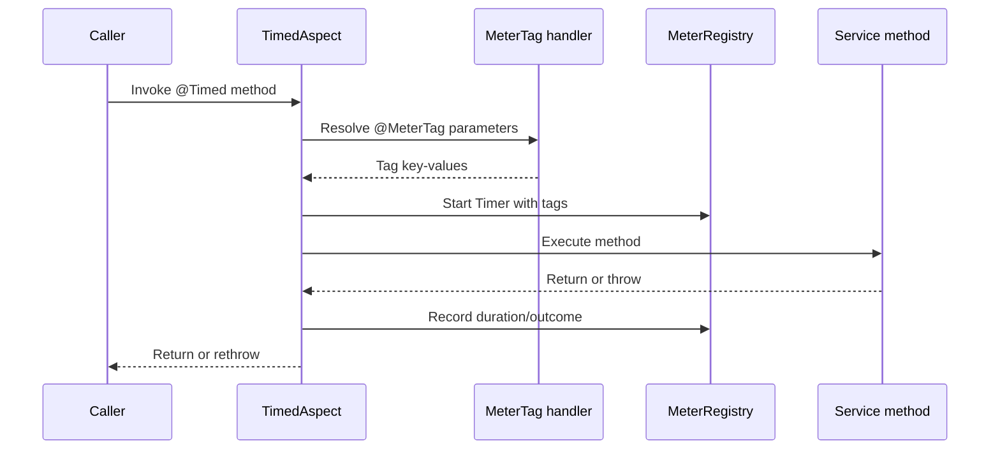

# @MeterTag in Micrometer

A Spring Boot service has a business method that processes requests by customer tier, channel, or operation group. The operations team wants to analyze execution time across a few meaningful groups rather than only seeing the method's aggregate latency. Micrometer provides the **@MeterTag** annotation to attach tags to a meter created by method instrumentation, typically used together with **@Timed** and **TimedAspect**.

`@MeterTag` is placed on a parameter of an instrumented method. When `TimedAspect` processes the invocation, a tag handler reads the parameter value and converts it into a tag key-value pair for the meter. Value conversion can be customized using a resolver; some setups also support expression-based resolution. The annotation keeps tag declarations close to the method signature, but it does not create a standalone meter by itself and does not automatically instrument every method.

This **@MeterTag** lesson belongs to the **Annotation observability** chapter of the **SPRING_BOOT_OBSERVABILITY** module. The module focuses on setting up observability for Spring Boot using Micrometer Observation, metrics, logs, and distributed tracing; you will learn context propagation, tags/cardinality, exporters, sampling, and signal correlation to investigate errors, latency, and application behavior in production environments.

## 1. Learning Objectives

After this lesson, you can:

- Explain the role of `@MeterTag` in Micrometer method metrics.
- Combine `@MeterTag` with `@Timed` and `TimedAspect`.
- Understand how parameter values are converted into meter tags.
- Configure an appropriate value resolver and expression resolver.
- Avoid attaching IDs, emails, tokens, or dynamic values to metric tags.
- Recognize proxy/AOP and self-invocation limitations.
- Inspect actual tags in `MeterRegistry`/Actuator.
- Write tests to verify meter names, tag values, and cardinality.

## 2. What Does @MeterTag Do?

Micrometer `@Timed` marks a method whose execution time should be measured. `TimedAspect` uses AOP to wrap the method invocation and record a `Timer` into `MeterRegistry`. `@MeterTag` lets you extract a value from a method parameter and include it in the `Timer`'s tags.



The diagram provides a high-level overview. Handler/resolver APIs and annotation processing details depend on the Micrometer version. Use the exact API of the version managed by the Spring Boot BOM.

`@MeterTag` has three key points to remember:

1. It provides tag metadata from a method parameter.
2. It requires an instrumentation mechanism such as `TimedAspect` to read the annotation.
3. Tag values must be low-cardinality and must not contain sensitive data.

Without a corresponding aspect or handler, placing the annotation on a parameter does not guarantee a metric will be created.

## 3. @Timed and @MeterTag Example

Example of a service measuring processing time by customer tier:

```java
import io.micrometer.core.annotation.MeterTag;
import io.micrometer.core.annotation.Timed;
import org.springframework.stereotype.Service;

@Service
public class PricingService {

    @Timed(value = "pricing.calculate", description = "Pricing calculation time")
    public Price calculate(
            @MeterTag(key = "customer_tier") String customerTier,
            String productCode) {
        return calculatePrice(customerTier, productCode);
    }

    private Price calculatePrice(String tier, String productCode) {
        return new Price(productCode, tier);
    }
}

record Price(String productCode, String tier) {}
```

This snippet illustrates annotation usage; verify annotation attributes against the Micrometer version in use. Only `customerTier` is annotated with `@MeterTag`, so `productCode` does not automatically become a metric tag.

### @MeterTag on Method Return Value

Micrometer also supports placing `@MeterTag` on a method to create a tag from the return value of a `@Timed`-instrumented method. This is useful when the return value is a bounded category, but requires care because a method result can be a large object or sensitive data:

```java
@Timed("feature.lookup")
@MeterTag("feature_result")
public String lookupFeature() {
    return "enabled";
}
```

In the example, the return value becomes the tag value according to the configured resolver. Only use this approach when the result is normalized to a small set of values. For parameter-based tagging, the implementation method needs to be instrumented along the proper proxy/AOP path; check method/implementation annotations according to the Micrometer version.

### Tag Values Must Be Normalized

If `customerTier` only has bounded values such as `standard`, `silver`, `gold`, this tag can be useful. If the parameter is a customer ID, email, or free-text, never attach it directly because each value can create a separate time series and leak data.

## 4. Configuring TimedAspect

`@Timed` is an annotation; for the method to be intercepted, the application needs `TimedAspect` and `MeterRegistry` configured. Basic configuration example:

```java
import io.micrometer.core.aop.TimedAspect;
import io.micrometer.core.instrument.MeterRegistry;
import org.springframework.context.annotation.Bean;
import org.springframework.context.annotation.Configuration;

@Configuration
class MetricsAspectConfiguration {

    @Bean
    TimedAspect timedAspect(MeterRegistry registry) {
        return new TimedAspect(registry);
    }
}
```

In Spring Boot, check your version and auto-configuration before manually registering the aspect to avoid duplicate configuration. `TimedAspect` uses an AOP proxy; the method must be called through the Spring proxy and meet the application's proxy conditions.

### Configuring the @MeterTag Resolver

Micrometer supports configuring `MeterTagAnnotationHandler` for `TimedAspect`. The resolver determines how arguments are read/formatted. Constructor/lambda APIs may vary by Micrometer version; general example:

```java
@Bean
TimedAspect timedAspect(MeterRegistry registry) {
    TimedAspect aspect = new TimedAspect(registry);

    ValueResolver valueResolver = parameter ->
        parameter == null ? "none" : parameter.toString();
    ValueExpressionResolver expressionResolver = new MyExpressionResolver();

    MeterTagAnnotationHandler handler =
        new MeterTagAnnotationHandler(
            resolverClass -> valueResolver,
            resolverClass -> expressionResolver
        );

    aspect.setMeterTagAnnotationHandler(handler);
    return aspect;
}
```

This is a general wiring example. `MyExpressionResolver` is an application-provided implementation; Micrometer does not ship a specific expression engine out of the box. Verify functional interfaces and imports in your project's Micrometer version. The resolver should return normalized, bounded values containing no sensitive data.

### Why Is a Resolver Needed?

A parameter may be an enum, domain object, or nullable value. Calling default `toString()` on an object can produce unpredictable tags containing IDs or changing with implementation details. A resolver lets you map an object to a stable category, for example:

```java
String toMetricTier(Customer customer) {
    return switch (customer.tier()) {
        case GOLD -> "gold";
        case SILVER -> "silver";
        default -> "standard";
    };
}
```

Only allow-listed categories should make it into metrics.

## 5. Expression-Based Tag Resolution

Some `MeterTagAnnotationHandler` configurations allow using an expression resolver, such as SpEL, to extract a property from an argument. You must register the corresponding expression resolver; the annotation alone does not automatically enable every expression engine.

Conceptual example:

```java
@Timed("pricing.calculate")
public Price calculate(
        @MeterTag(key = "customer_tier", expression = "tier")
        Customer customer) {
    // ...
}
```

This example illustrates extracting the `tier` property from an object; annotation syntax and expression resolver must match your Micrometer version. If no resolver is configured, the expression may not evaluate as intended.

Expressions should be simple, deterministic, and return a bounded set of values. Do not use expressions to generate UUIDs, concatenate entire objects, read PII, or produce a new value on every invocation. If mapping logic is complex, use a custom resolver with an explicit allow-list.

## 6. Tag Cardinality and Cost

Each combination of meter name and tag values can create a separate meter/time series. For example, if a method has 3 customer tiers, 4 channels, and 5 outcomes, the maximum number of combinations is 3 × 4 × 5 = 60 series for one method, before multiplying by instance count, histogram buckets, and other dimensions.

| Parameter | Use as Tag? | Reason |
| --- | --- | --- |
| Customer tier | Possible | Small, controlled set of values |
| Channel (web, mobile, partner) | Possible | Bounded set of categories |
| Operation type | Possible | Bounded set of operations |
| Customer ID | No | Each customer can create a separate series |
| Order ID | No | Virtually unique values |
| Email/phone | No | PII and high cardinality |
| Raw URL/query | No | Dynamic values and may contain secrets |
| Trace ID | No | Almost every trace is a distinct value |
| Exception message | No | Dynamic content, may contain payloads |

`@MeterTag` is a convenience annotation, not an automatic cardinality guard. The designer must choose safe parameters and the resolver must normalize values. Do not put `@MeterTag` on every argument just because you can.

## 7. Null Values and Exceptions

A method parameter can be `null` if the contract allows it. The resolver must clearly define how to handle it: use a category such as `none`/`unknown`, or omit the tag if supported by the handler/version. Never let the resolver throw an exception and break a business invocation just because tag conversion failed.

A method can finish normally or throw an exception. `TimedAspect` records duration around the invocation; how errors/outcomes are classified depends on instrumentation and the registry. `@MeterTag` only adds tags from arguments; it does not define error semantics by itself.

If you need to classify outcomes, use a separate business `Observation` or appropriate metrics. Avoid attaching exception messages as tags; use an exception class/category from a bounded set if truly needed.

## 8. AOP and Proxy Limitations

`TimedAspect` relies on Spring AOP proxies:

- Method calls from another bean through the Spring proxy are normally intercepted.
- Self-invocation (a method in the same object calling an annotated method) typically bypasses the proxy.
- Methods not proxied under the active mechanism may not be intercepted.
- Objects created with `new` rather than managed by the Spring container do not automatically have the aspect applied.
- `final`/`private` methods may not be proxied/intercepted as expected depending on the proxy strategy.

Self-invocation example:

```java
@Service
class ReportService {

    public void generate() {
        calculateRows(); // internal call, may bypass AOP proxy
    }

    @Timed("report.calculate")
    public int calculateRows() {
        return 100;
    }
}
```

If method-level timing is needed for an internal call, extract the operation into another bean or use the `Observation`/`Timer` API directly. Do not rely on annotations without checking the actual call path.

## 9. Inspecting Meters and Tag Values

When Actuator is present, expose the metrics endpoint in a secured environment:

```yaml
management:
  endpoints:
    web:
      exposure:
        include: health,metrics
```

Inspect the meter:

```http
GET /actuator/metrics/pricing.calculate
```

To filter:

```http
GET /actuator/metrics/pricing.calculate?tag=customer_tier:gold
```

Exact tag names depend on annotation/resolver configuration. Use `availableTags` to verify the tag keys and values created. Actuator shows in-process metrics; an exporter/registry delivers time series to an external backend.

### Checking via MeterRegistry in Tests

A test can call the proxied method and then inspect the `Timer`:

```java
Timer timer = meterRegistry.find("pricing.calculate")
    .tag("customer_tier", "gold")
    .timer();

assertThat(timer).isNotNull();
assertThat(timer.count()).isEqualTo(1);
```

This assertion snippet is illustrative; tests must invoke the Spring-managed bean through its proxy before looking up the `Timer`. If a test invokes a manually constructed object, the aspect may not run.

## 10. @MeterTag Does Not Replace Observation

`@MeterTag` typically serves method metrics created by `@Timed`/`TimedAspect`. Micrometer `Observation` has a broader scope: a single `Observation` can be processed by multiple handlers to produce both metrics and tracing within the same lifecycle.

| Tool | Role |
| --- | --- |
| @Timed | Declare a method to be timed |
| @MeterTag | Add tags from method parameters to an instrumented meter |
| TimedAspect | Intercept the method and record a Timer |
| Observation | Multi-handler observation lifecycle model |
| ObservationRegistry | Coordinate Observation handlers |
| @Observed (if integration/version supports it) | Annotation-based Observation via its corresponding aspect |

If an operation needs both metrics and a trace span under `Observation`, choose the `@Observed`/`Observation` mechanism appropriate for your Spring Boot version. Do not assume `@MeterTag` automatically creates a tracing span.

## 11. Troubleshooting

| Symptom | Possible Cause | What to Check |
| --- | --- | --- |
| No Timer | Missing TimedAspect or method bypasses proxy | Check bean, AOP, and invocation path |
| Timer exists but tag is missing | @MeterTag not processed by handler or resolver not configured | Check Micrometer version and handler |
| Tag value is an unreadable object name | Default resolver calls `toString()` | Create a resolver that normalizes to categories |
| Expression is not evaluated | Expression resolver not registered or syntax mismatches version | Check handler configuration |
| Self-invocation not measured | Internal call bypasses proxy | Extract bean or use Observation API |
| Timer is duplicated | Multiple aspects/instrumentations measuring the same method | Review TimedAspect beans and custom metrics |
| Cardinality grows rapidly | Parameter containing IDs/free-text attached as tag | Remove tag and use allow-listed categories |
| Resolver throws exception | Null/object not handled | Handle null and provide a safe fallback |
| Actuator shows meter but backend is empty | Registry/exporter or scrape not configured | Check metrics pipeline |
| Method measures wrong duration | Aspect covers code outside the intended operation | Define boundary or create a dedicated Observation |

### Investigation Checklist

1. Confirm Micrometer and Spring AOP dependencies are compatible.
2. Confirm `TimedAspect` is registered exactly once.
3. Call the method through the Spring-managed bean/proxy.
4. Check that the `Timer` appears in `MeterRegistry`.
5. Verify `@MeterTag` key and value via available tags.
6. Check resolver/expression resolver and null handling.
7. Estimate cardinality before deploying.
8. Verify there are no PII/secrets in tag values.

## 12. Hands-On: Grouping Latency by Customer Tier

**Context:** `pricing-service` has a `calculate` method called for three customer groups: `standard`, `silver`, `gold`. The team wants to compare latency by tier without putting customer IDs into metrics.

### Part A — Preparation

1. Configure `MeterRegistry` and `TimedAspect`.
2. Annotate the method with `@Timed`.
3. Annotate the `tier` parameter with `@MeterTag`.
4. If the parameter is an object, configure a resolver mapping it to the three valid categories.
5. Expose Actuator metrics in the test environment.

### Part B — Verification

| Case | Input | Expected Result |
| --- | --- | --- |
| A — Standard | standard | Timer has tag `customer_tier=standard` |
| B — Gold | gold | Timer has tag `customer_tier=gold` |
| C — Silver | silver | Timer has tag `customer_tier=silver` |
| D — Unknown | Value outside allow-list | Resolver returns the defined fallback category |
| E — Null | Null parameter if contract allows | Does not break resolver/business invocation |
| F — Self-invocation | Call annotated method from the same object | Verify AOP proxy boundary |
| G — Cardinality | Pass different customer IDs through resolver | Metrics keep only tier categories, no per-ID series |

### Part C — Self-Assessment Questions

1. Where is `@MeterTag` placed and which component reads it?
2. Why does placing the annotation alone not guarantee a meter is created?
3. What are the roles of `@Timed` and `TimedAspect`?
4. How does a resolver help control tag values?
5. When is an expression-based resolver useful?
6. Why is customer ID unsuitable as a metric tag?
7. How does self-invocation affect annotation-based timing?
8. How does `@MeterTag` differ from `Observation`/`@Observed`?
9. How do you inspect tag values in Actuator or `MeterRegistry`?
10. Why should you test null values, exceptions, and resolver fallbacks?

## 13. Key Takeaways

**`@MeterTag` enriches metrics created by instrumentation such as `@Timed` and `TimedAspect` with tag values from method parameters.** The annotation requires an appropriate handler/resolver to convert arguments into key-values; it does not automatically instrument every method and does not automatically create distributed tracing spans.

Use Spring-managed proxies, configure `TimedAspect` exactly once, and check invocation paths—especially for self-invocation. Resolvers should normalize parameters into a bounded set of categories, handle nulls safely, and never generate tags from IDs, emails, tokens, free-text, or trace IDs. Verify meters/tags in `MeterRegistry` and Actuator before exporting to a backend. When you need both metrics and tracing sharing one lifecycle, consider version-appropriate Micrometer Observation rather than expecting `@MeterTag` to handle all of it. Careful tag design enables method latency analysis while keeping cardinality, privacy, and observability costs under control.
