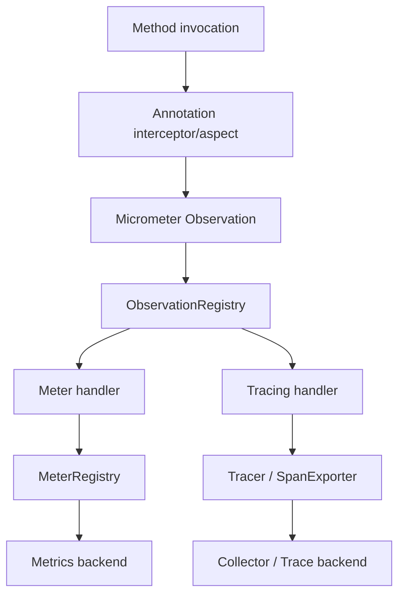

# management.observations.annotations.enabled in Spring Boot

**management.observations.annotations.enabled** is a Spring Boot configuration property used to enable or disable creating observations from supported observation annotations in an application. When annotation-driven observation is enabled and the required components are configured, methods annotated with the corresponding annotation can create a Micrometer `Observation`; `ObservationHandler`s then turn that observation into metrics, spans, or other signals.

In the **SPRING_BOOT_OBSERVABILITY** module, this property controls method-level instrumentation, complementing HTTP server, database, messaging, and background task instrumentation. This lesson belongs to the **Annotation observability** chapter and focuses on the meaning of the property, profile configuration, AOP/proxy conditions, the relationship between annotations and `ObservationRegistry`, how to verify metrics/tracing, and limitations to keep in mind for production.

## 1. What Does This Property Control?

`management.observations.annotations.enabled` is a property under the management observations group. It controls enabling annotation-based observations supported by Spring Boot. When enabled and the integration is present, methods annotated with the corresponding annotation can be instrumented via an AOP/interceptor mechanism and Micrometer Observation.

Distinguish three steps:

1. **Enablement:** the property allows the annotation observation mechanism to be configured.
2. **Instrumentation:** the annotation/interceptor recognizes the method and creates an observation when the method is invoked.
3. **Signal handling:** `ObservationRegistry` forwards the observation lifecycle to handlers, such as metrics or tracing.

Enabling the property does not automatically generate metrics for every method. Methods need the appropriate annotation, the integration must be present, and `ObservationRegistry` must have corresponding handlers.

## 2. Configuration in application.yml

The property can be set in Spring Boot configuration:

```yaml
management:
  observations:
    annotations:
      enabled: true
```

To disable:

```yaml
management:
  observations:
    annotations:
      enabled: false
```

Use the exact property structure for your project's Spring Boot version. If the property is not recognized in the version you are using, check the configuration metadata/reference documentation for that exact version rather than assuming every release supports the same configuration.

### 2.1. Enabling by Environment

Example baseline disabling annotation observation and enabling it only in environments where method-level observation is needed:

`application.yml`:

```yaml
management:
  observations:
    annotations:
      enabled: false
```

`application-local.yml`:

```yaml
management:
  observations:
    annotations:
      enabled: true
```

`application-staging.yml`:

```yaml
management:
  observations:
    annotations:
      enabled: true
```

`application-prod.yml`:

```yaml
management:
  observations:
    annotations:
      enabled: false
```

This is an illustrative policy. Production can enable it after evaluating overhead, observation volume, naming/cardinality, and tracing configuration. There is no single `true`/`false` setting suitable for all systems.

### 2.2. Activating Profiles

```bash
SPRING_PROFILES_ACTIVE=staging
```

Or:

```bash
java -jar app.jar --spring.profiles.active=staging
```

Profiles only select the corresponding configuration. The property can still be overridden by environment variables, system properties, command-line arguments, or external configuration with higher precedence.

## 3. Annotation Observation and Micrometer Observation

Micrometer Observation provides a unified abstraction for instrumenting an operation. The annotation-driven mechanism lets you declare observations at method boundaries instead of writing start/stop boilerplate in every method.

An observation can be processed by:
- A meter handler to record metrics.
- A tracing handler to create spans.
- Custom handlers to integrate with other systems.

An annotation is a way of declaring instrumentation; it is not an exporter. If you only have an observation without an appropriate `MeterRegistry`/tracing handler, the corresponding metrics/spans may not appear.

### 3.1. Distinguishing @Observed and @Timed

In the Micrometer ecosystem:
- **@Observed** declares an observation, which can be converted into metrics and tracing by handlers.
- **@Timed** declares a timing metric under the corresponding metrics mechanism.

The two annotations have different semantics and integrations. Do not attach both to the same method just to be sure telemetry is produced, as this can create duplicate timing data or two different operation names.

Which annotations Spring Boot processes automatically, which dependencies/configurations are required, and which properties control them must be verified against the Spring Boot/Micrometer version in use.

## 4. Conditions for Annotations to Be Processed

For method-level observation to work, verify:
- The Spring Boot/Micrometer version supports annotation observation integration.
- The property is bound and enablement is active.
- The annotation API is on the runtime classpath.
- AOP/interceptor infrastructure is configured as required by the integration.
- The bean is managed by Spring.
- Invocations go through the corresponding proxy/interceptor.
- `ObservationRegistry` has the desired handlers.

Do not infer that every Java class is automatically instrumented just because the property is set to `true`.

### 4.1. Spring Beans and Proxies

Annotation-driven instrumentation typically relies on proxies/AOP or interceptor integration. An object created with `new` outside the Spring container may not pass through a proxy. In that case, the annotation may not create an observation.

```java
@Service
class PricingService {

    public Price calculate(String productCode) {
        return loadFromStore(productCode);
    }
}
```

The class must be managed and invoked through the appropriate instrumentation mechanism. Simply adding an annotation to a manually instantiated object does not guarantee interception.

### 4.2. Self-Invocation

With proxy-based AOP, a method in the same bean calling another method directly on `this` can bypass the proxy:

```java
@Service
class ReportService {

    public void generate() {
        this.buildReport();
    }

    public void buildReport() {
        // work
    }
}
```

If the annotation is on `buildReport()`, self-invocation may not pass through the proxy, so the interceptor will not run. You can extract the operation into another bean or structure the invocation through a proxy in a way the framework supports.

## 5. Annotated Method Example

Example using Micrometer `@Observed` on a Spring bean:

```java
import io.micrometer.observation.annotation.Observed;
import org.springframework.stereotype.Service;

@Service
class InventoryService {

    @Observed(name = "inventory.lookup")
    public InventoryItem findItem(String sku) {
        return loadFromStore(sku);
    }

    private InventoryItem loadFromStore(String sku) {
        return new InventoryItem(sku);
    }
}
```

Annotation/package names and how the aspect is enabled depend on the Micrometer/Spring Boot integration version. In some setups, the corresponding aspect/interceptor must be registered manually; do not assume the property automatically adds the entire AOP infrastructure if dependencies/versions do not provide it.

### 5.1. Choosing a Stable Observation Name

An observation name should:
- Describe the operation, e.g., `inventory.lookup`.
- Stay stable across deployments.
- Not contain SKUs, user IDs, or request-specific values.
- Follow a consistent convention across services if they share dashboards.

Do not construct dynamic observation names from method arguments. Dynamic operation names make comparisons difficult and can cause an explosion in metric series.

## 6. Adding Low-Cardinality and High-Cardinality Values

Annotation observation may support declaring metadata depending on the API/integration. Low-cardinality values are suitable for metric tags; high-cardinality values are generally only suitable as span attributes when permitted.

| Field | Example | Recommendation |
| --- | --- | --- |
| operation | inventory.lookup | Stable name |
| component | inventory | Low cardinality |
| outcome | success/error | Bounded set |
| sku | SKU-10001 | Do not use as metric tag |
| customerId | 918273 | Do not use as metric tag |
| traceId | One value per trace | Use trace correlation |

Do not feed all method arguments into the observation. Arguments may contain PII, credentials, large payloads, or high-cardinality identifiers.

### 6.1. Custom ObservationConvention

If the annotation integration or observation API supports custom conventions, use a convention to normalize names and key values. Do not add tags directly from untrusted input.

A custom convention should:
- Allow-list permitted fields.
- Normalize values into a bounded set if used for metrics.
- Maintain consistent naming.
- Avoid duplicating Resource attributes.
- Have tests checking cardinality and privacy.

## 7. ObservationRegistry and Signal Handlers

`ObservationRegistry` manages the observation lifecycle. When a method annotation creates an observation, the registry supplies handlers to turn it into signals.



If metrics do not appear, check `MeterRegistry` and the meter handler. If spans do not appear, check the tracing bridge, sampler, span processor, and exporter. Property enablement is only one part of the pipeline.

### 7.1. Avoid Unintended Parallel Registries

Spring Boot typically configures an `ObservationRegistry` for the application context. If you create another registry and the aspect uses that one, observations may not reach the handlers you are inspecting. Use the application-managed registry or explicitly verify which registry the instrumentation uses.

## 8. Synchronous vs. Asynchronous

For synchronous methods, the interceptor can start the observation before the method invocation and stop it when the method returns or throws an exception.

For methods returning `Mono`, `Flux`, `CompletableFuture`, or an async handle, the method returning does not necessarily mean the operation has completed. If the interceptor stops the observation as soon as the publisher/future is created, the duration will only measure object creation time.

Reactive/async instrumentation must follow the actual completion/error/cancel lifecycle if the goal is to measure the entire operation. Exact behavior depends on the annotation integration and framework version.

### 8.1. Exception Handling

If a method throws an exception through the interceptor, the observation can record an error. If the method catches the exception and returns a normal fallback, the interceptor may only see a successful outcome. Clarify the semantics you want to measure: technical errors, business rejections, or fallbacks.

Do not mark every business decline as `ERROR` if it is a valid outcome under the contract.

## 9. Property Precedence and Runtime Configuration

`management.observations.annotations.enabled` is an externalized configuration property. Its effective value can come from:
- `application.yml`.
- `application-{profile}.yml`.
- Environment variables.
- Java system properties.
- Command-line arguments.
- Config server or mounted configuration.

When a property in YAML does not take effect, check active profiles and property sources. Do not edit multiple places simultaneously before locating the override source.

If the Spring Boot version does not bind this property or the property no longer exists in the version in use, check the configuration metadata and release documentation for that exact version. Do not invent unfamiliar properties expecting the framework to understand them.

## 10. Performance and Instrumentation Cost

Annotation observation adds work at method boundaries: interceptor execution, observation start/stop, key-value processing, and handler execution. Cost depends on call frequency, number of handlers, number of tags, tracing sampling, and the exporter/registry.

Considerations:
- Instrument only operations with operational value.
- Do not annotate tiny methods called millions of times unless needed.
- Use stable names and few low-cardinality tags.
- Avoid custom synchronous handlers that perform network I/O on the request path.
- Measure overhead with representative load tests.
- Monitor metrics/trace volume and backend cost.

Do not put annotations on every method as a way to automatically turn on full observability. Selective instrumentation produces much more interpretable data.

## 11. Security and Privacy

Annotations do not make data safe. If a custom convention or interceptor uses method arguments as tags/attributes, sensitive metadata can be exported.

Do not put into telemetry:
- Passwords, API keys, bearer tokens.
- Session/cookie values.
- Emails/phones/addresses.
- Full request/response bodies.
- Raw customer/account identifiers.
- Object `toString()` output that may contain sensitive data.

Use allow-lists and redact at the source. Trace backends may retain data longer than local logs; appropriate retention and access controls are required.

## 12. Testing Annotation Observations

A unit test calling a method and asserting its business result does not prove an observation was created. You need integration tests with a Spring context and the corresponding registry/handlers.

### 12.1. Testing Business Behavior

```java
@SpringBootTest
class InventoryServiceTest {

    @Autowired
    InventoryService inventoryService;

    @Test
    void findsItem() {
        InventoryItem item = inventoryService.findItem("SKU-1");
        assertEquals("SKU-1", item.sku());
    }
}
```

This test checks method behavior. To test the annotation, verify that the observation handler is invoked or that the meter/span appears.

### 12.2. Testing the Observation Registry

You can use a test handler or test `MeterRegistry` to check:
- Observation name.
- Low-cardinality values.
- Start/stop lifecycle.
- Recorded errors.
- Absence of high-cardinality values in meter tags.
- That when annotations are disabled, observations are not created via that mechanism.

How a test handler is registered depends on the Micrometer version and Spring Boot test configuration.

### 12.3. Testing Proxy Behavior

Verify that the method is called through the Spring bean proxy. Add tests for self-invocation or manually instantiated objects to confirm which cases are not intercepted when the architecture relies on proxy-based AOP.

## 13. Troubleshooting management.observations.annotations.enabled

| Symptom | Possible Cause | What to Check |
| --- | --- | --- |
| Annotation creates no observation | Property false, unbound, or integration missing | Check effective config and version |
| Property true but no metrics | Missing MeterRegistry/handler or annotation aspect | Check registry and AOP integration |
| Metrics exist but no spans | Tracing bridge/sampler/exporter not configured | Check tracing pipeline |
| Direct method call not instrumented | Object bypasses Spring proxy | Check bean ownership and proxy |
| Self-invocation creates no observation | Internal call bypasses proxy | Extract bean or call through proxy |
| Async duration too short | Observation stops when future/publisher is created | Check async lifecycle support |
| Duplicate timers/spans | Annotation and manual instrumentation both measure | Check instrumentation paths |
| High metric cardinality | Dynamic names/tags or method args | Normalize names and allow-list tags |
| Production differs from staging | Profile/property source override | Check active profile and precedence |
| Property missing in metadata | Version unsupported or artifact metadata differs | Check docs/config metadata for exact version |
| Exception not marked as error | Method catches exception and returns fallback | Check exception boundary and outcome |
| Trace ID differs between logs and span | Multiple ObservationRegistries/providers | Check registry ownership and tracing bridge |

### Investigation Workflow

1. Confirm Spring Boot/Micrometer versions.
2. Check that the property is supported by that version and inspect its effective value.
3. Confirm the annotation class is on the runtime classpath.
4. Confirm the bean is managed by Spring and invocations pass through the proxy/interceptor.
5. Check which `ObservationRegistry` the aspect uses.
6. Check `MeterRegistry` and tracing handlers separately.
7. For async methods, check the observation stop boundary.
8. Check names/tags and cardinality.
9. Look for overlapping instrumentation with manual `Observation`/`Timer`.
10. Check the exporter/Collector/backend if handlers received the observation but no data is visible.

## 14. Hands-On Exercise: Enabling Annotation Observations by Profile

The goal is to enable annotation observations in local/staging, verify that methods are instrumented, and compare against a disabled configuration.

### Preparation

- A Spring Boot version supporting the corresponding property/integration.
- Actuator and Micrometer Observation.
- Required annotation API and AOP/interceptor integration.
- `MeterRegistry`; tracing bridge/exporter if checking spans.
- A Spring service with a stable method.

### Step 1 — Check Version and Configuration Metadata

Confirm `management.observations.annotations.enabled` exists in the version in use. Check integration docs for required annotations and aspects/interceptors.

### Step 2 — Set the Property to Disabled

In `application.yml`, set the property to `false`. Start the context and call the test method. Verify that annotation-driven observations are not created under the integration being tested.

### Step 3 — Enable in the Local Profile

Set the property to `true` in `application-local.yml` and activate the `local` profile. Invoke the method through the Spring-managed bean proxy.

### Step 4 — Verify Metrics

Check that `MeterRegistry`/test handler receives the expected observation name and low-cardinality values. If not, verify the aspect/interceptor and registry.

### Step 5 — Verify Tracing

Enable the tracing bridge and test exporter. Verify that a span appears when allowed by the sampler and carries the Trace ID matching the current context.

### Step 6 — Test Self-Invocation

Make an internal call within the same bean and compare with calling through the bean proxy. Determine whether the proxy boundary affects instrumentation.

### Step 7 — Test Async Methods

Test a method returning a future/publisher if supported by the integration. Measure completion duration and verify the observation does not end prematurely.

### Step 8 — Check Privacy/Cardinality

Ensure method arguments, IDs, and payloads do not automatically become metric tags. Check custom conventions/handlers.

### Step 9 — Compare Disabled and Enabled

Compare observation counts, metrics/spans, and overhead under a controlled test workload.

### Step 10 — Choose Deployment Configuration

Decide which profiles enable the property based on operational needs, cost, and version support. Document the policy and verify effective config upon deployment.

### Acceptance Checklist

| Item to Prove | Expected Result |
| --- | --- |
| Property support | Verified that the version has the property |
| Enablement | `true`/`false` toggles the annotation mechanism |
| AOP | Method called through integration/proxy |
| Observation | Correct operation name and lifecycle |
| Metrics | Handler records when registry is present |
| Tracing | Span created when bridge/sampler permit |
| Async | Completion/error/cancel measured accurately |
| Cardinality | No dynamic arguments in metric tags |
| Privacy | No secrets/PII exported |
| No duplicates | Same operation not instrumented twice |
| Configuration | Profiles and precedence are correct |
| Testing | Tests cover enabled/disabled and proxy behavior |

## 15. Principles to Remember

1. **The property controls annotation-driven observation according to the capabilities of the Spring Boot version in use.** Verify configuration metadata before rollout.
2. **Enablement does not mean every method automatically emits telemetry.** Appropriate annotations, integration/interceptors, and Spring-managed invocations are required.
3. **`ObservationRegistry` connects observations to handlers.** `MeterRegistry` and the tracing bridge/exporter decide which signals are recorded/exported.
4. **`@Observed` and `@Timed` have different semantics.** Do not stack them just to produce more telemetry.
5. **Proxies/AOP have limits.** Self-invocation or objects instantiated outside the Spring container can bypass interception.
6. **Async/reactive lifecycles must be handled properly.** A method returning a future/publisher does not mean the operation is finished.
7. **Names and tags must be stable.** Do not use method arguments, IDs, or payloads that create high metric cardinality.
8. **Be selective about operationally valuable methods.** Annotating every method increases overhead and noise.
9. **Protect metadata.** Allow-list and redact secrets/PII at the source.
10. **Verify each signal independently.** Creating an observation does not prove metrics/traces reached the backend.

`management.observations.annotations.enabled` is the configuration toggle for annotation-driven observation in Spring Boot/Micrometer versions that support it. When the property, AOP integration, `ObservationRegistry`, and handlers are configured consistently, method-level instrumentation adds detailed visibility to the application. Verifying version support, proxy boundaries, async lifecycles, and cardinality before enabling broadly ensures telemetry accurately reflects operations and avoids unnecessary cost.
