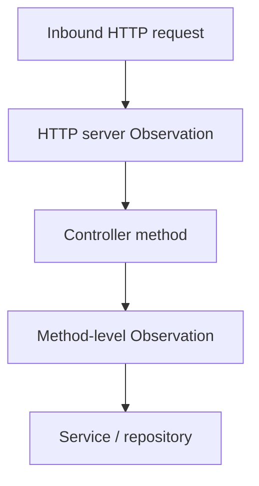

# Annotations on Controllers in Spring Boot Observability

Annotations help add observability to controller methods without manually writing the full lifecycle of an `Observation` or `Timer`. They can keep code concise and establish consistent conventions across endpoints. However, annotations only work with the right instrumentation, AOP/proxy, and configuration; nor do they replace HTTP server instrumentation, which measures the full request lifecycle at the web layer.

This **Annotations on Controllers** lesson belongs to the **Annotation observability** chapter of the **SPRING_BOOT_OBSERVABILITY** module. The module teaches how to set up observability for Spring Boot using Micrometer Observation, metrics, logs, and distributed tracing; you will learn context propagation, tags/cardinality, exporters, sampling, and signal correlation to investigate errors, latency, and application behavior in production environments.

After this lesson, you will be able to distinguish controller-layer annotations from server request `Observation`s, understand the roles of Micrometer `@Observed` and `@Timed`, configure appropriate instrumentation, recognize proxy/AOP limitations, design low-cardinality names and tags, and test annotations using metrics/tracing tests.

## 1. What Do Annotations Provide?

A controller is typically the entry point for HTTP requests. You may need to observe a method-level operation such as searching orders, confirming a payment, or generating a report. Annotations let you declare observability intent directly on the method:

- A stable operation name for searching in metrics/traces.
- Allow-listed supplemental metadata.
- Method execution duration.
- Exceptions/outcomes according to instrumentation semantics.

Conceptual example:

```java
@Observed(name = "orders.lookup")
public OrderView findOrder(String orderId) {
    return orderService.find(orderId);
}
```

The snippet above only illustrates the idea. For the annotation to take effect, the application needs supporting libraries and configuration, such as Micrometer Observation AOP integration compatible with the Spring Boot version in use. Do not assume adding the annotation alone generates metrics and spans automatically.

## 2. Two Different Observability Layers: HTTP Request vs. Controller Method

Spring Boot can automatically instrument HTTP server requests via Actuator/Micrometer. Server `Observation`s typically measure requests across the web stack, including processing time, method, route, status, and exceptions by convention.

An annotation on a controller method has a different goal: measuring a specific operation in code. Both layers can coexist:



For example, a GET request has a server span covering the entire HTTP lifecycle, while a method observation only wraps the controller logic. If an annotation is applied to the request-handling method, the trace can have nested spans. This can be helpful when distinguishing controller logic from framework overhead, yet can also create duplicate telemetry if names and purposes are unclear.

Before adding an annotation, clarify the operational question you need to answer. If you only need HTTP latency by route, server instrumentation may already suffice. If you need to measure a specific business operation or controller processing step separately, a method-level `Observation` can add detail.

## 3. Micrometer @Observed and Observation AOP

Micrometer provides the `@Observed` annotation to declare an `Observation` around a method. With AOP integration, an interceptor can intercept the method invocation, start an `Observation`, attach metadata to the context, and stop when the method returns or throws.

Example:

```java
import io.micrometer.observation.annotation.Observed;
import org.springframework.stereotype.Controller;

@Controller
class OrderController {
    private final OrderService orderService;

    OrderController(OrderService orderService) {
        this.orderService = orderService;
    }

    @Observed(name = "orders.controller.lookup")
    public OrderView getOrder(String id) {
        return orderService.find(id);
    }
}
```

Package names, dependencies, and how AOP is enabled must match your Micrometer/Spring Boot version. Some applications need to add the observation annotation module and configure the corresponding aspect/interceptor. Check configuration metadata and docs for your exact version rather than copying properties from another release.

An `Observation` can be processed by multiple handlers: a metrics handler records an appropriate `Timer`/counter, and a tracing handler creates a span. Without a tracing handler, the annotation can still create an `Observation`, though no span will necessarily be exported.

## 4. @Timed and Method Duration

Micrometer `@Timed` is commonly used to record method execution duration as a `Timer` when the supporting aspect is configured. Example:

```java
import io.micrometer.core.annotation.Timed;
import org.springframework.stereotype.Component;

@Component
class ReportService {
    @Timed(value = "report.generate", description = "Report generation time")
    public Report generate(String reportType) {
        return buildReport(reportType);
    }
}
```

`@Timed` and `@Observed` are not completely interchangeable:

| Criterion | @Timed | @Observed |
| --- | --- | --- |
| Primary goal | Record method duration as a Timer | Create an Observation processable into multiple signals |
| Metrics | Timer | Depends on handler; can usually produce a Timer |
| Tracing | Does not automatically mean a span in all setups | Can produce a span if a tracing handler is present |
| Metadata | Per supported convention/aspect | Observation context and convention |
| Best suited for | Simple duration measurement | Instrumentation needing correlated metrics/tracing |

Do not place both annotations on the same method just to "be sure metrics are emitted." If both aspects record duration, counts can be doubled. Choose one mechanism according to your goal and verify actual meters/spans.

## 5. Configuration and Prerequisites for Annotations to Run

A typical setup requires:

1. Micrometer Observation API compatible with Spring Boot.
2. Appropriate annotation integration/AOP module.
3. Registered Spring AOP proxy or aspect.
4. Configured `ObservationRegistry` with required handlers attached.
5. `MeterRegistry` and/or tracing bridge/exporter if signals should be exported.

Illustrative Gradle dependency example:

```groovy
dependencies {
    implementation 'org.springframework.boot:spring-boot-starter-actuator'
    implementation 'org.springframework.boot:spring-boot-starter-aop'
    implementation 'io.micrometer:micrometer-observation'
    implementation 'io.micrometer:micrometer-observation-annotation'
}
```

Artifact names and auto-configuration may vary by Spring Boot/Micrometer BOM. Do not pin separate versions if Spring Boot dependency management already manages them. Verify the annotation module is present in the application's dependency tree.

Do not add AOP dependencies if the framework integration in use already provides an appropriate aspect. What matters is that exactly one interceptor owns that annotation.

## 6. Proxies and Self-Invocation

Spring AOP typically applies advice through a proxy. Therefore, method invocations must pass through the proxy for the aspect to run.

A common mistake:

```java
@Service
class InvoiceService {
    public void createInvoice() {
        calculateTax(); // self-invocation: bypasses proxy
    }

    @Observed(name = "invoice.calculate-tax")
    public Tax calculateTax() {
        return computeTax();
    }
}
```

In this example, the internal call from `createInvoice` to `calculateTax` can bypass the proxy, so the annotation is not applied as expected. The typical fix is to move the instrumented operation into another bean and inject that bean, or place the annotation on a method called externally through the proxy.

Do not switch the entire application to AspectJ weaving just to handle a minor self-invocation if bean structure can clarify the boundary.

## 7. Visibility, Final Methods, and Proxy Types

Whether a method can be intercepted depends on proxy type and AOP configuration:

- JDK dynamic proxies are interface-based; calls must pass through the interface proxy.
- Class-based proxies subclass the target class; `final` methods/classes cannot be overridden to intercept via standard subclass proxying.
- `private` methods are generally not join points for proxy-based Spring AOP.
- Internal methods called directly on `this` do not pass through the proxy.

Do not assume every annotation on every method will be applied. Check visibility, proxy type, bean registration, and call paths. When instrumentation is needed on a private helper or code not routed through a Spring bean, use the Observation API directly at the appropriate boundary.

## 8. Observation Names and Tag Cardinality

Observation names should describe the operation and remain stable across calls:

| Recommended | Avoid |
| --- | --- |
| `orders.controller.lookup` | `orders.lookup.ORD-98372` |
| `checkout.confirm` | `checkout.confirm.customer-123` |
| `report.generate` | `report.generate.2026-11-22` |

Tags must be categorized:

- **Low-cardinality:** channel, operation type, bounded outcome, bounded report type.
- **High-cardinality:** customer ID, order ID, email, request ID, raw query string.

Low-cardinality values can be used for metrics. High-cardinality values can cause unbounded metric series growth; do not put them into low-cardinality `Observation` key-values.

If an identifier is needed to look up a single run, consider a log field or policy-controlled trace attribute rather than using it as an observation name or metric tag. Do not embed sensitive data in fixed annotation values or automatic metadata.

## 9. Custom Observation Convention

When adding tags, use a managed convention/handler instead of stuffing everything into the annotation. For example, channel metadata should only accept a bounded set of values:

```java
@Observed(name = "checkout.confirm")
public Receipt confirm(CheckoutCommand command) {
    return checkoutService.confirm(command);
}
```

A convention can read an allow-listed context and add `channel`/`outcome`. Do not put all method arguments into tags. Arguments may contain DTOs, credentials, PII, or objects with huge `toString()` output.

Annotations are generally suited for static metadata, while conventions suit runtime-dependent metadata. Either way, clearly define which fields are low-cardinality and which are allowed in traces/logs.

## 10. Exceptions and Method Results

An observation interceptor normally stops the observation when the method returns or throws an exception. A tracing handler can record error/status per convention; a metrics handler can record an exception tag or outcome.

Do not record exception messages as tags, because messages are unstable and may contain sensitive data. Prefer a normalized exception class/category or a bounded error code.

If a controller catches an exception and returns an error `ResponseEntity`, the method may appear to return normally from AOP's perspective. In that case, the method observation may not automatically recognize that the HTTP response is 5xx if the exception was already converted into a response. HTTP server instrumentation can still record the actual status code. This is why method annotations should not replace server request metrics.

## 11. Async and Reactive Return Types

Method annotations must be understood according to the return type's actual lifecycle. For methods returning `CompletableFuture`, `Publisher`, or reactive types, the moment the method returns can differ from when asynchronous work finishes. Instrumentation must support async/reactive lifecycles so the observation does not finish prematurely.

Do not assume a synchronous aspect automatically measures the entire duration of a future or reactive stream. Check version support, context propagation, and how the interceptor wraps completion/error/cancel signals.

For controllers returning `Mono`/`Flux`, HTTP server observations normally have dedicated integration with the reactive lifecycle. A controller annotation can add another measurement layer; clarify whether it measures publisher creation time or stream completion time.

## 12. Do Controller Annotations Replace Server Instrumentation?

No. Server instrumentation knows the HTTP method, route template, response status, and request lifecycle. Method annotations primarily measure a specific invocation.

| Need | Appropriate Mechanism |
| --- | --- |
| HTTP request count/latency by route | HTTP server Observation |
| HTTP status/outcome | HTTP server instrumentation |
| A specific controller operation | `@Observed` or Observation API |
| Simple method duration measurement | `@Timed` if aspect is supported |
| Tracing SQL/downstream calls | JDBC/client instrumentation or child Observations |
| Business event semantics | Observation at the application service |

If both server `Observation` and `@Observed` create spans, the trace tree can show both a server span and a controller operation span. Name them clearly so viewers know which span measures the web lifecycle and which measures the code operation.

## 13. Testing Annotation Observability

Do not just verify the application starts. Verify the annotation is actually intercepted and produces the right telemetry:

| Test | What to Prove |
| --- | --- |
| Context load test | Aspect/Observation integration is registered |
| Proxy test | Injected bean is a proxy when required |
| Invocation test | External call through proxy creates Observation |
| Self-invocation test | Explicitly establish internal calls are not intercepted |
| Metrics test | Timer/meter created with expected name and tags |
| Trace test | Span created if tracing handler is enabled |
| Exception test | Error recorded properly and observation closed |
| Cardinality test | Runtime IDs do not create new metric tags |
| Async test | Observation keeps proper lifecycle until completion |

Example testing method observation with a test handler:

```java
// Pseudocode:
// 1. Create a test ObservationRegistry.
// 2. Register an ObservationHandler collecting names and lifecycle events.
// 3. Initialize a Spring context with the annotation aspect.
// 4. Fetch the bean from ApplicationContext and call the method through the proxy.
// 5. Assert the observation starts and stops exactly once.
// 6. Invoke the self-invocation case and verify behavior per the proxy model.
```

This is a testing strategy, not complete code for every version. For metrics, use `SimpleMeterRegistry` or an appropriate test registry; for tracing, use an in-memory/test exporter so no real backend is needed.

## 14. Common Issues

| Symptom | Possible Cause | What to Check |
| --- | --- | --- |
| Annotation creates no meter/span | Missing aspect/module or `ObservationRegistry` handler | Check dependencies, bean, and registry |
| External bean call has telemetry, internal call does not | Self-invocation bypasses proxy | Extract bean or call through proxy |
| Final/private method not intercepted | Proxy type/visibility limits | Check JDK/class proxy and method visibility |
| Metrics counted twice | `@Timed` and `@Observed`/custom Timer both run | Pick one instrumentation owner |
| HTTP 500 yet method observation shows no error | Exception caught and turned into response | Use server instrumentation for status/outcome |
| Controller p95 differs from HTTP p95 | Two instrumentations measure different lifecycles | Compare scopes and timestamps |
| Async duration too short | Aspect stops when Future/Publisher is created | Use integration supporting async/reactive lifecycle |
| Cardinality grows per request | Tag pulled from method arguments | Use low-cardinality allow-list only |
| Span tree too deep | Annotations repeated across controller/service/helper | Choose meaningful operation boundaries |
| Annotation stops working after upgrade | API/artifact/property changed | Check BOM and configuration metadata |

## 15. Real-World Scenario: Measuring a Controller Operation Separately

**Hypothetical context:** `orders-service` has HTTP server metrics by route. Latency p95 for `GET /orders/{id}` increases; the team wants to know whether controller mapping/validation takes significant time or whether the slowness lies in the service/database.

One instrumentation approach:

1. Keep server `Observation` to measure the full HTTP lifecycle, status, and route.
2. Add `@Observed` on a meaningful controller or application service operation, using a stable name like `orders.lookup`.
3. Do not put order ID/customer ID into low-cardinality tags.
4. Verify the method is called through the Spring proxy and the annotation aspect is actually active.
5. Use child spans/DB instrumentation to inspect downstream time.
6. Compare the server span duration with the method `Observation` duration; any gap may be framework binding, serialization, or processing outside the method.
7. Test success/error and async cases if the controller returns a reactive type.

As a result, dashboards still reflect the overall HTTP experience while the operation observation isolates the code region needing optimization.

## 16. Self-Check Exercises

**Exercise 1.** Does `@Observed` on a controller automatically replace HTTP server `Observation`?

*Hint:* No. It measures the method operation; server instrumentation measures the request lifecycle, route, and status.

**Exercise 2.** Why can self-invocation prevent an annotation from running?

*Hint:* Calls to `this.method()` do not pass through the Spring AOP proxy.

**Exercise 3.** When should you choose `@Timed` instead of `@Observed`?

*Hint:* When you only need simple `Timer` duration and the aspect is supported; use `Observation` when you need a single context capable of producing multiple signals.

**Exercise 4.** Should an order ID be placed in annotation tags?

*Hint:* Not in low-cardinality metric tags; IDs cause high cardinality and can be sensitive.

**Exercise 5.** A controller catches an exception and returns `ResponseEntity` 500. Why might the method observation not record an error?

*Hint:* The method returns normally after catching; HTTP server instrumentation still sees status 500.

**Exercise 6.** A method returns a `Mono` and the aspect ends when the method returns. Which part was not measured?

*Hint:* Reactive work may continue after the publisher is returned; async/reactive-aware instrumentation is required.

**Exercise 7.** What consequence can arise if both `@Timed` and `@Observed` create a `Timer`?

*Hint:* Double counting and misleading dashboards; choose only one mechanism for the same operation.

**Exercise 8.** How do you verify an annotation actually works?

*Hint:* Invoke the bean through the `ApplicationContext` proxy and capture `Observation`/`Timer`/Span using test handlers or an in-memory exporter.

## 17. Key Takeaways

- Annotations help declare instrumentation on methods, but require the right modules, aspect/proxy, and `Observation` handlers.
- **HTTP server Observation** measures the request lifecycle; **method annotations** measure specific operations. Both layers complement each other and need distinct names to avoid duplication.
- `@Observed` creates an `Observation` processable into metrics/tracing; `@Timed` focuses on `Timer`s. Pick one appropriate mechanism and avoid measuring duration twice.
- Spring proxies have limits: self-invocation, `private`/`final` methods, and proxy types can prevent advice from running.
- Keep observation names stable and tags low-cardinality; do not put IDs, PII, or full method arguments into metrics.
- Exceptions that are caught and turned into responses may not appear as method errors; use server instrumentation to record HTTP status/outcome.
- Async/reactive methods require instrumentation aligned with the completion lifecycle; do not assume method return means the work is done.
- Test proxies, observation lifecycles, metrics, tracing, exceptions, cardinality, and async behavior with a test registry/handler/exporter.
