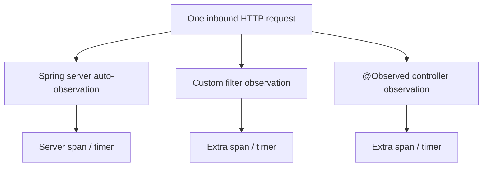
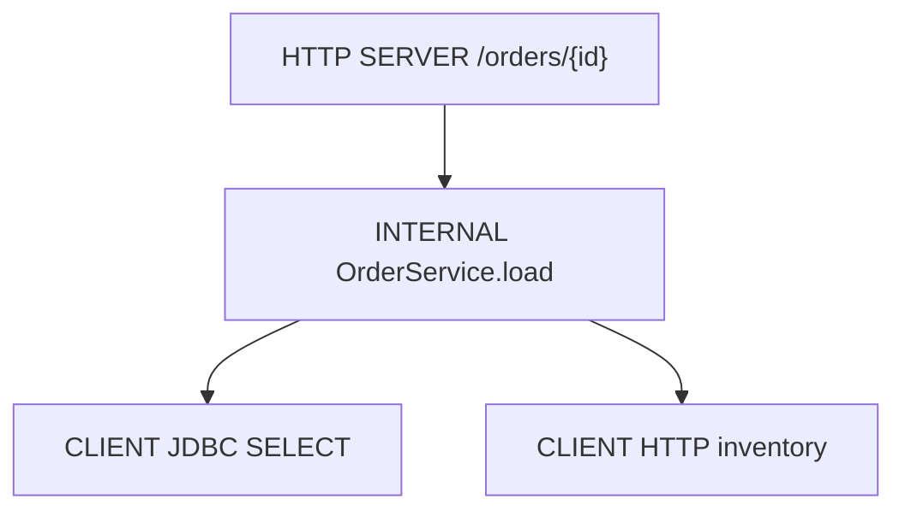
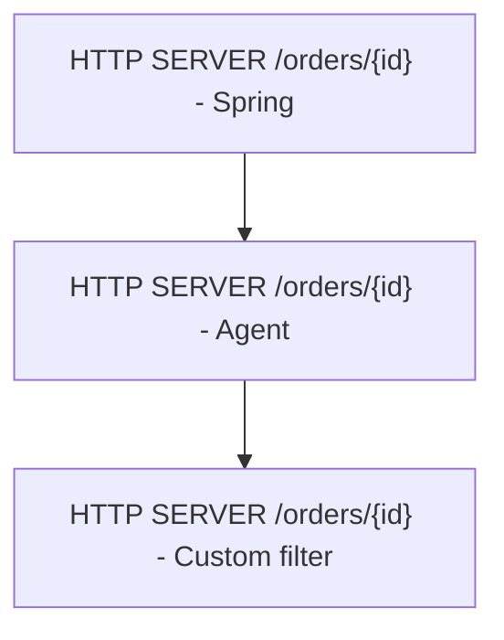

# Duplicate Observations When Auto-Instrumented

A Spring Boot controller receives an HTTP request, calls a business service, and the service calls a database or HTTP client. The framework may already automatically create a server observation, the service may be instrumented with an annotation, and the JDBC/HTTP client already has its own instrumentation. If a developer also wraps the entire controller or service with a manual `Observation` serving the same purpose, a single logical operation can produce multiple nested observations, timers, or spans. Dashboards may count requests multiple times, traces display duplicate spans, and latency is misinterpreted.

**Duplicate observation** occurs when the same operation or the same instrumentation boundary is unintentionally recorded multiple times. In an auto-instrumented environment, the cause is typically a combination of framework instrumentation, Micrometer annotations, custom `Observation` wrappers, tracing bridges, and a Java Agent all observing one boundary. Not every nested span is a duplicate: a server span, a service operation span, and a database client span can all be valid distinct operations. You must distinguish overlapping-boundary instrumentation from a hierarchy reflecting real work.

This lesson belongs to the **Annotation observability** chapter of the **SPRING_BOOT_OBSERVABILITY** module. The module teaches how to set up observability for Spring Boot using Micrometer Observation, metrics, logs, and distributed tracing; you will learn context propagation, tags/cardinality, exporters, sampling, and signal correlation to investigate errors, latency, and application behavior in production environments. This lesson explains how to detect, prevent, and resolve duplicate observations when the framework or an agent already auto-instruments components.

## Learning Objectives

After this lesson, you can:

1. Explain duplicate observations and their impact on metrics, traces, and logs.
2. Distinguish duplicate instrumentation from valid nested spans.
3. Identify boundaries already auto-instrumented by Spring Boot, Micrometer, libraries, or a Java Agent.
4. Understand how `@Observed`, the Observation API, and AOP/proxies create additional observations.
5. Analyze cases where a single HTTP request or DB call generates multiple overlapping spans/timers.
6. Choose a single instrumentation owner per boundary.
7. Preserve child spans and context propagation when removing duplicate instrumentation.
8. Test observation counts, span kinds, parent relationships, and metric counts.
9. Handle migrations when enabling/disabling a Java Agent or changing tracing bridges.
10. Establish a checklist to catch duplicate instrumentation before production.

## 1. What Is a Duplicate Observation?

An observation normally represents an operation with a start/stop lifecycle, context, and handlers. Observation handlers can create meters or spans. If the same operation is instrumented twice, the system can receive two equivalent records.

For example, an inbound HTTP request is already recorded by Spring MVC instrumentation as a server observation. The controller is also annotated with `@Observed` named `http.server.requests`, and a custom filter creates yet another observation around the same request. The result can be three measurements all representing one request.



Importantly, do not draw conclusions solely from the number of spans. A valid request can produce:
- One `SERVER` span for the inbound HTTP request.
- One `INTERNAL` span for a service operation if intentionally instrumented.
- One `CLIENT` span for an outbound HTTP call.
- One `CLIENT`/database span for a database operation.

These are distinct operations. Duplication occurs when two instrumentations record the same operation/boundary with equivalent semantics—for example, two `SERVER` spans for a single inbound request.

### 1.1. Impact of Duplicates

| Signal | Impact |
|---|---|
| Metrics | Request counts/durations are doubled or recorded under two meter names |
| Traces | Span tree has identical spans, overlapping durations, or wrong parents |
| Logs | Duplicate log events if multiple layers log the same error |
| Alerts/SLOs | Error rate, throughput, and latency can be wrong |
| Cost | Increased telemetry volume, storage, indexing, and ingestion |
| Diagnosis | Operators struggle to tell which span represents the real operation |

Duplicates might not inflate all metrics at the same ratio. Two observations might have different names/tags, one might be filtered, or one might emit only a span. Inspect each handler and signal.

## 2. Auto-Instrumentation in Spring Boot

Instrumentation can come from multiple layers:

| Source | Example Boundary |
|---|---|
| Spring Framework | Inbound MVC/WebFlux requests |
| Spring Boot/Micrometer | Observation registry, HTTP client customizers, metrics binders |
| Micrometer annotations | Methods annotated with `@Observed` when aspect is enabled |
| JDBC/HTTP libraries | Client calls through instrumented datasources/clients |
| OpenTelemetry Java Agent | HTTP server/client, JDBC, messaging, and runtime libraries |
| Custom code | `Observation.createNotStarted`, `Observation.observe`, or wrappers |
| Third-party AOP | Annotations/aspects from another monitoring library |

Not all sources instrument the same boundary. For instance, Spring MVC auto-observation and an `INTERNAL` method observation can validly coexist. Risk rises when multiple sources create `SERVER` spans for one request or create client spans for one outbound exchange.

### 2.1. Auto-Configured Does Not Mean Auto-Instrumenting Every Method

Spring Boot can instrument integrated framework boundaries. That does not mean every service method automatically gets an observation. `@Observed` or manual `Observation` remains useful for business operations not measured by the framework.

Before adding an annotation, clarify the question you want to answer: do you want to measure an inbound request, a service method, a scheduled task, or an outbound dependency call? Each should have its own boundary and semantics.

### 2.2. Java Agent and In-Process Instrumentation

A Java Agent can instrument library bytecode without changing application code. Spring/Micrometer can also instrument the same libraries via framework integrations. Enabling both for the same boundary risks duplicate spans.

Agent and framework instrumentation can work together if exclusions or ownership are configured clearly. Do not assume they detect and suppress each other automatically across all versions.

## 3. Distinguishing Valid Span Hierarchies from Duplicates

A trace tree reflects operation relationships. Example:



This is a valid hierarchy if each span measures a distinct boundary.

By contrast:



Three server spans describing one inbound request usually indicate duplicate instrumentation, unless the system truly has distinct proxy/forwarding boundaries.

### 3.1. Comparing Span Attributes

Two spans sharing a trace ID are not automatically duplicates. Compare:
- Span kind: `SERVER`, `CLIENT`, `INTERNAL`.
- Operation/span name.
- Start/end timestamps and duration.
- HTTP method, route, URL/target.
- Peer/service identity.
- Parent span ID.
- Instrumentation scope/library/version.
- Events/status.

If two spans share the same kind, name, method, route, nearly identical timestamps, and differ in instrumentation scopes, investigate double instrumentation.

### 3.2. Comparing Metrics

One HTTP request might increment both a framework meter and a custom meter. If a dashboard sums both, request count doubles. Compare meter names, tags, registries, and where meters are recorded. Two different metric names do not automatically imply duplication; check whether they measure the same quantity.

## 4. @Observed and the Observation API

Micrometer can create an observation around a method via `@Observed` when the corresponding aspect is configured. Applications can also create observations manually using the Observation API.

Annotation example:

```java
@Service
class OrderService {
    @Observed(name = "order.load")
    Order load(String orderId) {
        return repository.findById(orderId)
                .orElseThrow();
    }
}
```

This annotation can create an `INTERNAL` observation/span for the business operation. It does not necessarily overlap with the server observation: the server span measures the HTTP request, while `order.load` measures the service method. However, if a custom annotation or another aspect also uses the same operation boundary/name, duplication can happen.

Manual Observation example:

```java
Observation.createNotStarted(
        "order.load",
        observationRegistry)
    .observe(() -> repository.findById(orderId));
```

Do not put both `@Observed` and a manual wrapper around the same method just to "make sure tracing happens." Pick one mechanism to create observations for that boundary.

### 4.1. Proxy/AOP Boundaries

Annotation-based observations typically rely on AOP proxies/aspects. Self-invocation within the same bean can bypass the proxy, causing the annotation not to apply as expected. If a developer notices a missing span and adds a manual wrapper, a later refactor that makes the annotation work will create duplicates.

Verify proxy behavior and method invocation paths before adding a second instrumentation.

### 4.2. Method Names and Observation Names

Observation names should represent stable operations. Do not use the same name for different types of operations just because they belong to the same service. Conversely, renaming a meter/span does not fix duplication if two instrumentations still measure the same boundary.

## 5. Duplicate HTTP Server Instrumentation

Spring MVC/WebFlux can create server observations automatically. Common duplicate sources:

- Spring server instrumentation and Java Agent HTTP server instrumentation both active.
- Custom servlet filter/`WebFilter` creating an observation wrapping an already-instrumented request.
- `@Observed` on a controller reusing the name and semantics of the server request observation.
- A reverse proxy or gateway creating its own spans; this may be a valid separate boundary, so inspect trace context.

### 5.1. How to Detect

Send a single test request and inspect the trace:
- How many `SERVER` spans exist?
- Which span carries the route template?
- Which instrumentation scope/library created each span?
- Do they share timestamps and HTTP attributes?
- Does the parent relationship form an unusual chain of server spans?

Also check metrics: does a single request increment two equivalent request timers?

### 5.2. How to Resolve

Choose either framework instrumentation or the agent as owner of the inbound HTTP server boundary. If keeping framework instrumentation, disable/exclude the corresponding server instrumentation in the agent per the agent's version/mechanism. If keeping the agent, avoid custom filters/aspects creating extra server spans. Do not disable all tracing when only one instrumentation overlaps.

Exclusion settings must be verified with a trace test after changes; property/agent option names vary across versions.

## 6. Duplicate HTTP Client Instrumentation

Outbound HTTP calls can be instrumented by Spring `RestClient`/`WebClient`/`RestTemplate` integration, the Java Agent's HTTP library instrumentation, or custom interceptors.

Signs:
- Two `CLIENT` spans with the same method/target and nearly identical durations.
- Two nested spans without two actual network attempts.
- Client request metrics doubling.
- One span has a Spring/Micrometer instrumentation scope, while the other comes from the agent/library.

### 6.1. Distinguishing Retries from Duplicates

Actual retries produce multiple network attempts. You may see multiple requests reaching the server or multiple attempt spans with differing statuses/durations. Duplicate instrumentation creates two spans for a single network exchange.

Use a mock server or access logs to count real requests. One outbound exchange producing two client spans for the same operation indicates double instrumentation.

### 6.2. Choosing One Owner

For each client type, decide whether instrumentation comes from Spring/Micrometer or the Java Agent. If both are needed for different libraries, configure exclusions by package/client boundary so they do not overlap. Do not delete observation metrics if only span instrumentation is duplicated; identify which signal is duplicated.

## 7. Duplicate Database Instrumentation

JDBC calls can be instrumented by datasource proxies, Micrometer integrations, the OpenTelemetry Java Agent, or custom repository aspects. A single SQL execution can create two `CLIENT`/database spans.

Distinguish:
- A database span represents SQL execution.
- An `INTERNAL` repository/service span represents business logic.
- Connection pool metrics measure active/idle/acquire/usage; they are not SQL spans.

If a repository method has `@Observed` and the JDBC driver/agent creates a database span, two spans are valid when one measures method logic and the other measures SQL. Duplication occurs only when two spans describe the same JDBC execution.

### 7.1. Inspecting SQL Spans

Compare database system, operation, sanitized statement, peer/database name, duration, and instrumentation scope. Do not turn on broad statement capture just to find duplicates if it could expose sensitive parameters. Use a simple test query with controlled data.

## 8. Duplicate Metrics and Observation Handlers

One `Observation` can be processed by multiple handlers, such as a metrics handler and a tracing handler. This is by design: a single observation produces multiple signals.

Duplication occurs when:
- Two metrics handlers both record timers for the same observation.
- The same method creates two identical observations, each producing a timer.
- A framework meter and a custom meter measure the same request count and dashboards sum both.
- A registry or binder is registered twice, causing the same instrumentation to bind multiple times.

### 8.1. Do Not Confuse Multiple Signals with Duplication

One observation creating one timer and one span is not a duplicate. One observation also producing logs/events is not a duplicate. Check the record count per signal and the semantics of each record.

### 8.2. Handler Registration

Inspect which handlers are registered in `ObservationRegistry`, which auto-configuration creates them, and whether any custom bean registers a duplicate. Do not manually add `DefaultMeterObservationHandler` if Spring Boot already configures the corresponding handler, unless you know for certain the registry lacks one.

## 9. Instrumentation Inventory Process

Before fixing, build an ownership table by boundary:

| Boundary | Existing Instrumentation | Selected Owner |
|---|---|---|
| HTTP server | Spring MVC/WebFlux, agent, filter | One source |
| HTTP client | RestClient/WebClient, agent, interceptor | One source per client |
| JDBC | datasource proxy, agent, custom aspect | One source for SQL |
| Business service | `@Observed` or Observation API | One mechanism per method |
| Scheduled task | scheduler integration/custom wrapper | One mechanism per execution |
| Messaging | broker integration/agent/custom wrapper | One mechanism per receive/send |

Document:
- Dependencies/versions.
- Agent-enabled instrumentation.
- Spring auto-configuration.
- Custom aspects/filters/interceptors.
- `ObservationRegistry` handlers.
- Meter binders.
- Current exclusions.

Read only the configuration and trace output needed to identify span sources. Do not remove an instrumentation for a different boundary just because span names look similar.

## 10. Testing to Detect Duplicates

### 10.1. Test a Single Operation

Create a repeatable test request or outbound call. Use an in-memory span exporter/test `ObservationHandler` and an in-memory `MeterRegistry` to count records. Define expectations:
- One server span per inbound server boundary.
- One client span per outbound exchange.
- One database span per SQL execution if that instrumentation is enabled.
- Separate business spans appearing only when explicitly declared.

### 10.2. Assert Attributes and Parent Relationships

Do not only assert total span count. Assert span kind, operation name, instrumentation scope, route/target, parent span ID, and timestamps. Parent-child relationships help reveal when the same operation is wrapped twice.

### 10.3. Test With and Without the Agent

If production uses a Java Agent, have a test profile running with the agent or a smoke test in an equivalent staging environment. Agent-free tests cannot detect duplicates that only appear when the agent is enabled.

### 10.4. Test Metric Counts

Call the endpoint N times in a test and assert the canonical meter's count increases by N. Check other similar meters so dashboards will not double-count. Ensure test isolation/registry resets between cases.

## 11. Resolving Duplicates Without Losing Observability

A safe procedure:

1. Pick a specific operation boundary.
2. Identify every instrumentation creating records for that boundary.
3. Choose the owner fitting the framework/agent architecture.
4. Disable/exclude the overlapping duplicate instrumentation.
5. Keep child spans for distinct operations.
6. Verify metrics handlers were not unintentionally removed.
7. Test success, error, retry, and async paths.
8. Compare traces/metrics before and after the change.
9. Verify propagation and log correlation still work.
10. Monitor telemetry volume and SLO dashboards after rollout.

Do not disable the entire agent or tracing bridge just because a pair of duplicate spans was found. Broad changes can drop HTTP, JDBC, messaging, or other runtime instrumentation.

## 12. Diagnosing Through Real-World Examples

### Example A: Two SERVER Spans for One HTTP Request

A trace shows two spans with the same method, route, status, and nearly equal duration; one from Spring, one from the OTel Java Agent. Check the agent's server instrumentation config and Spring integration. Pick one owner, exclude the other boundary, send another request, and confirm only one `SERVER` span remains.

### Example B: Two CLIENT Spans Yet Only One Network Request

The mock server receives a single request, yet the trace has two `CLIENT` spans with the same URL and nearly matching durations. Inspect `WebClient` filters/interceptors, agent HTTP client instrumentation, and custom wrappers. Choose one client instrumentation source.

### Example C: One Request Increments Two Timers

A dashboard sums the framework HTTP meter and a custom timer around the controller. Confirm both timers measure the same quantity. Use the standard meter as the request SLI; if a custom business metric is needed, change its semantics/name to measure a different business operation rather than summing two request counters.

### Example D: @Observed and Custom Observation Both Wrap a Method

A service method produces two nested parent-child `INTERNAL` spans with the same name and nearly identical durations. Keep one mechanism: either the annotation or the Observation API. If you want to separate parent method from child operation, assign distinct boundaries/names and measure distinct work.

## 13. Anti-Patterns to Avoid

| Anti-pattern | Consequence | Proper Approach |
|---|---|---|
| Enabling agent and framework instrumentation on the same boundary unchecked | Duplicate spans | Inventory and pick one owner |
| Wrapping every controller with `@Observed` using server-span semantics | Multiple server-like spans | Instrument only distinct business operations |
| Using both `@Observed` and Observation API around the same method | Two observations/timers | One mechanism per boundary |
| Disabling all tracing to fix one duplicate | Loss of many signals | Exclude only the overlapping instrumentation |
| Treating every nested span as a duplicate | Removes causal detail | Compare operation and span kind |
| Summing framework and custom meters for the same quantity | Inaccurate SLIs | Pick a canonical metric |
| Looking only at span names | Unclear which source emitted it | Compare instrumentation scope/attributes |
| Testing only without the Java Agent | Misses production duplicates | Smoke test with the agent |
| Removing client spans alongside server spans | Loses dependency visibility | Preserve distinct boundaries |
| Renaming a span to hide a duplicate | Still wastes telemetry and skews semantics | Remove the duplicate instrumentation |

## 14. Production Checklist

1. **Inventory:** have framework, agent, annotations, custom wrappers, and handlers been listed?
2. **Boundary:** which operation does each instrumentation represent?
3. **Owner:** does each boundary have one clear owner?
4. **Span kind:** do `SERVER`/`CLIENT`/`INTERNAL` match the operations?
5. **Scope:** does instrumentation scope identify the span source?
6. **Metrics:** are meter counts/durations recorded only once?
7. **Handlers:** does `ObservationRegistry` avoid duplicate metrics handlers?
8. **Annotations:** does `@Observed` avoid overlapping with the Observation API on the same method?
9. **Agent:** do exclusions align with framework instrumentation?
10. **Propagation:** are trace ID/parent context still accurate after removing duplicates?
11. **Children:** are valid DB/HTTP spans preserved?
12. **Errors:** are exceptions/statuses recorded once under clear semantics?
13. **Tests:** do tests check span count, kind, parent, meter count, and agent profile?
14. **Cardinality:** do custom/duplicate tags avoid creating extra series?
15. **Rollout:** have telemetry volume and SLO dashboards been compared before and after?

## 15. Self-Assessment Questions

**Question 1.** What is a duplicate observation?

**Hint:** The same operation boundary is unintentionally recorded multiple times, creating duplicate or equivalent metrics/spans.

**Question 2.** Is an HTTP request with a server span, a service span, and a database span a duplicate?

**Hint:** No. They represent distinct operation boundaries and form a valid hierarchy.

**Question 3.** Why can enabling both Spring instrumentation and a Java Agent create duplicates?

**Hint:** Both can instrument the same HTTP/JDBC boundary without clear exclusions/ownership.

**Question 4.** What can happen when both `@Observed` and the Observation API wrap the same method?

**Hint:** Two observations with identical semantics, creating duplicate timers or unnecessary nested spans.

**Question 5.** How do you distinguish retries from duplicate client spans?

**Hint:** Check actual network request counts, attempt spans, statuses, and timing; duplicates create two spans for a single exchange.

**Question 6.** Is one observation creating both a timer and a span a duplicate?

**Hint:** No. Metrics and tracing are two handlers/signals for the same observation.

**Question 7.** Why shouldn't you disable the entire Java Agent when finding one duplicate?

**Hint:** It can drop instrumentation on other boundaries that are not duplicated.

**Question 8.** What does instrumentation scope tell you?

**Hint:** It identifies the library/instrumentation source that created the span, helping pinpoint the overlapping source.

**Question 9.** What must be tested if production runs an agent?

**Hint:** Smoke/integration tests with an agent matching production, counting spans and metrics per boundary.

**Question 10.** What should be verified after removing duplicates?

**Hint:** Span count/kind/parent, meter count, propagation, child spans, log correlation, and SLO dashboards.

## Conclusion

**Duplicate observations occur when multiple instrumentations record the same operation boundary, distorting metrics, trace structure, and telemetry costs.** Spring Boot/Micrometer, annotations, custom `Observation` wrappers, and a Java Agent can all participate in observability; you must inventory instrumentation sources and distinguish valid nested spans from semantically duplicate spans. Pick one owner per boundary, remove only the overlapping instrumentation, preserve child spans describing distinct operations, and test span kinds, parent relationships, meter counts, and propagation. In production environments using a Java Agent, smoke tests must reflect the actual agent configuration before rollout.
