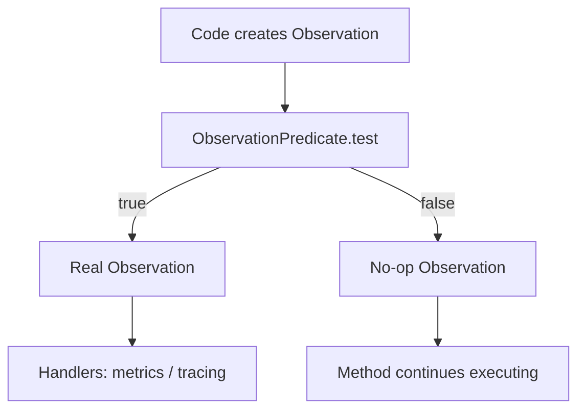

# Predicates to Exclude Annotations in Spring Boot Observability

## 1. Objectives and Context

In a Spring Boot application, `@Observed` creates an observation around a Spring bean method. However, not every method needs to emit metrics or tracing. Some methods are too small, are invoked at very high frequency, or are already measured at another boundary. Producing telemetry for all of them can increase cost, cardinality, and unusable data volume.

Micrometer provides `ObservationPredicate` to decide whether an observation is allowed to start. The predicate receives the observation name and context; if it returns `false`, Micrometer uses a no-op observation for that operation. This mechanism is useful for excluding a group of annotation-generated observations based on a naming convention or recognizable metadata.

This lesson belongs to the Annotation observability chapter of the `SPRING_BOOT_OBSERVABILITY` module. The module teaches how to set up observability for Spring Boot using Micrometer Observation, metrics, logs, and distributed tracing; you will learn context propagation, tags/cardinality, exporters, sampling, and signal correlation to investigate errors, latency, and application behavior in production environments.

After this lesson, you can:
1. Explain the role of `ObservationPredicate` in the lifecycle.
2. Register a predicate in Spring Boot.
3. Exclude `@Observed` by convention-based observation names.
4. Understand the global scope of a predicate and avoid blocking other instrumentation.
5. Distinguish excluding telemetry from skipping method/business logic.
6. Test both retained and excluded observations.
7. Design naming conventions so filtering policies are easy to manage.

Baseline: Spring Boot 3.5.x, Micrometer Observation, and Spring AOP. Use Spring Boot's dependency management; verify packages/APIs against your actual version.

## 2. How Does ObservationPredicate Work?

`ObservationPredicate` is a hook invoked by Micrometer when creating an observation. Its core API has the form:

```java
boolean test(String name, Observation.Context context)
```

- `name` is the name of the observation being created.
- `context` holds the operation's data and can provide additional information for the decision.
- Return `true` to allow the observation to proceed.
- Return `false` to exclude the observation from the pipeline; the caller still executes the method/business logic.

The predicate is evaluated before the observation is started. It is a filtering policy at the `ObservationRegistry` layer, not a condition for running the method and not a log backend filter.



Because the predicate operates on the registry, it can affect many kinds of observations: annotation-driven, HTTP server/client, database, or manually created observations. Policy scope must be designed carefully.

## 3. Registering a Predicate in Spring Boot

In a Spring application, register `ObservationPredicate` as a bean. Spring Boot/Micrometer applies predicate beans to the auto-configured `ObservationRegistry`.

Example excluding a dedicated namespace for internal `@Observed` methods:

```java
import io.micrometer.observation.ObservationPredicate;
import org.springframework.context.annotation.Bean;
import org.springframework.context.annotation.Configuration;

@Configuration
public class ObservationFilteringConfiguration {
    @Bean
    ObservationPredicate excludeInternalAnnotatedOperations() {
        return (name, context) ->
                name == null || !name.startsWith("internal.annotated.");
    }
}
```

Annotate methods with the corresponding naming convention:

```java
import io.micrometer.observation.annotation.Observed;
import org.springframework.stereotype.Service;

@Service
public class CacheMaintenanceService {
    @Observed(
        name = "internal.annotated.cache.refresh",
        contextualName = "refresh internal cache"
    )
    public void refreshCache() {
        // Business operation still executes normally.
    }
}
```

Observations whose names start with `internal.annotated.` are excluded. `refreshCache()` still runs and can still throw exceptions as before; only telemetry flowing through the Observation pipeline is dropped.

## 4. Why Use a Naming Convention?

`ObservationPredicate` receives `name` and `context`, yet there is not necessarily a standard flag stating that a specific observation came from `@Observed`. An explicit naming convention lets you classify groups of annotation observations without relying on internal aspect class names.

| Namespace | Purpose | Example Policy |
| --- | --- | --- |
| `internal.annotated.*` | Internal, high-frequency `@Observed` methods | Can be selectively excluded |
| `business.*` | Business operations requiring monitoring | Keep |
| `http.server.requests` | HTTP server instrumentation | Keep |
| `http.client.requests` | HTTP client instrumentation | Keep |
| `db.*` | Database operations | Keep per dedicated policy |

Avoid overly broad conditions such as excluding every observation containing the word `internal` if HTTP/database instrumentation also uses that namespace. Namespaces must be governed by the development team and reviewed when adding new operations.

## 5. Predicates Have Global Scope

A predicate attached to `ObservationRegistry` applies to every observation created through that registry, not only annotation-driven observations.

If a predicate excludes a generic name such as `cache.lookup`, a manual observation or an observation from another library sharing that name will also be blocked. Therefore:
- Use a dedicated prefix for the annotation group to filter.
- Avoid generic names like `service`, `method`, or `internal`.
- Keep critical HTTP/database observations outside filtered namespaces.
- Test other instrumentations after adding a predicate.
- Only rely on context metadata verified for your exact Micrometer version; do not depend on internal classes without API stability guarantees.

A predicate is not a way to disable all AOP or annotation processing. It filters observations at the registry after code has requested to create an observation.

## 6. Combining Multiple Predicates

An application can have multiple `ObservationPredicate` beans—for example, one excluding an internal namespace and another keeping allow-listed observations. Predicates should be viewed as a combined policy: if even one predicate rejects, the observation is not recorded.

Avoid conflicting predicates or side effects. A predicate should be:
- Fast and deterministic.
- Read-only on `name`/`context`, without database/network calls.
- Free of logging on every evaluation.
- Free of mutating context or business state.
- Covered by unit tests for both `true` and `false` cases.

If complex policies are needed, consolidate conditions into one structured predicate rather than scattering hard-to-follow beans.

## 7. Excluding Observations Differs from Excluding Methods

When a predicate returns `false`:
- Spring AOP still intercepts the method call if a proxy is configured.
- The target method still executes.
- Return values or exceptions are still returned/thrown per method logic.
- Observation handlers do not receive lifecycle events for the excluded observation.
- No timer/span is created from that observation through the registry.

A predicate does not replace authorization, validation, feature flags, or business conditions. Do not use it to decide whether to process a payment, write to a database, or call a dependency.

## 8. Exceptions and Nested Observations

If an excluded method throws an exception, the caller still receives the exception. The predicate does not swallow exceptions or turn errors into successes.

If an excluded operation creates another nested observation inside it, the nested observation is evaluated independently. For example, `internal.annotated.cache.refresh` may be excluded while an HTTP client call inside it still creates `http.client.requests` and a client span if other predicates allow it.

This is useful when you want to drop telemetry for small wrapper methods while preserving dependency calls. Conversely, if a predicate also excludes the nested operation's namespace, those signals disappear as well.

## 9. Distinguishing Predicates, Sampling, and Exporter Filtering

| Mechanism | When Applied | Impact |
| --- | --- | --- |
| `ObservationPredicate` | When creating an observation | No real observation is created if rejected |
| Trace sampling | When deciding to record/keep a trace | Can drop certain traces per sampling policy |
| Meter filter | When a meter is registered/accepted | Filters or transforms meters/tags |
| Logging filter | When a log event is processed | Filters log records |
| Exporter/backend filtering | When telemetry is sent/stored | Data may already have been created before filtering |

If the goal is to reduce observation count and prevent handlers from running, a predicate is the right layer. If you only want to skip exporting some traces, a sampling/exporter policy may be more appropriate. If you only want to reduce log volume, use a logging policy.

## 10. Testing Predicates

### 10.1. Unit Test

```java
import io.micrometer.observation.Observation;
import io.micrometer.observation.ObservationPredicate;
import org.junit.jupiter.api.Test;
import static org.assertj.core.api.Assertions.assertThat;

class ObservationPredicateTest {
    @Test
    void excludesOnlyInternalAnnotatedNamespace() {
        ObservationPredicate predicate =
                (name, context) -> name == null
                        || !name.startsWith("internal.annotated.");

        assertThat(predicate.test(
                "internal.annotated.cache.refresh",
                new Observation.Context())).isFalse();
        assertThat(predicate.test(
                "business.payment.authorize",
                new Observation.Context())).isTrue();
        assertThat(predicate.test(
                "http.client.requests",
                new Observation.Context())).isTrue();
    }
}
```

### 10.2. Integration Test with Spring Context

1. Create a test application context with `ObservationRegistry`, the predicate bean, and the `@Observed` aspect.
2. Inject the service bean from the context so calls go through the proxy.
3. Call a method whose name belongs to the excluded namespace.
4. Verify the method still executes and its return value is unchanged.
5. Use a test `ObservationHandler` or meter registry to verify no corresponding observation/meter exists.
6. Call a method whose name is kept and verify the handler receives start/stop.
7. Call an excluded method that throws an exception; verify the exception still propagates.
8. Call an HTTP client/database operation inside to verify the predicate does not accidentally block other instrumentation.

Tests must use the exact Micrometer/Spring Boot version. Do not only assert the predicate lambda while skipping real wiring into `ObservationRegistry`.

## 11. Troubleshooting

| Symptom | Possible Cause | Resolution |
| --- | --- | --- |
| `@Observed` creates no span/metric | Predicate returns `false` or annotation/AOP not enabled | Check predicate, name, AOP, and handlers |
| HTTP metrics also disappear | Global predicate has overly broad condition | Narrow the excluded namespace |
| Method does not run after adding predicate | Confused predicate with business guard or proxy error | Check exceptions/proxy; predicates do not skip target methods |
| Same-named observation unexpectedly dropped | Manual/library observation shares prefix | Use a dedicated namespace and check callers |
| Observation dropped yet HTTP client span remains | Nested observation evaluated independently | Keep dependency telemetry per policy |
| Predicate adds latency | Heavy processing or logging inside `test()` | Keep predicate pure, fast, and deterministic |
| Exception disappears in test | Test checks only telemetry | Assert exceptions still propagate |
| No difference visible in metrics | Handler not configured or meter created elsewhere | Use a test `ObservationHandler` and inspect meter source |

## 12. Production Checklist

- [ ] Annotation processing and Spring AOP are configured properly.
- [ ] The predicate is registered with the application's `ObservationRegistry`.
- [ ] Excluded namespaces follow a clear convention and do not overlap HTTP/database instrumentation.
- [ ] The predicate has no side effects, I/O, or per-evaluation logging.
- [ ] Methods/business logic still execute when an observation is rejected.
- [ ] Exceptions still propagate and are handled per application policy.
- [ ] Important nested observations are preserved.
- [ ] Metrics, tracing sampling, logging filters, and predicates each serve their distinct purposes.
- [ ] Unit tests and integration tests cover keep/drop behavior.
- [ ] Cardinality and telemetry volume are verified after deployment.

## 13. Self-Check Questions

1. At what stage of the observation lifecycle is `ObservationPredicate` invoked?
2. Does a predicate returning `false` stop the target method from running?
3. Why can a predicate bean affect HTTP server/client observations?
4. How does a naming convention help bound the scope of exclusion?
5. Why shouldn't you exclude using an overly generic prefix like `internal`?
6. Is a nested HTTP client observation dropped along with its parent?
7. How does a predicate differ from trace sampling and `MeterFilter`?
8. What side effects should be avoided inside a predicate?
9. How do you test that exceptions still propagate when an observation is excluded?
10. Why is an integration test with a real `ObservationRegistry` needed?

## References

- [Micrometer Observation — Concepts](https://docs.micrometer.io/micrometer/reference/observation.html)
- [Micrometer Observation — API](https://docs.micrometer.io/micrometer/reference/observation/instrumenting.html)
- [Spring Boot 3.5 — Observability](https://docs.spring.io/spring-boot/3.5/reference/actuator/observability.html)
- [Spring Boot 3.5 — Common Application Properties](https://docs.spring.io/spring-boot/3.5/appendix/application-properties/index.html)
- [Spring Framework — AOP Proxies](https://docs.spring.io/spring-framework/reference/core/aop/proxying.html)
- [Micrometer Tracing — Sampling](https://docs.micrometer.io/tracing/reference/api.html)
