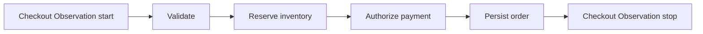

# When to Use Annotations Instead of Custom APIs in Spring Boot

Spring Boot and Micrometer offer multiple ways to instrument code: annotations such as `@Counted`, `@Timed`, and `@Observed`, or direct API calls such as `Observation`, `Counter`, `Timer`, and `MeterRegistry`. Both approaches can produce useful telemetry, yet each fits different boundaries.

**Annotations fit when a clean method boundary accurately represents the operation to measure and metadata is relatively static.** Custom APIs fit when you need precise control over start/stop timing, outcomes, context, controlled dynamic tags, or an operation spanning multiple steps and asynchronous boundaries.

This lesson **“When to Use Annotations Instead of Custom APIs”** belongs to the **Annotation observability** chapter of the **SPRING_BOOT_OBSERVABILITY** module. The module teaches how to set up observability for Spring Boot using Micrometer Observation, metrics, logs, and distributed tracing. The goal is to choose the right tool to measure metrics, create traces, propagate context, and correlate signals when investigating errors, latency, and application behavior in production environments.

## 1. Two Ways to Instrument Code

### Annotation-Driven Instrumentation

Annotations are placed on methods so an aspect/interceptor performs instrumentation around the call.

```java
@Service
public class InvoiceService {

    @Counted("invoice.generate.calls")
    public Invoice generate(GenerateInvoice command) {
        return createInvoice(command);
    }
}
```

Business code stays concise, with instrumentation declared right at the method boundary. However, annotations only take effect when the framework supports them, the aspect/interceptor is registered, and calls pass through the corresponding interception mechanism.

### Programmatic/Custom API

Code invokes the Micrometer API directly at meaningful points:

```java
@Service
public class InvoiceService {

    private final Counter generated;

    public InvoiceService(MeterRegistry registry) {
        this.generated = Counter.builder("invoice.generated")
                .register(registry);
    }

    public Invoice generate(GenerateInvoice command) {
        Invoice invoice = createInvoice(command);
        generated.increment();
        return invoice;
    }
}
```

The custom API is slightly more verbose, yet the increment position explicitly expresses the business outcome: it only increments after the invoice is successfully created.

With `Observation`:

```java
Observation.createNotStarted("invoice.generate", observationRegistry)
        .lowCardinalityKeyValue("invoice.channel", channel)
        .observe(() -> createInvoice(command));
```

The Observation API can connect multiple handlers to produce metrics and tracing from a single lifecycle.

## 2. Choosing Based on the Semantics to Measure

The first question is not whether an annotation or API is shorter, but what signal is meaningful and which boundary accurately represents it.

| Need | Typically Suitable Choice | Reason |
| --- | --- | --- |
| Count each time a Spring bean method is called | `@Counted` | Method invocation is a clear boundary |
| Measure execution duration of a synchronous method | `@Timed` | Aspect wraps the method call |
| Produce metrics and tracing for a simple method operation | `@Observed` | Declares an Observation boundary |
| Count business success after a transaction | Custom Counter/API at outcome boundary | Invocation does not equal success |
| Measure a workflow spanning multiple methods | Custom `Observation` | Boundary encompasses the workflow |
| Measure individual phases within an operation | Custom Timer/Observation | Controls start/stop of each phase |
| Metadata derived from runtime context | Custom convention/API | Depends on request/task context |
| Measure a reactive task until terminal signal | Reactive-aware API/instrumentation | Method return may only return a `Publisher` |
| Measure retry attempts and final outcome separately | Custom metrics | Distinguishes attempts from final outcome |

Annotations are accurate when the method invocation itself is the exact operation to measure. Nor is a custom API automatically better; placing start/stop in the wrong spot can skew durations.

## 3. When Are Annotations a Good Choice?

Annotations generally fit when the operation corresponds to a stable method boundary, the method is called through a Spring-managed proxy, static metadata or a convention suffices, manual start/stop control is unnecessary, and annotation semantics match the desired measurements.

Counting method calls:

```java
@Counted(
    value = "catalog.lookup.calls",
    extraTags = {"operation", "lookup"}
)
public Product lookup(String code) {
    return repository.findByCode(code);
}
```

Measuring duration:

```java
@Timed(
    value = "catalog.lookup",
    histogram = true
)
public Product lookup(String code) {
    return repository.findByCode(code);
}
```

Verify annotation attribute names and histogram support against the Micrometer version managed by the Spring Boot BOM.

The strengths of annotations are minimal boilerplate, easy visibility in code reviews, and separating instrumentation from business logic. For clean method boundaries, they offer a simple and consistent declarative style.

## 4. When Is a Custom API a Better Fit?

A custom API should be preferred when instrumentation must express logic that does not coincide with a single method call:

1. Incrementing a `Counter` only after a business operation succeeds.
2. Measuring validation, database access, remote calls, and serialization separately.
3. Operations that start in one method and finish in another callback/async task.
4. Needing `KeyValue`s from a validated/normalized runtime context.
5. Needing an `Observation` spanning a multi-step workflow.
6. Needing links to multiple parent contexts, such as batch message processing.
7. Recording outcomes after retries/recovery.
8. Needing custom error handling or lifecycle control.

Example distinguishing attempts from final outcomes:

```java
public Result execute(Command command) {
    attempts.increment();

    Result result = performWithRetry(command);

    if (result.isSuccessful()) {
        successes.increment();
    } else {
        failures.increment();
    }
    return result;
}
```

A single `@Counted` on the method only reports that the method was called; it does not classify retry attempts, business successes, and final failures by itself.

## 5. Distinguishing @Counted, @Timed, and @Observed

The three annotations do not share the same semantics.

| Annotation | Primary Signal/Function | When to Use |
| --- | --- | --- |
| `@Counted` | Counter for method invocations | Need how many times a method was called |
| `@Timed` | Timer for duration/count/distribution | Need latency at a method boundary |
| `@Observed` | Observation lifecycle for handlers | Need metrics and tracing when handlers are configured |

`@Counted` counts invocations via an aspect. Invocations may still be counted when a method throws an exception. Do not use it as a business success counter if failures are also counted.

`@Timed` measures the interval the aspect wraps around the method invocation. For synchronous methods, the boundary is straightforward. For methods returning `Future`/`Publisher`, verify whether the instrumentation measures method call time or asynchronous work completion time; do not assume the two durations are equal.

`@Observed` creates an `Observation` for the method boundary. `ObservationRegistry` handlers can convert the lifecycle into metrics and tracing. The annotation does not guarantee a span on its own if a tracing handler/bridge is not configured or sampling drops the trace.

Do not stack all three annotations on the same method just to get comprehensive telemetry. Pick the signal needed, and avoid duplicate counters/timers and meaningless nested spans.

## 6. AOP Proxies and Self-Invocation

Annotation-driven instrumentation in Spring typically relies on proxies/interceptors. Method calls from another bean through the proxy can be intercepted; internal calls via `this` typically bypass the proxy.

```java
@Service
public class BillingService {

    public void runBilling() {
        calculate(); // Self-invocation may bypass the proxy
    }

    @Counted("billing.calculate.calls")
    public void calculate() {
        // Work
    }
}
```

If `runBilling()` calls `calculate()` directly on the same instance, the aspect may not run. Objects created with `new` outside the Spring container likewise do not receive AOP proxies automatically.

How to handle: move the operation to a separate bean, call through the Spring-managed proxy, use the programmatic API if the method boundary cannot go through a proxy, and test actual behavior.

## 7. Async and Reactive Lifecycles

For synchronous methods, an aspect can start before the method and stop after the method returns/throws. However, an asynchronous method can return before the work actually finishes.

```java
@Timed("report.generate")
public CompletableFuture<Report> generateAsync() {
    return CompletableFuture.supplyAsync(this::generateReport);
}
```

If the aspect measures method invocation, the duration may reflect only the time to create and return the `CompletableFuture`, not the time until `generateReport` completes.

With Reactor, the method returns a `Mono` immediately; work normally begins upon subscription. Do not assume a timer around the method automatically covers the reactive exchange through its terminal signal.

When asynchronous completion must be measured, use framework-supported reactive-aware instrumentation or wrap the `Observation`/`Timer` around the publisher lifecycle, including complete/error/cancel. Propagate context through Reactor Context/Micrometer Context Propagation; avoid keeping manual `ThreadLocal` scopes across schedulers.

## 8. Multi-Step Workflows Needing a Dedicated Observation Boundary

Suppose checkout involves validation, inventory reservation, payment authorization, and order persistence. Putting `@Timed` on each method reports each method's duration, yet does not necessarily provide an operation-level `Observation` spanning the whole workflow.



You can use the Observation API:

```java
public CheckoutResult checkout(CheckoutCommand command) {
    return Observation.createNotStarted("checkout.process", registry)
            .lowCardinalityKeyValue("channel", normalizeChannel(command.channel()))
            .observe(() -> {
                validate(command);
                reserveInventory(command);
                authorizePayment(command);
                return persistOrder(command);
            });
}
```

This example fits a synchronous workflow. If any step is asynchronous, keep the `Observation` lifecycle open until the workflow completes and handle cancel/error with the right semantics.

## 9. Runtime Metadata and Cardinality

Annotations typically suit static metadata such as operation names or fixed channels. If tags depend on runtime data, a custom convention/API may fit better, though values must still be normalized and cardinality controlled.

Good examples: `channel=web/mobile/partner`; `dependency=payment/inventory`; `operation=authorize/capture/refund`; `outcome=success/failure`.

Do not put user ID, order ID, trace ID, request ID, raw URL/query string, exception message, message payload, email, or token into metric tags.

Using a custom API does not grant permission to add arbitrary dynamic values. Cardinality and privacy constraints apply equally to annotations and APIs.

## 10. Custom Conventions vs. Adding Code to Every Method

If many methods share the same metadata policy, do not duplicate logic inside every method. Use a convention or `ObservationFilter` to centralize it.

| Approach | Scope | When Appropriate |
| --- | --- | --- |
| Annotation attributes | Per method, static metadata | Operations with fixed tags |
| Custom `ObservationConvention` | One Observation type | Normalizing keys/values from context |
| `ObservationFilter` | Multiple Observation types | Shared post-processing policy |
| Observation API | Specific workflow | Controlling lifecycle and runtime metadata |
| `MeterRegistry` API | A specific metric | Business counters/timers at outcome boundaries |

Do not use `ObservationFilter` to replace all instrumentation when a convention or handler is the more appropriate extension point. Each extension point has its own responsibility.

## 11. Transactions and Business Outcomes

A method can return successfully before a transaction commit finishes, depending on transaction boundaries and proxy ordering. If a counter must reflect committed data, incrementing inside the method body may be too early.

A service method can return normally while the subsequent transaction commit fails. Invocation counters and committed-operation counters have different semantics.

If you need to count after commit, use transaction synchronization/events suited to the transaction manager and record the metric only after a successful commit. Consider the outbox/audit pattern when high-reliability business records are needed; metrics are not a ledger.

Annotations fit method invocations; custom hooks fit business outcomes tied to transaction lifecycles.

## 12. Consistency and Operational Cost

Choose a consistent naming convention:

- Names describe the operation, avoiding volatile implementation details.
- Tag keys remain consistent across services.
- Tag values come from enums/allow-lists.
- Distinguish attempts, successes, failures, and retry exhaustion.
- Use `Timer`/histograms for latency.
- Create spans only at meaningful boundaries.
- Avoid multiple instrumentations measuring the same operation without a clear goal.

Annotations reduce boilerplate but still incur AOP/interceptor and registry update overhead. Custom APIs offer finer control at the cost of more code to review/test. Choose based on semantics and maintainability.

## 13. Quick Decision Matrix

| Question | If Yes | Choice |
| --- | --- | --- |
| Only need to count method invocations? | Yes | `@Counted` |
| Need duration of a synchronous method? | Yes | `@Timed` |
| Need an Observation at a simple method boundary? | Yes | `@Observed` |
| Only count when the business outcome succeeds? | Yes | Custom `Counter` at outcome |
| Workflow spans multiple methods? | Yes | Custom `Observation` |
| Need to measure async completion/cancellation? | Yes | Reactive/async-aware instrumentation |
| Need multiple producer contexts for a batch? | Yes | Custom `Observation` with links |
| Runtime metadata requires normalization? | Yes | Convention or custom API |
| Method does not go through a Spring proxy? | Yes | Programmatic API or fix boundary |
| Static metadata and standard method boundary? | Yes | Annotation |

## 14. Testing Your Instrumentation Choice

A test suite must verify semantics, not merely that a meter exists:

1. Call the method through the Spring proxy and verify the annotation is intercepted.
2. Test self-invocation and manually instantiated objects to observe proxy limits.
3. Throw an exception and verify count/error semantics.
4. For business counters, verify increments occur only after the desired outcome.
5. For transactions, test both commit and rollback.
6. For `Timer`, verify the duration boundary.
7. For `CompletableFuture`/`Mono`, verify whether the timer stops at method return or async completion.
8. For the Observation API, verify start/stop and terminal signals.
9. Verify trace context and log correlation if using `@Observed`/`Observation`.
10. Verify tag cardinality and absence of sensitive values.
11. Verify there are no duplicate metrics/spans.
12. Verify meters/observations reach the right registry and exporter.

Use `SimpleMeterRegistry` or a test `ObservationHandler` in unit tests; use Spring integration tests for AOP proxies, auto-configuration, and HTTP/messaging instrumentation.

## 15. Scenario-Based Examples

### Counting Service Method Invocations

Use `@Counted` when total invocations are needed:

```java
@Counted("inventory.reserve.calls")
public Reservation reserve(ReserveCommand command) {
    return inventoryRepository.reserve(command);
}
```

### Counting Successful Reservations

Use a custom `Counter` after the result is confirmed:

```java
public Reservation reserve(ReserveCommand command) {
    Reservation reservation = repository.reserve(command);
    successfulReservations.increment();
    return reservation;
}
```

### Measuring Latency and Tracing an Operation

Use `@Observed` when the method boundary is the right operation and handlers are configured:

```java
@Observed(name = "inventory.reserve")
public Reservation reserve(ReserveCommand command) {
    return repository.reserve(command);
}
```

### Measuring an Async Workflow

Use `Observation` around publisher/task completion rather than only around the method returning the publisher. For reactive chains, ensure `Observation` scope/context is managed properly across subscription and terminal signals according to your Micrometer/Spring version's API.

## 16. Self-Check Questions

1. When are annotations more appropriate than custom APIs?
2. Does `@Counted` measure invocations or business success?
3. Does `@Timed` on a method returning `Mono` necessarily measure until the terminal signal?
4. Which handlers does `@Observed` require to produce metrics and traces?
5. Why can AOP self-invocation bypass an annotation?
6. When should you use a custom `Counter` at an outcome boundary?
7. Where should an `Observation` be placed for a multi-method workflow?
8. How should cardinality be controlled for runtime tags?
9. How does `ObservationConvention` differ from `ObservationFilter` and `ObservationHandler`?
10. How can transaction commit cause business success to differ from method return?
11. When does a custom API help handle cancellation and async lifecycles?
12. How do you avoid duplicate metrics when combining annotations and APIs?
13. Which test verifies that an annotation is intercepted by a proxy?
14. Why do metrics, traces, and logs need a shared operation/service identity?

## References

- [Micrometer — Annotation-based Observability](https://docs.micrometer.io/micrometer/reference/observation/annotations.html): `@Observed` and aspect configuration.
- [Micrometer — Counters](https://docs.micrometer.io/micrometer/reference/concepts/counters.html): Counter semantics and `@Counted`.
- [Micrometer — Timers](https://docs.micrometer.io/micrometer/reference/concepts/timers.html): Timer duration/count/distribution.
- [Micrometer — Observation](https://docs.micrometer.io/micrometer/reference/observation.html): Observation API, registry, conventions, filters, and handlers.
- [Spring Boot — AOP](https://docs.spring.io/spring-boot/reference/features/aop.html): proxy-based AOP behavior.
- [Spring Boot — Metrics](https://docs.spring.io/spring-boot/reference/actuator/metrics.html): `MeterRegistry`, Actuator metrics, and instrumentation.

## Conclusion

**Use annotations when the method boundary itself is the operation to observe; use custom APIs when semantics or lifecycles extend beyond a method invocation.** `@Counted` counts calls, `@Timed` measures duration within the interception scope, and `@Observed` creates an `Observation` for handlers. They are simple and readable when boundaries are clear, metadata is stable, and proxies/interceptors function properly.

Custom `Counter`/`Timer`/`Observation` APIs fit when you need to count business outcomes, measure multi-step workflows, track async completion/cancellation, attach runtime context, or control retry and transaction boundaries. Whichever approach you choose, keep cardinality low, avoid duplicate instrumentation, and test the exact lifecycle. The goal is telemetry that accurately reflects real operations so metrics, traces, and logs support production investigations.
