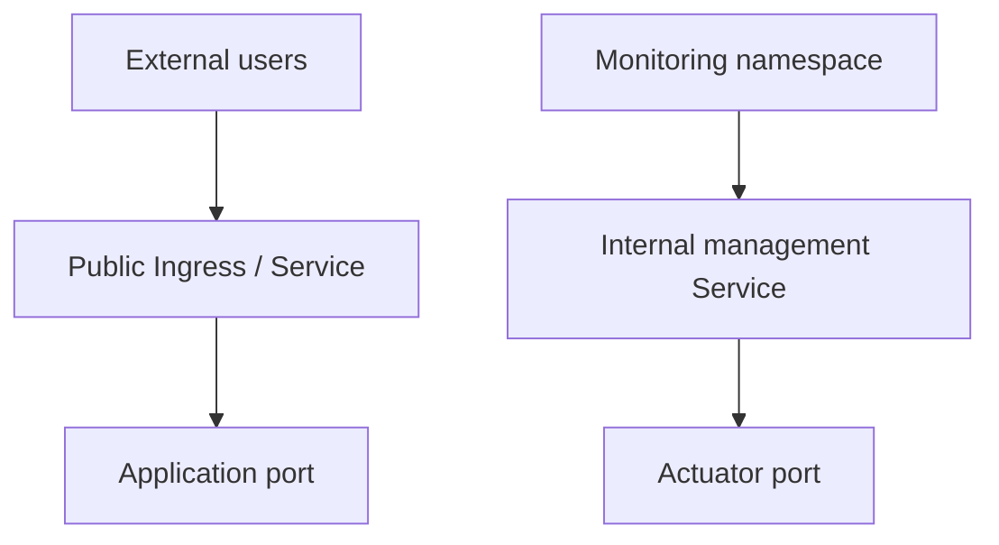

# Security for Actuator in Spring Boot

Spring Boot Actuator provides endpoints for operating and observing applications, such as health, metrics, info, loggers, env, configprops, threaddump, and heapdump. These endpoints are very useful for monitoring and troubleshooting, but some of them can reveal internal information or allow altering application state. If exposed improperly, outsiders can read configuration, view environment information, download diagnostic data, or change log levels.

The **Security for actuator** lesson belongs to the **Actuator and Management** chapter of the **SPRING_BOOT_OBSERVABILITY** module. The module guides setting up observability for Spring Boot using Micrometer Observation, metrics, logs, and distributed tracing; learning context propagation, tags/cardinality, exporters, sampling, and signal correlation to investigate errors, latency, and application behavior in production environments.

After this lesson, you will be able to distinguish endpoint exposure from authorization, design access permissions by endpoint and role, configure Spring Security for management endpoints, separate the management port/network boundary when appropriate, protect health details, and test access permissions in production environments.

## 1. What Can Actuator Endpoints Reveal?

| Endpoint | Purpose | Risks to Evaluate |
| --- | --- | --- |
| health | Application and dependency status | Health details may expose hostnames, databases, or infrastructure status |
| info | Application/build info | May contain versions, commits, or internal metadata |
| metrics | List of meters and measurements | May reveal service names, dependencies, traffic, and system structure |
| prometheus | Export metrics for scrapers | Operational data may be read publicly if endpoint is open |
| env | Environment properties | May leak secrets/configuration if data is not properly sanitized |
| configprops | Configuration properties | May reveal topology, credentials, or configuration contents |
| loggers | View and change log levels | Unauthorized users could enable DEBUG/TRACE or increase log volume |
| threaddump | Thread diagnostics | May reveal class names, request context, or internal details |
| heapdump | Download heap dump | May contain credentials, tokens, and user data in memory |
| shutdown | Shut down the application if enabled | May cause service disruption |

Sensitivity depends on the endpoint, actual content, and environment. Even a read-only endpoint can pose a security risk if it returns internal information.

## 2. Exposure and Authorization Are Two Different Layers

Spring Boot Actuator provides an exposure mechanism to decide which endpoints are published over web/JMX. Spring Security checks which requests are permitted to access published endpoints.

| Layer | Question | Example |
| --- | --- | --- |
| Exposure | Is the endpoint published on the management surface? | Expose only health and prometheus over the web |
| Authentication | Who is the request coming from? | Service account or logged-in operator |
| Authorization | What is that principal allowed to do? | Monitoring role reads metrics; operator reads health details |
| Network boundary | Can the request reach the management listener? | Only monitoring subnet can reach the management port |

Hiding endpoints via exposure does not replace authorization for the remaining endpoints. Conversely, adding Spring Security rules while exposing every endpoint still enlarges the surface that must be protected.

A secure design requires minimal exposure, authentication/authorization, and appropriate network controls.

## 3. Expose Only Necessary Endpoints

Example configuration exposing only health and prometheus over HTTP:

```yaml
management:
  endpoints:
    web:
      exposure:
        include: health,prometheus
```

If the application needs metrics via the dedicated endpoint, `metrics` can be added after identifying which caller needs it. Do not use wildcard include in production without a clear inventory and policy.

Some endpoints may be enabled by default or depend on dependencies. Check the application's actual endpoint list after adding starters, rather than inferring from YAML alone.

## 4. Configuring Spring Security for Management Endpoints

A dedicated security chain for management endpoints separates actuator policy from application API policy. Illustrative Spring Security 6 example:

```java
import org.springframework.boot.actuate.autoconfigure.security.servlet.EndpointRequest;
import org.springframework.context.annotation.Bean;
import org.springframework.context.annotation.Configuration;
import org.springframework.core.annotation.Order;
import org.springframework.security.config.Customizer;
import org.springframework.security.config.annotation.web.builders.HttpSecurity;
import org.springframework.security.web.SecurityFilterChain;

@Configuration
class ManagementSecurityConfiguration {
    @Bean
    @Order(1)
    SecurityFilterChain actuatorSecurity(HttpSecurity http) throws Exception {
        return http
            .securityMatcher(EndpointRequest.toAnyEndpoint())
            .authorizeHttpRequests(auth -> auth
                .requestMatchers(EndpointRequest.to("health")).permitAll()
                .requestMatchers(EndpointRequest.to("prometheus"))
                    .hasRole("MONITOR")
                .anyRequest().hasRole("OPS")
            )
            .httpBasic(Customizer.withDefaults())
            .build();
    }

    @Bean
    @Order(2)
    SecurityFilterChain applicationSecurity(HttpSecurity http) throws Exception {
        return http
            .authorizeHttpRequests(auth -> auth
                .requestMatchers("/public/**").permitAll()
                .anyRequest().authenticated()
            )
            .httpBasic(Customizer.withDefaults())
            .build();
    }
}
```

This example illustrates a two-filter-chain structure, not production credentials configuration. You must configure an AuthenticationProvider/UserDetailsService or OAuth2 resource server appropriate for your identity system. Do not store passwords in source code; use an identity provider, secret manager, or platform authentication mechanism.

Key points: the first chain matches Actuator endpoints via EndpointRequest; health can allow reading minimal status; Prometheus is restricted to monitoring principals; remaining management endpoints require an operations role; the application chain handles all other routes.

If the application already has custom SecurityFilterChain beans, review the overall chain ordering and matchers so actuator endpoints do not fall into an unintended chain.

## 5. Health Endpoint and Health Details

The health endpoint is commonly used by load balancers/orchestrators. However, health details can expose dependency information such as databases, disks, brokers, or component names.

Example:

```yaml
management:
  endpoint:
    health:
      show-details: when-authorized
      roles: OPS
```

Common values for show-details include never, when-authorized, and always. Do not use `always` on endpoints reachable from untrusted networks. For liveness/readiness probes, returning only minimal status may be sufficient.

Health groups separate liveness/readiness and checked components. Do not put sensitive information into custom HealthIndicator details; that data may appear in logs or monitoring systems.

## 6. Separating the Management Port and Network Boundary

Management endpoints can use a separate port:

```yaml
server:
  port: 8080
management:
  server:
    port: 8081
```

A separate port makes it easier to apply firewalls, Kubernetes Services, or network policies distinct from user traffic. However, a different port does not automatically mean secure: if the listener still binds to a public interface or an ingress route is open, endpoints can still be reached.

In production, route the management port only to monitoring/operator networks; use NetworkPolicies or firewalls/security groups; do not publish the management service to the internet; restrict scraper source IPs/workload identities; use TLS and authentication when traversing untrusted networks; verify whether ingress/service mesh accidentally exposes the management port.

## 7. Authentication and Role Model

| Principal | Suggested Permissions |
| --- | --- |
| Liveness/readiness probe | Read minimal health status via internal probe mechanism |
| Metrics scraper | Read prometheus/metrics |
| Support engineer | Read health and approved diagnostic info |
| Operator | Read management endpoints needed for operations |
| Administrator | Perform mutating actions such as loggers if policy permits |

Do not grant a single full-access role to every scraper or every on-call engineer. Use dedicated service accounts, credentials with lifecycle/rotation, and access auditing.

HTTP Basic may fit some internal networks if wrapped in TLS with well-managed secrets; enterprise environments may use an OAuth2 resource server, mTLS, or workload identity. Choose a method compatible with your platform rather than inventing a custom authentication protocol.

## 8. Protecting State-Changing Endpoints

The loggers endpoint can alter log levels at runtime. The shutdown endpoint can stop the application. These endpoints require stricter policies than read-only endpoints.

- Expose only when there is an approved operational need.
- Grant access only to roles authorized to modify configuration.
- Emit audit events for state-changing operations.
- Maintain a procedure to restore log levels after debugging.
- Do not enable the shutdown endpoint if the deployment platform already manages lifecycle.

If an endpoint is not needed, do not expose it. That is the simplest way to reduce attack surface.

## 9. CSRF, CORS, and HTTP Methods

Do not disable CSRF globally just so a scraper can read Prometheus. Understand which endpoints use browser sessions/cookies and which use service credentials. For machine-to-machine access, configure appropriate authentication and restrict matchers specifically.

CORS is not an authorization mechanism. Allowing a browser origin to call Actuator does not mean the user is authorized. Do not use wildcard CORS for management endpoints carrying sensitive information.

If CSRF needs to be disabled for a scrape endpoint that does not use cookies/sessions, narrow the matcher precisely and consider a separate security chain. Avoid broad configuration that weakens protection for application routes.

## 10. Sanitizing Information and Secrets

Actuator can return metadata from multiple configuration sources. Some endpoints have sanitization behavior, but you should not assume every custom property or custom endpoint is masked automatically.

- Do not store plain-text secrets in application properties when a proper secret manager is available.
- Verify env/configprops output on your exact version and with custom sanitizers.
- Do not put tokens/passwords into the info endpoint or build metadata.
- Do not return connection strings containing credentials.
- Do not include request headers, cookies, or payloads in custom health details.
- Restrict access to thread dumps/heap dumps because they can contain runtime data.

Sanitization is a leak-reduction layer; authorization and network controls remain essential.

## 11. Endpoint Security in Kubernetes Environments

In Kubernetes, separate the paths of user traffic and management traffic:



Only the monitoring namespace or workload identity is permitted to access the management service. Do not create a public Ingress for Actuator. NetworkPolicies must restrict sources, destinations, and ports as supported by the cluster CNI.

Liveness/readiness probes can be executed by kubelet over the pod network; design rules so probes still work without opening the endpoint to the entire cluster. If the health endpoint requires authentication, configure probe credentials or choose a health group/port compatible with the deployment mechanism.

## 12. Testing Security for Actuator

Security tests should verify both permitted and denied access:

| Test | Expectation |
| --- | --- |
| Anonymous GET health | Minimal status only if allowed by policy |
| Anonymous GET prometheus | 401/403 |
| MONITOR GET prometheus | 200 |
| MONITOR GET loggers | 403 |
| OPS GET management endpoint | 200 if endpoint is exposed |
| OPS POST loggers | Succeeds only when policy permits changes |
| Health details without role | No sensitive details |
| Application API request | Still follows application security chain |
| Unexposed endpoint | Not reachable via web mapping |

Illustrative MockMvc security test example:

```java
import org.junit.jupiter.api.Test;
import org.springframework.beans.factory.annotation.Autowired;
import org.springframework.boot.test.autoconfigure.web.servlet.AutoConfigureMockMvc;
import org.springframework.boot.test.context.SpringBootTest;
import org.springframework.test.web.servlet.MockMvc;
import static org.springframework.security.test.web.servlet.request
    .SecurityMockMvcRequestPostProcessors.user;
import static org.springframework.test.web.servlet.request.MockMvcRequestBuilders.get;
import static org.springframework.test.web.servlet.result.MockMvcResultMatchers.status;

@SpringBootTest
@AutoConfigureMockMvc
class ActuatorSecurityTest {
    @Autowired MockMvc mvc;

    @Test
    void monitorCanReadPrometheus() throws Exception {
        mvc.perform(get("/actuator/prometheus")
                .with(user("scraper").roles("MONITOR")))
            .andExpect(status().isOk());
    }

    @Test
    void monitorCannotChangeLoggers() throws Exception {
        mvc.perform(get("/actuator/loggers")
                .with(user("scraper").roles("MONITOR")))
            .andExpect(status().isForbidden());
    }
}
```

This example requires the `spring-security-test` dependency and the corresponding endpoints to be exposed. Specific status codes depend on the authentication entry point and access-denied handler; test your actual production policy rather than copying expected status codes blindly.

## 13. Common Errors

| Symptom | Possible Cause | How to Check |
| --- | --- | --- |
| Anonymous can access env | Endpoint is exposed and security matcher misses it | Check chain order, EndpointRequest, and exposure |
| Scraper gets 401 | Credentials/role mismatch or wrong chain | Check service account and authentication provider |
| Scraper gets 403 | Authenticated but missing role | Check authority mapping |
| Health details leak database info | show-details always or custom indicator returns too much | Use when-authorized/never and sanitize details |
| Actuator still public on separate port | Management listener still reachable from ingress/network | Check bind, Service, Ingress, and firewall |
| Endpoint unprotected | Application security chain matches request first | Check @Order and securityMatcher |
| Prometheus scrape fails after CSRF change | Matcher/CSRF policy mismatch | Configure specifically for scrape endpoint, keep app protection |
| Loggers modified unexpectedly | Overly broad role or unnecessary endpoint still exposed | Restrict roles, exposure, and audit |
| Config secrets appear in logs | Sanitizer does not cover custom endpoint or log dump | Inspect output and remove secret source |
| Probe fails after enabling auth | Probe lacks credentials or wrong health group | Adjust probe path/port and internal policy |

## 14. Real-World Scenario: Locking Down Actuator After Finding Public Endpoints

**Hypothetical context:** A security audit discovers `/actuator/env` and `/actuator/configprops` are reachable from the internet. There is no evidence the endpoints were exploited, but the application must reduce exposure immediately.

Procedure:

1. **Reduce exposure:** keep only truly needed web endpoints, e.g., health and prometheus.
2. **Add authorization:** use a separate management security chain; scrapers only get MONITOR, operators get OPS.
3. **Protect details:** set health details to when-authorized and review custom HealthIndicators.
4. **Restrict network:** move scrapes to an internal management Service/port and restrict sources with firewall/NetworkPolicy.
5. **Check secrets:** review logs/access records and rotate credentials if exposure was possible.
6. **Regression tests:** verify anonymous users cannot access env/configprops, scrapers can only read metrics, and the application API still works.
7. **Monitor:** alert on unusual denied requests or log level changes outside change windows.

An endpoint having been public does not by itself prove unauthorized access occurred. Evaluate access logs and incident evidence according to your organization's incident process.

## 15. Self-Check Exercises

**Exercise 1.** How do exposure and authorization differ?

*Hint:* Exposure determines whether an endpoint is published; authorization determines which principal is allowed to call a published endpoint.

**Exercise 2.** Why should you avoid `show-details=always` on a public health endpoint?

*Hint:* Health details can reveal databases, brokers, hosts, and dependency statuses.

**Exercise 3.** Is separating the management port enough to secure Actuator?

*Hint:* No. You still need network reachability restrictions, authentication, and authorization.

**Exercise 4.** Why should a metrics scraper have its own dedicated role?

*Hint:* Least privilege; a scraper only needs to read metrics, not modify loggers or access env.

**Exercise 5.** Should CSRF be disabled for the entire application just so Prometheus can scrape?

*Hint:* No. Scope the policy to the required endpoint/service authentication and preserve protection for application routes.

**Exercise 6.** What risks does the loggers endpoint pose?

*Hint:* It can change log levels, increase log volume, leak data, or impact performance.

**Exercise 7.** Why must heapdump and threaddump be strictly controlled?

*Hint:* They can contain runtime data, secrets, request context, and internal structure.

**Exercise 8.** How can you verify the security chain actually protects Actuator?

*Hint:* Test anonymous access, each role, endpoint exposure, health details, and the application chain using integration tests.

## 16. Takeaway

- Actuator provides useful operational endpoints but can reveal configuration, topology, runtime data, or permit state changes.
- **Exposure is not authorization**: expose only needed endpoints, then authenticate and authorize according to least privilege.
- Use a separate security chain for management endpoints with precise matchers and clear chain ordering.
- Health details should be restricted by role; do not use `always` on endpoints reachable from untrusted networks.
- A separate management port is only useful when the network path is actually restricted; do not publish the management Service/Ingress to the internet.
- Scrapers, probes, support engineers, and operators need different permissions; do not grant one full-access role to everyone.
- State-changing endpoints like loggers/shutdown require strict exposure, authorization, and auditing.
- Test anonymous/role-based access, CSRF behavior, health details, endpoint exposure, and application routes after every security change.