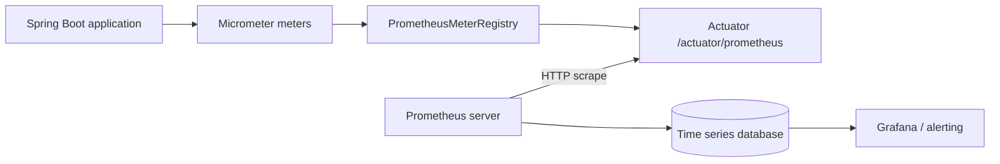

# Prometheus Endpoint in Spring Boot Actuator

## 1. Objectives and Context

Prometheus collects metrics by periodically scraping an application's HTTP endpoint. In Spring Boot, Actuator provides the `/actuator/prometheus` endpoint to export Micrometer meters in the Prometheus exposition format. The application records metrics, Actuator exposes them, and Prometheus scrapes and stores the time series for querying and alerting.

For the endpoint to work, three pieces are required: the Prometheus registry on the classpath, the Actuator endpoint exposed over the web, and network/security configuration allowing Prometheus to reach it. Simply adding Actuator or opening exposure without the registry is not enough.

This lesson belongs to the **Actuator and Management** chapter of the **SPRING_BOOT_OBSERVABILITY** module. The module teaches how to set up observability for Spring Boot using Micrometer Observation, metrics, logs, and distributed tracing; learning context propagation, tags/cardinality, exporters, sampling, and signal correlation to investigate errors, latency, and application behavior in production environments.

After this lesson, you will be able to:
1. Add the Prometheus registry to Spring Boot.
2. Distinguish endpoint enablement from web exposure.
3. Configure and verify `/actuator/prometheus`.
4. Set up a Prometheus scrape job.
5. Understand metric naming, labels, cardinality, and histograms.
6. Protect the endpoint with network policies and authentication.
7. Diagnose endpoint or scrape failures.

**Baseline:** Spring Boot 3.5.x, Java 17+, Actuator, and Micrometer Prometheus registry. Property and format details must be cross-checked against your application's version.

## 2. Scrape Architecture

Prometheus actively calls the endpoint on a schedule. In the standard scrape model, the application does not push metrics to Prometheus.



Micrometer provides a unified API for code to create Counters, Timers, Gauges, and other meters. `PrometheusMeterRegistry` converts meters into the exposition format. The Actuator endpoint serves the content over HTTP.

## 3. Adding Dependencies

Maven:

```xml
<dependency>
    <groupId>org.springframework.boot</groupId>
    <artifactId>spring-boot-starter-actuator</artifactId>
</dependency>
<dependency>
    <groupId>io.micrometer</groupId>
    <artifactId>micrometer-registry-prometheus</artifactId>
</dependency>
```

Gradle:

```groovy
dependencies {
    implementation 'org.springframework.boot:spring-boot-starter-actuator'
    runtimeOnly 'io.micrometer:micrometer-registry-prometheus'
}
```

Use Spring Boot dependency management rather than manually picking an incompatible Micrometer version. Inspect the dependency tree to confirm the registry is present at runtime.

## 4. Enablement and Exposure

An Actuator endpoint can be enabled without being exposed over HTTP. Configuring exposure:

```yaml
management:
  endpoints:
    web:
      exposure:
        include: health,info,prometheus
```

Exposure controls whether the endpoint is accessible over the web. The Prometheus endpoint is auto-configured when the appropriate registry is present; if needed, control enablement separately using the property for your version. Do not use wildcard `*` in production without justification and security controls.

Example with a separate management port:

```yaml
management:
  server:
    port: 8081
  endpoints:
    web:
      exposure:
        include: health,prometheus
```

Prometheus must scrape the right management port. If the application has a base path or reverse proxy prefix, the final URL also changes.

## 5. Endpoint and Response

With the default configuration:

```text
http://<host>:<port>/actuator/prometheus
```

Local example:

```text
http://localhost:8080/actuator/prometheus
```

The response contains the Prometheus text exposition format, typically with `HELP`/`TYPE` lines and samples. Illustrative example:

```text
# HELP orders_submitted_total Number of submitted orders
# TYPE orders_submitted_total counter
orders_submitted_total{channel="web"} 42
```

Meter names and conversions depend on the Micrometer registry/version. Inspect the actual endpoint before building dashboards.

The default base path is `/actuator` and can be changed:

```yaml
management:
  endpoints:
    web:
      base-path: /manage
```

The endpoint is then `/manage/prometheus`. You also need to account for the management port, servlet context path, and proxy routing.

## 6. Exposing Custom Metrics

Example registering a Counter and Timer:

```java
import io.micrometer.core.instrument.Counter;
import io.micrometer.core.instrument.Timer;
import io.micrometer.core.instrument.MeterRegistry;
import org.springframework.stereotype.Service;

@Service
public class OrderMetrics {
    private final Counter submitted;
    private final Timer processing;

    public OrderMetrics(MeterRegistry registry) {
        this.submitted = Counter.builder("orders.submitted")
                .description("Number of submitted orders")
                .tag("channel", "web")
                .register(registry);
        this.processing = Timer.builder("orders.processing")
                .description("Order processing duration")
                .register(registry);
    }

    public void recordSubmission() {
        submitted.increment();
    }

    public void recordProcessing(Runnable operation) {
        processing.record(operation);
    }
}
```

The registry receives meters and the Prometheus endpoint exports them. You do not need a separate controller for each metric. Automatic Spring Boot metrics may also appear when corresponding instrumentation is enabled, such as JVM, process, HTTP server, datasource, and cache. The endpoint only exports registered meters; it does not automatically measure everything.

## 7. Naming and Labels

Prometheus represents dimensions as labels; in Micrometer, they correspond to meter tags. One metric can produce multiple time series across combinations of label values.

Example:

```text
orders_submitted_total{channel="web",outcome="success"} 128
orders_submitted_total{channel="partner",outcome="success"} 42
```

Labels should have a bounded set of values. Avoid user ID, order ID, email, session/request ID, raw URL/path, exception message, SQL text, UUID, or unbounded dynamic hostnames/tenants.

If every request creates a new label value, the time-series count grows rapidly, increasing memory, storage, and query cost. Use route templates instead of raw paths; error categories instead of messages; logical dependency names instead of dynamic hostnames.

Micrometer meter names typically use dotted notation in code, e.g., `orders.processing`. The Prometheus registry converts them to match Prometheus conventions, usually using underscores. Counters/Timers may get suffixes and additional series depending on the registry; verify the final names at the endpoint rather than manually appending suffixes.

## 8. Histograms and Percentiles

By default, a Timer provides count and total time. For Prometheus to compute histogram quantiles, histogram buckets must be enabled for the relevant meter.

```yaml
management:
  metrics:
    distribution:
      percentiles-histogram:
        http.server.requests: true
```

Once buckets are exported, Prometheus can use `histogram_quantile()` to estimate quantiles. Client-side percentiles and histogram buckets have different semantics and costs; choose according to query/backend needs.

Do not enable histograms for every meter. Each bucket and label combination creates additional series. Start with critical latency metrics, then evaluate series counts.

Illustrative PromQL example:

```promql
histogram_quantile(0.95,
  sum by (le, uri) (
    rate(http_server_requests_seconds_bucket[5m])
  )
)
```

Actual metric/label names may vary depending on registry version and instrumentation. Verify against the endpoint before using the query.

## 9. Exemplars and Trace Correlation

Prometheus exemplars can attach a trace reference to a sample/histogram observation to jump from a metric spike to a specific trace, provided the stack supports exemplars end-to-end.

An exemplar is not a normal label. Do not add `traceId` as a label because `traceId` has nearly one unique value per request. Use exemplar integration/configuration compatible with your Micrometer, tracing bridge, and Prometheus server version.

You need a tracing bridge/exporter, an active trace context, a scrape format supporting exemplars, and a Prometheus/Grafana UI linked to the trace backend. A working Prometheus endpoint does not mean exemplars automatically appear.

## 10. Prometheus Scrape Configuration

Example `prometheus.yml` for a local application:

```yaml
scrape_configs:
  - job_name: 'spring-boot-app'
    metrics_path: '/actuator/prometheus'
    scrape_interval: 15s
    static_configs:
      - targets: ['localhost:8080']
```

If the application runs in Docker/Kubernetes, the target must be an address reachable by the Prometheus server. `localhost` inside the Prometheus container refers to the Prometheus container itself, not the host or application container.

Prometheus Operator can use `ServiceMonitor`/`PodMonitor` for discovery; that is an additional discovery mechanism and does not change how the application exposes the endpoint.

The scrape interval controls sampling frequency. Shorter intervals increase resolution but also increase request load and ingestion volume. Choose based on rate of change, number of targets, and Prometheus capacity.

A Counter is cumulative; usually use `rate()` or `increase()`. A Gauge is an instantaneous value. Timers/histograms expose count, total time, and bucket counters depending on configuration.

## 11. Securing the Endpoint

`/actuator/prometheus` can reveal request rates, route names, datasources, JVM stats, pool sizes, and dependency status. Do not expose it publicly just because Prometheus needs to scrape it.

Recommendations:
- Place the management endpoint inside a private network/VPC/cluster network.
- Use firewalls, security groups, or Kubernetes NetworkPolicies allowing only Prometheus to scrape.
- If authentication is required, configure Spring Security so only the authorized service identity can access it.
- Use TLS/mTLS when traversing untrusted networks or per security standards.
- Expose only needed endpoints; do not open all of Actuator with wildcards.
- Never put secrets/PII into metric names or labels.
- Control who can access Prometheus and dashboards.

The security matcher must integrate into the existing `SecurityFilterChain`; do not copy an independent chain that accidentally overrides policies for other endpoints. Grant scrape permissions only to the Prometheus identity.

## 12. Verifying the Endpoint

Test with curl:

```bash
curl -i http://localhost:8080/actuator/prometheus
```

Confirm a successful HTTP status, appropriate `Content-Type`, presence of `HELP`/`TYPE` and samples, expected meters, and absence of PII/secrets/dynamic labels.

In the Prometheus UI, open **Targets** and confirm the job is **UP**. If **DOWN**, check scrape errors, HTTP status, DNS, network route, TLS, and authentication.

Verify the metric with PromQL:

```promql
up{job="spring-boot-app"}
```

A value of `1` means the latest scrape succeeded; `0` means the target was discovered but scraping failed. If the series does not appear, check discovery, labels, and target configuration.

## 13. Troubleshooting

| Symptom | Possible Cause | Resolution |
| --- | --- | --- |
| `/actuator/prometheus` returns 404 | Registry missing, endpoint not exposed, or different base path | Check dependency, exposure, and base path |
| Endpoint returns 401/403 | Spring Security blocks Prometheus | Grant scrape permission to the service identity |
| Endpoint initialization error | Incompatible registry/configuration | Check startup logs and dependency versions |
| HELP/TYPE present but missing custom metric | Meter not registered or code path has not run | Check bean/instrumentation |
| Prometheus target DOWN | Wrong host/port/path, DNS, firewall, or auth | Check scrape error and test curl from Prometheus network |
| Scraping wrong path | Management base path/context path changed | Align `metrics_path` with actual URL |
| Target UP but dashboard empty | Wrong metric name/labels in query or no samples yet | Query Prometheus directly and inspect endpoint output |
| Time series growing rapidly | High label cardinality | Remove IDs/URLs/messages from tags |
| Missing p95 | Histogram buckets not enabled or wrong query | Selectively enable histograms and inspect bucket series |
| Exemplars not appearing | Tracing/exemplar provider/scrape format unsupported | Check each component and version |
| Local curl works but Prometheus cannot scrape | Different network namespace/DNS | Use a target reachable from Prometheus |
| Endpoint unexpectedly public | Wildcard exposure or open ingress route | Narrow exposure and network policies |

## 14. Production Checklist

- [ ] Actuator and `micrometer-registry-prometheus` are present at compatible versions.
- [ ] Prometheus endpoint is enabled and exposed over the web.
- [ ] Scrape path/port/base path match management configuration.
- [ ] Prometheus target is UP and metric samples query successfully.
- [ ] Labels have low cardinality; no IDs, PII, secrets, or raw URLs.
- [ ] Histograms are enabled only for meters needing percentile/bucket analysis.
- [ ] Exemplars are enabled only when tracing and the Prometheus/Grafana stack support them.
- [ ] Endpoint is reachable only from authorized networks/identities.
- [ ] All Actuator endpoints are not exposed unnecessarily.
- [ ] Alerts exist for scrape failures and telemetry pipeline health.
- [ ] Dashboard queries use metric names/labels verified against the real endpoint.

## 15. Self-Practice Questions

1. What is the default path of the Spring Boot Actuator Prometheus endpoint?
2. Why is `micrometer-registry-prometheus` needed in addition to Actuator?
3. How does endpoint enablement differ from web exposure?
4. How does Prometheus scraping differ from pushing metrics?
5. Why is a raw request ID unsuitable as a label?
6. What series types is a Timer converted into in Prometheus?
7. When should histogram buckets be enabled?
8. How does an exemplar differ from a regular label?
9. Why can't a Prometheus container use `localhost` to scrape another app container?
10. How do you determine whether a target is DOWN due to security or networking?
11. Why should you avoid exposing all Actuator endpoints via a wildcard?
12. What should you verify before writing a PromQL dashboard?

## References

- [Spring Boot 3.5 — Prometheus Endpoint](https://docs.spring.io/spring-boot/3.5/reference/actuator/metrics.html#actuator.metrics.export.prometheus)
- [Spring Boot 3.5 — Actuator Endpoints](https://docs.spring.io/spring-boot/3.5/reference/actuator/endpoints.html)
- [Spring Boot 3.5 — Metrics](https://docs.spring.io/spring-boot/3.5/reference/actuator/metrics.html)
- [Micrometer — Prometheus Registry](https://docs.micrometer.io/micrometer/reference/implementations/prometheus.html)
- [Prometheus — Configuration](https://prometheus.io/docs/prometheus/latest/configuration/configuration/)
- [Prometheus — Exposition Formats](https://prometheus.io/docs/instrumenting/exposition_formats/)
- [Prometheus — Histograms](https://prometheus.io/docs/practices/histograms/)
- [Prometheus — Exemplars](https://prometheus.io/docs/prometheus/latest/feature_flags/)
