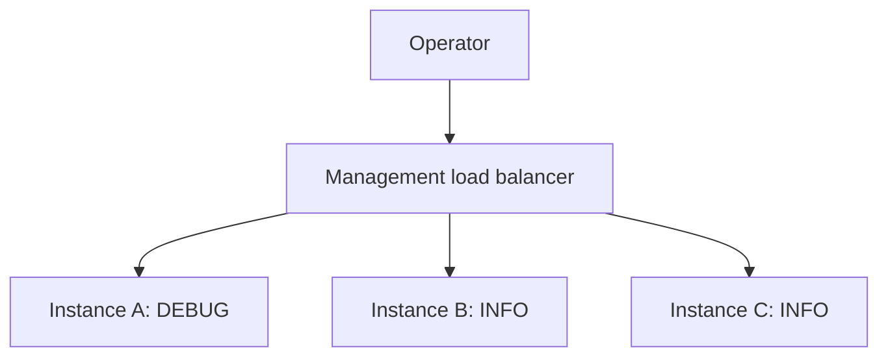
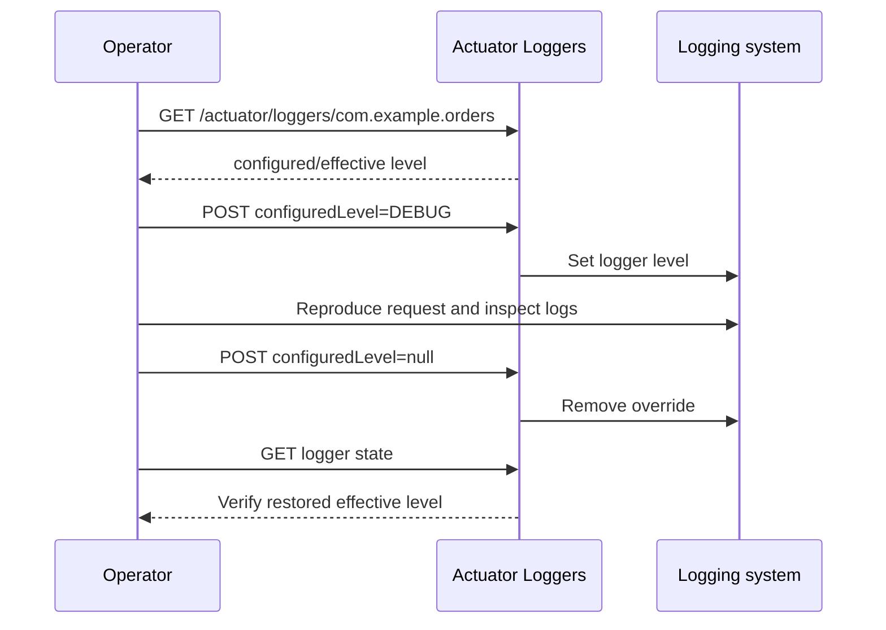

# Loggers Endpoint in Spring Boot Actuator

During operations, you sometimes need to increase the log level of a package or class to investigate an active issue. Changing configuration and restarting the application can take time and disrupt service. Spring Boot Actuator provides the **Loggers endpoint** to view current loggers and change log levels at runtime over HTTP.

The Loggers endpoint supports targeted investigation: raise the log level of a package from INFO to DEBUG, observe briefly, and then restore the previous level. The change affects the logging system of the running process; it does not automatically update application configuration or guarantee the value persists across restarts.

The **"Loggers endpoint"** lesson belongs to the **Actuator and Management** chapter of the **SPRING_BOOT_OBSERVABILITY** module. The module guides setting up observability for Spring Boot using Micrometer Observation, metrics, logs, and distributed tracing; learning context propagation, tags/cardinality, exporters, sampling, and signal correlation to investigate errors, latency, and application behavior in production environments.

## 1. What Problem Does the Loggers Endpoint Solve?

The logging level determines which events a logger emits. A logger at INFO normally does not emit DEBUG messages. When investigating production issues, you may need to enable DEBUG for a specific package instead of increasing the log level across the whole application.

The Loggers endpoint lets you:

- List logger names known to the logging system.
- View the configured level if a logger has an explicit setting.
- View the effective level currently applied after inheritance from parent/root.
- Change the configured level at runtime.
- Reset a logger back to inherited state by sending a null level.
- Inspect logging behavior without restarting the process.

This endpoint is not a log viewer. It does not return emitted log records and does not query a log aggregation backend. It only manages the log levels of the running logging system.

## 2. Enabling and Exposing the Loggers Endpoint

Add Spring Boot Actuator:

```groovy
dependencies {
    implementation 'org.springframework.boot:spring-boot-starter-actuator'
}
```

To access it over HTTP, expose the endpoint with the appropriate management configuration:

```yaml
management:
  endpoints:
    web:
      exposure:
        include: health,info,loggers
```

Do not expose all Actuator endpoints to a public network. Loggers can alter runtime behavior, so only allow access via the management network and authorized principals.

If using Spring Security, protect `/actuator/loggers/**` with an authorization policy for operators/admins. Exposure only decides whether the endpoint is published; it does not replace authentication, authorization, or network controls.

## 3. Listing Loggers

Call the endpoint:

```http
GET /actuator/loggers
```

The response can have a structure like:

```json
{
  "levels": [
    "OFF",
    "ERROR",
    "WARN",
    "INFO",
    "DEBUG",
    "TRACE"
  ],
  "loggers": {
    "ROOT": {
      "configuredLevel": "INFO",
      "effectiveLevel": "INFO"
    },
    "com.example.orders": {
      "configuredLevel": null,
      "effectiveLevel": "INFO"
    }
  }
}
```

Logger names depend on classes/packages the logging system already knows about. Not every package appears before its classes are loaded or its logger is initialized. You can query a specific logger by its full name.

## 4. Configured Level and Effective Level

Two important fields:

- **configuredLevel:** the level set directly on the logger; may be `null` if the logger has no explicit setting.
- **effectiveLevel:** the actual level the logger uses after applying inheritance from a parent logger or root.

Example:

```json
{
  "configuredLevel": null,
  "effectiveLevel": "INFO"
}
```

The logger has no explicit level; it inherits INFO from its parent/root. If root is WARN, a logger without its own configured level can have an effective level of WARN.

A `configuredLevel` of `null` does not mean the logger is disabled. Read `effectiveLevel` to understand actual behavior.

## 5. Inspecting a Specific Logger

Use the logger name as a path segment:

```http
GET /actuator/loggers/com.example.orders
```

Example response:

```json
{
  "configuredLevel": "DEBUG",
  "effectiveLevel": "DEBUG"
}
```

A logger name is usually a package or fully qualified class name, such as `com.example.orders.OrderService`. URLs must be encoded if the logger name contains special characters.

## 6. Changing Log Levels at Runtime

The Loggers endpoint supports POST to set the configured level:

```http
POST /actuator/loggers/com.example.orders
Content-Type: application/json

{
  "configuredLevel": "DEBUG"
}
```

After a successful request, the logger is set directly to DEBUG in the current process. DEBUG statements from that logger and child loggers without their own override can now be emitted.

Common levels:

| Level | Purpose |
| --- | --- |
| TRACE | Very granular detail, usually high volume |
| DEBUG | Information for investigation |
| INFO | Normal operational events |
| WARN | Unusual conditions needing attention |
| ERROR | Errors requiring handling |
| OFF | Disable logging for the logger |

### Resetting to Inherit

Send `configuredLevel` as `null`:

```http
POST /actuator/loggers/com.example.orders
Content-Type: application/json

{
  "configuredLevel": null
}
```

The logger removes its own override and falls back to the effective level from its parent/root. This is how you restore it if the logger previously had no explicit configured level.

Do not blindly reset it to INFO if the logger originally inherited WARN or DEBUG. Record the prior `configuredLevel` before making changes so you restore the exact state.

## 7. Changing the Root Logger

You can change the root logger:

```http
POST /actuator/loggers/ROOT
Content-Type: application/json

{
  "configuredLevel": "WARN"
}
```

The root logger broadly affects every logger inheriting its level from root. This is a wide-reaching change; do not set root to DEBUG to investigate a single package when you can target a specific logger.

Child loggers with their own `configuredLevel` will continue using their override. Thus, changing the root level does not necessarily give every logger the same effective level.

## 8. Logger Groups

Spring Boot supports logger groups to bundle related loggers under one logical name. Operators can update multiple packages/classes at once.

Example:

```yaml
logging:
  group:
    web:
      - org.springframework.core.codec
      - org.springframework.http
      - org.springframework.web
    sql:
      - org.springframework.jdbc
      - org.hibernate.SQL
```

Once a group is defined, you can query or update the logger group by group name:

```http
POST /actuator/loggers/web
Content-Type: application/json

{
  "configuredLevel": "DEBUG"
}
```

A group name is a Spring Boot configuration alias, not a new logger class. Check your logging configuration for existing group names; the endpoint does not automatically infer groups from packages.

Use groups when you need to enable DEBUG for a set of related framework loggers, such as HTTP mapping/serialization or SQL. An overly broad group can still produce heavy log volume; name groups by function and control their members.

## 9. Do Runtime Changes Persist After a Restart?

Changes via the Loggers endpoint update the logging system inside the running process. They do not write back to `application.yml`, environment variables, Config Server, or deployment manifests.

After a restart, the logging system reinitializes from startup configuration. Runtime overrides are normally lost. If external configuration management is present, levels follow that source. In multi-replica deployments, updating one instance does not automatically update the remaining instances.

The endpoint is suited for temporary troubleshooting. For permanent changes, update centralized configuration through your release/configuration change process.

## 10. Multi-Instance and Load Balancers

In a multi-replica deployment, an HTTP call to a load balancer may reach only one instance. In that case, only one process has its level changed.



If changes are needed across multiple instances:

1. Identify the instances/pods to investigate.
2. Call the management endpoint of the target instance directly or use controlled orchestration automation.
3. Verify configured/effective levels on each instance.
4. Record the change and timestamp.
5. Restore every instance after investigation.

Do not assume a single POST through a load balancer updated the whole cluster. Management endpoints should have clear routing/identity so operators know which instance a request affects.

## 11. Securing the Loggers Endpoint

The Loggers endpoint can expose internal details and sharply increase log volume. DEBUG/TRACE logs sometimes include headers, payloads, SQL values, or sensitive identifiers.

- Expose the endpoint only on the management interface/network.
- Require authentication.
- Grant log-level modification permissions only to appropriate operator roles.
- Audit who changed which logger, old/new levels, and timestamp.
- Restrict root-level changes.
- Maintain a level restoration runbook.
- Verify log statements do not log secrets before enabling DEBUG/TRACE.
- Monitor log ingestion volume and storage costs.

Do not treat internal-only exposure as sufficient protection. Application-layer authorization and network segmentation are both necessary.

## 12. Integration with the Logging System

Spring Boot supports logging systems such as Logback and Log4j2 depending on dependencies. The Actuator Loggers endpoint operates through the logging system abstraction; exact behavior depends on the backend.

The logger name must match the category used by the logging backend. Parent-child hierarchy affects the effective level. Loggers with explicit overrides do not necessarily follow root. Async appenders can delay log appearance. Filter/appender thresholds can still drop events even when the logger level permits them.

Runtime levels do not modify patterns, encoders, appenders, or destinations. If you set DEBUG and still see no logs, check the logger name, effective level, appender thresholds, filters, and whether the code actually emits a DEBUG event.

## 13. Safe Operational Procedure

1. Identify the symptom and suspect package/class.
2. Read `configuredLevel`/`effectiveLevel` before making changes.
3. Choose the narrowest specific logger or group needed.
4. Set DEBUG temporarily, avoiding root TRACE.
5. Trigger a controlled reproduction/request.
6. Watch log volume and sensitive data.
7. Collect the needed evidence.
8. POST `configuredLevel` as `null` if the logger originally inherited, or restore the old level if it had an override.
9. Read the endpoint again to confirm the effective level has been restored.
10. Record the audit trail and update runbooks if needed.



## 14. Testing the Loggers Endpoint

In integration tests, you can use MockMvc/WebTestClient to verify the endpoint is exposed and logging system behavior works as expected.

Cases to test:

1. GET loggers list returns `levels` and logger map.
2. GET specific logger returns `configuredLevel`/`effectiveLevel`.
3. POST DEBUG updates `configuredLevel`.
4. GET after POST confirms `effectiveLevel`.
5. POST `null` removes the override.
6. Child loggers inherit the new level from parent/root.
7. Child loggers with overrides keep their own levels.
8. Logger groups update members as configured.
9. Security blocks unauthorized users.
10. HTTP endpoint is not exposed when disallowed by config.
11. Runtime overrides are not mistaken for persistent config after restart.

HTTP test example:

```java
mockMvc.perform(post("/actuator/loggers/com.example.orders")
        .contentType(MediaType.APPLICATION_JSON)
        .content("""
            {"configuredLevel":"DEBUG"}
            """))
    .andExpect(status().isNoContent());
```

Status codes and test setup must match your Spring Boot version. After POST, perform a GET to verify state rather than relying solely on the response status.

## 15. Diagnosing When the Loggers Endpoint Does Not Work

| Symptom | Possible Cause | How to Check |
| --- | --- | --- |
| 404 endpoint | Actuator missing or loggers not exposed | Check dependency and exposure include |
| 401/403 | Authentication/authorization policy | Check management security rules |
| POST does not change level | Wrong logger name or backend behavior | GET logger state and check logging system |
| configuredLevel null | Logger inherits from parent/root | Inspect effectiveLevel |
| DEBUG does not appear | Appender/filter threshold or code emits no DEBUG | Check backend config and logger calls |
| Only one replica changes | Request hit only one instance | Check pod/instance routing |
| Level reverts after restart | Runtime override is non-persistent | Update external/application config for long-term changes |
| Sudden spike in log volume | Scope too broad or TRACE/DEBUG on root | Restore level, narrow logger scope |
| Group not found | Group not configured | Check logging.group properties |
| Logs still missing after enabling | Child logger override or appender filter | Check hierarchy and appenders |

## 16. Hands-On: Investigating an Issue with the Loggers Endpoint

Perform in local/test:

1. Add Spring Boot Actuator and expose the loggers endpoint on the local management interface.
2. Create a `com.example.orders` service package with INFO/DEBUG logs.
3. Start the application and GET logger state.
4. Set the package logger to DEBUG using POST.
5. Call the business endpoint and verify DEBUG events appear.
6. Create a child logger with a WARN override; observe the effective level.
7. Set the parent logger to null and verify the child inherits properly.
8. Define a `web` logger group and test updating the group level.
9. Send an unauthorized request and verify it is blocked.
10. Restart the application and verify the runtime override is not treated as persistent config.
11. Restore all levels to their initial state and check log volume.

Do not run DEBUG/TRACE experiments in production without a defined scope, time window, and designated owner responsible for restoration.

## 17. Self-Check Questions

1. What does the Loggers endpoint manage, and what does it not do?
2. How do you expose the endpoint over HTTP?
3. How does `configuredLevel` differ from `effectiveLevel`?
4. Does `configuredLevel` being `null` mean the logger is disabled?
5. Which POST request sets a logger to DEBUG?
6. How do you remove an override so the logger inherits from its parent?
7. How does the root logger affect child loggers?
8. Where are logger groups defined?
9. Do runtime levels persist across restarts?
10. Why might a POST through a load balancer only change one replica?
11. What security risks arise when enabling DEBUG/TRACE?
12. Why does exposure not replace authorization?
13. If DEBUG does not appear, which layers need to be checked?
14. How do you verify the level has been restored?
15. When should you use the Loggers endpoint vs. editing long-term configuration?

## References

- [Spring Boot — Actuator Loggers Endpoint](https://docs.spring.io/spring-boot/reference/actuator/loggers.html): API for reading and changing logger levels.
- [Spring Boot — Logging](https://docs.spring.io/spring-boot/reference/features/logging.html): logging systems, logger hierarchy, and configuration.
- [Spring Boot — Actuator Endpoints](https://docs.spring.io/spring-boot/reference/actuator/endpoints.html): endpoint exposure, HTTP/JMX, and security.
- [Spring Boot — Externalized Configuration](https://docs.spring.io/spring-boot/reference/features/external-config.html): environment-specific configuration and config sources.

## Conclusion

**The Loggers endpoint allows operators to inspect and change logger levels of a running Spring Boot process without restarting.** GET shows configured/effective levels; POST sets a new level or sends `null` to remove an override and inherit from the parent. Logger groups help update a targeted set of loggers at once.

Runtime overrides normally do not survive restarts and do not automatically propagate to other replicas. Protect the endpoint with authentication/authorization and a management network, target the narrowest logger needed, monitor log volume, and restore levels after investigation. Combining temporary log levels with correlated metrics/traces lets operators gather extra evidence while keeping operational impact under control.
