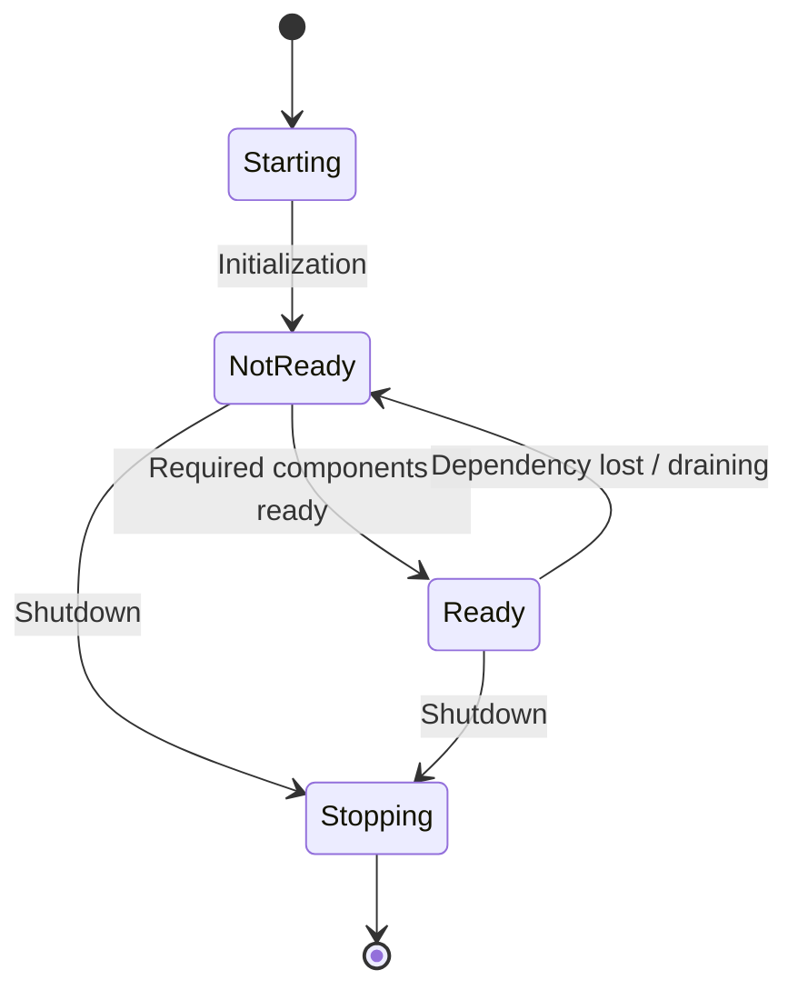

# Readiness State in Spring Boot

A Spring Boot instance can be running yet not ready to receive traffic. For example, the application may have just started, be warming up a cache, not have finished connecting to a required dependency, or be draining before shutdown. If a load balancer only checks whether the process is alive, it might send requests to an instance that cannot serve them yet. **Readiness state** indicates whether an instance is currently eligible to receive traffic; it is an essential part of the health model and deployment lifecycle.

Spring Boot Actuator provides health indicators and health groups to represent application status. With Kubernetes probes integration, the readiness endpoint can be used to decide whether a Pod should be added to Service endpoints. Readiness differs from liveness: a readiness failure typically removes the instance from traffic, whereas a liveness failure can cause the platform to restart the container. The two signals must be designed with distinct failure semantics.

The **Readiness state** lesson belongs to the **Health and readiness** chapter of the **SPRING_BOOT_OBSERVABILITY** module. The module focuses on setting up observability for Spring Boot with Micrometer Observation, metrics, logs, and distributed tracing; learning context propagation, tags/cardinality, exporters, sampling, and signal correlation to investigate errors, latency, and application behavior in production environments.

## 1. Learning objectives

After this lesson, you will be able to:

- Explain readiness state and distinguish it from liveness/overall health.
- Enable readiness/liveness probes in Spring Boot Actuator.
- Understand health groups and how health indicators contribute statuses.
- Choose which dependencies affect readiness according to business requirements.
- Avoid restart loops caused by putting temporary dependencies into liveness.
- Design startup, warm-up, drain, and shutdown transitions.
- Configure Kubernetes readiness probes and verify traffic routing.
- Diagnose readiness DOWN, probe timeouts, and instances removed from service.

## 2. What is readiness state?

Readiness answers the question: **should this instance receive new requests right now?** This state reflects the instance's current ability to serve, not simply whether the process exists.

Examples of situations affecting readiness:

- The application has not finished startup or warm-up.
- A mandatory cache has not been loaded yet.
- A critical dependency on the request path is unavailable.
- The instance is draining for a deployment/scale-down.
- A consumer/worker has not completed initialization if that capability is a condition for receiving traffic.

Not every dependency should mark readiness DOWN. If the application can serve requests using a degraded mode, cache, or fallback, the readiness policy should reflect actual capabilities rather than depending on every external service.

## 3. Readiness, liveness, and overall health

| Signal | Question | Typical platform action |
| --- | --- | --- |
| Liveness | Is the process still functioning and able to continue running? | Restart the instance if the probe fails beyond threshold |
| Readiness | Is the instance ready to receive new traffic? | Stop routing traffic to the instance |
| Overall health | What status are the configured health indicators reporting? | Used for diagnostics/operations per policy |
| Startup probe | Has the application completed the startup phase? | Defer liveness/readiness checks per platform configuration |



Readiness can change multiple times during an instance's lifecycle. A recovering dependency can bring an instance from NotReady back to Ready, if policy and the application allow it.

## 4. Enabling readiness and liveness probes

With Spring Boot Actuator, probe health groups can be enabled:

```yaml
management:
  endpoint:
    health:
      probes:
        enabled: true
```

Endpoints typically provided in probe-enabled environments:

```text
/actuator/health/liveness
/actuator/health/readiness
```

Actual paths depend on management base path, management port, and Spring Boot version. Verify runtime endpoints and web exposure instead of relying solely on YAML.

### Exposing the health endpoint

If configuring a web exposure allow-list, ensure the health endpoint is exposed:

```yaml
management:
  endpoints:
    web:
      exposure:
        include: health,metrics
```

Exposure only makes the endpoint accessible over the web; authorization and network restrictions must still be configured separately. For Kubernetes probes, choose a security policy that allows kubelet to access the specific endpoint without opening up other management endpoints.

## 5. Health groups and indicators

Spring Boot Actuator aggregates status from `HealthIndicator`/reactive health contributors. Each contributor returns a status and optionally details. Health groups allow grouping contributors by purpose, such as readiness and liveness.

Example readiness group configuration adding a health contributor:

```yaml
management:
  endpoint:
    health:
      group:
        readiness:
          include: readinessState,db
```

This is a general configuration example. Contributor names must exist in the application and may vary by dependency/auto-configuration. Spring Boot usually includes `readinessState` automatically in the readiness group when probes are enabled; verify effective group members for your version.

### Which dependencies should affect readiness?

Ask questions along the request path:

1. If this dependency is unavailable, can the instance still respond to valid requests?
2. Is there a designed and tested fallback/cache/degraded mode?
3. Is the dependency required for all routes or only a subset?
4. If readiness goes DOWN, will it reduce capacity too drastically and overload remaining replicas?
5. Can dependency recovery safely transition the instance back to Ready?

For example, a database may be a critical dependency for a CRUD service. However, a system with sufficient cached data or a read-only fallback may still serve some routes when the database is temporarily unavailable. The readiness group should reflect the chosen routing goal.

Do not include every external dependency in readiness. If a non-essential analytics API or recommendation service fails, you do not necessarily need to take the entire instance out of traffic. If all replicas simultaneously report readiness DOWN due to a shared dependency, the system can lose all capacity even though core functionality still works.

## 6. ReadinessState and ApplicationAvailability

Spring Boot has an application availability model representing `LivenessState` and `ReadinessState`. State events can be published during the startup/shutdown lifecycle. The readiness probe health indicator reflects the current readiness state.

The application can update readiness according to its lifecycle when needed:

```java
import org.springframework.boot.availability.AvailabilityChangeEvent;
import org.springframework.boot.availability.ReadinessState;
import org.springframework.context.ApplicationEventPublisher;
import org.springframework.stereotype.Component;

@Component
public class TrafficAvailability {
    private final ApplicationEventPublisher events;

    public TrafficAvailability(ApplicationEventPublisher events) {
        this.events = events;
    }

    public void markReady() {
        AvailabilityChangeEvent.publish(
            events, this, ReadinessState.ACCEPTING_TRAFFIC
        );
    }

    public void markNotReady() {
        AvailabilityChangeEvent.publish(
            events, this, ReadinessState.REFUSING_TRAFFIC
        );
    }
}
```

The example illustrates publishing state events; Spring Boot can automatically manage part of these transitions. Only update the state from an appropriate lifecycle coordinator; avoid having multiple components overwrite readiness over one another.

### Startup and warm-up

An application may finish refreshing its context yet still need to warm up data or initialize local resources. In that case, readiness should remain NotReady until the mandatory steps finish. Do not mark Ready just because the JVM opened a port.

If warm-up fails, whether to retry, enter degraded mode, or fail startup must be decided per business requirements. Avoid leaving readiness NotReady indefinitely without metrics/logs explaining why.

## 7. Kubernetes readiness probe

A Pod readiness probe can call an HTTP endpoint:

```yaml
apiVersion: v1
kind: Pod
metadata:
  name: order-service
spec:
  containers:
    - name: app
      image: example/order-service:1.0
      ports:
        - name: http
          containerPort: 8080
        - name: management
          containerPort: 8081
      readinessProbe:
        httpGet:
          path: /actuator/health/readiness
          port: management
        periodSeconds: 5
        timeoutSeconds: 2
        failureThreshold: 3
```

This is an illustrative example when the management server runs on port 8081. If Actuator shares the application port, the probe must point to that port. The path must match the management base path and exposure.

Kubernetes marks a Pod Ready when the readiness probe succeeds per policy. A failing readiness endpoint removes the Pod from Service endpoints; the container is not necessarily restarted solely due to a readiness failure.

### Startup probe and liveness probe

If the application takes a long time to start, use a startup probe to prevent the liveness probe from restarting the process before startup completes:

```yaml
startupProbe:
  httpGet:
    path: /actuator/health/liveness
    port: management
  periodSeconds: 5
  failureThreshold: 30
livenessProbe:
  httpGet:
    path: /actuator/health/liveness
    port: management
  periodSeconds: 10
  timeoutSeconds: 2
  failureThreshold: 3
```

Values are examples; choose period/timeout/failure threshold based on measured startup duration and recovery behavior. Do not set timeouts too low such that probes create false failures when the node is under load.

## 8. Readiness during deploy, scale-down, and graceful shutdown

When an instance prepares to shut down, it must stop receiving new traffic before stopping the processing of active requests. A typical workflow includes:

1. Transition readiness to Refusing traffic.
2. Wait for the load balancer/orchestrator to update routing.
3. Drain in-flight requests within a bounded time limit.
4. Stop consumers/background tasks according to shutdown policy.
5. Close resources and the process.

Spring Boot graceful shutdown can assist in finishing in-flight requests during the server shutdown lifecycle. The readiness transition and orchestrator termination grace period must be coordinated to avoid new requests reaching an instance that has already started stopping.

### Do not use readiness as a circuit breaker

Readiness indicates the traffic-receiving capability of the entire instance. It does not replace a circuit breaker for a specific dependency. If a remote service is slow, a circuit breaker can prevent calling that dependency while the instance stays Ready to serve other routes.

## 9. Readiness for reactive applications

For WebFlux/reactive applications, health contributors can be reactive. Avoid blocking I/O in health checks because probes may run frequently and stall the event loop. Use reactive clients and intentional timeouts; do not create new connections or run heavy queries on every probe if a recently updated state/cache can be used.

Health checks must also avoid amplifying incidents. If every replica continuously calls a downed dependency, probes can generate additional load. Use a sensible caching/refresh strategy and bound concurrency/timeouts.

## 10. Readiness metrics and diagnostics

The readiness endpoint returns the state at check time. To understand trends, combine Ready/NotReady replica counts over time, readiness transition count/reason, startup/warm-up duration, dependency health, request traffic/error rates, Pod restarts, and deployment events.

Do not use the health endpoint alone as the sole source for incident analysis. Health is a state snapshot; metrics/logs/events explain when and why the state changed.

### Controlled reason codes

If the application records readiness reasons in logs/metrics, use a finite set of categories such as `startup`, `dependency_unavailable`, `draining`. Do not put exception messages, dynamic URLs, or dependency response bodies into metric tags.

## 11. Security and health information

Health details can expose dependency names, hostnames, database statuses, or internal topology. Only return details to authorized callers; probes that only need status generally do not need all component details.

Example details configuration:

```yaml
management:
  endpoint:
    health:
      show-details: when-authorized
```

Specific properties may vary by Spring Boot version and security setup. Combine endpoint exposure, role-based authorization, and network isolation. Do not return credentials, connection strings, or raw exception messages in health details.

## 12. Troubleshooting

| Symptom | Possible cause | Investigation approach |
| --- | --- | --- |
| Readiness endpoint returns 404 | Probes not enabled, health not exposed, or different base path | Check Actuator config and runtime endpoints |
| Readiness stays DOWN at startup | Required contributor not ready or custom state not updated | Inspect health group contributors and lifecycle |
| Pod not added to Service endpoints | Readiness probe failing or wrong selector/port | Check Pod conditions and Service endpoints |
| Readiness fails while app port works | Management port/path/address unreachable | Test probe from the relevant container/network |
| Liveness restart loop when DB is down | DB included in liveness group | Move dependency check to readiness if appropriate |
| All replicas NotReady | Shared dependency failed or readiness policy too strict | Evaluate fallback and capacity impact |
| Probe timeout under load | Blocking/heavy health check or timeout too low | Measure health handler latency and reduce work |
| Instance Ready too early | Warm-up not factored into readiness | Update lifecycle state after initialization |
| Instance still receives traffic while draining | Slow readiness transition/routing propagation | Coordinate termination grace and load balancer |
| Health details expose topology | show-details/exposure/security unrestricted | Restrict details and authorization |
| Reactive probe stalls event loop | Health contributor doing blocking I/O | Switch to reactive/non-blocking checks |

### Investigation checklist

1. Call the readiness endpoint from the same network namespace as the probe.
2. Check the Pod Ready condition and event history.
3. Inspect readiness group contributors and authorized status details.
4. Confirm management port, address, base path, and exposure.
5. Correlate readiness state transitions with startup/warm-up/dependency events.
6. Verify the liveness group does not depend on unnecessary external dependencies.
7. Measure health check latency and timeout behavior under load.
8. Verify Service endpoints update after readiness changes.

## 13. Practice: controlling traffic with readiness state

**Context:** `order-service` needs to load a product cache at startup before receiving traffic. During deployment, the instance must stop accepting new requests, drain in-flight requests, and then shut down.

### Part A — Preparation

1. Enable Actuator health probes.
2. Confirm readiness and liveness endpoints work.
3. Create a startup initializer representing cache warm-up.
4. Only transition readiness to `ACCEPTING_TRAFFIC` after warm-up completes.
5. Configure Kubernetes readiness/startup/liveness probes pointing to the right management port.
6. Enable graceful shutdown and set an appropriate termination grace period.

### Part B — Verification

| Case | Action | Expected observation |
| --- | --- | --- |
| A — Startup | Start the app and keep warm-up incomplete | Readiness does not yet allow traffic |
| B — Ready | Complete warm-up | Readiness transitions to UP/ACCEPTING_TRAFFIC |
| C — Dependency | Make a mandatory dependency unavailable in test | Readiness reflects the chosen policy |
| D — Degraded mode | Shut down a non-essential dependency | Instance stays Ready if fallback meets contract |
| E — Drain | Send shutdown signal | Readiness switches to Refusing traffic before stopping |
| F — Probe path | Change management base path | Kubernetes probe is updated accordingly |
| G — Overload | Increase load during probing | Health endpoint still responds within timeout |
| H — Security | Request health details with an unauthorized caller | Details are hidden per policy |

### Part C — Self-assessment questions

1. What question does readiness answer about an instance?
2. How does a readiness failure differ from a liveness failure in platform action?
3. Why should not all external dependencies be included in liveness?
4. When should a database affect readiness?
5. How do `ReadinessState` and `ApplicationAvailability` work together?
6. Why is a startup probe helpful for applications with a long warm-up?
7. During drain, why must readiness transition before closing the server?
8. How do you avoid health checks overloading a failing dependency?
9. Why do health details require authorization?
10. If a Pod is NotReady yet the API port still returns responses when called directly, what should you check?

## 14. Key takeaways

**Readiness state** indicates whether an instance should receive new traffic. Spring Boot Actuator provides a readiness health group and application availability state; Kubernetes readiness probes use this state to add or remove a Pod from Service endpoints. Liveness has a different goal: determining whether the process needs to restart.

Design readiness around actual serving capability, accounting for fallbacks and degraded modes. Do not let normal dependency outages cause liveness to restart all replicas. Transition to NotReady before draining/shutting down, and only transition to Ready after mandatory initialization completes. Verify management port/path, probe timeouts, health group membership, and security policies in the deployment environment. Combining health state with metrics, logs, and deployment events helps explain transitions and keeps traffic flowing to genuinely ready instances.
