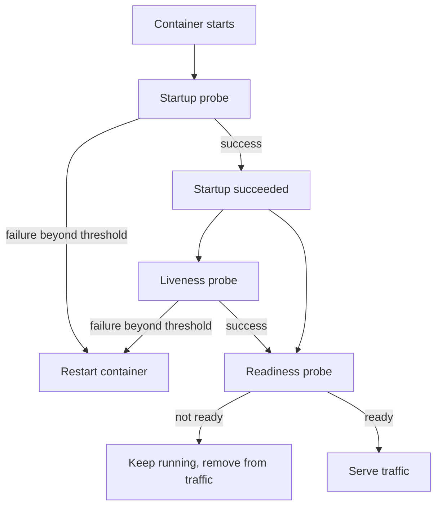

# Liveness State in Spring Boot

In production, an application may still be running yet no longer processing requests properly. For example, the process may be deadlocked, the event loop may stop progressing, or an internal component may enter an unrecoverable state. Kubernetes needs to know when to restart the container. That is the role of **liveness state**. Liveness answers the question: is this process still alive and able to continue running? It differs from readiness, which answers whether the application is currently ready to receive traffic.

The **Liveness state** lesson belongs to the **Health and readiness** chapter of the **SPRING_BOOT_OBSERVABILITY** module. The module guides setting up observability for Spring Boot using Micrometer Observation, metrics, logs, and distributed tracing; learning context propagation, tags/cardinality, exporters, sampling, and signal correlation to investigate errors, latency, and application behavior in production environments.

After this lesson, you will be able to distinguish liveness, readiness, and startup probes; configure Spring Boot Actuator health groups; avoid mechanically putting dependency health into liveness; understand the impact of probe failures on restarts; and test custom health indicators to avoid restart loops.

## 1. What is liveness state?

Liveness is a signal indicating whether a process/container is still in a state where it can continue operating or has become stuck/broken in a way that requires a restart. When a liveness probe fails consecutively beyond the configured threshold, kubelet may restart the container.

Liveness is not a measure of overall system quality. An application can be:

- **Live and ready:** the process is functioning and can receive traffic.
- **Live but not ready:** the process is still running, but has not completed startup, is draining traffic, or a required dependency is temporarily unavailable.
- **Not live:** the process is deadlocked or in an unrecoverable state; a restart may be the recovery action.

A liveness probe failure typically leads to a restart, whereas a readiness probe failure only removes the pod from traffic-serving endpoints. Misusing the two signals can turn a brief dependency outage into a restart storm.

## 2. Distinguishing liveness, readiness, and startup

Kubernetes has three main probe types:

| Probe | Question | On failure |
| --- | --- | --- |
| Startup | Has the application finished starting up? | Container is restarted after exceeding failure threshold |
| Liveness | Is the process still alive and able to keep running? | Kubelet restarts the container |
| Readiness | Can the Pod receive traffic right now? | Pod is removed from Service endpoints until ready again |

A startup probe is useful for slow-starting applications. When a startup probe is configured, Kubernetes delays liveness and readiness checks until the startup probe succeeds.



Probe endpoints should be simple, fast, return stable results, and create no significant load. Do not use an endpoint aggregating all dependencies as liveness if a dependency error does not mean the process needs restarting.

## 3. Why should liveness not check every dependency?

Suppose `orders-service` cannot connect to the database for 30 seconds due to database maintenance. If liveness depends on the database, every pod may report unhealthy and get restarted. Restarting does not fix the database; it only drops more connections, increases startup load, and can trigger a restart loop.

A practical principle:

- **Liveness:** checks the internal state of the process, such as whether the app context is still active and a critical internal invariant has not been broken.
- **Readiness:** checks whether the application can serve traffic under current requirements; may include mandatory dependencies.
- **Startup:** checks that initialization has completed.

There is no rule that readiness must always check all dependencies. Only include a dependency in readiness if requests cannot be safely served when that dependency is unavailable. For some systems, degradation/fallback still permits accepting traffic.

## 4. Spring Boot Actuator provides liveness state

Spring Boot Actuator has health indicators and health groups. When an application uses appropriate Kubernetes probes integration, Actuator can expose health groups for liveness and readiness, typically at these paths:

```text
/actuator/health/liveness
/actuator/health/readiness
```

In Spring Boot versions supporting Kubernetes probes, configuration can enable probe groups on Actuator:

```yaml
management:
  endpoint:
    health:
      probes:
        enabled: true
```

Paths and auto-configuration depend on the Spring Boot version and deployment setup. Verify actual endpoints using Actuator mappings or integration tests. Do not assume a probe group is automatically exposed over the web if an exposure policy restricts endpoints.

Example exposing the health endpoint:

```yaml
management:
  endpoints:
    web:
      exposure:
        include: health
```

If the management port is separate, the Kubernetes probe must access the correct port and path. Also protect the endpoint from access beyond the necessary scope.

## 5. Configuring Kubernetes probes

A Deployment can define separate startup, liveness, and readiness probes:

```yaml
apiVersion: apps/v1
kind: Deployment
metadata:
  name: orders-service
spec:
  replicas: 3
  selector:
    matchLabels:
      app: orders-service
  template:
    metadata:
      labels:
        app: orders-service
    spec:
      containers:
        - name: app
          image: example/orders-service:1.0.0
          ports:
            - name: http
              containerPort: 8080
          startupProbe:
            httpGet:
              path: /actuator/health/liveness
              port: http
            periodSeconds: 5
            failureThreshold: 30
          livenessProbe:
            httpGet:
              path: /actuator/health/liveness
              port: http
            periodSeconds: 10
            timeoutSeconds: 2
            failureThreshold: 3
          readinessProbe:
            httpGet:
              path: /actuator/health/readiness
              port: http
            periodSeconds: 5
            timeoutSeconds: 2
            failureThreshold: 3
```

This is an illustrative configuration. With startup probe `periodSeconds=5` and `failureThreshold=30`, kubelet gives the application roughly 150 seconds for the startup probe to succeed (excluding other scheduling/runtime factors). Choose timeout, period, and thresholds based on actual startup time rather than copying blindly.

If the probe endpoint requires authentication, kubelet HTTP probes will not automatically send arbitrary credentials like a browser login. Design appropriate probe paths/ports/networks; do not open sensitive endpoints publicly just to make probes work.

## 6. Custom liveness indicator

You can create a custom `HealthIndicator` for a truly necessary internal invariant. For example:

```java
import org.springframework.boot.actuate.health.Health;
import org.springframework.boot.actuate.health.HealthIndicator;
import org.springframework.stereotype.Component;

@Component("processState")
class ProcessStateHealthIndicator implements HealthIndicator {
    private final ProcessState processState;

    ProcessStateHealthIndicator(ProcessState processState) {
        this.processState = processState;
    }

    @Override
    public Health health() {
        if (processState.isAcceptingWork()) {
            return Health.up().build();
        }
        return Health.down()
            .withDetail("reason", "process-not-accepting-work")
            .build();
    }
}
```

This is an illustrative example; `ProcessState` is an internal application abstraction. Do not use an arbitrary boolean flag as the sole liveness check if it does not reflect actual ability to make progress. A health indicator must be fast, non-blocking, and independent of remote calls prone to timeouts.

A custom indicator also needs clear semantics: which states can recover via a restart, and which only require stopping incoming traffic? If the process is intentionally draining, it should usually be marked not ready rather than not live.

## 7. Health groups and included components

Health groups let you specify which indicators participate in liveness/readiness. You can configure separate groups instead of letting every indicator automatically affect every probe.

Example group configuration:

```yaml
management:
  endpoint:
    health:
      group:
        liveness:
          include: livenessState
        readiness:
          include: readinessState,db
```

Indicator names `livenessState`, `readinessState`, and `db` depend on auto-configuration/dependencies. Group configuration must be verified against actual health contributors. Spring Boot may auto-configure probe groups when probes are enabled; if declaring groups manually, ensure required indicators are not omitted.

Do not put the database into liveness merely because the database is important. If an unavailable database causes every pod to restart, database recovery can be worsened by a reconnect storm.

## 8. Liveness and graceful shutdown

When an application receives a shutdown signal, it should stop accepting new traffic and finish processing active requests within a bounded time limit. During this phase, readiness should transition to DOWN/OUT_OF_SERVICE so the Service stops routing traffic; liveness typically stays UP until the process actually terminates.

General graceful shutdown flow:

1. Receive SIGTERM or lifecycle stop signal.
2. Mark the application as no longer ready.
3. Stop accepting new requests/messages per the server/container mechanism.
4. Wait for in-flight work to finish within the shutdown timeout.
5. Close resources and terminate the process.

If liveness turns DOWN too early during shutdown, kubelet may restart the container instead of allowing graceful shutdown to finish. Check `terminationGracePeriodSeconds`, the Spring lifecycle timeout, and load balancer propagation delay.

## 9. Avoiding probe flapping and restart loops

Probe flapping occurs when results repeatedly toggle UP/DOWN around thresholds. Causes may include timeouts being too short, CPU throttling, GC pauses, endpoints making remote calls, or overly sensitive health logic.

To reduce flapping:

- Set a timeout large enough for the internal endpoint yet reasonably smaller than the period.
- Use `failureThreshold` to absorb brief spikes.
- Do not perform database/remote HTTP queries in liveness.
- Avoid allocating heavy objects or scanning system-wide state on every probe.
- Monitor probe failure events and restart counts.
- Ensure the probe endpoint does not depend on a thread pool congested by business traffic if management execution can be separated.

Setting `failureThreshold` too high can also lengthen deadlock detection time. Choose parameters based on recovery objectives and application behavior.

## 10. Liveness state and observability signals

Probe state is an orchestrator control signal; metrics/logs/traces explain why the state changed.

Track container restart count and last termination reason, liveness/readiness probe failures, JVM thread count/blocked threads/deadlock detection, CPU throttling/memory pressure/GC pauses, HTTP latency/error rate, startup duration and graceful shutdown duration, along with application logs around the time probes failed.

Do not create a new trace span for every probe request if it creates substantial telemetry noise. You can exclude probe traffic from detailed access logs/metrics or group it separately by route, while still not hiding probe failures from monitoring.

## 11. Testing liveness behavior

| Test | Expectation |
| --- | --- |
| App starts | Startup probe turns UP after initialization completes |
| Healthy process | Liveness UP |
| Dependency unavailable | Readiness may be DOWN; liveness stays UP if the process is still working |
| Process invariant broken | Liveness DOWN only when restart is the appropriate recovery action |
| Graceful shutdown begins | Readiness DOWN before the process exits |
| Slow startup | Startup probe grants sufficient time, avoiding premature restart |
| Probe endpoint timeout | Failures are observed and thresholds operate as expected |
| Remote dependency timeout | Liveness is not dragged DOWN by unnecessary dependency checks |

Example testing a health group:

```java
import org.junit.jupiter.api.Test;
import org.springframework.beans.factory.annotation.Autowired;
import org.springframework.boot.actuate.health.HealthEndpoint;
import org.springframework.boot.test.context.SpringBootTest;
import static org.assertj.core.api.Assertions.assertThat;

@SpringBootTest
class LivenessStateTest {
    @Autowired
    HealthEndpoint healthEndpoint;

    @Test
    void livenessIsUpWhenProcessIsHealthy() {
        assertThat(healthEndpoint.healthForPath("liveness").getStatus())
            .isEqualTo(org.springframework.boot.actuate.health.Status.UP);
    }
}
```

The `healthForPath` API and how groups are accessed may vary by Spring Boot version; this is a directional example. You can use `WebTestClient`/`MockMvc` to test the actual HTTP path and separately test Kubernetes probe behavior in an integration environment.

## 12. Common pitfalls

| Symptom | Possible cause | Investigation approach |
| --- | --- | --- |
| Pod restarts when database temporarily drops | DB indicator merged into liveness | Move dependency check to readiness if appropriate |
| Slow startup causes restart loop | Startup probe not configured or threshold too low | Measure startup duration and increase startup budget |
| Readiness UP before app accepts traffic | Indicator does not reflect actual initialization | Check readiness group and startup lifecycle |
| Probe timeouts under high load | Health endpoint uses a congested thread pool or does heavy work | Keep probes fast, separate management execution if needed |
| Liveness repeatedly flips UP/DOWN | Sensitive timeout/threshold or remote dependency check | Remove remote calls, tune period/threshold |
| Shutdown killed mid-flight | Readiness did not turn DOWN or grace period too short | Check lifecycle, termination grace, and drain |
| Health path returns 404 | Group not created/exposed or path differs by version | Check Actuator endpoint mapping |
| Probe receives 401/403 | Security chain blocks kubelet | Design internal probe access and management network |
| One pod restarts more than other replicas | Resource pressure or process-specific deadlock | Correlate restart reason, JVM/CPU/GC, and logs |

## 13. Real-world scenario: database outage causes a restart storm

**Hypothetical context:** PostgreSQL undergoes brief maintenance. All `orders-service` pods have a liveness check that calls the database. When the DB stops responding, liveness fails and Kubernetes restarts multiple pods. After the DB recovers, pods start up simultaneously, creating a connection storm while readiness remains slow.

Resolution approach:

1. **Classify probes:** confirm that liveness depends on the DB even though the process can still run.
2. **Separate health groups:** liveness reflects only process state; DB availability affects readiness if requests cannot be served when the DB is unavailable.
3. **Reduce restart cascade:** adjust probe groups/config and perform a safe rollout; avoid restarting all replicas simultaneously.
4. **Limit reconnects:** review pool initialization, retry/backoff, and database connection budget.
5. **Verify readiness:** only return pods to the Service once required dependencies have recovered.
6. **Verify:** simulate a DB outage in staging, observing restart count, probe state, queue/HTTP latency, and connection pool behavior.

Liveness should be used to recover broken processes. Readiness controls traffic when the application is still running but unable to serve. Separating these two meanings prevents turning a dependency error into a cluster-wide outage.

## 14. Self-check exercises

**Exercise 1.** How do liveness and readiness differ?

*Hint:* Liveness decides whether the process needs to restart; readiness decides whether the pod receives traffic.

**Exercise 2.** The database is temporarily unavailable, but the process is still functioning. Which probe should reflect this state?

*Hint:* Typically readiness if the DB is required for requests; liveness should remain UP.

**Exercise 3.** How does a startup probe help a slow-starting Spring Boot application?

*Hint:* It defers liveness/readiness until startup finishes, preventing premature restarts.

**Exercise 4.** Why should liveness not make HTTP calls to every downstream service?

*Hint:* A single dependency outage could cause all pods to restart even though the processes are not broken.

**Exercise 5.** When graceful shutdown begins, which state should transition first?

*Hint:* Readiness transitions DOWN to stop routing new traffic; liveness stays UP during drain.

**Exercise 6.** What impact can probe flapping cause?

*Hint:* Unnecessary restarts, reduced traffic capacity, and additional load on dependencies.

**Exercise 7.** If the management endpoint returns 401 to kubelet, what should be done?

*Hint:* Design internal probe access within the proper network/security boundary instead of opening all Actuator endpoints publicly.

**Exercise 8.** How do you verify that a database outage does not cause a restart storm?

*Hint:* Test in staging with DB unavailable; liveness stays UP, readiness goes DOWN per policy, and restart count does not spike abnormally.

## 15. Key takeaways

- **Liveness** indicates whether a process can continue running or needs a restart; **readiness** indicates whether a pod can receive traffic; **startup** protects slow-starting applications.
- Do not put every dependency into liveness. A database outage should generally affect readiness if the process is still running and can recover.
- Spring Boot Actuator health groups provide liveness/readiness states; verify endpoint paths, exposure, and specific version behavior.
- Kubernetes restarts containers after liveness failures exceed thresholds; readiness failures only remove pods from traffic endpoints.
- Use a startup probe to allocate sufficient startup budget; choose period, timeout, and failure thresholds based on observed data.
- During graceful shutdown, transition readiness DOWN first, drain in-flight work, then terminate the process.
- Keep probes fast, internal, and stable; avoid remote calls, blocking work, and dependency cascades that cause flapping/restart storms.
- Combine probe events with restart counts, JVM/CPU/GC metrics, logs, and application metrics to investigate why liveness state changed.
