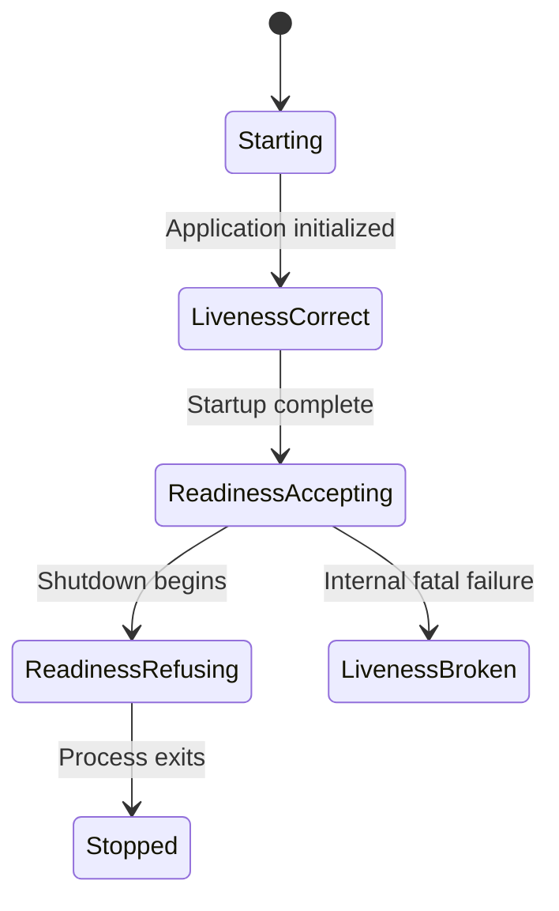

# Application Availability in Spring Boot

A service can be running yet not ready to receive traffic. For example, the JVM has started and the HTTP server has opened a port, but schema migrations have not finished or the connection pool cannot connect to the database yet. Conversely, a secondary dependency such as an email-sending system might fail temporarily while the data-reading API still serves fine. If all signals are collapsed into a single UP/DOWN state, orchestration may restart the service unnecessarily or continue sending traffic to an unready instance.

**Application availability** describes the ability of an instance or service to participate in serving workloads at a given moment. In Spring Boot Actuator, health indicators and health groups provide statuses that distinguish liveness from readiness. Liveness answers whether the process needs to be restarted; readiness answers whether the instance should receive traffic. Startup probes give applications a long startup window before liveness/readiness checks take effect.

Availability is an operational decision, not simply whether every dependency is UP. You must choose which components directly affect serving capability, when checks run, and what actions the platform takes when the state changes.

This lesson belongs to the **Health and readiness** chapter of the **SPRING_BOOT_OBSERVABILITY** module. The module guides setting up observability for Spring Boot using Micrometer Observation, metrics, logs, and distributed tracing; learning context propagation, tags/cardinality, exporters, sampling, and signal correlation to investigate errors, latency, and application behavior in production environments. This lesson focuses on application availability, liveness/readiness, startup, dependency policies, and coordination with the orchestration platform.

## Learning objectives

1. Explain application availability and Spring Boot health statuses.
2. Distinguish liveness, readiness, and startup probes.
3. Decide which dependencies should affect readiness and which should not affect liveness.
4. Configure Actuator health groups and endpoint exposure.
5. Design appropriate `HealthIndicator`/`ReactiveHealthIndicator` implementations.
6. Understand how Kubernetes uses probes to restart containers or stop routing traffic.
7. Combine startup, graceful startup/shutdown, and readiness transitions.
8. Avoid restart loops and cascading failures caused by poorly designed health checks.
9. Test UP, DOWN, OUT_OF_SERVICE, and UNKNOWN states.
10. Diagnose availability issues using health, metrics, logs, and deployment signals.

## 1. What is application availability?

Application availability is the ability of an instance to handle the workload it was deployed to serve. An API may still serve read requests even if a secondary reporting dependency is failing; a worker may be healthy yet should not accept new messages while the queue consumer is shutting down.

A health response typically includes status (UP, DOWN, OUT_OF_SERVICE, or UNKNOWN), components, and details depending on configuration and access permissions.

Example response:

```json
{
  "status": "UP",
  "components": {
    "readinessState": { "status": "UP" },
    "db": { "status": "UP" }
  }
}
```

The structure of components/details depends on the health group and show-details policy. Do not assume every component is always visible to anonymous callers.

### 1.1. Process health and service availability

An alive process does not prove the service can handle traffic. The JVM may be partially deadlocked, out of worker threads, unable to connect to the database, or not finished starting up. Therefore, a single probe is insufficient to answer all operational questions.

### 1.2. Instance availability and system availability

The readiness of an instance only indicates whether that instance can accept traffic. The overall service can still operate when one replica is NOT_READY if other replicas are healthy and have capacity. Conversely, if every instance is READY yet a shared dependency is overloaded, the service can still degrade.

## 2. Liveness, readiness, and startup

| Probe | Question | What does the platform usually do on failure? |
|---|---|---|
| Liveness | Is the process stuck/broken to the point of needing a restart? | Restart the container/process |
| Readiness | Can the instance accept new requests/messages? | Stop sending traffic or stop assigning work |
| Startup | Has the application finished the startup phase? | Defer liveness/readiness until startup succeeds |

### 2.1. Liveness

Liveness should reflect the internal state of the process. If liveness depends on a database or remote API, an external outage can cause all replicas to fail liveness simultaneously and restart repeatedly. Restarting does not fix a database outage and further increases reconnection load.

Spring Boot can provide a liveness state indicator in Actuator when availability support is configured appropriately. Verify the actual endpoint group for your version.

### 2.2. Readiness

Readiness reflects whether the instance is ready to accept workload. Factors can include startup completion, listener readiness, local initialization, and dependencies truly mandatory for the request path.

Do not put every optional dependency into readiness. If an email provider temporarily fails while the API can still serve requests, marking the whole service NOT_READY can unnecessarily reduce capacity.

### 2.3. Startup probe

Startup probes are meant for slow-starting applications, such as loading caches, migrations, or warm-ups. Before the startup probe succeeds, Kubernetes can defer liveness/readiness checks per configuration. This prevents liveness from restarting the application simply because startup takes time.

A startup probe does not replace readiness: after startup, an instance may still not be ready to receive traffic.

## 3. Spring Boot AvailabilityState

Spring Boot provides an application availability model with state events, typically consisting of:
- `LivenessState`: `CORRECT` or `BROKEN`.
- `ReadinessState`: `ACCEPTING_TRAFFIC` or `REFUSING_TRAFFIC`.

Events reflect application lifecycle states. Actuator health groups can expose these states through health endpoints.



Event/class names and publishing timing depend on the Spring Boot version. Applications can publish readiness/liveness events when lifecycle control is needed, but should not toggle states on every transient dependency error without a clear policy.

### 3.1. Readiness on startup

When the application context is ready but the app has not finished warming up, readiness can stay `REFUSING_TRAFFIC`. Once warm-up finishes, the state transitions to `ACCEPTING_TRAFFIC`. The platform only routes traffic once the instance is genuinely ready.

### 3.2. Readiness on shutdown

When graceful shutdown begins, the application should stop accepting new work. Readiness transitions to `REFUSING_TRAFFIC` so the platform removes the instance from traffic, after which the server completes in-flight requests within the shutdown timeout.

## 4. Health groups in Actuator

Health groups let you separate health indicators by purpose. Spring Boot typically provides `liveness` and `readiness` groups when availability probes are enabled or via configuration.

Example:

```yaml
management:
  endpoint:
    health:
      probes:
        enabled: true
      group:
        liveness:
          include: livenessState
        readiness:
          include: readinessState,db
```

This is an illustrative configuration. Including `db` in readiness is only appropriate if the database is truly required for the instance to serve its workload. Evaluate the dependency policy before adding indicators.

### 4.1. Endpoint paths

```http
GET /actuator/health
GET /actuator/health/liveness
GET /actuator/health/readiness
```

Context path, management base path/port, and exposure policies can change URLs. Only expose health groups needed by the platform.

### 4.2. Component details

Health details can contain hostnames, database names, URLs, or error messages. Only show details to authorized roles. Orchestrator probes typically only need status.

## 5. Dependency health and readiness policy

| Dependency | Potential impact | Suggested readiness policy |
|---|---|---|
| Primary database for all requests | Unable to process most traffic | Can affect readiness |
| Optional reporting database | Only affects reporting | Does not necessarily affect API readiness |
| Email provider | Sending mail can be retried/queued | Usually does not mark API NOT_READY |
| Payment provider | Only affects payment operations | Decide based on contract/fallback |
| Cache | Can fall back to database | Evaluate fallback/capacity |
| Message broker for worker | Worker cannot receive/ack messages | Can affect worker readiness |
| Remote config service | Only needed at startup/refresh | Policy based on cache/fallback |

### 5.1. Do not put dependencies into liveness

A database outage usually does not mean the JVM needs to restart. If the database is included in liveness, all replicas can restart during an outage, creating a connection storm when the DB recovers.

### 5.2. Readiness and partial degradation

A service may still serve most endpoints when a secondary dependency fails. You can apply a workload-based readiness policy or split deployments/services by capability. Do not use a single aggregate indicator to represent all features if they have different serving capabilities.

### 5.3. Timeouts and health check frequency

Health checks need short timeouts and bounded concurrency. A probe that runs expensive queries or waits long on dependencies can itself add load while the system is degraded. Use lightweight queries, explicit timeouts, and avoid checking every dependency on every probe if unnecessary.

## 6. Creating a custom HealthIndicator

When an internal capability needs checking, you can create a `HealthIndicator`. Example component checking local initialization:

```java
@Component
class CacheWarmupHealthIndicator implements HealthIndicator {
    private final CacheWarmupState warmupState;

    CacheWarmupHealthIndicator(CacheWarmupState warmupState) {
        this.warmupState = warmupState;
    }

    @Override
    public Health health() {
        if (warmupState.isComplete()) {
            return Health.up().build();
        }
        return Health.outOfService()
                .withDetail("reason", "cache-warmup-in-progress")
                .build();
    }
}
```

This is a conceptual example. The indicator should read existing state rather than running warm-up or calling remote operations on each health check.

### 6.1. Health status mapping

Spring Boot has status ordering and mapping to aggregate component statuses. `OUT_OF_SERVICE` typically means a component temporarily cannot serve; `DOWN` indicates failure; `UNKNOWN` indicates undetermined state. The platform needs clear mapping of which statuses cause probes to fail.

### 6.2. ReactiveHealthIndicator

Reactive applications can use `ReactiveHealthIndicator` for asynchronous checks. Health checks still need timeouts and must not generate excessive load. Avoid blocking event-loop threads when calling dependencies.

## 7. Kubernetes probes

Kubernetes can call Actuator health group endpoints from `livenessProbe`, `readinessProbe`, and `startupProbe`.

Example deployment snippet:

```yaml
livenessProbe:
  httpGet:
    path: /actuator/health/liveness
    port: 8080
  periodSeconds: 10
  timeoutSeconds: 2
  failureThreshold: 3

readinessProbe:
  httpGet:
    path: /actuator/health/readiness
    port: 8080
  periodSeconds: 5
  timeoutSeconds: 2
  failureThreshold: 2

startupProbe:
  httpGet:
    path: /actuator/health/liveness
    port: 8080
  periodSeconds: 5
  timeoutSeconds: 2
  failureThreshold: 30
```

Values are illustrative. Choose paths/ports matching the management server and timings based on startup duration, recovery, and SLOs.

### 7.1. Liveness failure

When a liveness probe fails enough times to exceed its threshold, Kubernetes restarts the container. Use liveness for unrecoverable internal errors, not for every dependency outage.

### 7.2. Readiness failure

When readiness fails, the Pod is marked not ready and usually removed from Service endpoints for new traffic. The container is not necessarily restarted.

### 7.3. Startup probe

Startup probes protect slow-starting applications. When configured, Kubernetes defers liveness/readiness checks until startup succeeds. Size `failureThreshold x periodSeconds` large enough for a reasonable worst-case startup.

## 8. Graceful startup and shutdown

Availability is a state transition, not just a point-in-time check.

Startup:
1. Initialize application context.
2. Initialize server and required dependencies.
3. Run migrations/warm-up per deployment design.
4. Transition readiness to `ACCEPTING_TRAFFIC` once able to serve.

Shutdown:
1. Receive shutdown signal.
2. Transition readiness to `REFUSING_TRAFFIC`.
3. Stop accepting new requests/messages.
4. Complete in-flight work within timeout.
5. Close connection pools, executors, and resources.
6. Exit the process.

Spring Boot graceful shutdown can be configured via server shutdown properties depending on version:

```yaml
server:
  shutdown: graceful
spring:
  lifecycle:
    timeout-per-shutdown-phase: 30s
```

Kubernetes `terminationGracePeriodSeconds` must exceed the expected drain/shutdown time. If the platform kills the process before the application finishes, in-flight requests may fail.

### 8.1. Readiness propagation

Readiness transitions take time for the platform to update endpoints/load balancers. Do not assume that as soon as the application changes state, all network routes have stopped. Design `preStop`/drain and shutdown timeouts to fit the platform.

### 8.2. Background workers

Workers should stop polling/consuming new messages when shutdown starts, while completing or requeuing in-flight work per broker semantics. Worker readiness should reflect the ability to accept new work.

## 9. Availability and autoscaling

Readiness is not an autoscaling signal. A `NOT_READY` Pod may be removed from traffic, but autoscalers typically rely on CPU, memory, custom metrics, or queue depth. If readiness fails due to insufficient capacity, a separate scaling policy is needed.

Liveness restarts do not replace autoscaling either. When high load exhausts a worker pool, restarts can temporarily reduce capacity and increase load on remaining replicas.

### 9.1. Probe flapping

If readiness fluctuates due to dependency latency or overly sensitive thresholds, a Pod can repeatedly enter and leave Service endpoints. Use appropriate `period`/`failureThreshold`/`successThreshold`, reasonable timeouts, and stable indicators.

### 9.2. Dependency storm

If every Pod probes the same remote dependency every few seconds, health checks can create extra load during an outage. Use locally cached state, timeouts, jitter, or reduced check frequency as required.

## 10. Securing health endpoints

Health endpoints can disclose database status, internal service names, hostnames, and exception details.

- Only expose necessary health groups.
- Restrict network access to management endpoints.
- Use status-only responses for probes that do not need details.
- Enable `show-details` only for administrative roles.
- Do not include credentials/tokens in `HealthIndicator` details.
- Do not call arbitrary URLs from input to check health.
- Protect custom indicators from SSRF or resource exhaustion.
- Ensure the orchestrator is permitted to access the right endpoint.

Status-only probes can be exposed inside the cluster network; diagnostic health details should require authentication.

## 11. Testing availability behavior

### 11.1. Testing health groups

Use Spring Boot tests to call liveness/readiness endpoints and assert statuses according to application availability state. Verify dependency indicators are only in their intended groups.

### 11.2. Testing startup transitions

Initialize the application with warm-up incomplete and assert readiness is NOT_READY/OUT_OF_SERVICE per policy; after warm-up completes, assert readiness is UP. Use latches/state controls instead of long sleeps.

### 11.3. Testing dependency outages

Simulate an unavailable database/remote dependency. Verify liveness stays UP if the process is still healthy, readiness changes only when the dependency is truly mandatory, optional dependency outages do not take the service down outside policy, and probe timeouts do not create cascading load.

### 11.4. Testing graceful shutdown

Start a long-running request, trigger shutdown, and verify readiness switches to `REFUSING_TRAFFIC`, in-flight requests complete within timeout, workers stop accepting new work, and resources close in order.

### 11.5. Testing Kubernetes behavior

In a staging/integration environment, verify Pod readiness conditions, Service endpoints, restart counts, and termination behavior. Unit testing health indicators does not prove manifest probes are configured correctly.

## 12. Diagnosing abnormal availability

| Symptom | Possible cause | Investigation method |
|---|---|---|
| Pods restart repeatedly during DB outage | DB indicator is inside liveness | Check liveness group |
| Pod runs but receives no traffic | Readiness is DOWN/OUT_OF_SERVICE | Readiness health and endpoint conditions |
| Startup probe timeout | Threshold shorter than actual startup | Startup duration and probe budget |
| Readiness flapping | Dependency latency or sensitive threshold | Probe history, indicator timing |
| All replicas NOT_READY | Shared dependency or overly broad indicator | Dependency policy and health group |
| Health endpoint slow | Indicator calls remote/blocking dependency | Per-indicator duration and thread dumps |
| Health UP yet requests fail | Probe does not represent real capability | Readiness scope and request SLO |
| Shutdown drops requests | Drain/grace period too short | Readiness transition and termination logs |
| Worker consumes messages during shutdown | Consumer not coordinated with lifecycle | Listener container lifecycle |
| Health details leak internals | Broad show-details/exposure policy | Security config and payload |

### Investigation workflow

1. Identify which probe is failing: startup, liveness, or readiness.
2. Check endpoint URL, management port, and response status.
3. Read component details per access permissions.
4. Identify the indicator determining the aggregate status.
5. Compare dependency outage with process health and request capability.
6. Check probe `timeout`, `period`, `failureThreshold`, and `successThreshold`.
7. Inspect logs/metrics for indicator duration, thread saturation, and dependency latency.
8. Check Pod events, restart count, and Service endpoints.
9. Inspect graceful startup/shutdown and in-flight requests.
10. Adjust health policy and test in a production-like environment.

## 13. Anti-patterns to avoid

| Anti-pattern | Consequence | Proper approach |
|---|---|---|
| Putting database checks in liveness | Restart storm during DB outage | Focus liveness on the process |
| Merging all optional dependencies into readiness | Unnecessary capacity loss | Base readiness on workload capability |
| Using info/metrics endpoints as probes | Does not measure readiness/liveness | Use health groups |
| Health check calling remote API without timeout | Probe hangs and adds load | Short timeout, cache/local state |
| Exposing health details publicly | Leaks topology/error details | Status-only for probes, secure details |
| Readiness flapping on brief errors | Traffic constantly shifts across replicas | Thresholds/hysteresis |
| Treating readiness failure as restart | Misunderstanding platform action | Readiness removes traffic; liveness restarts |
| Missing startup probe for slow-starting apps | Premature liveness restarts | Appropriate startup probe budget |
| Shutting down before draining | Lost in-flight work | Graceful shutdown and termination grace |
| Using health as an autoscaling signal | Improper scaling behavior | Autoscale using workload/capacity metrics |

## 14. Production checklist

1. **Semantics:** Do liveness, readiness, and startup serve distinct purposes?
2. **Liveness:** Does it only reflect internal errors requiring a restart?
3. **Readiness:** Does it reflect actual workload-serving capability?
4. **Dependencies:** Do only mandatory dependencies affect readiness?
5. **Startup:** Is the probe budget sufficient for cold starts/warm-up?
6. **Groups:** Do health groups include the right indicators?
7. **Timeouts:** Do probes and indicators have short timeouts?
8. **Load:** Do health checks avoid generating heavy load during outages?
9. **Security:** Are details shown only to authorized roles?
10. **Kubernetes:** Do path/port/period/threshold match the deployment?
11. **Transitions:** Does readiness drain traffic before shutdown?
12. **Graceful:** Do in-flight requests/messages have time to finish?
13. **Workers:** Do consumers stop accepting new work during shutdown?
14. **Testing:** Are there dependency outage, warm-up, flapping, and shutdown tests?
15. **Observability:** Are probe history, indicator duration, and restart events monitored?
16. **Runbook:** Is there guidance to distinguish app failures, dependency outages, and orchestration misconfigurations?

## 15. Self-assessment questions

**Question 1.** What question does liveness answer?

**Hint:** Whether the process is broken/stuck to the point of needing a restart; not whether every dependency is healthy.

**Question 2.** How does readiness differ from liveness?

**Hint:** Readiness decides whether the instance receives new workload; liveness decides whether the process needs restarting.

**Question 3.** What problem does a startup probe solve?

**Hint:** Gives applications a long startup period before liveness/readiness checks start taking effect.

**Question 4.** Why should a database outage not automatically mark liveness DOWN?

**Hint:** Restarting does not fix the database and can create a reconnect storm across the whole deployment.

**Question 5.** Should an optional email provider failure mark the API NOT_READY?

**Hint:** No, if the API still serves its core workload and emails can be queued/retried.

**Question 6.** What can OUT_OF_SERVICE indicate?

**Hint:** A component/instance should temporarily not serve traffic per health policy.

**Question 7.** Why should a health indicator be fast and have a timeout?

**Hint:** Probes run periodically; a slow indicator can add extra load and cause widespread probe failures.

**Question 8.** What does Kubernetes usually do when readiness fails?

**Hint:** Marks the Pod not ready and removes it from Service endpoints for new traffic; does not necessarily restart the container.

**Question 9.** When shutdown begins, how should readiness transition?

**Hint:** Transition to `REFUSING_TRAFFIC` to stop accepting new work before draining and closing resources.

**Question 10.** Why must manifest probes be tested in Kubernetes/staging?

**Hint:** Unit testing an indicator does not verify paths/ports/thresholds, Pod conditions, Service endpoints, and restart behavior.

## Conclusion

**Application availability requires distinguishing between an alive process, an instance ready to receive workload, and the startup phase.** Spring Boot Actuator health groups together with `LivenessState`/`ReadinessState` express these states; Kubernetes uses liveness to restart, readiness to stop routing traffic, and startup probes to protect slow-starting applications. Keep liveness independent of dependency outages, include only mandatory dependencies in readiness, bound the time and load of health indicators, and coordinate readiness transitions with graceful shutdown. Test dependency outages, warm-up, probe flapping, and rollouts in a production-like environment to avoid restart storms, lost capacity, or premature traffic.
