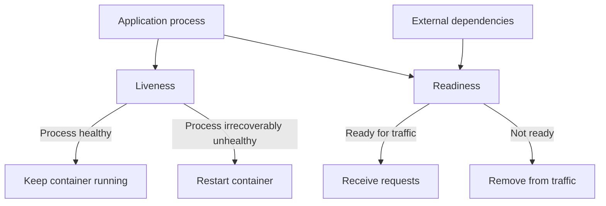
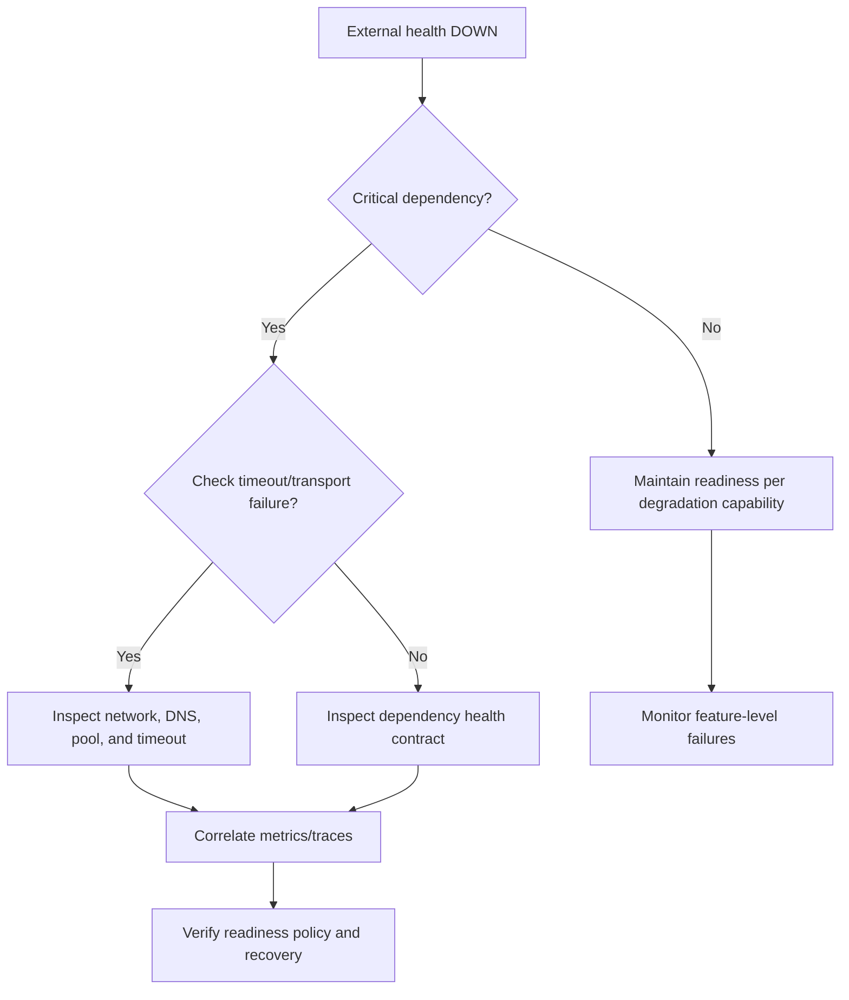

# External Service Health in Spring Boot

A Spring Boot service typically depends on databases, message brokers, identity providers, or external HTTP APIs. When a dependency encounters an issue, operators need to know whether that dependency is reachable and whether the incident affects the application's ability to serve requests.

Spring Boot Actuator allows integrating dependency status into the health endpoint via `HealthIndicator` or `ReactiveHealthIndicator`. However, **external service health does not mean every dependency must always be healthy for the application to be considered ready**. A non-essential dependency may temporarily fail while the service still handles most functions; mechanically placing every dependency into readiness can reduce capacity and cause cascading failures.

The **“External service health”** lesson belongs to the **Health and readiness** chapter of the **SPRING_BOOT_OBSERVABILITY** module. The module teaches how to set up observability for Spring Boot using Micrometer Observation, metrics, logs, and distributed tracing; learning context propagation, tags/cardinality, exporters, sampling, and signal correlation to investigate errors, latency, and application behavior in production environments.

## 1. What is external service health?

External service health is the observable state of systems the application needs to call or use. Examples:

- A database serving business data reads/writes.
- Kafka/RabbitMQ receiving and sending events.
- An identity provider issuing tokens or verifying identities.
- A payment gateway processing payments.
- A search service handling search queries.
- A partner's HTTP API.

A health check usually performs a small operation to confirm the dependency can respond within a time limit. The result can be surfaced through the Actuator health endpoint and used for operations.

Health checks do not replace full monitoring. A single successful ping does not prove the dependency satisfies all business queries, throughput, or target latency.

## 2. HealthIndicator and ReactiveHealthIndicator

Spring Boot Actuator provides primary extension points:

| Interface | Used for |
| --- | --- |
| HealthIndicator | Synchronous checks |
| ReactiveHealthIndicator | Reactive/non-blocking checks |
| CompositeHealthContributor | Grouping multiple health contributors |
| HealthContributor | General contributor abstraction |

Example synchronous health indicator for an external HTTP service:

```java
import org.springframework.boot.actuate.health.Health;
import org.springframework.boot.actuate.health.HealthIndicator;
import org.springframework.stereotype.Component;
import org.springframework.web.client.RestClient;

@Component
public class PartnerApiHealthIndicator implements HealthIndicator {

    private final RestClient restClient;

    public PartnerApiHealthIndicator(RestClient.Builder builder) {
        this.restClient = builder
                .baseUrl("https://partner.example")
                .build();
    }

    @Override
    public Health health() {
        try {
            restClient.get()
                    .uri("/health")
                    .retrieve()
                    .toBodilessEntity();

            return Health.up()
                    .withDetail("dependency", "partner-api")
                    .build();
        }
        catch (Exception ex) {
            return Health.down()
                    .withDetail("dependency", "partner-api")
                    .withDetail("reason", ex.getClass().getSimpleName())
                    .build();
        }
    }
}
```

This is an illustrative example; the partner's health endpoint and status policy must be verified against the actual contract. Do not return exception messages, URLs containing credentials, or sensitive response bodies in health details.

For reactive applications, use `ReactiveHealthIndicator` and a corresponding reactive client. Never call a blocking `RestClient` from a reactive event loop.

## 3. Readiness and liveness serve different purposes

Kubernetes and Spring Boot distinguish two questions:

- **Liveness:** is the process still functioning well enough to continue running? If liveness fails, the orchestrator may restart the container.
- **Readiness:** is the instance ready to receive new traffic? If readiness fails, the orchestrator usually removes the instance from service endpoints.

External dependency health is often related to readiness, yet not every dependency should fail readiness. Liveness should generally not depend on remote services: a database outage does not mean the JVM/process is broken and needs restarting.

Spring Boot can provide health groups for readiness and liveness, such as the corresponding actuator health groups. Check your application's configuration and version before customizing.



Do not put an external dependency into the liveness group merely because it is important to some business operations.

## 4. Dependency criticality: which dependencies affect readiness?

Classify dependencies by business role:

| Dependency | Example impact when unavailable | Readiness consideration |
| --- | --- | --- |
| Critical | Service cannot serve most requests | Can affect readiness |
| Feature-specific | Only one group of features fails | Evaluate readiness per service/traffic model |
| Optional | Has fallback/cache or degrades gracefully | Usually should not mark whole instance unready |
| Background-only | Only serves async jobs | Can have a separate health group |
| Observability backend | Telemetry export is interrupted | Usually should not mark business service unready |

For example, if the payment gateway is unavailable while the checkout service can still read orders, display status, and handle non-payment operations, marking the whole instance DOWN can eliminate capacity unnecessarily.

Readiness policy must answer: if this dependency is down, which requests can the instance serve? Is there a fallback? Is there a queue/buffer? Can controlled errors be returned for that specific feature?

## 5. Integrating built-in health contributors

Spring Boot Actuator includes auto-configured health contributors for many technologies when the corresponding dependency is present. For example, databases, Redis, messaging, or Elasticsearch may have dedicated indicators depending on starter and version.

Before writing a custom indicator:

1. Check which contributors Actuator has already auto-registered.
2. See whether the contributor matches the health semantics you need to measure.
3. Check whether it is included in the readiness group.
4. Only write a custom indicator when different check operations or custom metadata are needed.
5. Avoid creating two checks repeatedly calling the same dependency.

Auto-configured indicators can be enabled/disabled via corresponding configuration properties. Property names depend on the contributor; consult documentation for your exact version rather than guessing.

## 6. Timeouts and bounded health checks

The health endpoint can be called frequently by orchestrators, load balancers, and monitoring systems. If each check triggers an unbounded slow HTTP call, the health check itself can consume threads/connections and worsen the application's state.

Principles:

- Set short, finite connect/read/overall timeouts.
- Bound concurrency of health checks.
- Do not perform multiple retries inside a single probe.
- Use lightweight requests; do not run full business workflows.
- Do not load large payloads or scan the entire database.
- Use a bulkhead if health checks could compete for resources with traffic.
- Consider short-term result caching if probe frequency is high.
- Keep the health check budget below the orchestrator/probe timeout.

A 1-2 second timeout is only an example; pick values according to network, dependency SLOs, and probe intervals. Do not use excessively long timeouts that hang the readiness endpoint and cause overlapping probes.

## 7. Caching and check frequency

If multiple probes call the health endpoint every few seconds and each call queries 5 dependencies, the check traffic volume can become significant.

Health results can be cached briefly or updated via a separate periodic check. Balance carefully:

- Long caches make status stale.
- Too-short caches hit dependencies with too many probes.
- Periodic checks need to update status during app startup/recovery.
- Health responses should include a timestamp/age if freshness must be assessed.
- Avoid having many replicas create a thundering herd against the dependency simultaneously.

Do not cache a DOWN state for too long once the dependency recovers and the service needs to regain readiness. Likewise, do not report UP solely because an old check succeeded when it is past due.

## 8. Status mapping and health details

The Health API uses statuses such as `UP`, `DOWN`, `OUT_OF_SERVICE`, and `UNKNOWN`. The status aggregator determines the overall status when multiple contributors exist.

Example health response:

```json
{
  "status": "UP",
  "components": {
    "partnerApi": {
      "status": "UP",
      "details": {
        "dependency": "partner-api"
      }
    }
  }
}
```

Do not expose sensitive details on a public health endpoint. The management endpoint can provide a more detailed representation for operators, while public/LB probes only need the aggregated status.

If custom statuses are used, configure status ordering/HTTP mapping appropriately so load balancers and orchestrators interpret them accurately. Do not assume every non-UP status maps to the same HTTP code in every configuration.

## 9. Health groups for readiness and dependency checks

Health groups can be defined to separate probe concerns. Conceptual example:

```yaml
management:
  endpoint:
    health:
      group:
        readiness:
          include: readinessState,db,partnerApi
        liveness:
          include: livenessState
```

This is an illustrative configuration. Contributor IDs must match actual names in the Actuator context; do not copy the example verbatim if the app has no `db` or `partnerApi` contributor.

Only include `partnerApi` in readiness if the service cannot accept valid traffic when the partner API is down. If only one endpoint depends on the partner, consider keeping the overall service readiness UP and letting that specific request return an error/degrade.

## 10. Avoiding cascading failures

When a dependency slows down, health checks can time out en masse. If readiness fails across all replicas, the orchestrator removes every instance from traffic. This can leave the service unable to serve requests it could still handle.

Some mitigations:

- Include only critical dependencies in readiness.
- Use short timeouts and bounded concurrency.
- Use circuit breakers to stop calling a failing dependency.
- Use fallbacks/caches/queues when business semantics permit.
- Separate background worker health from HTTP-serving readiness if needed.
- Avoid making liveness depend on remote dependencies.
- Monitor ready replica counts alongside dependency failures.

Health checks must not trigger a feedback loop: dependency down -> probe down -> all replicas removed -> traffic concentrated on fewer remaining instances -> overload -> more probe failures.

## 11. Circuit breakers and health status

A circuit breaker protects application calls by opening the circuit when a dependency's failure rate or latency exceeds thresholds. A health indicator can observe circuit state, but an OPEN circuit should not automatically equate to an unhealthy process.

| Circuit state | Meaning | Health interpretation |
| --- | --- | --- |
| CLOSED | Calls are permitted through | Dependency path is being used normally |
| OPEN | Calls are blocked temporarily | Dependency has issues; service may still serve fallbacks |
| HALF_OPEN | A few probe calls are permitted | Testing recovery |

If readiness is tied to circuit OPEN, determine whether the service can still handle other traffic. Circuit breakers and readiness have different goals: one protects dependency calls; the other decides whether the instance receives traffic.

## 12. Health checks and dependency SLOs

The health endpoint is generally a binary/coarse-grained signal, not a replacement for SLO dashboards.

To observe a dependency better, track:

- Request rate to the dependency.
- Error rate by status/error type.
- Latency histograms/percentiles.
- Connection pool active/idle/pending.
- Timeouts and circuit breaker states.
- Retry counts and retry exhaustion.
- Broker lag or queue depth if the dependency is messaging.
- Health status and timestamp of the last successful check.

Metrics/traces show impact severity and root causes; the health endpoint helps orchestration decide traffic placement. Never use a single probe as proof that a dependency meets its SLO.

## 13. Securing the health endpoint

Health details can leak topology, hostnames, database types, broker names, or internal error information.

- Expose a public endpoint with minimal status if needed for a load balancer.
- Protect detailed management endpoints with authentication/authorization.
- Never return credentials, connection strings, raw exception messages, or internal IPs unnecessarily.
- Restrict network access.
- Use TLS for management traffic.
- Inspect responses when dependencies are DOWN to ensure no sensitive info leaks.

Do not mistake the health endpoint for a full diagnostic endpoint. Operators can use logs/traces/metrics in access-controlled systems for deep investigation.

## 14. Testing external service health

A test suite should cover statuses and impact on readiness:

1. Dependency responds successfully within timeout.
2. Dependency returns HTTP errors or protocol errors.
3. DNS resolution fails.
4. Connection refused and connect timeout.
5. Dependency responds slower than health timeout.
6. Non-essential dependency is DOWN yet readiness stays UP per policy.
7. Critical dependency DOWN causes readiness to become OUT_OF_SERVICE/DOWN per policy.
8. Liveness remains UP when external dependencies are down.
9. Health checks do not retry infinitely or create overlapping requests.
10. Cached results expire and refresh.
11. Dependency recovery restores readiness to UP.
12. Security rules hide details from unauthorized callers.

Use a mock server/test container or stubbed dependency. Do not depend on real production systems in unit/integration tests.

## 15. Diagnosing incorrect external service health

| Symptom | Possible cause | How to check |
| --- | --- | --- |
| Readiness DOWN even though service can still serve | Optional dependency included in readiness | Review criticality and group membership |
| Liveness DOWN during database outage | Liveness depends on remote service | Check only process/local state |
| Health endpoint slow | Probe calls dependency without timeout | Set bounded timeout and concurrency |
| Dependency overloaded by probes | High probe frequency or synchronized replicas | Cache/periodic checks/jitter |
| Status stays UP when dependency is down | Contributor not registered or errors swallowed | Check contributor and error mapping |
| Status stays DOWN after recovery | Stale cached state or refresh error | Check cache age and refresh mechanism |
| Public health leaks details | Overly broad show-details policy | Separate public/management health groups |
| All replicas removed from traffic | Readiness depends on too many dependencies | Include only critical dependencies |
| Circuit OPEN forces readiness DOWN | Two concepts coupled improperly | Evaluate fallbacks and remaining servable features |
| Probes trigger retry storm | Health indicator retries internally | Remove retries or cap attempts |

Investigation workflow:

1. Inspect which health group is failing.
2. Identify the specific contributor and dependency criticality.
3. Check timeout, error mapping, and check timing.
4. Correlate dependency metrics/traces.
5. Inspect circuit breakers, pool metrics, and retry counts.
6. Check readiness/liveness membership.
7. Verify recovery and cache freshness.
8. Verify response details/security.



## 16. Practice: external health indicator

Perform locally/in test:

1. Create a Spring Boot application with Actuator.
2. Create a mock external HTTP service with a health endpoint.
3. Implement a `HealthIndicator` with short, finite connect/read timeouts.
4. Expose the health endpoint and inspect component status.
5. Create a readiness group containing the critical dependency.
6. Bring an optional dependency DOWN and verify readiness follows the desired policy.
7. Stop the critical dependency and verify readiness changes while liveness stays UP.
8. Restart the dependency and verify readiness recovery.
9. Add short caching or a periodic check if probe frequency requires it; test cache freshness.
10. Secure health details and verify unauthorized callers only see appropriate status.
11. Monitor the request count of health checks to ensure no probe storm is created.

Expected outcome: the health contributor accurately reflects the dependency, readiness expresses traffic-accepting capability, liveness is independent of remote outages, and checks have explicit timeouts/budgets.

## 17. Self-check questions

1. How does external service health differ from the health of the process itself?
2. How do `HealthIndicator` and `ReactiveHealthIndicator` differ?
3. Why are external dependencies usually related more to readiness than liveness?
4. Should an optional dependency being DOWN mark the entire service unready?
5. How should health check timeouts be bounded?
6. Why can probe retries place load on an already failing dependency?
7. When is caching or a periodic health check needed?
8. How are configured statuses and HTTP status mappings related?
9. Does circuit breaker OPEN always mean the application is unhealthy?
10. Are queue residence time/latency fully measured by health checks?
11. How do you avoid a readiness cascade when a dependency goes down?
12. What information can health details disclose?
13. What do metrics/traces add compared to the health endpoint?
14. Which tests prove liveness stays UP when an external dependency is down?
15. How do you verify readiness recovers after a dependency returns?

## References

- [Spring Boot — Actuator Health Endpoint](https://docs.spring.io/spring-boot/reference/actuator/endpoints.html#actuator.endpoints.health): health contributors, statuses, and health groups.
- [Spring Boot — Kubernetes Probes](https://docs.spring.io/spring-boot/reference/actuator/endpoints.html#actuator.endpoints.kubernetes-probes): liveness/readiness integration.
- [Spring Boot — Health Groups](https://docs.spring.io/spring-boot/reference/actuator/endpoints.html#actuator.endpoints.health.groups): configuring groups and component membership.
- [Spring Framework — WebClient](https://docs.spring.io/spring-framework/reference/web/webflux-webclient.html): reactive HTTP client.
- [Micrometer Observation](https://docs.micrometer.io/micrometer/reference/observation.html): metrics/tracing correlation to investigate dependencies.
- [Resilience4j — CircuitBreaker](https://resilience4j.readme.io/docs/circuitbreaker): circuit breaker states and failure/slow-call thresholds.

## Conclusion

**External service health indicates whether the dependencies an application needs are responding to health checks.** Spring Boot Actuator allows adding `HealthIndicator`/`ReactiveHealthIndicator` and grouping them into readiness or appropriate health groups. Readiness determines whether an instance should receive traffic; liveness determines whether the process needs restarting.

Select dependencies by criticality, set finite timeouts and bounded concurrency, avoid retry storms, secure health details, and test both outages and recovery. Never let an optional dependency mark an entire service unready or let a remote outage trigger cascading liveness restarts. Combine health status with dependency metrics, traces, pool signals, and logs to understand actual impact and restore traffic safely.
