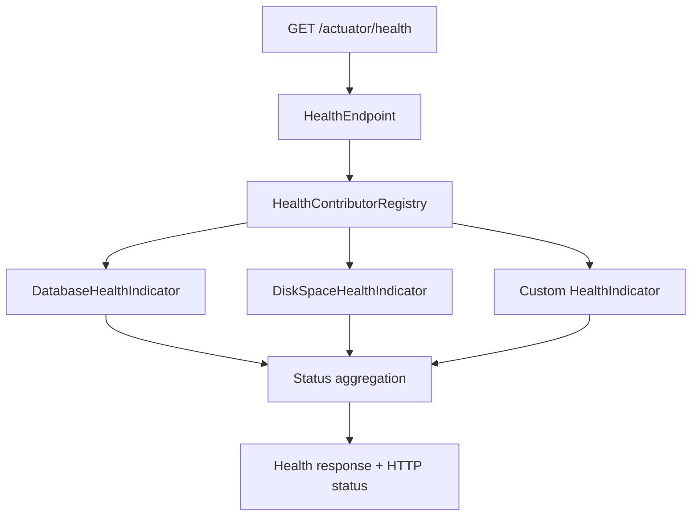

# Health Endpoint Details in Spring Boot Actuator

## 1. Objective and context

The health endpoint indicates whether an application is in a suitable state to continue receiving traffic. In Spring Boot Actuator, `/actuator/health` aggregates results from `HealthIndicator` and `ReactiveHealthIndicator` beans, returning an overall status along with component information depending on the display configuration.

The health endpoint can serve multiple consumers: load balancers, orchestrators, monitoring systems, and operators. Each audience needs a different level of information. Kubernetes probes typically only need an UP/DOWN status; internal dashboards may need component details; public users should never see database names, hosts, buckets, or internal exceptions.

This lesson belongs to the **Health and readiness** chapter of the **SPRING_BOOT_OBSERVABILITY** module. The module guides setting up observability for Spring Boot using Micrometer Observation, metrics, logs, and distributed tracing; learning context propagation, tags/cardinality, exporters, sampling, and signal correlation to investigate errors, latency, and application behavior in production environments.

After this lesson, you will be able to:
1. Understand how Actuator aggregates health contributors.
2. Distinguish aggregate status from component details.
3. Configure detail visibility levels based on access permissions.
4. Organize health groups and liveness/readiness endpoints.
5. Write safe custom `HealthIndicator` implementations.
6. Avoid putting unnecessary external dependencies into liveness probes.
7. Test responses, status mapping, and security.

**Baseline:** Spring Boot 3.5.x, Java 17+, Spring Boot Actuator. Some health contributors appear automatically when their corresponding dependency is present; exact properties should be cross-checked against your version.

## 2. How does the health endpoint work?

Default endpoint:

```text
GET /actuator/health
```

Actuator collects results from registered health contributors. Each contributor returns a `Status` such as `UP`, `DOWN`, `OUT_OF_SERVICE`, or `UNKNOWN`, optionally with details. `HealthEndpoint` aggregates them into a final health result according to the status aggregator and HTTP mapping.



The health endpoint does not automatically test all business functions. It only aggregates contributors registered and included in the queried group.

## 3. Aggregate status and component details

A simple response may look like this:

```json
{
  "status": "UP"
}
```

When details are permitted to be shown, the response may contain components:

```json
{
  "status": "UP",
  "components": {
    "db": {
      "status": "UP",
      "details": {
        "database": "PostgreSQL"
      }
    },
    "diskSpace": {
      "status": "UP"
    }
  }
}
```

This is a condensed example; actual contents depend on contributors, version, and show-details policy.

Aggregate status answers the overall question. Component details explain which components contributed to that result. Do not rely on component ordering or treat component names as a fixed API contract if the application may add or remove dependencies.

## 4. Controlling health details visibility

Spring Boot supports configuring detail visibility:

```yaml
management:
  endpoint:
    health:
      show-details: when-authorized
      show-components: when-authorized
```

Common values for `show-details`/`show-components` include:

| Value | Behavior |
| --- | --- |
| `never` | Do not show details/components |
| `when-authorized` | Show only when the request is authenticated/authorized per security configuration |
| `always` | Show to every caller able to access the endpoint |

`always` is only suitable for controlled environments where the endpoint is not publicly reachable and information is permitted to be exposed. In production, prefer `never` or `when-authorized` paired with a specific security policy.

For instance, security may allow an operations team to view details while probes only read status. Integrate matchers into the existing `SecurityFilterChain`; do not create a new chain that overrides other policies.

Do not assume `when-authorized` creates authentication on its own. The application must have Spring Security or an equivalent authorization mechanism, and the principal must satisfy the configured condition.

## 5. Health groups

Health groups allow defining separate sets of contributors and visibility policies. Example group for readiness:

```yaml
management:
  endpoint:
    health:
      group:
        readiness:
          include: readinessState,db
          show-details: never
```

Group endpoints can be accessed via `/actuator/health/{group}`, such as `/actuator/health/readiness`. Default groups `liveness` and `readiness` can be provided when probes integration is enabled under the right configuration.

Groups allow you to:
- Include only relevant contributors for a probe.
- Apply a dedicated `show-details`/`show-components` policy.
- Set a separate status mapping when needed.
- Separate overall health from health used for traffic decisions.

Do not put every dependency into every group. Liveness and readiness answer different questions, so their contributor sets should differ.

## 6. Liveness and readiness

**Liveness** answers: is the process alive and able to continue running? If liveness fails repeatedly, the orchestrator may restart the container.

**Readiness** answers: is the instance currently ready to receive traffic? If readiness fails, the orchestrator/load balancer should stop sending traffic to that instance without necessarily restarting the process.

| Probe | Goal | Example contributors |
| --- | --- | --- |
| Liveness | Detect an unrecoverable process | `livenessState` |
| Readiness | Detect an instance not yet able to accept requests | `readinessState`, truly mandatory dependencies per policy |
| Overall health | Aggregate picture of contributors | DB, disk, messaging, custom indicators |

Do not include databases, remote APIs, or message brokers in the liveness probe by default. If a database temporarily goes down, restarting all instances can cause a restart loop and increase load on the failing dependency. Liveness should focus on internal process state.

Readiness can include dependencies mandatory for serving traffic, though failure modes must be weighed. If all instances transition to `NOT_READY` simultaneously due to a shared dependency, the system may stop serving entirely; that may be intended or may widen the outage.

## 7. Enabling Kubernetes probes in Spring Boot

Spring Boot can expose liveness/readiness health groups via Actuator when probes are enabled:

```yaml
management:
  endpoint:
    health:
      probes:
        enabled: true
  health:
    livenessstate:
      enabled: true
    readinessstate:
      enabled: true
```

In Kubernetes environments, common paths are:

```text
/actuator/health/liveness
/actuator/health/readiness
```

Example Pod probe configuration:

```yaml
livenessProbe:
  httpGet:
    path: /actuator/health/liveness
    port: 8080
  periodSeconds: 10
  failureThreshold: 3

readinessProbe:
  httpGet:
    path: /actuator/health/readiness
    port: 8080
  periodSeconds: 5
  failureThreshold: 3
```

This is a snippet for the container spec; adjust port/path to match your application. If management endpoints reside on a separate port, Kubernetes probes must be able to reach that port and network policies must permit it.

Spring Boot can expose probe paths on the main server port in certain configurations to test the actual web server path as well. Consider using the main port when you want probes to reflect real HTTP handling capability rather than only a separate management server.

## 8. Writing a custom HealthIndicator

When needing to check a dependency or business state, you can write a `HealthIndicator`:

```java
import org.springframework.boot.actuate.health.Health;
import org.springframework.boot.actuate.health.HealthIndicator;
import org.springframework.stereotype.Component;

@Component
public class SearchIndexHealthIndicator implements HealthIndicator {
    private final SearchIndexClient client;

    public SearchIndexHealthIndicator(SearchIndexClient client) {
        this.client = client;
    }

    @Override
    public Health health() {
        try {
            boolean available = client.isAvailable();
            if (available) {
                return Health.up()
                        .withDetail("service", "search-index")
                        .build();
            }
            return Health.down()
                    .withDetail("reason", "not available")
                    .build();
        } catch (Exception ex) {
            return Health.down(ex).build();
        }
    }
}
```

A `HealthIndicator` must be fast, have a timeout, and not generate heavy load. If `client.isAvailable()` can wait indefinitely or run heavy queries, the health endpoint itself can hang and cause widespread probe failures.

Do not place exception messages, internal hostnames, credentials, or sensitive payloads into details. Even when details are hidden, avoid putting sensitive data into the `Health` object unnecessarily.

### 8.1. Reactive HealthIndicator

For reactive dependencies, use `ReactiveHealthIndicator` so health checks do not block the event loop:

```java
import org.springframework.boot.actuate.health.Health;
import org.springframework.boot.actuate.health.ReactiveHealthIndicator;
import reactor.core.publisher.Mono;

public class ReactiveSearchHealthIndicator
        implements ReactiveHealthIndicator {

    private final ReactiveSearchClient client;

    public ReactiveSearchHealthIndicator(ReactiveSearchClient client) {
        this.client = client;
    }

    @Override
    public Mono<Health> health() {
        return client.ping()
                .timeout(Duration.ofSeconds(2))
                .map(ok -> ok
                        ? Health.up().build()
                        : Health.down().build())
                .onErrorResume(ex -> Mono.just(Health.down().build()));
    }
}
```

The example needs a `Duration` import and a client with an actual reactive API. Choose a short, intentional timeout; do not log full exceptions on every probe failure if probes run continuously.

## 9. Status aggregation and HTTP status mapping

Actuator aggregates statuses from contributors via `StatusAggregator`. By default, more severe statuses take precedence in the aggregated result. Precedence order and mappings can be customized.

HTTP status mapping determines the health endpoint's response code based on the aggregate status. Typically UP returns 200; DOWN or OUT_OF_SERVICE returns 503; UNKNOWN usually has its own default mapping. Check documentation for your exact version when modifying status codes or order.

Status order can be configured:

```yaml
management:
  endpoint:
    health:
      status:
        order: DOWN, OUT_OF_SERVICE, UNKNOWN, UP
```

Do not change status mapping arbitrarily. Orchestrators often rely on HTTP status codes to decide restarts or stop routing traffic; an incorrect mapping can turn dependency degradation into a restart loop or send traffic to an unready instance.

## 10. Health checks are not deep diagnostics

The health endpoint is typically called frequently. It should answer a status question quickly, reliably, and at low cost. Avoid:
- Running full database queries or large data scans.
- Calling multiple remote APIs sequentially without timeouts.
- Opening write transactions just to test.
- Fetching secrets or returning configuration details.
- Writing stack traces for every probe failure.
- Adding optional dependencies to readiness without justification.

Deep diagnostics belong on dedicated internal endpoints, dashboards, logs, traces, or synthetic checks scheduled less frequently. Health probes must stay light enough not to become a source of incidents themselves.

## 11. Testing the health endpoint

### 11.1. Verifying the HTTP response

Use integration tests with the Spring context and Actuator:

```java
mockMvc.perform(get("/actuator/health"))
        .andExpect(status().isOk())
        .andExpect(jsonPath("$.status").value("UP"));
```

The example requires static imports `MockMvcRequestBuilders.get`, `MockMvcResultMatchers.*`, and appropriate test configuration. When health is DOWN, confirm the expected status mapping (usually 503).

### 11.2. Testing details policy

- Anonymous callers cannot see component details when policy requires authorization.
- Principals with the right authority can view details when permitted.
- No passwords, tokens, SQL, sensitive hosts, or exception messages appear in the response.
- Group endpoints contain only configured contributors.

### 11.3. Testing probes

- Liveness remains UP when the database is temporarily down, if the database is not a process-liveness condition.
- Readiness is DOWN when a mandatory dependency cannot serve traffic, per policy.
- Probes have finite timeouts and do not block request threads indefinitely.
- Custom indicators do not call remote dependencies too frequently or generate heavy load.

## 12. Troubleshooting

| Symptom | Possible cause | Resolution |
| --- | --- | --- |
| `/actuator/health` returns 404 | Actuator missing or endpoint not exposed | Check dependency and web exposure |
| Only status visible, no components | `show-details`/`show-components` hidden | Check policy and caller permissions |
| Details always visible publicly | `show-details=always` or overly broad security matcher | Switch to `when-authorized`/`never` and narrow access |
| Health DOWN even though app serves requests | Secondary/optional contributor is DOWN | Inspect component details and design groups |
| Liveness fails when database is down | External dependency placed in liveness | Keep liveness focused on the process |
| Readiness always UP even before warm-up | Missing appropriate readiness state/contributor | Enable readiness probes and update state in lifecycle |
| Probe timeout | `HealthIndicator` calls slow dependency or lacks timeout | Add timeout and reduce probe work |
| Reactive health blocks event loop | Blocking indicator/client used in reactive stack | Use `ReactiveHealthIndicator`/non-blocking client |
| Kubernetes restarts repeatedly | Wrong liveness path/status mapping or aggressive probe | Inspect events, thresholds, initial delay, and semantics |
| Pod receives no traffic even though healthy | Wrong readiness path/port or group DOWN | Inspect probe config and service routing |
| Security returns 401/403 to kubelet | Probe path blocked by authentication | Permit probe via safe network/identity policy |
| Response leaks exceptions/hosts | Custom indicator adds sensitive details | Remove or sanitize details |

## 13. Production checklist

- [ ] Health endpoint exposed only within required scope.
- [ ] `show-details`/`show-components` do not expose internal info to unauthorized callers.
- [ ] Security policy distinguishes probe callers from operators authorized to view details.
- [ ] Liveness focuses on the process's ability to self-recover.
- [ ] Readiness reflects ability to receive traffic per dependency policy.
- [ ] External dependencies are not included in liveness by default.
- [ ] Custom indicators have timeouts, low cost, and emit no sensitive data.
- [ ] Reactive applications use reactive health checks for non-blocking I/O.
- [ ] Health groups include only the needed contributors.
- [ ] HTTP status mapping suits the orchestrator.
- [ ] Kubernetes path/port/thresholds verified in deployment.
- [ ] Tests cover UP, DOWN, details visibility, readiness, and liveness.

## 14. Self-practice questions

1. Which components does `/actuator/health` aggregate results from?
2. How does aggregate status differ from component details?
3. What security prerequisites does `show-details: when-authorized` require?
4. Why should health details not be exposed publicly?
5. Which two different questions do liveness and readiness answer?
6. Why should a database outage usually not fail liveness?
7. When should readiness check external dependencies?
8. How should a custom `HealthIndicator` bound time and cost?
9. What problem does `ReactiveHealthIndicator` help avoid?
10. How do `StatusAggregator` and HTTP status mapping affect Kubernetes?
11. Why should a health probe not become a deep diagnostic?
12. Which scenarios should be tested before deploying probes?

## References

- [Spring Boot 3.5 — Actuator Endpoints](https://docs.spring.io/spring-boot/3.5/reference/actuator/endpoints.html)
- [Spring Boot 3.5 — Health Information](https://docs.spring.io/spring-boot/3.5/reference/actuator/endpoints.html#actuator.endpoints.health)
- [Spring Boot 3.5 — Kubernetes Probes](https://docs.spring.io/spring-boot/3.5/reference/actuator/endpoints.html#actuator.endpoints.kubernetes-probes)
- [Spring Boot 3.5 — Monitoring and Management](https://docs.spring.io/spring-boot/3.5/reference/actuator/index.html)
- [Kubernetes — Liveness, Readiness and Startup Probes](https://kubernetes.io/docs/concepts/configuration/liveness-readiness-startup-probes/)
- [Micrometer — Observation Concepts](https://docs.micrometer.io/micrometer/reference/observation.html)
