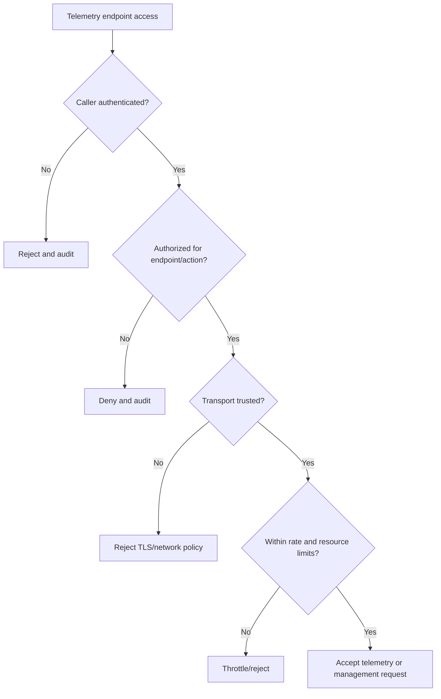

# Securing Telemetry Endpoints in Spring Boot

Telemetry endpoints provide critical data and operations for operations teams: Actuator health/metrics/loggers, application management endpoints, and OTLP receivers that ingest logs, metrics, and traces. If left with uncontrolled access, attackers or unauthorized internal users can inspect topology, change log levels, collect sensitive data, or exhaust resources with telemetry traffic.

**Securing telemetry endpoints** requires combining authentication, authorization, network segmentation, TLS, resource limits, and data policies. There is no single configuration suitable for every endpoint: public health may return only minimal status, whereas loggers, env, heapdump, or OTLP ingestion require much stricter access scopes.

The lesson **“Securing Telemetry Endpoints”** belongs to the **Security and Privacy** chapter of the **SPRING_BOOT_OBSERVABILITY** module. This module guides you through setting up observability for Spring Boot with Micrometer Observation, metrics, logs, and distributed tracing; learning context propagation, tags/cardinality, exporters, sampling, and signal correlation to investigate errors, latency, and application behavior in production environments.

## 1. Classifying Telemetry Endpoints

There are two common groups of endpoints:

| Group | Examples | Primary Risks |
| --- | --- | --- |
| Application management | Actuator health, metrics, loggers, env, configprops, heapdump | Internal information disclosure or runtime modification |
| Telemetry transport | OTLP HTTP/gRPC receivers, Prometheus scrape endpoint, remote-write/export endpoints | Data spoofing, ingestion spam, unauthorized read/write, resource exhaustion |

Actuator endpoints expose the application's state and administrative operations. An OTLP receiver is where agents/SDKs send telemetry into a Collector or service. A Prometheus scrape endpoint is typically called by an internal scraper to read metrics. Each endpoint needs its own policy based on caller, direction, and data sensitivity.

Do not treat all endpoints as read-only. The loggers endpoint can modify runtime log levels; shutdown or heapdump/configuration endpoints can have severe impact depending on the application and version.

## 2. Principle of Least Privilege

Each caller should only access the exact endpoints and operations it needs.

- Public load balancers only need minimal health status if the architecture requires it.
- Prometheus scrapers only need read access to the metrics endpoint.
- Operators may need health details and the loggers endpoint.
- Telemetry agents only send data to the designated OTLP receiver.
- Developers should not have default access to read env, heapdump, or loggers in production.
- Each workload's service account should not share credentials with human operators.

Separate read permissions from mutating permissions. A principal may be allowed to GET health but not POST to change a logger level. Use roles/groups aligned with responsibilities and audit administrative actions.

## 3. Exposure Is Not Authentication

Spring Boot Actuator lets you choose which endpoints are exposed over HTTP or JMX. For example:

```yaml
management:
  endpoints:
    web:
      exposure:
        include: health,info,metrics,prometheus
```

The configuration above only controls endpoint exposure. It does not automatically protect endpoints with authentication, authorization, or network policy.

Do not use `include=*` on a public interface. Expose only the endpoints that are actually needed, and apply independent security controls. Also check JMX exposure if the application enables JMX management.

An endpoint not exposed over HTTP can still be exposed via JMX or another management port. Inventory every transport rather than checking only the `/actuator` URL.

## 4. Separating Management Port and Network

Spring Boot can run management endpoints on a separate port:

```yaml
management:
  server:
    port: 9091
```

Separating the port helps apply dedicated firewalls, service routing, and network policies. However, a separate port does not create security by itself; if it binds to all network interfaces and the firewall is left wide open, endpoints remain reachable from unwanted zones.

Network design should:

- Allow access only from the monitoring network or management subnet.
- Avoid publishing the management port through public ingress unless needed.
- Use Kubernetes NetworkPolicy, security groups, or firewall rules.
- Restrict egress of telemetry agents to the exact collector/backend.
- Separate management traffic from user-facing traffic when possible.
- Verify that a service mesh or proxy does not accidentally expose management routes.

If the application runs in containers, inspect the actual port mappings and service definitions, not just `application.yml`.

## 5. Authentication and Authorization with Spring Security

Authentication verifies who the caller is; authorization decides what the caller is allowed to do. Spring Security can protect Actuator endpoints with a dedicated or shared filter chain depending on the application.

Conceptual policy example:

```java
@Bean
@Order(1)
SecurityFilterChain actuatorSecurity(HttpSecurity http) throws Exception {
    return http
            .securityMatcher(EndpointRequest.toAnyEndpoint())
            .authorizeHttpRequests(auth -> auth
                    .requestMatchers(EndpointRequest.to("health", "info"))
                        .permitAll()
                    .requestMatchers(EndpointRequest.to("prometheus"))
                        .hasRole("METRICS")
                    .requestMatchers(EndpointRequest.to("loggers"))
                        .hasRole("OPS")
                    .anyRequest().hasRole("ACTUATOR_ADMIN"))
            .httpBasic(Customizer.withDefaults())
            .build();
}
```

This is an illustrative example; you need to add an authentication provider, credential management, an appropriate CSRF policy, and a filter chain for application routes. Verify endpoint IDs and the Spring Boot/Security version. If the application defines its own `SecurityFilterChain`, default security auto-configuration may no longer apply as expected.

Do not grant the `ADMIN` role to a scraper that only reads metrics. Use a dedicated service account and a narrow role.

## 6. Protecting State-Changing Operations

| Endpoint | Permission/Risk |
| --- | --- |
| health | Minimal status can be public; details need protection |
| metrics/prometheus | Can expose service names, route patterns, topology, and business volumes |
| loggers | Can modify runtime log levels |
| env/configprops | Can expose configuration and sensitive information if sanitized incorrectly |
| heapdump | Can contain secrets, tokens, and user data |
| threaddump | Can expose thread names, class names, and runtime state |
| shutdown | Can stop the application if enabled |
| mappings | Can expose route/API structure |

Expose only necessary endpoints. Sensitive endpoints should require a dedicated administrative role, auditing, and management network access. Do not expose heapdump/env/loggers just for debugging convenience.

## 7. CSRF and HTTP Methods

Spring Security CSRF protection can affect POST/DELETE operations on management endpoints. Do not disable CSRF globally just to make Actuator POST requests work.

If using Basic Auth for machine-to-machine management APIs, evaluate the CSRF threat model based on browser credentials, cookie/session usage, and endpoint exposure. You can use a separate filter chain for Actuator with precise matchers and a CSRF policy scoped appropriately.

Do not exempt all application routes from CSRF if only a management endpoint needs machine-to-machine access. Test both GET and POST and verify that unauthorized callers cannot modify state.

## 8. TLS and mTLS

Management and telemetry traffic often traverse internal networks, but internal does not mean completely safe. Use TLS to protect confidentiality and integrity on the transport.

- Server-side TLS for HTTPS management endpoints and OTLP receivers.
- mTLS when both client and server identity must be verified.
- Clear certificate rotation processes and expiration schedules.
- Never disable certificate validation in production.
- Restrict the trust store to only the required CAs.
- Protect private keys and avoid storing them in source control.
- Use TLS termination at a gateway only when the downstream hop is also protected within the trust boundary.

For OTLP gRPC/HTTP, configure TLS and client authentication according to the receiver/exporter implementation. Verify the protocol endpoint, certificate SANs, trust chain, and hostname verification.

## 9. Protecting the OTLP Receiver

An OTLP receiver ingests telemetry from SDKs, agents, or services. If the receiver is open to untrusted sources, an attacker can send forged data, inflate ingestion costs, or flood memory and CPU.

1. Bind the receiver only to the required interface/network.
2. Use TLS/mTLS or an appropriate authentication extension.
3. Allowlist workload identities/network sources when possible.
4. Limit request size, concurrency, and rate.
5. Configure a memory limiter, batch processor, and queue bounds.
6. Monitor rejected requests, refused spans, and exporter failures.
7. Separate tenant/resource identity according to trust boundaries.
8. Do not trust client-supplied resource attributes if they determine authorization or routing.

Example OTLP receiver binding only to an internal address and using a memory limiter:

```yaml
receivers:
  otlp:
    protocols:
      grpc:
        endpoint: 10.20.0.15:4317
      http:
        endpoint: 10.20.0.15:4318

processors:
  memory_limiter:
    check_interval: 1s
    limit_mib: 512
  batch:
    timeout: 5s

service:
  pipelines:
    traces:
      receivers: [otlp]
      processors: [memory_limiter, batch]
      exporters: [otlp/backend]
```

This is an illustrative configuration; the `otlp/backend` exporter must be defined and the receiver requires TLS/auth per deployment. Do not copy sample IP addresses into production.

## 10. Protecting the Prometheus Scrape Endpoint

Prometheus typically scrapes metrics from an internal endpoint. Metrics can reveal service names, instance labels, deployment topology, route patterns, request volume, error rates, queue names, dependency names, or sensitive custom business metrics.

Allow only trusted scrapers to access the endpoint. Use network policies, mTLS, or authentication via a reverse proxy/service mesh when appropriate. Never put secrets, user IDs, or raw request values into labels.

The Prometheus endpoint is usually scraped via GET, but GET does not mean the data is public. A read-only endpoint can still disclose sensitive operational information.

## 11. Secrets and Credential Management

Credentials for Actuator, OTLP exporters, Prometheus gateways, or backends should not be hard-coded in committed YAML files.

- Use a secret manager, Kubernetes Secrets with encryption at rest, or a platform vault.
- Inject credentials via environment variables or secret volumes according to policy.
- Rotate credentials and revoke them if a workload is compromised.
- Use dedicated service accounts per environment/workload.
- Never write tokens/passwords into logs or telemetry attributes.
- Avoid passing credentials in query strings.
- Limit token scope and lifetime.

Do not place secrets in resource attributes, baggage, span names, metric labels, or health details. These fields are frequently exported to multiple systems with different retention policies.

## 12. Privacy: What Data Can Telemetry Contain?

Logs, traces, and metrics can carry personal or business-sensitive data if instrumentation records too broadly.

| Signal | Potentially Leaked Data | Control |
| --- | --- | --- |
| Logs | Request body, headers, email, tokens, SQL params | Allowlist, redaction at the producer |
| Traces | URL/query, span attributes, exception details, baggage | Attribute policy, processor redaction |
| Metrics | Labels such as userId/orderId or tenant ID | Cardinality review, label allowlist |
| Health | Hostnames, dependency names, exception text | Details policy and access control |
| Dumps | Heap objects, credentials, payloads | Never expose publicly; tightly restrict access |

Prioritize not collecting sensitive data at the producer in the first place. Redaction in the Collector is an additional defense layer; you cannot recall data already sent to another backend or exporter earlier.

## 13. Multi-Tenant Isolation and Resource Attributes

If a Collector/backend serves multiple tenants, do not trust a client-supplied tenant ID in resource attributes as the basis for authorization. An untrusted client can spoof a tenant and write data into another tenant's namespace if the gateway routes solely on that field.

Tenant identity should be authenticated from an mTLS identity, token claim, or gateway context. Afterward, the gateway/collector attaches trusted tenant metadata and strips or overwrites any client-provided value.

Isolate credentials, queues, retention, and query permissions per tenant. Check both the read path and the write path; tenant isolation is not just ingest routing.

## 14. Rate Limiting and Resource Protection

Telemetry endpoints can be overloaded by abnormal traffic or instrumentation bugs.

- Limit request rate and payload size at the gateway/receiver.
- Limit concurrent requests.
- Use bounded queues and a memory limiter.
- Set timeouts for exporter/backend calls.
- Configure bounded retries and backoff.
- Monitor queue utilization, dropped data, and refused requests.
- Separate telemetry workloads from application request pools if needed.
- Enforce quotas per tenant/workload.

Do not retry indefinitely when the backend is unavailable. Unbounded retries can grow queues and cause OOM. Bound retries/queues and alert when data is dropped.

## 15. Auditing and Incident Response

Operations that modify management state should be audited:

- Who called the endpoint?
- From which workload/network?
- Which endpoint/action?
- Which logger/setting changed?
- What were the before/after values?
- What was the timestamp and correlation/request ID?
- Was the operation accepted or denied?

Do not write credentials or sensitive payloads into audit logs. Audit trails need separate access permissions and appropriate retention.

When suspecting telemetry endpoint abuse:

1. Identify the endpoint, caller identity, and timestamp.
2. Collect access/security logs.
3. Check changes to logger levels, configuration, and resource usage.
4. Revoke/rotate affected credentials.
5. Tighten network exposure and rate limits.
6. Check the telemetry backend for forged data or tenant crossover.
7. Restore configuration and verify that monitoring still works.

## 16. Security Testing for Telemetry Endpoints

Test both allowed and denied access:

1. Unauthenticated callers hitting Actuator metrics/loggers are blocked per policy.
2. Metrics scrapers can only read the granted metrics endpoint.
3. Scrapers cannot POST to loggers.
4. Operators are allowed to change logger levels within their authorized scope.
5. Unauthorized users are denied when reading env/heapdump.
6. Public health returns only minimal status if policy requires it.
7. OTLP receivers reject clients without credentials.
8. Invalid client certificates are rejected when using mTLS.
9. Oversized payloads/high rates are throttled or rejected.
10. Spoofed tenant identities cannot route into another tenant.
11. TLS hostname/certificate validation is active.
12. Security/audit logs record caller/action without recording secrets.
13. Endpoints are not exposed via unexpected ports/ingresses.
14. Secret rotation does not leave the telemetry pipeline unprotected.

Use MockMvc/WebTestClient for Actuator security integration tests and test deployment/network policies in staging. Unit tests do not prove that firewalls or Kubernetes NetworkPolicies are configured correctly.

## 17. Troubleshooting Telemetry Endpoint Access Issues

| Symptom | Possible Cause | How to Check |
| --- | --- | --- |
| 401 Unauthorized | Missing/invalid credentials or expired token | Check identity provider and auth logs |
| 403 Forbidden | Principal lacks role/authority | Check authorization matcher |
| 404 Not Found | Endpoint not exposed or wrong management port/path | Check exposure and routing |
| Scraper cannot scrape | Network policy, TLS, or auth mismatch | Check target status, certificate, and firewall |
| OTLP receiver gets data from unknown source | Receiver bound too broadly or missing authentication | Check listener, gateway, and network source |
| Telemetry dropped | Rate limit, full queue, or memory limiter | Check receiver/processor/exporter metrics |
| Metrics expose topology | Endpoint accessible too broadly | Narrow exposure and scrape network |
| Tenant data mixed | Trusting client-supplied tenant resource attribute | Authenticate identity at the gateway |
| DEBUG logs contain secrets | Missing logging policy/redaction | Disable level, rotate secrets, and remediate data |
| Management POST rejected by CSRF | CSRF policy unsuitable for machine caller | Check dedicated filter chain; do not disable globally |

Investigation workflow:

1. Identify the endpoint and transport (HTTP, JMX, OTLP gRPC/HTTP, scrape).
2. Check exposure, bind address, and routing.
3. Verify caller identity and credentials.
4. Check the specific authorization rule.
5. Check TLS chain/hostname and mTLS identity.
6. Check rate limits, payload size, queue, and memory.
7. Check privacy/redaction and tenant mapping.
8. Cross-check audit/security logs and confirm the policy has been restored.



## 18. Hands-On Exercise: Securing Actuator and OTLP

Perform in local/staging:

1. Expose health, metrics, and loggers; keep sensitive endpoints unexposed.
2. Separate the management port from the application port.
3. Configure a dedicated Spring Security filter chain for Actuator.
4. Allow minimal health status and a metrics scraper role; restrict loggers to operators.
5. Test GET/POST requests and verify permissions for each role.
6. Enable HTTPS for management endpoints; verify certificates/hostnames.
7. Configure the OTLP receiver to bind only to an internal interface.
8. Enable TLS/authentication or mTLS per deployment.
9. Add a memory limiter, batch processor, and bounded queues.
10. Test oversized payloads/traffic bursts to verify rate/resource limits.
11. Verify redaction for logs/traces and remove secrets.
12. Test a spoofed tenant ID and verify the gateway uses trusted identity.
13. Check audit records for logger operations and access denied events.
14. Verify the Prometheus scraper can still scrape after tightening policy.

Expected result: each caller accesses only the right endpoints/actions; telemetry transport is protected; sensitive data is not inadvertently exported; the pipeline continues operating within resource limits.

## 19. Self-Check Questions

1. How do Actuator management endpoints and OTLP receivers differ?
2. Why does endpoint exposure not replace authentication?
3. How does least privilege apply to operators and metrics scrapers?
4. When should you separate the management port?
5. Why does the Loggers endpoint need separate write permissions?
6. What sensitive data can heapdump/env contain?
7. How should the CSRF policy be scoped for management endpoints?
8. Which sides do TLS and mTLS protect?
9. How do you protect an OTLP receiver from unknown data senders?
10. Why should you not trust a client-supplied tenant ID?
11. What topology information can a metrics endpoint reveal?
12. What are the limitations of redaction at the Collector?
13. How do rate limiting and bounded queues protect a receiver?
14. What information should an audit trail record?
15. How do you test authorization separately for GET and POST?
16. Why do unit tests not prove that a NetworkPolicy is correct?

## References

- [Spring Boot — Actuator Endpoints](https://docs.spring.io/spring-boot/reference/actuator/endpoints.html): exposure, endpoint access, and security.
- [Spring Boot — Actuator Security](https://docs.spring.io/spring-boot/reference/actuator/endpoints.html#actuator.endpoints.security): securing management endpoints.
- [Spring Security — Servlet Authorization](https://docs.spring.io/spring-security/reference/servlet/authorization/index.html): request authorization and filter chains.
- [Spring Boot — SSL](https://docs.spring.io/spring-boot/reference/features/ssl.html): TLS/SSL configuration.
- [OpenTelemetry Collector — Security](https://opentelemetry.io/docs/security/config-best-practices/): collector deployment and security best practices.
- [OpenTelemetry Protocol](https://opentelemetry.io/docs/specs/otlp/): OTLP transport and protocol.
- [Micrometer Observation](https://docs.micrometer.io/micrometer/reference/observation.html): Observation, handlers, and telemetry lifecycle.

## Conclusion

**Securing telemetry endpoints requires controlling both the humans/systems reading or administering the application and the workloads sending telemetry.** Actuator exposure requires authentication, authorization, and a management network; OTLP receivers require sender authentication, TLS, payload/rate limits, and resource bounds; Prometheus scrape endpoints also need protection because metrics can reveal internal topology and operations.

Apply least privilege, separate read/write permissions, avoid exposing sensitive endpoints, centralize secret management, redact at the source, and audit administrative actions. Test HTTP, JMX, OTLP, and network paths to confirm the policy actually takes effect. When the management plane and telemetry transport are properly secured, operations teams can observe the system while reducing the risk of data leakage or endpoint abuse.
