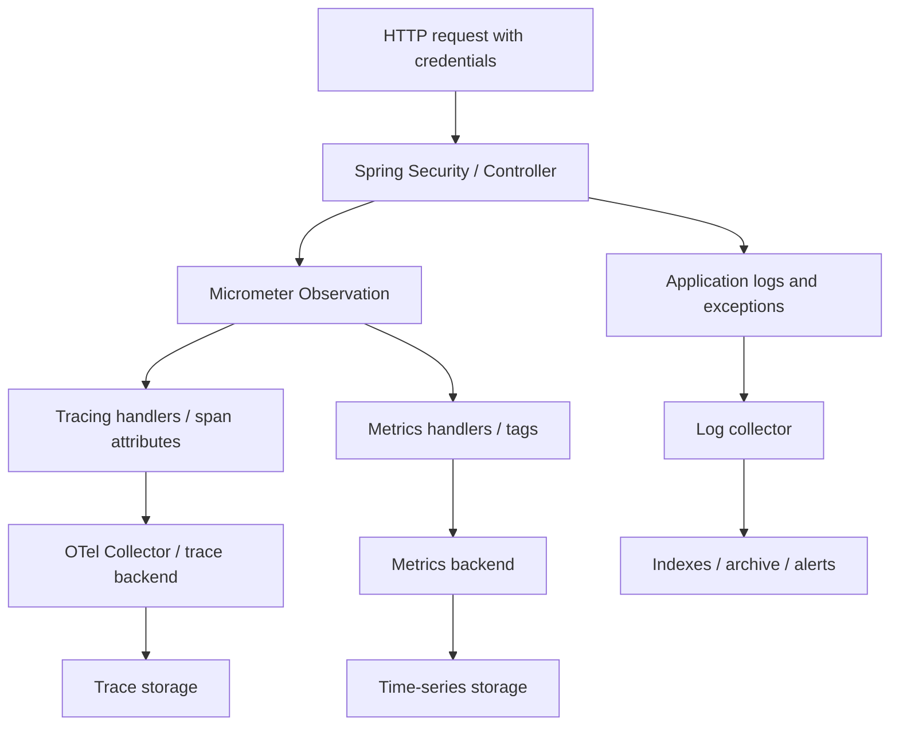

# Never Trace Passwords in Spring Boot

Observability helps investigate errors by recording requests, dependency calls, logs, and traces. However, telemetry is typically sent to multiple systems, retained longer than the original request, and accessed by more teams than business data. If a password, access token, or secret appears in a log or span attribute, a logging mistake can turn into a credential exposure incident across the entire observability platform.

**Never trace passwords** is a telemetry design principle: do not include passwords, credentials, tokens, or secrets in logs, traces, metrics, baggage, exception messages, or exported metadata. Prevent sensitive data right where telemetry is created, use allowlists for permitted attributes/headers, test redaction, and restrict access to collected data. Deleting a secret from a dashboard after export cannot recall copies already sent to collectors, indexes, or archives.

In Spring Boot, data can enter telemetry via HTTP request/response headers, query parameters, form bodies, exception messages, JDBC URLs, SQL parameters, MDC, custom Observation conventions, tracing baggage, and instrumentation agents. Protecting a single logger or filter alone is not enough.

This lesson belongs to the **Security and Privacy** chapter of the **SPRING_BOOT_OBSERVABILITY** module. The module guides you through setting up observability for Spring Boot using Micrometer Observation, metrics, logs, and distributed tracing; learning context propagation, tags/cardinality, exporters, sampling, and signal correlation to investigate errors, latency, and application behavior in production environments. This lesson focuses on keeping passwords and credentials out of telemetry across the entire pipeline.

## Learning Objectives

1. Explain why telemetry can become a credential leakage vector.
2. Identify passwords, tokens, API keys, cookies, and secrets in request/response data.
3. Analyze the paths sensitive data takes into logs, traces, metrics, baggage, and exceptions.
4. Design allowlists instead of capturing all headers/attributes.
5. Redact data at the source before export.
6. Protect MDC, structured logging, and custom Observation conventions.
7. Avoid recording SQL parameters, JDBC URLs, and HTTP bodies containing secrets.
8. Test with synthetic credentials and search for traces of them across every signal.
9. Handle an incident when a secret has already been exported.
10. Establish operational policies to prevent recurrence.

## 1. Why Are Passwords in Telemetry a Risk?

Telemetry is generated at runtime but typically leaves the application boundary. Logs may be forwarded to a central log platform; traces are sent to collectors/backends; metrics are scraped and stored in time-series databases. Each pipeline has its own retention, backup, replication, indexing, and access controls.

If a password appears in a log, a log shipper can move it outside the cluster, a search index stores copies across multiple shards, snapshots/backups keep data after the original log expires, alerts/tickets may copy the contents, and telemetry readers may lack permission to access the password store.

Therefore, telemetry must be treated as a high-risk data sink for leakage, not a safe default location.

### 1.1. Data That Must Be Protected

| Data Type | Examples | Telemetry Handling |
|---|---|---|
| Password | Login password, database password | Do not record/propagate |
| Access token | Bearer token, OAuth token | Do not record/propagate |
| API key | Partner key, service key | Do not record/propagate |
| Cookie/session | Session cookie, refresh cookie | Do not record/propagate |
| Private key | PEM, signing key | Do not record/propagate |
| Connection secret | JDBC URL with password | Redact or omit completely |
| Recovery code | MFA/recovery secret | Do not record/propagate |
| Sensitive personal data | Email, phone, address | Minimize, mask, or omit per policy |

It is not only passwords that need protection. Any token that can be used to impersonate a user or service must also be treated as a secret.

## 2. Threat Model for the Observability Pipeline

A login request can pass through the following layers:



Secrets can leak in application logs, custom tags, instrumentation capture, exporter processors, collector processors, or backend transformations. Filtering at the end of the pipeline is useful as defense-in-depth, but the source has already transmitted the secret over the network.

### 2.1. Data in Motion and Data at Rest

Both must be protected:
- **In motion:** TLS/mTLS, authenticated exporters, network policies, and destination restrictions.
- **At rest:** encryption, role-based access, retention, deletion policies, and access auditing.

Encryption does not replace redaction. Users with read access to the backend can still view a secret if it is stored in plaintext.

### 2.2. Sampling Is Not Redaction

Trace sampling only decides which traces are kept/exported. If a trace is sampled, secrets inside a span can still be stored. Do not rely on sampling to mitigate credential exposure risk.

## 3. Paths Passwords Can Take Into Telemetry

### 3.1. HTTP Headers

Sensitive headers commonly include `Authorization`, `Proxy-Authorization`, `Cookie`, and `Set-Cookie`. Do not log all request headers or turn them into span attributes.

```text
Authorization: Bearer TOKEN_VALUE
Cookie: session=SESSION_SECRET
Set-Cookie: refresh_token=REFRESH_SECRET
```

These values are illustrative only. Configure instrumentation with an allowlist of required headers; exclude credential headers before creating telemetry.

### 3.2. Query Parameters and URLs

Some legacy systems pass API keys, reset tokens, or passwords in query strings. URLs can appear in access logs, client spans, exception messages, proxy logs, and browser history.

Never place secrets in URLs. If a legacy endpoint must accept tokens via query parameters, do not capture raw URLs; redaction must run before log/trace exporters, and a protocol migration plan is needed.

### 3.3. Request/Response Bodies

Login forms, password resets, payment payloads, or API requests can contain credentials. Never serialize entire bodies into logs or spans just for debugging. If diagnostics are needed, record event name, status, payload size, and allowlisted field names; omit sensitive values.

### 3.4. Exception Messages

HTTP clients, authentication libraries, or database drivers can include URLs, request data, or connection strings inside exception messages. Logging full exception messages/stack traces can leak secrets if a library embeds sensitive data.

Keep the exception class, error code, and stack trace per policy; sanitize messages/context before logging or attaching to a span event. Never concatenate passwords into messages to aid debugging.

### 3.5. JDBC URLs and SQL

JDBC URLs can contain usernames/passwords or secret parameters. SQL statements can contain literal values; prepared statements reduce risk, yet instrumentation can still capture bind values if configured to do so.

Never log full connection strings. Use a normalized logical database/role name; avoid SQL parameter capture or sanitize according to an approved schema.

## 4. Logs: Allowlists and Structured Fields

Structured logging helps explicitly choose which fields are recorded. Safe authentication failure example:

```json
{
  "event.name": "auth.login.failed",
  "auth.provider": "local",
  "failure.code": "INVALID_CREDENTIALS",
  "http.response.status_code": 401,
  "trace_id": "0af7651916cd43dd8448eb211c80319c"
}
```

Do not record password, `Authorization` header, cookie, request body, or raw exception message.

### 4.1. Never Log Whole Request Objects

Debug-logging a request object, DTO, or `Map.toString()` can serialize every field, including passwords. Construct log events with selected fields instead of dumping objects.

### 4.2. MDC

MDC is useful for attaching correlation fields like trace ID and span ID. Never put passwords/tokens into MDC: MDC is typically rendered automatically in every log line of a thread, including logs from third-party libraries.

If using tenant/user context, log only policy-approved identifiers or normalized groups/roles. Always clean up context when threads are reused.

### 4.3. Redaction at the Logging Layer

Structured encoders/filters can strip sensitive fields such as `password`, `token`, `authorization`, and `cookie`. However, field names vary by payload; simple regexes can miss nested JSON, escaped values, or binary/body encodings. Design a safe log schema upfront, then use filters as an additional defense layer.

## 5. Traces and Span Attributes

Span attributes help query operations, but every attribute can be exported and stored. Never add passwords/tokens to span attributes, span events, span status descriptions, exception event attributes, baggage, resource attributes, or link attributes.

An HTTP span should retain normalized method, route template, status, and service metadata. Avoid raw request/response headers and bodies.

### 5.1. HTTP Header Capture

Some instrumentation allows configuring header capture. Use a specific allowlist, such as non-sensitive correlation headers. Never capture `Authorization`, `Cookie`, `Set-Cookie`, or custom headers carrying API keys. Check the configuration for your exact Java Agent/instrumentation version.

### 5.2. Baggage

Baggage is propagated across service boundaries and can be added to spans/logs depending on configuration. Never put credentials, session identifiers, or personal secrets into baggage. Baggage should contain small, approved metadata with a clear propagation purpose.

### 5.3. Span Events and Exception Recording

When recording exceptions, record only information needed for diagnostics. Some tracing SDKs automatically create exception events with messages/stack traces. Check actual behavior and sanitize before recording if a library may include secrets. Never assume exceptions recorded in spans are automatically masked.

## 6. Metrics and Cardinality

Metric tags are indexed as time series; never use passwords/tokens as tags. Avoid values that encode or hash secrets if they still allow linking back to credentials.

Do not use passwords/tokens/API keys, usernames/emails without policy approval, raw URLs/query strings, session IDs, request/trace IDs, exception messages, or SQL literals as dimensions.

Instead, use dimensions with bounded value sets such as auth provider, outcome, status class, operation name, and error category.

### 6.1. Hashing Is Not Automatically Safe

Hashing a password/token still produces a stable fingerprint, which can be used for correlation or brute-forced if the secret has low entropy. Never hash credentials to put into metrics or logs. If identity correlation is required, use an opaque identifier issued by a dedicated system and approved by policy.

## 7. Source Redaction and Defense-in-Depth

Priority order:

1. Never create telemetry fields containing secrets.
2. Allowlist recorded attributes/headers.
3. Sanitize exception messages and custom events before recording.
4. Use exporter/collector processors/filters as an additional layer.
5. Inspect backends, alerts, archives, and support exports.
6. Restrict access permissions and retention.

### 7.1. Redaction Before Span Completion

If custom code adds an attribute to a span and only redacts at the log appender, the trace exporter can still send the original value. Redaction must happen before the signal is sent by its respective exporter.

### 7.2. Collector Processors

The OpenTelemetry Collector can use processors to delete/transform attributes or filter data. This is useful defense-in-depth for telemetry from multiple services, but it does not replace preventing capture at the source. The Collector may not control a separate log pipeline or copies already sent elsewhere.

### 7.3. Naming Policy

Use standard, consistent field names such as `auth.provider`, `failure.code`, and `http.route`. Maintain an explicit list of forbidden field names: `password`, `secret`, `token`, `authorization`, `cookie`, `credential`, `private_key`. However, do not rely solely on names; secrets can end up inside `message`, `url`, or `detail` fields.

## 8. Safe Configuration Examples in Spring Boot

Safe logging focuses on selected events/metadata rather than dumping request bodies:

```java
log.warn(
    "Authentication failed: provider={}, reason={}",
    authProvider,
    failureCode
);
```

Never pass passwords, raw request objects, or `Authorization` headers to the logger.

Custom Observations only add normalized metadata:

```java
Observation.createNotStarted("auth.login", observationRegistry)
        .lowCardinalityKeyValue("auth.provider", "local")
        .lowCardinalityKeyValue("auth.outcome", "failure")
        .observe(() -> authenticationService.authenticate(command));
```

Never add commands/passwords into observation context or key-values. Observation context can be read and exported by handlers; treat every custom field as data that can leave the process.

### 8.1. Do Not Capture Sensitive Headers

If configuring HTTP instrumentation header capture, configure an allowlist rather than wildcards. Only capture system-issued correlation headers confirmed not to carry secrets. Exact property names vary across Spring Boot, Micrometer Tracing, and the OTel Java Agent; check version-specific docs.

### 8.2. Do Not Log JDBC URLs

Datasource configuration may contain passwords from a secret store. Ensure startup logs, exceptions, and custom datasource tags do not print full JDBC URLs. Use logical database/pool names in metrics.

## 9. Testing Against Password Leakage

Create synthetic credentials strictly for tests, e.g., `TEST_SECRET_DO_NOT_EXPORT_7f3a`. Never use real passwords to test redaction.

A test suite should:
1. Send a login request with a synthetic password/token.
2. Trigger both success and failure paths.
3. Capture application logs.
4. Capture exported spans and span events using an in-memory exporter.
5. Read meter tags/measurements.
6. Check MDC and structured log fields.
7. Check outbound headers and downstream baggage.
8. Search all captured telemetry to confirm the synthetic secret does not appear.
9. Check encoded/escaped forms and nested fields.
10. Run tests with the Java Agent if production uses the agent.

### 9.1. Negative Assertions

Tests must assert that the secret **does not appear**, not merely assert that a `password` field was redacted in one JSON log. Search for the secret string across all log outputs, spans, metric labels, exception messages, and collector payloads.

### 9.2. Regression Tests

Include secret leakage tests in CI so changes to logging, HTTP instrumentation, or tracing agents do not inadvertently capture credentials. If the telemetry schema changes, update allowlists and negative tests together.

## 10. If a Secret Has Already Been Exported

1. Identify the credential type, originating system, and exposure window.
2. Identify destinations: log backends, trace backends, collector queues, metrics, alerts, tickets, archives, and backups.
3. Restrict access immediately and preserve evidence per incident policy.
4. Rotate/revoke the credential according to the issuing system's procedure.
5. Delete or quarantine records per backend capabilities and retention policy; account for replicas, snapshots, and backups.
6. Check access audits to determine who accessed the data.
7. Fix source instrumentation/logging and collector filters.
8. Add synthetic-secret regression tests.
9. Monitor new telemetry to confirm leakage has stopped.
10. Document the incident, scope, and remediation actions.

Deleting a single log entry does not make an old credential safe again. If the secret is still valid, rotating/revoking it is a mandatory step per incident process.

## 11. Diagnosing Secret Leakage in Observability

| Symptom | Possible Source | How to Investigate |
|---|---|---|
| Password appears in login log | DTO/object dump or debug logging | Locate logger and request serialization |
| Bearer token in server span | Header capture | Inspect instrumentation header allowlist |
| Cookie in access log | Web server/proxy logging | Inspect access log format and proxy |
| Secret in exception event | Exception message/driver | Capture test exception and inspect span event |
| JDBC password on startup | DataSource URL/config logging | Redact connection strings and config logs |
| Token in baggage | Custom propagation fields | Inventory baggage producers/propagators |
| Password becomes a metric label | Custom tag from request data | Inspect meter tags and conventions |
| Redacted in app log but trace still leaks | Filter applied only to logging | Inspect tracing source/exporter |
| Secret persists after deletion | Index replica/snapshot/archive | Backend retention/deletion workflow |
| Leak occurs only when agent is enabled | Auto-instrumentation capture config | Agent version, header/body capture |

### Investigation Workflow

1. Locate the original source of the sensitive field.
2. Identify the first signal receiving the value: log, observation, span, metric, or baggage.
3. Trace exporters/collectors and destinations.
4. Determine whether the secret is still valid; rotate/revoke per policy.
5. Verify who can read the telemetry and check access audits.
6. Fix at the source and add defense-in-depth in the pipeline.
7. Run synthetic-secret tests across every signal.
8. Verify the backend no longer receives sensitive values.

## 12. Anti-Patterns to Avoid

| Anti-Pattern | Consequence | Better Approach |
|---|---|---|
| Logging full request/DTO | Passwords and PII dumped | Structured allowlist |
| Capturing all HTTP headers | `Authorization`/`Cookie` exported | Header allowlist |
| Recording request/response body in spans | Credentials/payloads leaked | Do not capture bodies by default |
| Putting tokens in baggage | Propagates secrets across services | Baggage holds approved metadata only |
| Hashing passwords for correlation IDs | Creates credential fingerprints | Never derive telemetry identities from secrets |
| Using exception messages as metric tags | Data leak and high cardinality | Stable error categories |
| Redacting only at the dashboard | Backend already stored raw copy | Redact before export |
| Relying on trace sampling | Kept traces still carry secrets | Prevent capture at the source |
| Logging full JDBC URL | Leaks database credentials | Logical database/pool name |
| Single regex for all payloads | Misses nested/escaped/binary data | Schema allowlist and tests |
| Assuming TLS solves leakage | Secrets remain readable at backend | Redaction + access control |
| Not rotating credentials after incident | Old secret stays usable | Revoke/rotate and audit |

## 13. Production Checklist

1. **Data inventory:** identified passwords/tokens/secrets across requests, configs, and exceptions?
2. **Logs:** no DTOs, bodies, headers, or full exception contexts dumped?
3. **MDC:** contains only approved correlation fields?
4. **Traces:** span attributes/events contain no credentials?
5. **HTTP:** header capture uses an allowlist; `Authorization`/`Cookie` excluded?
6. **URLs:** no secrets in query strings or paths?
7. **Bodies:** request/response bodies not captured by default?
8. **JDBC:** connection strings and SQL bind values protected?
9. **Baggage:** no credentials or session secrets propagated?
10. **Metrics:** tags contain no secrets, dynamic identifiers, or messages?
11. **Redaction:** occurs before exporters with defense-in-depth?
12. **Collector:** processors/routes verified for every signal?
13. **Access:** observability backend roles, auditing, and retention appropriate?
14. **Testing:** synthetic-secret negative assertions run in CI?
15. **Agent:** tested with the exact production Java Agent/instrumentation version?
16. **Incident:** revoke/rotate, deletion, and access review procedures in place?

## 14. Self-Assessment Questions

**Question 1.** Why is telemetry a sensitive data sink?

**Hint:** It is exported, replicated, indexed, backed up, and accessed by many teams/systems for long periods.

**Question 2.** Why should you avoid logging entire request DTOs?

**Hint:** DTOs can contain passwords, tokens, or personal data; object dumps do not control which fields are emitted.

**Question 3.** Which headers must specifically be excluded from HTTP tracing?

**Hint:** `Authorization`, `Proxy-Authorization`, `Cookie`, and `Set-Cookie`.

**Question 4.** Why should tokens not be placed in baggage?

**Hint:** Baggage is propagated across service boundaries and can appear in spans/logs across multiple systems.

**Question 5.** Is hashing a password safe for use as a tag?

**Hint:** No. A hash still produces a stable fingerprint and can be brute-forced or correlated.

**Question 6.** Where should redaction take place?

**Hint:** Before signals are exported—ideally by preventing sensitive field creation at the source; collector filters are an extra layer.

**Question 7.** Does trace sampling replace redaction?

**Hint:** No. Sampled traces can still contain secrets.

**Question 8.** Why must exception messages be inspected?

**Hint:** Libraries can embed URLs, request data, connection strings, or inputs into messages/attributes.

**Question 9.** How should secret leakage be tested?

**Hint:** Use synthetic credentials and search for them across logs, spans, events, metric labels, baggage, and collector payloads.

**Question 10.** If a password has already been exported, what must be done?

**Hint:** Determine scope/destinations, restrict access, rotate/revoke the credential, remediate copies per backend policy, and add regression tests.

## Conclusion

**Passwords and credentials must never appear in any observability signal.** Logs, traces, metrics, baggage, exception events, and HTTP/JDBC instrumentation can all become leakage paths. Design telemetry around allowlists, never dump request objects or headers, redact before exporters, protect MDC and custom observation attributes, and test with synthetic secrets under exact production configurations. If a secret has already been exported, determine scope, restrict access, rotate/revoke the credential, and remediate copies per incident policy. Observability remains sustainable in the long run only when diagnostic data never exposes authentication credentials.
