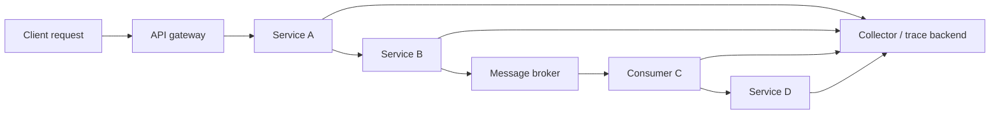

# PII in Distributed Tracing Baggage

**PII in baggage** is a security risk that arises when an application puts personally identifiable information (PII) into distributed tracing baggage and propagates it across multiple services. Baggage is designed to carry metadata across an entire trace; therefore, a field added at an incoming request can appear in message headers, outbound HTTP calls, logs, spans, or telemetry backends across many systems.

In the **SPRING_BOOT_OBSERVABILITY** module, baggage supports propagating context across services, not storing user profiles or sensitive business data. This lesson belongs to the **Security and Privacy** chapter and focuses on identifying PII, baggage propagation and retention scope, data minimization principles, allowlists, pseudonymization, redaction, testing, and incident procedures when sensitive data has already been exported.

## 1. What Is Baggage and Why Is PII in Baggage Dangerous?

Baggage is a set of key-value pairs propagated alongside tracing context across process boundaries. In OpenTelemetry, the W3C Baggage propagator can serialize baggage into an HTTP header; messaging instrumentation can also place context into message headers.

Example of a request carrying baggage:

```text
baggage: tenant-tier=standard,region=ap-southeast
```

Metadata like tier or region can be useful if controlled. However, if baggage contains emails, phone numbers, names, addresses, account IDs, or tokens, that data can be copied across numerous downstream requests and stored in multiple telemetry systems.

The risk does not stop at the initial header:
- Multiple services can receive the same baggage.
- HTTP clients and messaging instrumentation can keep injecting baggage.
- Debug logs may print all headers or context.
- Collectors may receive and forward data to multiple exporters.
- Trace backends may index, replicate, and retain data per retention policy.
- Users with access to traces may not have permission to view user profiles in business systems.

Therefore, baggage must be treated as data that can propagate widely and be stored persistently, not as temporary memory existing only within a single request.

## 2. Distinguishing Trace Context, Baggage, and Span Attributes

These three concepts serve different roles:

| Component | Role | Should It Contain PII? |
| --- | --- | --- |
| Trace Context | Links spans via Trace ID, Span ID, flags | Contains no user information |
| Baggage | Propagates key-value metadata across process boundaries | Avoid PII; use only allowlisted fields |
| Span attributes | Describes a specific operation in a trace | Record only necessary and approved data |
| Metric tags | Groups metrics by dimensions | No PII or high-cardinality identifiers |
| Logs | Records events for investigation | Redact/mask sensitive data |

A Trace ID is a random trace identifier, not a user ID. Even so, when a mapping table or linking log exists, a Trace ID can become linkable to an individual within a specific system. Apply access controls and retention to trace data commensurate with its actual contents.

Baggage differs from span attributes in that baggage is designed to be forwarded. A span attribute usually describes the current span; baggage can traverse many services and create a much wider propagation surface.

## 3. Common PII and Sensitive Data

PII can identify a person directly or when combined with other data. Common examples in applications:

| Data | Example | Recommended Handling |
| --- | --- | --- |
| Email | `user@example.com` | Never put in baggage |
| Phone | Personal contact number | Never put in baggage |
| Full name | Full legal name | Never put in baggage |
| Address | Home/shipping address | Never put in baggage |
| Account/customer ID | User profile identifier | Avoid; use controlled reference if genuinely needed |
| Access token | Bearer token | Never propagate in baggage |
| Session/cookie | Session identifier | Never propagate in baggage |
| Payment data | Card/account details | Never propagate in baggage |
| Tenant tier | `free`/`standard`/`enterprise` | May allowlist if needed and small value set |
| Region code | `ap-southeast` | May allowlist if not personally identifying |

Not every identifier is automatically PII in every context. However, a stable identifier can be linked to personal records, enabling cross-service tracking. When linkability has not been assessed, treat it as sensitive data and keep it out of baggage.

## 4. Why Does Baggage Expand the Risk Blast Radius?

Suppose a gateway receives a header with an email and puts it into baggage. Service A calls Service B; B publishes a message; Consumer C calls Service D. If propagation is enabled at every step, the same value can be replicated across many network hops.



A baggage field can be stored across multiple spans/logs or headers in many services. Removing the field at the last service does not erase copies already exported from upstream services.

### 4.1. Fan-Out and Batch Processing

One service can send a request to multiple downstream services or publish many messages. Propagated baggage can multiply with fan-out. In a batch consumer, multiple message contexts may be combined; never arbitrarily copy baggage from the first message across the entire batch.

### 4.2. Retries and Dead-Letter Queues

Retries, redeliveries, and dead-letter queues can retain message headers far longer than the original request duration. If PII resides in baggage, the data can persist inside queues, archives, or DLQs. Broker retention policies must be factored into privacy assessments.

## 5. Principle of Data Minimization

The most important principle is to propagate only data required for a specific observability objective.

Before adding a baggage field, answer:
1. Which downstream operation genuinely needs this field?
2. Can a coarser, less detailed category be used instead?
3. Does the field directly or indirectly identify an individual?
4. Can the field be looked up from a business system via a controlled reference?
5. Does the field need to traverse every service or only a single boundary?
6. Can a span attribute on one service be used instead of baggage propagation?
7. Who can read the data after it reaches the Collector/backend?
8. When does the data expire and get deleted?

If there is no concrete use case, do not add the field. Baggage should not become a copy of request headers, security principals, or user profiles.

## 6. Use Allowlists Instead of Propagating Everything

Design propagation using an allowlist: only reviewed keys are injected/extracted. Never copy all incoming baggage into outgoing context.

Examples of fields that may be considered if approved:
- `tenant-tier` with a finite value set.
- `deployment-region`.
- `workflow-class`.
- `experiment-cohort` if it contains no user-specific identity and has an approved policy.

Fields to reject:
- `email`, `phone`, `full-name`, `address`.
- `access-token`, `authorization`, `cookie`.
- `raw-user-id`, `customer-id`, `account-number`.
- `request-body` or serialized principals.
- Any unrecognized or unreviewed key.

### 6.1. Value Normalization

Even non-PII fields can create high cardinality if values are arbitrary. Normalize:
- Use finite enums/categories instead of free-form strings.
- Enforce length limits.
- Reject values with control characters.
- Cap the number of baggage entries.
- Reject duplicate keys with unclear semantics.
- Never let clients choose arbitrary baggage keys.

Allowlists must be enforced where context enters a trust boundary and maintained at subsequent boundaries. Filtering only at the backend is too late if data has already been logged or exported earlier.

## 7. Never Use Baggage as Authorization Context

Baggage is observability metadata, not proof of authentication or authorization. Untrusted clients or producers can send forged baggage.

Never use fields like `tenant-id`, `role`, `permission`, or `user-id` in baggage to decide:
- Resource access.
- Tenant isolation.
- Administrative privileges.
- Financial limits.
- Billing policies.
- Bypassing authentication.

Authorization must rely on a verified security context checked at the responsible service. If a service needs tenant identity, obtain it from a verified security token/context or trusted internal source; never trust baggage.

## 8. Pseudonymization and Tokenization

In some investigation use cases, operations teams need to correlate multiple events for the same subject without knowing their real identity. A pseudonymous reference generated by an authoritative system may be considered.

Distinctions:
- **Masking:** concealing part of a value when displayed.
- **Pseudonymization:** replacing a direct identifier with a substitute code; still re-identifiable if a mapping exists.
- **Tokenization:** replacing data with a token while keeping the mapping in a separately protected system.
- **Hashing:** one-way algorithmic transformation; hashing is generally not automatically safe if inputs are predictable or lack a secret key.

Example of a pseudonymous reference:

```text
subject-ref=psn_7f31a9
```

This is only a format example. Never hash an email with SHA-256 on your own and treat the result as anonymous: emails have a predictable value space and are vulnerable to dictionary attacks. If deterministic pseudonyms are needed, use a keyed HMAC or managed token service with protected keys and a rotation policy.

Even a pseudonymous reference can still count as personal data in context if re-linkage is possible. Keep access to the mapping separate and bound retention.

## 9. Redaction at Trust Boundaries

Redaction should occur as early as possible, before sensitive data enters the propagation pipeline.

Critical boundaries:
- **Ingress:** validate incoming headers/baggage from clients.
- **Application context:** populate baggage only from allowlisted fields.
- **Outbound HTTP:** filter context before injection.
- **Messaging producer:** filter headers before publishing.
- **Consumer:** re-validate/re-extract received metadata.
- **Logging:** never dump entire contexts or headers.
- **Collector:** filter attributes/headers per policy as defense-in-depth.
- **Backend:** access control, retention, and deletion policies.

Collector filtering is an extra defense layer. If the application has already written PII into logs or sent it to another exporter, the Collector cannot recall those copies.

## 10. Example: Filtering Baggage in the Application

Exact implementation depends on Micrometer Context Propagation, OpenTelemetry propagators, and Spring Boot version. A safe approach is never taking incoming baggage verbatim; the application builds a new context strictly from validated values.

Illustrative allowlist example at the application boundary:

```java
Set<String> ALLOWED_BAGGAGE_KEYS =
        Set.of("tenant-tier", "deployment-region");

Map<String, String> sanitizeBaggage(
        Map<String, String> incoming) {

    Map<String, String> safe = new HashMap<>();

    for (String key : ALLOWED_BAGGAGE_KEYS) {
        String value = incoming.get(key);
        if (value != null && isAllowedValue(key, value)) {
            safe.put(key, value);
        }
    }

    return Map.copyOf(safe);
}

boolean isAllowedValue(String key, String value) {
    if (value.length() > 32) {
        return false;
    }

    return switch (key) {
        case "tenant-tier" ->
                Set.of("free", "standard", "enterprise")
                        .contains(value);
        case "deployment-region" ->
                Set.of("ap-southeast", "eu-west", "us-east")
                        .contains(value);
        default -> false;
    };
}
```

This is illustrative logic, not a complete Baggage API. In a real application, transfer sanitized values into baggage using the appropriate API and ensure the outgoing propagator injects only permitted baggage. Never use a client-supplied map as a direct data source.

### 10.1. Protect Both Inbound and Outbound

Sanitizing only at ingress is insufficient if an internal service can receive messages from another producer. Every trust boundary must validate received context. Outbound instrumentation must use the filtered context rather than restoring original baggage from another source.

## 11. How Span Attributes, Logs, and Metrics Replace Baggage

If information is only needed within a single operation, a span attribute is better suited than baggage because it does not propagate onward. If aggregate classification is needed, a low-cardinality metric tag may fit. If investigating a specific event is needed, structured logs with proper access control/retention can help.

| Need | Better Place | Notes |
| --- | --- | --- |
| Deployment classification | Resource attribute | Stable values per instance/service |
| Operation name | Span name | Contains no dynamic IDs |
| Database system | Span attribute/metric dimension | Per semantic conventions |
| User email | Do not export | Keep in internal business systems if genuinely needed |
| Pseudonymous support reference | Controlled span/log | Review re-identification risk |
| Request category | Low-cardinality metric tag | Use finite enums |
| Cross-service diagnostic metadata | Baggage allowlist | Only when downstream genuinely needs it |

Do not move PII from baggage into span attributes or logs without assessment. Changing locations does not eliminate privacy risk.

## 12. Header Size, Cardinality, and Cost

Baggage is serialized into headers, so the number and length of fields affect request size. Many proxies, gateways, and brokers enforce header size limits. Oversized headers can cause request rejections, increase network overhead, and expose more data.

Limits to enforce:
- Maximum number of baggage entries.
- Maximum key/value length.
- Maximum total baggage size.
- Accepted character sets/encodings.
- Duplicate key rules.
- List of keys propagated at each boundary.

Never use user ID or email as a metric tag. Even if baggage is copied into span attributes, it can still bloat index size and backend costs.

## 13. Safe Logging and Correlation

Trace correlation is useful for connecting logs with spans, but you do not need to log all baggage. Logging patterns should print only Trace ID/Span ID and approved fields.

Do not:
- Log raw baggage headers.
- Log all request headers.
- Write security principals or `object.toString()` into logs.
- Write access tokens/cookies in exception contexts.
- Create log keys containing emails or customer IDs.

If correlation with a support case is needed, use a controlled random reference or pseudonymous token. Never put the decoding mapping into logs or trace backends.

## 14. Retention, Access, and Handling Exported PII

Once PII has entered telemetry backends, removing the field from code only stops new data; already-stored copies remain.

Response procedure:
1. Stop new PII emissions by blocking the field at ingress/application boundaries.
2. Identify the services, exporters, Collector pipelines, and backends that received the data.
3. Identify the time range, trace IDs, and datasets involved using authorized access.
4. Restrict read permissions or pause queries temporarily if needed.
5. Execute each backend's and replica's deletion/retention procedure.
6. Check logs, broker headers, DLQs, object storage, and backups per policy.
7. Document the incident, root cause, and changes preventing recurrence.
8. Test to verify the field is no longer injected or exported.

Do not assume deleting a trace from the search UI deletes all copies, indexes, archives, and backups. Work with the actual retention/deletion mechanisms of each system.

## 15. Testing Baggage Privacy

Tests must verify both valid and invalid cases at every boundary.

### 15.1. Allowlist Unit Tests

Feed baggage containing allowed `region`/`tier` keys alongside forbidden `email`/`token`/`user ID` keys. Confirm the output retains only allowlisted fields and values within enum/length limits.

### 15.2. Propagation Integration Tests

Send requests through a producer service and inspect outbound HTTP/message headers:
- Permitted keys are injected.
- PII keys are absent.
- Header size stays within limits.
- Consumers extract only permitted fields.
- Invalid/duplicate baggage is handled per policy.

### 15.3. Telemetry Export Tests

Use an in-memory exporter or Collector lab to inspect exported span attributes/log records. Do not check only request headers; PII might be added in another interceptor after the sanitization step.

### 15.4. Regression Tests

Create test fixtures with common sensitive keys such as `email`, `phone`, `authorization`, `cookie`, `customer ID`, and raw payloads. Run tests across integration points after every upgrade to tracing/messaging dependencies.

## 16. Troubleshooting PII in Baggage

| Symptom | Possible Cause | How to Check |
| --- | --- | --- |
| Email appears in downstream spans | Inbound baggage propagated verbatim | Check ingress allowlist and propagators |
| Token appears in trace backend | `Authorization`/headers copied to baggage or spans | Find source instrumentation and block at ingress |
| PII appears in message headers | Messaging producer injects unfiltered context | Inspect record headers before publishing |
| Logs contain full baggage | Logging pattern/custom middleware dumps context | Audit logging configuration |
| PII still appears after code fix | Backend still holds old data or another exporter exists | Check retention, replicas, and pipelines |
| Collector filter fails to strip data | PII was logged/exported prior to Collector | Redact earlier in the application |
| Baggage header too large | Too many fields or overly long values | Limit entries, value length, and total bytes |
| Pseudonymous value still treated as sensitive | Mapping exists or re-identification is possible | Review tokenization/key custody |
| Field re-added downstream | Another service populates baggage from request/user context | Inspect every trust boundary |
| Trace correlation lost after filtering | Policy stripped `traceparent` or replaced propagator | Filter only baggage; preserve valid W3C Trace Context |
| Tenant ID spoofed | Baggage used as security context | Derive tenant identity from an authenticated source |

### Investigation Workflow

1. Identify where the baggage key/value appears: inbound header, outbound header, span, log, or backend index.
2. Trace back to the first service that added the field into context.
3. Inspect auto-instrumentation and custom propagators/interceptors.
4. Check whether HTTP clients and messaging producers use the sanitized context.
5. Check whether consumers validate metadata after the broker.
6. Check Collector processors and all exporters.
7. Identify stored copies and retention/deletion policies.
8. Add regression tests for the forbidden field.
9. Verify Trace Context still works after filtering baggage.
10. Document the owner and policy for each permitted baggage field.

## 17. Hands-On Exercise: Keeping PII Out of Baggage

The objective is to build a propagation policy that allows only safe diagnostic metadata to cross services.

### Preparation

- Spring Boot application with Micrometer Tracing or OpenTelemetry integration.
- An HTTP client and messaging producer/consumer in a lab.
- An in-memory span exporter or Collector lab.
- A test framework for context propagation.
- Test dataset containing valid keys and synthetic PII.

### Step 1 — Inventory Current Baggage

Inspect where the application creates baggage and incoming headers. Record each key, purpose, owner, usage sites, and associated retention.

### Step 2 — Classify

Mark each field as allowlist, reject, or needs review. Email, phone, tokens, cookies, and raw customer identifiers must not propagate by default.

### Step 3 — Build the Sanitizer

Implement the allowlist, length/value-set limits, entry count limit, and total size limit. Never accept all incoming baggage.

### Step 4 — Apply at Ingress

Construct a fresh context from validated fields. Drop unpermitted keys before requests reach business services.

### Step 5 — Check Outbound HTTP

Call a downstream service. Verify headers contain only standard trace context and allowlisted baggage.

### Step 6 — Check Messaging

Publish a message and verify headers contain no PII. The consumer re-validates metadata before using it.

### Step 7 — Check Span/Log Export

Inspect spans and logs in the test exporter. Confirm PII is not re-added by custom instrumentation or logging middleware.

### Step 8 — Test Malicious Inputs

Send baggage with tokens, emails, oversized values, duplicate keys, and unusual characters. Confirm they are stripped or rejected per policy.

### Step 9 — Verify Trace Continuity

Confirm Trace ID and parent/link relationships remain intact after filtering baggage. Removing baggage must not corrupt `traceparent`.

### Step 10 — Review Retention

Determine how long backends store telemetry and the deletion procedure if exported PII is discovered.

### Acceptance Checklist

| Requirement to Prove | Expected Outcome |
| --- | --- |
| Data classification | Identify PII and linkable identifiers |
| Minimization | Propagate only metadata with a valid use case |
| Allowlist | Only approved keys/values propagate |
| Ingress | Incoming baggage is validated |
| Outbound HTTP | No PII injected |
| Messaging | Headers contain no PII |
| Consumer | Validates context received from broker |
| Trace continuity | Trace Context remains continuous |
| Cardinality | Dynamic identifiers not used as metric tags |
| Logging | Raw baggage/headers never dumped |
| Export | PII does not appear in spans/logs |
| Retention | Procedure exists for stored copies |

## 18. Key Principles to Remember

1. **Baggage can propagate and be stored across many services.** Treat it as metadata capable of leaving the process.
2. **Never put PII, secrets, or security credentials into baggage.** Never use baggage for authentication or authorization.
3. **Use allowlists and data minimization.** Propagate only fields with a clear use case, small value set, and defined owner.
4. **Baggage differs from span attributes, logs, and metric tags.** Choose where to record data based on usage scope and cardinality.
5. **Pseudonymization does not mean anonymous.** Mappings, keys, and linkability still create identification risks.
6. **Redact at ingress and every trust boundary.** Collector filtering is defense-in-depth, not a replacement for source filtering.
7. **Cap entry count, length, and total header size.** Avoid extra network overhead and storage bloat.
8. **Govern retries, brokers, and DLQ retention.** Message headers can outlive the original request.
9. **Test both propagation and telemetry export.** PII can be added at multiple integration points.
10. **Maintain a procedure for already-exported data.** Stop new data and remediate copies per retention/deletion policies.

Baggage is useful when diagnostic metadata must cross service boundaries, yet every field expands the shared data surface. By permitting only minimal metadata, filtering at ingress and outbound boundaries, and keeping PII out of baggage, logs, and metric tags, Spring Boot can preserve trace correlation without turning distributed tracing into a channel for leaking personal data.
