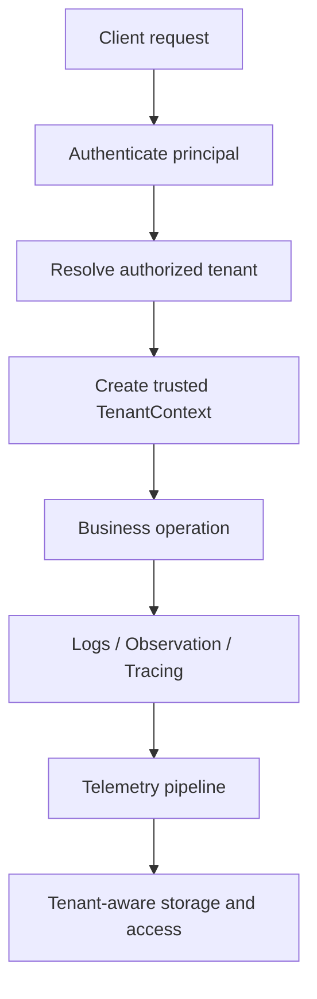

# Tenant Isolation in Spring Boot Telemetry

## 1. Objectives and Context

In a multi-tenant application, multiple customers share a single system, yet their data and access rights must remain isolated. Telemetry can also contain tenant data: log events, trace attributes, baggage, exception contexts, query metadata, and dashboards. If a tenant A user can view tenant B's logs or traces, the system has breached its security boundary even if the business database remains properly isolated.

**Tenant isolation in telemetry** is the set of measures ensuring observability data is tagged with the right tenant, stored/queried strictly within authorized boundaries, and never leaked via metrics, logs, traces, exporters, or operational tools.

This lesson belongs to the **Security and Privacy** chapter of the **SPRING_BOOT_OBSERVABILITY** module. The module guides you through setting up observability for Spring Boot using Micrometer Observation, metrics, logs, and distributed tracing; learning context propagation, tags/cardinality, exporters, sampling, and signal correlation to investigate errors, latency, and application behavior in production environments.

After this lesson, you will be able to:
1. Identify tenant boundaries across the telemetry pipeline.
2. Derive tenant context from authenticated sources rather than trusting arbitrary headers.
3. Propagate context safely across logs, traces, and async execution.
4. Avoid using tenant ID as a metric label when cardinality is high.
5. Partition telemetry storage and enforce per-tenant query controls.
6. Protect baggage, exemplars, dashboards, and support tooling.
7. Test to prevent cross-tenant access.

**Baseline:** Spring Boot 3.5.x, Java 17+, Micrometer Observation/Tracing, SLF4J MDC. Specific storage/query designs depend on your log backend, trace backend, and tenancy model.

## 2. Threat Model: Telemetry Is Also Tenant Data

Telemetry is often treated as purely technical data, yet it can contain:
- Tenant ID, organization name, or domain.
- User ID, email, request metadata, and correlation identifiers.
- SQL/query attributes or resource names.
- Exception messages, validation errors, and request/response fragments.
- Trace baggage propagated across multiple services.
- Metric labels, dashboard variables, and exemplar links.

Common risks:

| Risk | Example | Consequence |
| --- | --- | --- |
| Spoofed context | Client sends `X-Tenant-Id: tenant-b` | Events attributed to the wrong tenant |
| Unfiltered query | Dashboard queries logs by service without filtering tenant | Tenant A sees tenant B's data |
| Shared trace access | Trace backend authorizes only at a shared project level | Users read traces outside their tenant |
| Baggage leak | Tenant identifier propagated to external services | Tenancy data leaves the trust boundary |
| Metric cardinality | Each tenant creates a label series | Cost and DoS risk via series count |
| Async context leak | MDC/`ThreadLocal` not cleared between tasks | Logs carry the previous request's tenant context |
| Support export | Bundle contains logs/traces from multiple tenants | Leakage when shared or downloaded |

Isolation must be enforced throughout the entire lifecycle: context creation, propagation, emission, ingestion, storage, querying, exporting, and deletion/retention.

## 3. Building a Trustworthy Tenant Context

Tenant identity must be determined from the authentication/authorization layer or a verified trusted gateway. Never trust client-supplied tenant IDs from headers, query parameters, request bodies, or baggage by default.

Recommended flow:



For example: a logged-in user has access to tenant A. If the request sends a tenant B header, the application must verify membership/authorization before accepting tenant B. Signed headers or gateway headers are trustworthy only when the gateway lies inside the trust boundary, authenticates the caller, and strips/overwrites external headers.

Do not use raw tenant names/domains as identity if they can change or contain sensitive data. Prefer a normalized, opaque internal tenant key.

## 4. Tenant Context in a Spring Application

An authenticated tenant can be represented with an immutable context:

```java
public record TenantContext(String tenantKey) {
    public TenantContext {
        if (tenantKey == null || tenantKey.isBlank()) {
            throw new IllegalArgumentException("tenantKey is required");
        }
    }
}
```

Populate the context after the authentication/authorization step, such as in a dedicated filter or interceptor. Context access APIs must define clear semantics when no tenant is present: reject tenant-scoped requests or mark the operation as system-level per policy.

Never construct tenant context blindly from a header:

```java
// Unsafe if the header is controlled by the client.
String tenant = request.getHeader("X-Tenant-Id");
```

Instead, resolve the verified tenant from the principal/security context or a trusted tenant resolver:

```java
TenantContext tenantContext = tenantResolver.resolveAuthorizedTenant(authentication, request);
```

`tenantResolver` here is an application abstraction; its implementation must verify membership and access rights. Never let controllers/services pick a tenant from arbitrary input.

## 5. Linking Tenant Context to Logs

SLF4J MDC can add the tenant key to log events for backend searching. Add only an opaque, authenticated key that is necessary for operations.

Servlet stack filter example:

```java
import jakarta.servlet.FilterChain;
import jakarta.servlet.ServletException;
import jakarta.servlet.http.HttpServletRequest;
import jakarta.servlet.http.HttpServletResponse;
import org.slf4j.MDC;
import org.springframework.web.filter.OncePerRequestFilter;
import java.io.IOException;

public class TenantLoggingFilter extends OncePerRequestFilter {
    private final TenantResolver tenantResolver;

    public TenantLoggingFilter(TenantResolver tenantResolver) {
        this.tenantResolver = tenantResolver;
    }

    @Override
    protected void doFilterInternal(
            HttpServletRequest request,
            HttpServletResponse response,
            FilterChain chain) throws ServletException, IOException {
        String tenantKey = tenantResolver.resolveAuthorizedTenantKey(request);
        try (MDC.MDCCloseable ignored = MDC.putCloseable("tenant.key", tenantKey)) {
            chain.doFilter(request, response);
        }
    }
}
```

This example assumes the resolver has authenticated the request and returned a safe tenant key. In a real system, integrate with the Spring Security principal and ensure the filter runs after authentication. MDC entries must be restored/cleared on every exit path; never call `MDC.put` without cleaning up.

Log the tenant key only when the log backend and its readers are authorized to view it. For public logs or multi-tenant shared systems, a pseudonymous key or omitting the tenant dimension may be required.

## 6. Tracing Attributes and Baggage

Tenant context can be added to an Observation/Span as an attribute if there is a valid use case. However, distinguish clearly:

| Mechanism | Purpose | Caveats |
| --- | --- | --- |
| Span attribute | Metadata for the current span | Stored and searchable in the trace backend |
| Baggage | Context propagated across process boundaries | Can leave downstream and cross multiple systems |
| MDC | Log event field within an execution context | Requires proper thread propagation/cleanup |
| Metric tag | Time-series dimension | Must have low cardinality and a bounded value set |

Never automatically put every tenant field into baggage. Baggage can be serialized into outbound headers, so propagate it only across services inside the trust boundary, bound keys/values, and configure propagation explicitly.

A tenant key in a span attribute is also access-controlled data. If a trace backend is shared across multiple customers, an attribute alone does not create row-level security. The backend must enforce per-tenant read permissions or partition traces.

Never put secrets, access tokens, personal data, or tenant payloads into baggage solely for correlation.

## 7. Async, Executor, and Reactive Context Propagation

Servlet requests normally execute on a thread carrying MDC. When work moves to an executor, `ThreadLocal`/MDC does not follow automatically. Without proper propagation, logs can miss the tenant key or, worse, retain the value from an earlier task on a pooled thread.

Principles:
- Use a context propagation mechanism suited to Spring/Micrometer and your executor.
- Capture context when submitting a task and restore/clear it in `finally` when the task finishes.
- Never use a static mutable `TenantContext` shared across requests.
- With `CompletableFuture`, pass context explicitly or use a decorated executor.
- With Reactor, store context in Reactor Context and use proper context-propagation integration; never rely solely on `ThreadLocal`.
- Test concurrent requests belonging to two tenants to catch context bleed.

Tenant context must be authenticated before propagation. Propagation does not turn an untrusted value into a trusted one.

## 8. Metrics: Cardinality and Isolation

Metrics present a distinct trade-off for tenant isolation. Adding `tenant.id` to every meter can create a time series per tenant × method × route × status. With tens of thousands of tenants, series counts grow rapidly and can overload the monitoring backend.

Prefer aggregate metrics without a tenant dimension:

```java
Counter.builder("orders.created")
        .tag("outcome", "success")
        .register(registry)
        .increment();
```

If per-tenant analysis is required, consider:
- Using only a `tenant.tier`/`segment` with a small value set, not unique tenant IDs.
- Emitting per-tenant metrics to a dedicated system with quotas and tenant limits.
- Using access-controlled logs/traces for tenant-specific investigations.
- Using exemplars to jump to traces if your stack supports it, without making `traceId`/`tenantId` a label.
- Applying meter filters/deny rules for sensitive tag keys.

Do not assume a tenant ID is low-cardinality merely because the string is short. Cardinality is determined by the number of distinct values.

## 9. Tenant-Aware Storage and Querying

Adding a tenant key to a log or span does not automatically create isolation. The ingestion/storage/query system must enforce authorization.

Common models:

| Model | Isolation Approach | Trade-Offs |
| --- | --- | --- |
| Shared index/table | Every record has a tenant key; queries enforce filters and backend enforces policy | Easier to operate, but requires rock-solid row-level controls |
| Per-tenant index/namespace | Separates data per tenant or tenant group | Clearer isolation, increases resource and operational count |
| Dedicated backend/project | Each tenant or trust domain has its own telemetry backend | Strong isolation, higher cost |

With shared storage, tenant filters must be enforced at the server-side authorization/query layer, not only in the UI dashboard. Users must not be able to edit a query to remove the tenant filter.

Control all of these as well:
- Search APIs and dashboards.
- Trace lookup by `traceId`.
- Alert payloads and notification integrations.
- Export/download endpoints.
- Saved queries, notebooks, and support bundles.
- Backup, replica, and data retention workflows.

A Trace ID is not a credential. Knowing a `traceId` must never automatically grant permission to read the trace.

## 10. Sampling, Exemplars, and Exports

Sampling reduces stored trace volume but does not replace tenant authorization. Tail sampling or collector policies can route/drop traces based on attributes; if the tenant attribute is untrusted or unauthenticated, policies can misclassify traces.

Before exporting:
- Verify the tenant context has been authenticated.
- Add only necessary and approved attributes.
- Never send sensitive baggage to external vendors.
- Partition exporter/tenant endpoints if contracts or compliance require it.
- Verify collector logs, retry queues, and dead-letter storage also do not leak data.

Exemplars can carry trace references from metrics. Permission to open the trace must still be checked at the trace backend; an exemplar is not an authorization grant.

## 11. Retention and Access Permissions

Telemetry can be retained across multiple tiers: application stdout, node agents, collector queues, object storage, search indexes, trace backends, backups, and export archives.

Clearly define:
- Who may read logs/traces per tenant and per operational role.
- Who may view aggregate metrics or tenant-specific diagnostic data.
- Retention duration per data type and purpose.
- Procedures to delete/expire data in primary stores, replicas, and backups per policy.
- Audit trails for querying/exporting tenant data.
- Break-glass access with approval, scope, and expiration.

Operator privileges do not mean every employee may inspect every payload. Apply least privilege and audit sensitive access operations.

## 12. Testing Tenant Isolation

Use two tenants A and B with distinct sentinel identifiers. Tests must verify not only the business database but also telemetry sinks.

Test matrix:
1. A tenant A request emits a log event; a tenant B user cannot query or export that event.
2. A request sends a tenant B header while the principal only has tenant A rights; the request is rejected or the resolver selects the authorized tenant per policy.
3. Tenant A's trace cannot be opened using tenant B's credentials even if `traceId` is known.
4. Dashboard/query APIs automatically enforce the tenant filter server-side.
5. Metrics do not emit tenant IDs as labels outside approved policies/quotas.
6. Concurrent async tasks for tenants A and B never mix MDC/context.
7. Reactor subscriptions across multiple tenants do not share context.
8. Baggage does not propagate tenant data across external trust boundaries.
9. Exceptions, validation errors, and support bundles contain no other tenant's payload.
10. Exporter retries/dead-letter queues/backups still uphold isolation policies.

Example log output check:

```java
assertThat(tenantALogs).contains("tenant.key=tenant-a");
assertThat(tenantALogs).doesNotContain("TENANT_B_SECRET_SENTINEL");
assertThat(tenantBQueryResult).doesNotContain("TENANT_A_SECRET_SENTINEL");
```

These are pseudocode assertions; real tests should use production-like identities and backend query APIs.

## 13. Troubleshooting

| Symptom | Possible Cause | Remediation |
| --- | --- | --- |
| Tenant A log carries tenant key B | Trusted unauthenticated header or MDC not restored | Resolve from principal and use scoped MDC cleanup |
| Async log misses tenant key | Context not propagated to executor | Use a context-aware executor and test completion |
| Async log carries previous task's tenant | `ThreadLocal`/MDC not cleared in pooled thread | Restore/clear inside `finally` |
| Tenant B finds trace A | Trace backend lacks authorization/tenant partitioning | Enforce access at the query/backend layer |
| Dashboard filter can be bypassed | Tenant filter lives only in the UI | Enforce server-side query authorization |
| Metric series explode | Tenant ID used as metric label | Drop tenant ID or use a finite segment |
| External service receives tenant baggage | Propagation allowlist too broad | Restrict keys and trust boundaries |
| Exemplar opens trace without permission | Treating trace reference as an access token | Enforce authorization at the trace backend |
| Collector stores raw tenant payload | Sanitization applied only in app logger | Check agents/collectors/exporters and redact before export |
| Support bundle contains multiple tenants | Export lacks tenant scoping | Build bundles per authorization and audit exports |
| Tenant ID changes with aliases | Using domain/display name as identity | Use an opaque canonical tenant key |

## 14. Production Checklist

- [ ] Tenant identity is resolved after authentication/authorization.
- [ ] Client-supplied tenant headers/queries/bodies are not trusted by default.
- [ ] Tenant context is immutable with a clear lifecycle.
- [ ] MDC/context is restored/cleared after every request/task.
- [ ] Async/reactive propagation is tested concurrently cross-tenant.
- [ ] Logs/traces/baggage contain only approved tenant metadata.
- [ ] Metrics do not use high-cardinality tenant IDs as labels.
- [ ] Storage/query APIs enforce tenant authorization server-side.
- [ ] `TraceId`/exemplars are never treated as credentials.
- [ ] Exporters, collectors, queues, backups, and support bundles are protected.
- [ ] Retention, deletion, and audit policies cover all telemetry sinks.
- [ ] Cross-tenant negative tests exist for search, trace lookup, and export.

## 15. Practice Questions

1. Why does telemetry require tenant isolation just like the business database?
2. Why should you not trust a client-supplied `X-Tenant-Id` header?
3. At which layer should tenant context be created?
4. How can MDC cause context bleed in a pooled executor?
5. How does baggage differ from span attributes regarding propagation risk?
6. Why is tenant ID usually unsuitable as a metric label?
7. Where must a shared telemetry index enforce authorization?
8. Is a `TraceId` a credential to read a trace?
9. Does sampling replace access control?
10. Which export/backup paths must be tested?
11. Why is a dashboard-only tenant filter insecure?
12. How do you detect async/reactive context mixing across tenants?

## References

- [Spring Boot 3.5 — Observability](https://docs.spring.io/spring-boot/3.5/reference/actuator/observability.html)
- [Micrometer Context Propagation](https://docs.micrometer.io/context-propagation/reference/)
- [Micrometer Tracing — Baggage](https://docs.micrometer.io/tracing/reference/api.html)
- [OpenTelemetry — Context Propagation](https://opentelemetry.io/docs/concepts/context-propagation/)
- [OpenTelemetry — Baggage](https://opentelemetry.io/docs/concepts/signals/baggage/)
- [OWASP — Logging Cheat Sheet](https://cheatsheetseries.owasp.org/cheatsheets/Logging_Cheat_Sheet.html)
- [OWASP — Multi Tenant Security Cheat Sheet](https://cheatsheetseries.owasp.org/cheatsheets/Multi_Tenant_Security_Cheat_Sheet.html)
