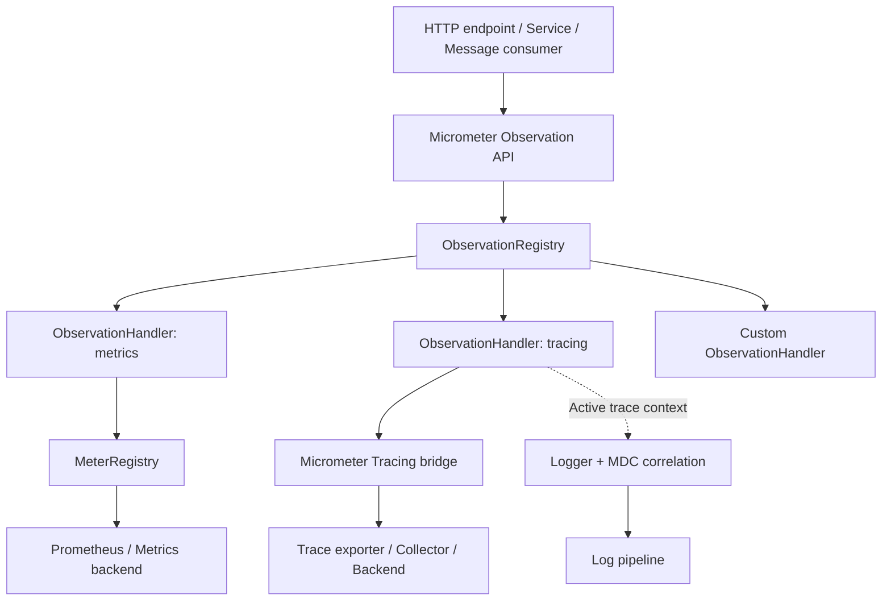
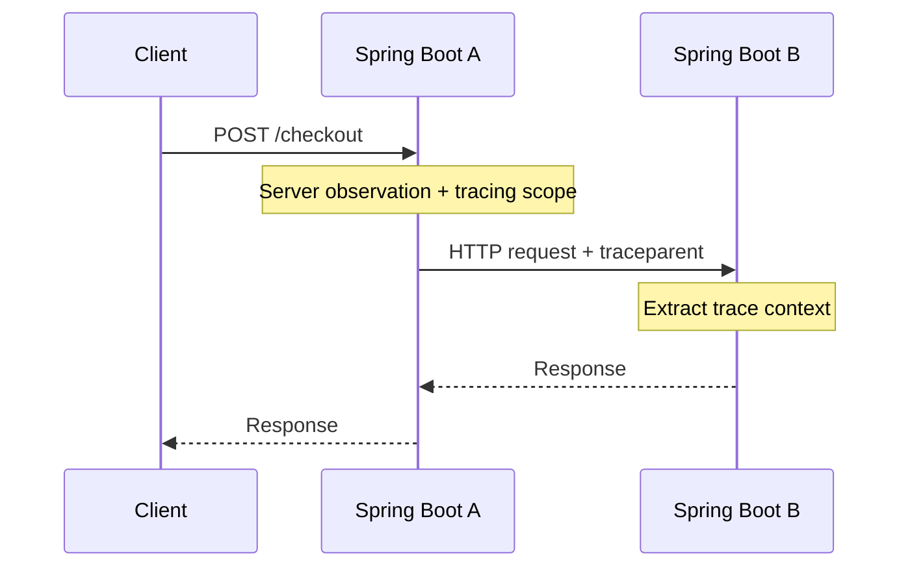

# What Is an Observation?

When a `POST /checkout` request takes 2 seconds, you want to know which step is slow, how many times it occurs, what failing requests have in common, and whether their logs can be correlated with a trace. If every measurement required writing a separate timer, span, and tagging system by hand, business code would quickly become coupled to multiple telemetry collection technologies.

**Micrometer Observation** solves that problem with a unified API to **observe an operation that has a name, a lifecycle, and a context**. The application describes *what it is doing*; the observation handlers decide *which signals to record it to*, such as metrics or distributed traces.

In the **SPRING_BOOT_OBSERVABILITY** module, Observation is the key bridge between Spring Boot instrumentation and metrics, logs, and traces. Understanding Observation properly helps you place instrumentation in the right spots, preserve trace context, choose appropriate tags, control sampling and exporters, and correlate that evidence when investigating errors or latency in production.

After this lesson, you will be able to:

1. Explain how an Observation differs from a metric, timer, log, and span.
2. Describe `Observation`, `ObservationRegistry`, `ObservationHandler`, `Observation.Context`, and the start → scope → stop lifecycle.
3. Create a custom Observation in a Spring Boot service, record errors, and distinguish between low-cardinality and high-cardinality key-values.
4. Understand the conditions required for an Observation to appear as a metric or trace and for logs to carry trace context.
5. Avoid duplicate instrumentation, context loss, cardinality explosion, and wrong conclusions when telemetry data is incomplete.

## 1. What Does an Observation Represent?

An **Observation** represents *a single execution of an activity that is meaningful to the system*. For example:

- Handling an HTTP request.
- Calling a payment service.
- Reserving an item in inventory.
- Running a scheduled job.
- Processing a message from a message broker.

Each call to `payment.authorize` is one occurrence, with its own start time, end time, context, and outcome. Multiple occurrences can be aggregated into a metric over time. If the system has tracing configured, each occurrence can also become a span or add context to an existing trace, depending on the `ObservationHandler`.

Let's distinguish the concepts before writing code:

| Concept | Description | Example |
| --- | --- | --- |
| **Observation** | Object recording the lifecycle and context of an operation | One execution of `checkout.authorize` |
| **Meter/Timer** | Tool for measuring/aggregating figures by name and tags | Call count, total duration, latency histogram |
| **Span** | Unit of work in a distributed trace; has relationships with other spans | HTTP server span and `payment` call span |
| **Log event** | Record of a specific event | `payment rejected: insufficient balance` |
| **Observation context** | Accompanying data used by handlers and conventions | Operation name, key-values, exception |
| **Trace context** | Context identifying and linking traces/spans across steps | `traceId`, `spanId`, `traceparent` |

**An Observation is not inherently a metric or a span.** It is the representation layer at the instrumentation level. The same Observation can be processed by multiple handlers; one handler creates a metric, while another creates a span. Conversely, not every metric or log in an application comes from Observation: JVM metrics, connection pool gauges, and business logs can come from separate mechanisms.

### Example: one operation, three different questions

Suppose `inventory.reserve` just took 870 ms:

- **Metric:** Over 5 minutes, what is the rate of calls slower than 500 ms? How are p95 or p99 of this operation changing?
- **Trace:** In a specific request, where does `inventory.reserve` sit along the path from the HTTP controller to the inventory database/API?
- **Log:** At that moment, what reservation result, exception, or retry policy did the system record?

To answer all three questions, Observation provides a unified instrumentation point; metrics/tracing/logging need appropriate configuration and pipelines to consume that context.

## 2. Where Does Observation Fit in the Micrometer Architecture?

Conceptual flow:



The diagram shows a logical view: specific handlers, bridges, and exporters vary by version and library. **ObservationRegistry does not store metrics or traces itself**; it coordinates the components that process an Observation. Appropriate handlers and backends must be present for data to actually be measured, exported, and queried.

### 2.1. Core components

**`Observation`** — The API used by application code to declare a name, start/stop an operation, attach key-values, and record exceptions or events.

**`ObservationRegistry`** — The central point for configuring and managing handlers, predicates, filters, and related conventions. In a Spring Boot application with Actuator and proper autoconfiguration, the registry is typically provided as a bean to inject; you should not create a new registry per service if you want to share the instrumentation configured by Boot.

**`ObservationHandler`** — Receives callbacks during the observation lifecycle, such as when starting, stopping, opening a scope, or recording an error. A handler can read `Observation.Context` to update a Timer, create/close a span, or perform other collection tasks. A handler does not have to handle every context type; `supportsContext(...)` determines its supported scope.

**`Observation.Context`** — Carries metadata for an observation: name, contextual name, key-values, error, events, and custom data that handlers can use. This context is **different** from the trace propagation context carried over HTTP/message headers, although a tracing handler can link them.

**`ObservationConvention`** — A convention for consistently naming and generating key-values for a group of observations. Conventions are especially useful when multiple places instrument the same kind of operation and need standardized metric names, routes, and statuses.

You can think of Observation as *a contract between business code and the telemetry recording system*: the business code says “this is a payment step”; the handler says “when do I measure duration, create a span, and export data”.

## 3. Lifecycle of an Observation

An Observation has two timing concepts that must be distinguished:

- **Lifetime:** From calling `start()` to `stop()`. Handlers can measure the duration of the operation using these boundaries.
- **Scope:** The period during which the observation is considered the *current observation* in the execution context. Scope typically supports linking parent–child relationships for spans, populating correlation information into logs, and looking up the current observation.

```text
Time --------------------------------------------------------->
           start()                           stop()
              |================================|
                 openScope()    closeScope()
                      |-------------|
                 current observation

'=' marks: observation lifetime
'-' marks: active scope duration on the execution thread
```

Key actions:

| Action | Meaning | Common mistake |
| --- | --- | --- |
| `createNotStarted(name, registry)` | Creates an unstarted observation | Assuming creation alone already emits a metric |
| `start()` | Begins the lifetime, invokes matching handlers | Forgetting `stop()`, leaving duration/span unfinished |
| `openScope()` | Sets the observation as current in context; returns a `Scope` | Not closing the scope, leaking context to subsequent work |
| `lowCardinalityKeyValue(k, v)` | Attaches a bounded-value dimension suitable for metrics | Putting `userId` or dynamic URLs into tags |
| `highCardinalityKeyValue(k, v)` | Attaches detailed context for tracing handlers when supported | Assuming arbitrary sensitive data can be stored |
| `event(...)` | Signals a milestone/event within the lifetime | Assuming every backend stores all events in full |
| `error(exception)` | Records an exception on the observation | Failing to record the error when catching and swallowing an exception |
| `stop()` | Ends the lifetime, triggers final handling | Stopping repeatedly or twice due to broken lifecycle management |
| `observe(...)` | Wraps a lambda with start/scope/stop and exception handling | Mixing manual `start()`/`stop()` calls on the same observation |

### 3.1. Use `observe(...)` for synchronous operations with clear boundaries

The example below uses **Spring Boot 3.x** (Java 17 or later). Assume `PaymentGateway` is a dependency already implemented as a bean:

```java
import io.micrometer.observation.Observation;
import io.micrometer.observation.ObservationRegistry;
import org.springframework.stereotype.Service;

@Service
public class CheckoutService {

    private final PaymentGateway gateway;
    private final ObservationRegistry registry;

    public CheckoutService(PaymentGateway gateway, ObservationRegistry registry) {
        this.gateway = gateway;
        this.registry = registry;
    }

    public String authorize(String paymentMethod, String paymentToken) {
        String methodTag = switch (paymentMethod == null ? "" : paymentMethod) {
            case "card" -> "card";
            case "bank_transfer" -> "bank_transfer";
            default -> "other";
        };

        return Observation.createNotStarted("checkout.authorize", registry)
                .contextualName("authorize payment")
                .lowCardinalityKeyValue("payment.method", methodTag)
                .observe(() -> gateway.authorize(paymentToken));
    }
}

// Illustrative interface. The application provides an implementation as a Spring bean.
interface PaymentGateway {
    String authorize(String paymentToken);
}
```

**What happens when `authorize(...)` is called?**

1. Creates an Observation with the stable name `checkout.authorize`; the value of `payment.method` only belongs to the set `card`, `bank_transfer`, `other`.
2. `observe(...)` starts the lifecycle and opens the scope, invokes `gateway.authorize(...)`, then closes the scope and stops the observation.
3. If the lambda throws an exception, the API records the error and propagates the exception outward; it does not turn the exception into a successful result.
4. Handlers registered in the registry decide whether to update a timer, create a span, record the error, and so on.

`paymentToken` is sensitive business-call data: **do not put it into metric tags, trace attributes, or logs**. In a real application, ensure tokens are handled according to appropriate security standards.

In this example, the name `checkout.authorize` does not have to remain unchanged at export time. The metrics system may transform the name according to Prometheus or other backend conventions; look up the raw meter via Actuator and look up the exported name via the endpoint/exporter.

### 3.2. Manual lifetime management for multi-step flows

If you need to start measuring before a sequence of statements and control the boundaries yourself:

```java
import io.micrometer.observation.Observation;
import io.micrometer.observation.ObservationRegistry;

public void processBatch(ObservationRegistry registry, Runnable work) {
    Observation observation = Observation
            .createNotStarted("batch.process", registry)
            .lowCardinalityKeyValue("job", "nightly-settlement")
            .start();

    try (Observation.Scope scope = observation.openScope()) {
        work.run();
    } catch (RuntimeException exception) {
        observation.error(exception);
        throw exception;
    } finally {
        observation.stop();
    }
}
```

`try-with-resources` guarantees the scope is closed even if the work throws an error. `finally` guarantees `stop()` is called. `observation.error(exception)` informs handlers that an exception occurred; however, the rule determining a **business failure** is still up to the application. For example, `reserve()` returning `false` may be a valid out-of-stock case rather than an exception. You need a separate business signal if you want to alert on rejection rates.

> **Common pitfall:** `openScope()` does not replace `start()`, and `stop()` does not automatically fix any propagation errors that already occurred. Lifecycle management and context propagation across execution boundaries are two related but distinct responsibilities.

## 4. How Does Observation Produce Metrics and Traces?

An Observation named `checkout.authorize` can flow through handlers in two main directions:

**Metrics path.** A metrics handler measures the lifetime and attaches **low-cardinality key-values** to a meter. Multiple calls with the same name and tag set are aggregated: count, total time, max, and optionally histograms/percentiles when configured. The data is ultimately exported through a `MeterRegistry` such as a Prometheus registry.

**Tracing path.** A tracing handler can create a span, use `contextualName` for a human-readable span name on the trace, attach attributes, mark errors, and link to the current span. A bridge such as Micrometer Tracing → OpenTelemetry connects to the tracing ecosystem; an exporter ships the data to a collector/backend.

**Logs path.** Observation itself **does not generate business logs**. If tracing and MDC/log correlation are configured, logs emitted *inside the scope* can carry `traceId`/`spanId`. As a result, you can look up logs by a request's trace, even when those logs are written with standard SLF4J.

```text
One checkout.authorize call
        |
        +--> Metrics handler --> Timer + low-cardinality tags
        |
        +--> Tracing handler --> Span + trace/span context
        |
        +--> Active scope    --> Correlated logs (when configured)
```

These three branches are **conditional**: if the appropriate handler, bridge, exporter, or storage backend is missing, one or more branches will produce no output. Tracing may drop data due to sampling; that does not mean the request's metric was dropped too.

### Observation name and contextual name

Distinguish between the two names:

- **Observation name** such as `checkout.authorize`: a **stable** technical name, suitable for aggregating data and creating meters.
- **Contextual name** such as `authorize payment`: a friendlier description for a single occurrence/span in a trace, when supported by the handler.

Do not use names like `checkout.customer-12345` or `authorize order 98765`, because dynamic names fragment data. Use a stable name, controlled key-values, and separate correlation fields.

### Key-values are observation data, not necessarily exported labels

`lowCardinalityKeyValue(...)` and `highCardinalityKeyValue(...)` are declared on the Observation; handlers and conventions decide how to map them to metric labels and trace attributes. The same key-value is not guaranteed to appear identically in every backend. When debugging, inspect the instrumentation code, handlers, exporter configuration, and backend query together.

## 5. Attaching Key-Values Properly: Cardinality and Privacy

**Cardinality** is the number of distinct values of a data dimension, or the number of label combinations of a metric. For example, a metric with:

- `operation`: 4 values;
- `outcome`: 3 values;
- `provider`: 5 values;

can generate up to `4 × 3 × 5 = 60` label sets for a single meter type, not counting instances, routes, or histogram buckets. Inserting `customerId` with 100,000 values would cause the potential number of series to explode.

| Data | Where to put it | Why |
| --- | --- | --- |
| `operation=authorize`, `outcome=success|failure` | Low-cardinality key-value | Few values, groupable in metrics |
| `payment.provider=provider-a|provider-b` | Low-cardinality if provider set is controlled | Compare latency/errors by provider |
| `http.route=/orders/{id}` | Low-cardinality | Group endpoints by route template, not actual IDs |
| `order.id`, `user.id`, email, token | Do not put in metrics; minimize data in traces/logs | High cardinality, potentially sensitive data |
| Bounded error category `failure.reason=timeout|declined|other` | Low-cardinality if well-defined | Enables error breakdown by group |

Micrometer Observation provides the `highCardinalityKeyValue(...)` API for detailed context that a tracing handler can use. **“High-cardinality” does not mean “allowed to store any data”.** Only attach data needed for diagnostics, avoid personally identifiable information, secrets, tokens, and payloads; apply masking and storage access controls.

Useful practices:

1. Name observations, labels, and values using a consistent vocabulary across services.
2. Normalize URLs with dynamic parameters into route templates; prevent arbitrary inputs from becoming metric labels.
3. Do not add the same information twice across framework instrumentation and custom observations.
4. If a tag can grow unboundedly per user, request, or transaction, use an alternative correlation/tracing mechanism.
5. Use `ObservationConvention` when a group of operations needs unified naming and key-value rules.

## 6. Using Observation in Spring Boot

### 6.1. Minimal dependencies and signal export paths

In the **Spring Boot 3.x** example, the application uses Spring Boot's BOM/dependency management. With Maven:

```xml
<!-- Actuator brings Observation integrations and operational endpoints into the application -->
<dependency>
    <groupId>org.springframework.boot</groupId>
    <artifactId>spring-boot-starter-actuator</artifactId>
</dependency>

<!-- Add only when exporting metrics to Prometheus -->
<dependency>
    <groupId>io.micrometer</groupId>
    <artifactId>micrometer-registry-prometheus</artifactId>
</dependency>

<!-- Add only when using Micrometer Tracing via OpenTelemetry -->
<dependency>
    <groupId>io.micrometer</groupId>
    <artifactId>micrometer-tracing-bridge-otel</artifactId>
</dependency>

<!-- Export traces via OTLP to a collector/backend -->
<dependency>
    <groupId>io.opentelemetry</groupId>
    <artifactId>opentelemetry-exporter-otlp</artifactId>
</dependency>
```

`spring-boot-starter-actuator` provides the auto-configuration foundation for observability and metrics; if HTTP endpoints are needed, a corresponding web starter must be present. The Prometheus registry, tracing bridge, and exporter serve different purposes. **Adding a bridge does not create a collector**, and an exporter does not create dashboards.

An illustrative configuration for Spring Boot 3.x:

```yaml
management:
  endpoints:
    web:
      exposure:
        include: health,info,metrics,prometheus
  tracing:
    sampling:
      probability: 0.1
  otlp:
    tracing:
      endpoint: http://localhost:4318/v1/traces
```

This configuration assumes an OTLP HTTP collector is listening at `localhost:4318`; adjust the endpoint for your environment. Sampling `0.1` means the sampling rate for traces under the tracing policy, **not** measuring only 10% of timers. In a lab environment you can set sampling to `1.0` for easier observation, but consider cost and load in production.

You can use the following endpoints to verify:

```bash
curl -fsS http://localhost:8080/actuator/health
curl -fsS http://localhost:8080/actuator/metrics
curl -fsS http://localhost:8080/actuator/metrics/checkout.authorize
curl -fsS http://localhost:8080/actuator/prometheus
```

The example assumes Actuator runs on port `8080`; `checkout.authorize` only appears **after** the instrumentation code has executed and an appropriate metrics handler is present. Do not automatically assume that not seeing a meter via curl means a Java code bug: the application might not have executed the call yet, the meter might be filtered, the metrics registry might not be integrated, or the endpoint might not be exposed.

**Version note:** The dependency structure and OTLP/tracing properties in Spring Boot **4.x** differ from 3.x; 4.x has a dedicated OpenTelemetry integration starter and corresponding export configuration groups. When upgrading, consult the reference documentation for the exact version you are running instead of copying 3.x example properties verbatim.

**Securing Actuator:** Use network segmentation, authentication/authorization, and appropriate exposure settings. Endpoints such as `/actuator/metrics` or `/actuator/prometheus` expose operational information and should not be publicly accessible on the Internet by default.

### 6.2. When do you need a custom observation?

Many paths are already instrumented by Spring Boot and libraries, such as HTTP server requests, certain HTTP clients, or integration components. Only create a new Observation for a **meaningful boundary**, for example:

- A `checkout.authorize` step containing business processing logic that the HTTP server timer cannot distinguish.
- A scheduled `report.generate` job.
- An `inventory.reserve` call with its own latency target.
- A batch/message processing operation whose outcome and duration need to be recorded separately.

If the framework already creates a span for an outbound HTTP call, adding another Observation wrapping that exact call can be useful when measuring *the entire business step*, but it can also produce **two overlapping spans** if it wraps the exact same client boundary. Inspect actual traces, decide what work each span represents, and keep only boundaries that are useful during investigation.

### 6.3. `@Observed` can replace wrapper code, but requires configuration

Micrometer provides `@Observed` to instrument methods via AOP. Example:

```java
import io.micrometer.observation.annotation.Observed;
import org.springframework.stereotype.Service;

@Service
public class PricingService {

    @Observed(name = "pricing.calculate", contextualName = "calculate price")
    public long calculate(long basePrice) {
        return basePrice;
    }
}
```

**Having the annotation alone does not guarantee the observation runs.** The corresponding aspect/AOP instrumentation (such as `ObservedAspect` and properly configured Spring AOP) is required, and the method call must pass through the Spring proxy. Self-invocation (`this.calculate(...)`) inside the same class can bypass the AOP proxy. Therefore, verify with actual meters/traces and choose between manual instrumentation and annotations depending on business boundaries, especially for async/reactive methods.

## 7. Scope, Tracing, and Context Propagation

With tracing, an Observation with an open scope can become the current span for the work inside it; a child Observation created within that scope can be linked to the parent context. However, **a scope is bound to the current execution context**, and you cannot assume it automatically propagates across every thread, executor, message broker, or service.



HTTP propagation is typically based on the **W3C Trace Context** standard, specifically the `traceparent` header. Micrometer Tracing and client/server instrumentation are responsible for injecting/extracting context when properly configured.

In Spring Boot, prefer using `RestClient.Builder` or `WebClient.Builder` provided by Spring Boot to take advantage of customizers and observation instrumentation. Instantiating clients manually outside Boot's mechanism can bypass instrumentation and break traces. For async executors or message listeners, verify context propagation using integrations and mechanisms such as Micrometer Context Propagation rather than assuming a new thread inherits the old thread's scope.

**Example of context loss:** An HTTP request opens a parent observation on thread A, but subsequent work runs on thread B without propagating context. Logs on B may lack `traceId`; spans created on B may start a new trace or become parentless spans. In that case, request counts are still recorded by metrics, but the trace path is no longer continuous.

An observation still in progress does not guarantee every log gets correlation. Logs must be emitted within a scope that has a valid tracing context, the logging system must be configured for MDC/correlation, and the log pipeline must preserve those fields. When a trace is dropped by sampling, depending on configuration you may still see the trace ID in logs even though the backend did not store the corresponding trace.

## 8. Errors, Events, Sampling, and Blind Spots

### 8.1. Observation error vs. business outcome

When code wrapped by `observe(...)` throws an exception, Observation can record the exception and handlers can use that information. However:

- A request returning `200` with `approved=false` may be a business failure under the business SLI.
- A request returning `409 Conflict` may be an expected outcome, not an operational incident.
- An exception caught and turned into a fallback result may no longer escape the lambda; you need to explicitly define and record that condition if you want to measure the fallback rate.

Separate **technical failure** (timeouts, exceptions, dependency failures) from **business outcome** (approve, reject, pending) into appropriate dimensions or metrics with bounded value sets. Do not mark every rejection result as an exception and create falsely "red" dashboards.

### 8.2. Events do not replace structured logs

An Observation can receive events:

```java
Observation observation =
        Observation.createNotStarted("order.process", registry).start();

try (Observation.Scope scope = observation.openScope()) {
    observation.event(Observation.Event.of("inventory_checked"));
    // Perform order processing steps ...
} finally {
    observation.stop();
}
```

Events can be useful with tracing handlers/backends that support span events. However, **there is no guarantee that every event turns into a log line or is stored by every exporter**. For business information requiring long-term retention or auditing, use dedicated logging or auditing mechanisms designed for that purpose.

### 8.3. Sampling, metrics, and exporters

Tracing may apply head sampling or other policies; rare traces might not be collected. Therefore:

- **Metrics** are the primary source for rates, trends, and SLIs across many requests, assuming the metrics pipeline is healthy.
- **Traces** show the processing chain and timing of collected requests; sampled traces are not necessarily statistically representative of all requests.
- **Logs** help inspect specific events and exceptions, but can only be linked to traces when correlation context is present.
- **Exporters/collectors** can fail or become overloaded. The absence of a trace in the backend does not prove the request never occurred.

Separate instrumentation bugs and telemetry pipeline failures from real business failures. When a `checkout.authorize` step is slow and the timer has data while no trace appears, check sampling, the tracing handler, propagation, exporter, collector, and backend querying before concluding that the observation did not run.

## 9. Incident Investigation Example with Observation

**Scenario:** After a traffic increase, `POST /checkout` p95 rose from 250 ms to 1.8 seconds. Dashboards show CPU at only 40%, while customers begin receiving `504` responses at the gateway.

Thanks to the custom `checkout.authorize` observation and built-in HTTP instrumentation, you correlate step by step:

| Evidence | Question to answer | Action |
| --- | --- | --- |
| Gateway `504` and upstream latency | Which requests do users actually see failing? | Measure error rate at the gateway boundary |
| HTTP server timer and `checkout.authorize` timer | Is most latency in the overall request or the payment step? | Compare latency distributions, counts, and tags |
| Trace containing server/client spans | Which step consumes the time—retries or waiting on downstream? | Open a sample trace of a slow request |
| Logs with `traceId` | Are there exceptions, fallbacks, or retries at the same time? | Query logs by trace/context |
| Pool queue, connection timeout, backend latency | Is there resource saturation or a slow dependency? | Verify using dependency metrics/traces |
| Synthetic check after remediation | Are users receiving stable responses again? | Re-verify external SLIs |

For example, a trace shows `checkout.authorize` taking 1.5 seconds, of which the HTTP client call to the payment service takes 1.4 seconds. This helps **narrow down where the slowdown is**, but does not yet reveal the root cause. You still need to inspect timeouts, retries, queued connections, networking, dependency errors, and recent deployments.

If `checkout.authorize` metrics are unchanged while gateway timeouts rise, check whether requests are reaching the application, wait times at ingress, measurement sources, sampling, or whether the observation wraps the intended boundary. Metrics and traces across layers can differ because of **different denominators**.

### Design flaws to catch yourself

| Symptom | Possible cause | Resolution |
| --- | --- | --- |
| Custom Observation metric not visible | Code not executed yet, missing registry/metrics handler, meter filtered | Trigger the operation, check `/actuator/metrics` and configuration |
| Metric present, no trace visible | Missing tracing bridge/handler, sampling, or exporter failure | Check the tracing pipeline and collector logs |
| Traces present, child spans disconnected | Scope/context lost across async or uninstrumented client | Check context propagation, client builders, message headers |
| Metric has too many series | Using `orderId`, dynamic URL, or `userId` as tags | Normalize routes and use low-cardinality labels |
| Wrong duration, dangling spans | Missing `stop()`, mismanaged scope, or wrong boundary | Use `observe(...)` or explicit `try/finally` |
| Multiple identical spans for one call | Custom Observation duplicates built-in instrumentation | Keep meaningful business boundaries, remove duplication |
| Logs missing `traceId` | Missing MDC/correlation, logged outside scope, or context lost | Verify logging/tracing config and thread context |

## 10. Hands-on Exercise: Tracking a Business Step

Use a Spring Boot API with Actuator and a test service. Follow the steps in order:

1. **Create the operation:** wrap simulated order placement logic with `Observation.createNotStarted("demo.reserve", registry).observe(...)`.
2. **Add a low-cardinality tag:** `outcome=accepted|rejected`, ensuring a bounded set of values. Run multiple times with both outcomes and inspect metric count/duration.
3. **Introduce controlled latency in a lab environment:** compare the timing metric with a sample trace. Look at where the span starts/ends and confirm you are not accidentally measuring sleep or setup code.
4. **Trigger an exception:** observe when the lambda throws an error, comparing logs, outcome metrics, and error info on the trace. Distinguish a valid `rejected` result from an exception.
5. **Test propagation:** call a second service using a Boot-configured HTTP client; compare the trace tree and log correlation in both places.
6. **Reduce sampling:** observe that metrics still report total operation counts even when not every request has a stored trace.
7. **Check cardinality:** suppose there are 100,000 order IDs; explain why `orderId` must not be a metric label and propose how to investigate individual requests via trace/log correlation.

Three self-check questions:

**1. If an Observation is created but no handler records metrics, what happens?**  
The Observation is still a valid API call; you cannot expect a metric to appear automatically. A registry and an appropriate signal-emitting handler/registry are required.

**2. Why are `start()` and `openScope()` different?**  
`start()` marks the lifetime to measure an operation; `openScope()` places it into the current execution context to link child activities and correlation, typically only within the scope's boundaries.

**3. Can you conclude the system has no errors because no error traces were found?**  
No. Traces may have been dropped by sampling, lost context, lacked instrumentation, failed in an exporter/collector, or not yet been stored by the backend. Cross-check metrics, logs, and user-facing boundary signals.

## 11. Takeaways

- **Observation is an API for describing an operation**, not identical to a metric, span, or log.
- **`ObservationRegistry` and its handlers** determine which signals are produced. Having instrumentation code does not guarantee data has been exported or stored.
- **`start()`/`stop()` manage lifetime; scope manages the current observation.** Prefer `observe(...)` for synchronous operations, and wrap `stop()` in `finally` when manual control is needed.
- **Names and low-cardinality keys must be stable.** Avoid tokens, personal IDs, and dynamic URLs in labels; use correlation with appropriate access controls to investigate individual requests.
- **Propagation, sampling, and exporters are independent links.** Read metrics, logs, and traces together when diagnosing errors/latency, and confirm outcomes using signals actually visible to users.

### References

- [Micrometer — Observation documentation](https://docs.micrometer.io/micrometer/reference/observation.html)
- [Micrometer — Observation components](https://docs.micrometer.io/micrometer/reference/observation/components.html)
- [Spring Boot 3.5 — Observability](https://docs.spring.io/spring-boot/3.5/reference/actuator/observability.html)
- [Spring Boot 3.5 — Tracing](https://docs.spring.io/spring-boot/3.5/reference/actuator/tracing.html)
- [Spring Boot 4.0 — Observability](https://docs.spring.io/spring-boot/4.0/reference/actuator/observability.html)
