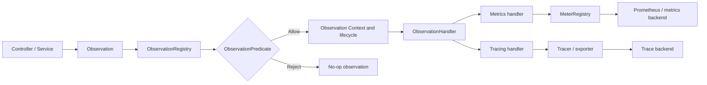
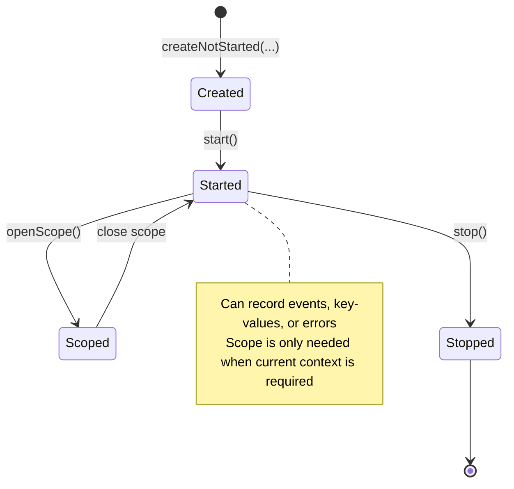

# ObservationRegistry: The Coordination Hub of Micrometer Observation

When investigating a slow order-creation API, we usually want to answer three sequential questions: *which operation took the most time*, *which services did this request pass through*, and *which error logs belong to which request*. In Spring Boot, **Micrometer Observation** models an operation so that both metrics and tracing systems can draw from the same source of context. **ObservationRegistry** is the component that coordinates those Observations.

This lesson belongs to the **Micrometer Observation** chapter of the `SPRING_BOOT_OBSERVABILITY` module. The scope of the module covers setting up observability for Spring Boot through Micrometer Observation, metrics, logs, and distributed tracing, including context propagation, tags/cardinality, exporters, sampling, and signal correlation for investigating production incidents. This lesson specifically focuses on how to use and configure **ObservationRegistry**; storage, visualization, and collection backends are mentioned where needed to explain the data flow.

## 1. What Problem Does ObservationRegistry Solve?

Suppose a payment-processing service needs to measure latency. One approach is to manually create a `Timer` and record every call. When tracing is needed, you manually create spans again; when correlating logs, you have to ensure trace context propagates properly across functions. If every piece of business code knows about every monitoring library directly, changing the observability stack makes the code hard to maintain.

Micrometer separates *describing the work to be observed* from *the mechanism that records telemetry*:

1. Business code creates an `Observation` with a stable name and meaningful key-values.
2. `ObservationRegistry` supplies configuration, decides whether the observation is accepted, and routes lifecycle events to `ObservationHandler` instances.
3. Matching handlers convert events into metrics, spans, or other integration behaviors.
4. The registry and handlers do not automatically replace Prometheus, an OTLP Collector, a log storage system, or a trace backend. Those components must be configured according to deployment needs.

**Definition:** `ObservationRegistry` is the central configuration and coordination point for Micrometer Observations within an application scope. An Observation created with a registry uses the predicates, conventions, filters, and handlers registered with that registry.

### Comparing commonly confused objects

| Object | Responsibility | Example |
| --- | --- | --- |
| `Observation` | Represents an observed operation and its lifecycle | `checkout.confirm` starts, throws an error, stops |
| `ObservationRegistry` | Holds observation config, exposes current observation context, and coordinates handlers | Bean injected into a service |
| `Observation.Context` | Holds data and key-values associated with an Observation | Operation name, channel type, error |
| `ObservationHandler` | Receives lifecycle callbacks and produces signals if it supports the context | Handler recording a Timer or creating a span |
| `MeterRegistry` | Registers, aggregates, and exposes metric data | Counter, Timer, Gauge |
| `Tracer` | Creates/manages spans, trace context, and tracing operations | Micrometer Tracing bridge |
| Exporter/backend | Forwards, stores, queries, or visualizes signals | Prometheus, OTLP, Jaeger, Tempo |

The registry is **not** a store of every Observation that has ever run. Nor is it where metric time series or trace history are stored. Handlers and backends perform those jobs according to configuration.

## 2. Coordination Mechanism in an Application



This is a **conceptual** diagram that simplifies the exact positions of certain lifecycle callbacks and filters. The key point: the application creates an Observation, the registry decides how it is handled, and specialized handlers translate it into signals. If a metrics handler is present without a tracing handler, the business logic still runs and metrics may be produced, while no corresponding spans are created.

A single registry can serve multiple categories of Observations:

- HTTP server/client paths pre-instrumented by the framework;
- database queries or calls to libraries with built-in integrations;
- business operations manually instrumented by developers;
- message processing, background jobs, or asynchronous tasks with appropriate instrumentation.

Not every operation appears automatically simply because an `ObservationRegistry` bean exists. Generating observations depends on instrumentation from the framework, libraries, or application code.

## 3. Creating and Obtaining an ObservationRegistry

### 3.1. In a Spring Boot application

With Spring Boot 3.x, when using `spring-boot-starter-actuator`, Boot provides Micrometer Observation integration and typically auto-configures an `ObservationRegistry` bean. The standard usage in a service is to **inject the Boot-managed bean**:

```xml
<dependencies>
    <dependency>
        <groupId>org.springframework.boot</groupId>
        <artifactId>spring-boot-starter-actuator</artifactId>
    </dependency>

    <!-- Add when Prometheus scraping is needed -->
    <dependency>
        <groupId>io.micrometer</groupId>
        <artifactId>micrometer-registry-prometheus</artifactId>
    </dependency>
</dependencies>
```

In the Java examples that follow, the project uses Spring Boot 3.x, Java 17+, and dependencies managed by the Spring Boot BOM/parent. Auto-configuration details or properties may differ when using other Spring Boot/Micrometer versions.

```java
import io.micrometer.observation.ObservationRegistry;
import org.springframework.stereotype.Service;

@Service
public class CheckoutService {
    private final ObservationRegistry observationRegistry;

    public CheckoutService(ObservationRegistry observationRegistry) {
        this.observationRegistry = observationRegistry;
    }

    // Business methods will use this same injected registry.
}
```

It is important to use the registry from the Spring container across business logic in the same application. If a service calls `ObservationRegistry.create()` on its own and uses a separate registry, handlers, filters, and policies configured by Boot on the main bean may not apply.

### 3.2. In plain Java applications

You can create a registry with:

```java
import io.micrometer.observation.ObservationRegistry;

ObservationRegistry registry = ObservationRegistry.create();
```

A newly created registry must have the necessary handlers and policies attached if you want to record metrics or traces. A standalone registry does not automatically expose Prometheus metrics or export spans to a backend. A no-op Observation or a registry not configured to record anything still allows the business code inside `observe(...)` to run normally.

**Practical rule:** in Spring Boot, inject the bean; in plain Java or isolated tests, you can create a registry and register handlers manually.

## 4. Observation Lifecycle and the Role of the Registry

Common lifecycle:



- `createNotStarted(name, registry)` creates an Observation bound to the registry without starting timing yet.
- `start()` starts the lifecycle; matching handlers can receive the `onStart` callback.
- `openScope()` places the Observation into the current context for the duration of the scope, allowing compatible components to access the active observation.
- `error(exception)` reports an error to the Observation; calling this method **does not replace throwing or handling the exception** in business code.
- `stop()` ends the Observation and triggers end-of-lifecycle processing; it must run even when the business logic fails.

### 4.1. The concise way: `observe(...)`

Example service confirming a transaction using a few normalized payment channel values:

```java
import io.micrometer.observation.Observation;
import io.micrometer.observation.ObservationRegistry;
import org.springframework.stereotype.Service;

@Service
public class PaymentService {
    private final ObservationRegistry registry;

    public PaymentService(ObservationRegistry registry) {
        this.registry = registry;
    }

    public String confirm(String orderRef, String paymentChannel) {
        String channel = normalizeChannel(paymentChannel);

        return Observation.createNotStarted("payment.confirm", registry)
            .contextualName("confirm-payment")
            .lowCardinalityKeyValue("payment.channel", channel)
            .highCardinalityKeyValue("order.ref", orderRef)
            .observe(() -> callPaymentProvider(orderRef));
    }

    private String normalizeChannel(String channel) {
        if ("card".equals(channel) || "bank".equals(channel)) {
            return channel;
        }
        return "other";
    }

    private String callPaymentProvider(String orderRef) {
        // Illustrative example: place the real partner adapter call here,
        // along with timeouts, controlled retries, and error handling.
        return "confirmed";
    }
}
```

`observe(Supplier)` automatically manages the start, scope, and stop steps for the wrapped operation; when an exception occurs, the observation mechanism records the error and rethrows it for calling code to handle. This is the right pattern for short synchronous code blocks.

The two key-value types serve different purposes:

- `payment.channel` has few values (`card`, `bank`, `other`): **low cardinality**, suitable as a metric label for group-level analysis.
- `order.ref` can differ on every request: **high cardinality**, and should not be used as a metric tag. Such data can be attached to spans by a tracing handler when appropriately configured. Only include reference IDs in telemetry if security policy allows; in practice, choose opaque IDs that contain no personal data.

The `contextualName` value typically serves as a readable span or context name; the Observation name `payment.confirm` should stay stable for creating metrics or applying conventions.

### 4.2. Manual lifecycle management when needed

When an operation spans multiple steps, needs events added, or requires explicit scope control, use the manual lifecycle:

```java
import io.micrometer.observation.Observation;
import io.micrometer.observation.ObservationRegistry;

public void process(ObservationRegistry registry) {
    Observation observation =
        Observation.createNotStarted("inventory.reserve", registry)
            .lowCardinalityKeyValue("inventory.mode", "online");

    observation.start();
    try (Observation.Scope scope = observation.openScope()) {
        reserveStock();
    } catch (RuntimeException ex) {
        observation.error(ex);
        throw ex;
    } finally {
        observation.stop();
    }
}

private void reserveStock() {
    // Actual synchronous business operation.
}
```

The example assumes both methods are in the same class. `try-with-resources` closes the scope before the `finally` block calls `stop()`. Forgetting `stop()` can cause missing or inaccurate timings; forgetting to close the scope can leave the current Observation active beyond its intended boundaries on the thread.

**Scope and lifecycle are two distinct concepts:** an Observation can start and stop without opening a scope, but instrumentation looking for the "current Observation" will not see its context. A scope does not automatically propagate context across another thread, message broker, or outbound HTTP request.

## 5. Observation.Context: The Data Carried Through

Each Observation has a context that lets you:

- record the operation name and contextual display name;
- attach low-cardinality key-values for metrics handlers to aggregate;
- attach high-cardinality key-values for handlers that can consume detailed data;
- record events or exceptions when needed;
- carry additional context-specific data, such as HTTP request/response objects or carriers for propagating trace context.

Example of data for a single operation:

| Property | Example value | Appropriate usage |
| --- | --- | --- |
| Observation name | `payment.confirm` | Grouping operations of the same type |
| Contextual name | `confirm-payment` | Readable span name |
| Low-cardinality `payment.channel` | `card` | Metric tag, analytical filtering |
| Low-cardinality `outcome` | `success` or `error` | Aggregating rates by outcome when recorded |
| High-cardinality `order.ref` | Opaque reference ID | Detailed lookup in traces/logs when permitted |
| Error | A `TimeoutException` | Marking failure in the appropriate telemetry |

### Why manage cardinality?

Suppose a timer metric has 3 values of `channel`, 4 values of `outcome`, and 6 values of `region`, plus instance and environment dimensions. Those first three tags alone yield up to **3 × 4 × 6 = 72 combinations**. Adding `order.ref` with 200,000 IDs could multiply the theoretical combinations enormously, driving up time series counts, memory usage, and cost.

Use low-cardinality key-values for data you want to chart on dashboards, alert on, and compare trends across. Reserve highly distinct identifiers for traces, logs, or dedicated lookup systems; also restrict sensitive data, because high-cardinality key-value does not mean "safe to log".

## 6. ObservationHandler: How the Registry Turns a Lifecycle into Signals

The registry holds a list of handlers capable of processing a given context type. A handler implements the `ObservationHandler` contract and provides lifecycle callbacks such as `onStart`, `onError`, `onEvent`, and `onStop`. The `supportsContext` method indicates whether a handler applies to the current context.

A metrics handler can use `MeterRegistry` to record duration and call counts; a tracing handler can start or end spans via `Tracer`. These handlers can process the same Observation together when configured to do so, avoiding the need to write instrumentation logic twice for the same operation.

In plain Java, a simple way to wire a registry to metrics is:

```java
import io.micrometer.core.instrument.MeterRegistry;
import io.micrometer.core.instrument.simple.SimpleMeterRegistry;
import io.micrometer.core.instrument.observation.DefaultMeterObservationHandler;
import io.micrometer.observation.Observation;
import io.micrometer.observation.ObservationRegistry;

MeterRegistry meters = new SimpleMeterRegistry();
ObservationRegistry observations = ObservationRegistry.create();
observations.observationConfig()
    .observationHandler(new DefaultMeterObservationHandler(meters));

Observation.createNotStarted("batch.import", observations)
    .lowCardinalityKeyValue("source", "file")
    .observe(() -> runBatch());

// The timer contains data after the code block has been observed and stopped.
long count = meters.get("batch.import").timer().count();
```

The snippet assumes a `runBatch()` method exists in the enclosing class. It illustrates **manual handler registration**; in Spring Boot, you should rely on the registry bean and handlers set up by auto-configuration. A `SimpleMeterRegistry` keeps metrics in memory and does not expose a Prometheus endpoint or push data to a collector.

**Note on ordering:** when combining multiple handlers (especially composite handlers used with tracing contexts), handler selection rules and ordering affect the outcome. Do not assume every handler in every configuration receives the exact same callbacks. Check the actual configuration if metrics are recorded while spans do not appear, or vice versa.

### Is a handler an exporter?

No. A handler converts Observation events into the data or state of a corresponding library. For instance, a metrics handler writes to `MeterRegistry`, and the registry/metrics exporter serves data to Prometheus; a tracing handler interacts with the tracer, and a tracing exporter ships data to a collector. The registry does not directly handle every export or storage stage.

## 7. Predicates, Filters, and Conventions at the Registry Level

In Spring Boot, these policies are typically applied through registry configuration or corresponding beans to standardize instrumentation.

| Mechanism | Question answered | Caveat |
| --- | --- | --- |
| `ObservationPredicate` | Should an active observation be created for this name/context? | Filtering too broadly can drop both metrics and traces for critical operations |
| `ObservationFilter` | Should the context be modified/supplemented before processing finishes? | Often applied late in the lifecycle; does not replace data handlers need at start |
| `ObservationConvention` | Which naming and key-value standard should be used? | Helps keep naming and tags consistent |
| `ObservationHandler` | Once an Observation exists, which signals are produced? | Depends on context type and registered handlers |

### 7.1. Example ObservationFilter adding a shared label

```java
import io.micrometer.common.KeyValue;
import io.micrometer.observation.ObservationFilter;
import org.springframework.context.annotation.Bean;
import org.springframework.context.annotation.Configuration;

@Configuration
class ObservationPolicyConfiguration {
    @Bean
    ObservationFilter teamTag() {
        return context -> context.addLowCardinalityKeyValue(
            KeyValue.of("team", "checkout")
        );
    }
}
```

With appropriate Spring Boot 3.x auto-configuration, an `ObservationFilter` bean can be registered into the managed observation registry. The `team` label has a bounded value set and is suitable for aggregation. If you need to add information that a tracing handler requires right when a span starts, understand when filters are applied and consider supplying that data before `start()` rather than relying on an end-of-lifecycle filter.

### 7.2. Example ObservationPredicate excluding internal checks

```java
import io.micrometer.observation.ObservationPredicate;
import org.springframework.context.annotation.Bean;

@Bean
ObservationPredicate excludeSyntheticCheck() {
    return (name, context) -> !name.equals("internal.synthetic.check");
}
```

This example lives inside a `@Configuration` class; it filters out a specific known Observation name. In real usage, verify that this is truly traffic you want to exclude, because dropping observations affects both error visibility and operational counts. Do not use predicates to hide production errors that operators need to investigate.

### 7.3. Conventions for unifying names and tags

`ObservationConvention` defines how names or key-values are produced for a group of observations; `GlobalObservationConvention` can supply shared behavior when appropriate. An HTTP server observation can use a URI template `/orders/{id}` instead of a URL containing dynamic IDs. A custom payment observation can standardize the `payment.confirm` name and `payment.channel` tag across services.

You do not have to write conventions on day one: create them when the same kind of Observation appears in multiple places or when you need to enforce a controlled telemetry schema.

## 8. Scope, Current Context, and Propagation

When an Observation opens a scope, code running in the same execution context can retrieve the current observation through the registry:

```java
Observation current = observationRegistry.getCurrentObservation();
if (current != null) {
    current.lowCardinalityKeyValue("flow", "checkout");
}
```

This pattern only makes sense when code executes inside an appropriate scope; outside, it may return `null`. Inside a service, avoid overusing `getCurrentObservation()` at every layer to add tags, as you may accidentally mutate the framework/HTTP Observation instead of the custom Observation you intended.

### 8.1. Across synchronous calls

If `checkout.confirm` opens a scope, synchronous code called within that scope sees the current observation. When instrumentation creates a child span, the tracer can use the scope's context to establish a parent–child relationship, provided a tracing handler is configured.

### 8.2. Across threads, executors, reactive chains, or messages

A ThreadLocal scope **does not automatically guarantee** propagation when work switches threads. With `CompletableFuture`, `@Async`, schedulers, Reactor, or message brokers, you must use compatible context capture/restore mechanisms (such as Micrometer Context Propagation and corresponding framework support). Avoid ad-hoc copying of context into arbitrary ThreadLocals.

Across HTTP or messaging, trace context must be injected into headers/metadata on the sending side and extracted on the receiving side by instrumentation and a compatible propagation format, typically W3C Trace Context. `ObservationRegistry` is one link on the application side; **injecting the registry alone does not automatically carry `traceId` over the network**.

### 8.3. Correlating with logs

When tracing integration sets up MDC and logging patterns properly, logs can include `traceId`/`spanId`. This lets you search logs by trace or jump from a log entry to its trace. Field names and whether they appear in logs depend on versions and logging configuration. `ObservationRegistry` is **not** a log collector; log export still requires configuring a dedicated sink, agent, or pipeline.

## 9. Integrating the Registry with Actuator and Observability Backends

An illustrative Spring Boot 3.x configuration:

```yaml
spring:
  application:
    name: payment-service

management:
  endpoints:
    web:
      exposure:
        include: health,metrics,prometheus
  observations:
    key-values:
      application: payment-service
  tracing:
    sampling:
      probability: 0.1
```

With a Prometheus registry present, Actuator can expose `/actuator/prometheus`; `/actuator/metrics` lets you inspect current meter names and tags. Setting `management.tracing.sampling.probability` alone **does not enable distributed tracing by itself**: you also need a Micrometer Tracing bridge, exporter, propagation, and a compatible backend.

Example tracing dependencies commonly used with Spring Boot 3.x when choosing OpenTelemetry:

```xml
<dependency>
    <groupId>io.micrometer</groupId>
    <artifactId>micrometer-tracing-bridge-otel</artifactId>
</dependency>
<dependency>
    <groupId>io.opentelemetry</groupId>
    <artifactId>opentelemetry-exporter-otlp</artifactId>
</dependency>
```

The application must also specify an exporter endpoint matching the protocol supported by the collector (such as OTLP HTTP) along with appropriate network and security settings. Trace sampling affects whether spans are kept, whereas metrics may be recorded at a different rate. If an observation is rejected by a predicate before handlers receive it, neither metrics nor traces from that observation may appear.

Note: enabling HTTP exposure only controls which endpoints are reachable over the web—it does not replace authentication and authorization. Restrict access to `/actuator/metrics`, `/actuator/prometheus`, and management endpoints using appropriate network policies and Spring Security.

## 10. Investigating "The Observation Ran, Yet No Signals Show Up"

Suppose payments succeed, yet dashboards show no `payment.confirm` chart. Verify in order:

| Check | What to determine | Appropriate action |
| --- | --- | --- |
| Registry in use | Did the service inject the Spring-managed registry or create a standalone one? | Use the shared `ObservationRegistry` bean |
| Code execution path | Did `observe(...)` or `start()/stop()` actually execute? | Trigger a real test request, check exception paths |
| Predicate | Was the Observation blocked before being recorded? | Inspect filtering policies |
| Handler | Is there a metrics or tracing handler supporting this context? | Verify dependencies and auto-configuration |
| Meter | Does the meter have the exact name/tags being queried? | Inspect `/actuator/metrics` and key-values |
| Exporter | Is the backend scraping or receiving data successfully? | Check registry/exporter/collector, endpoint, network |
| Sampling | Could the trace have been dropped by the sampling policy? | Check sampling probability, sampler type, and backend |
| Propagation | Do spans across multiple services share the same `traceId`? | Check headers, thread-switch context, client/server instrumentation |
| Log correlation | Do logs have `traceId`/`spanId` inside the appropriate scope? | Check tracing, MDC, and log pattern |

One notable case: **metrics appear, but traces do not**. Possible causes include only configuring a metrics handler, a failing trace exporter, sampling dropping the request, or broken context. Do not rush to rewrite Observation code before identifying which layer dropped the signal.

In the opposite case—**traces appear, but metrics do not**—the cause may be a missing meter handler/registry, a different metric name than expected, an observation using a custom context/handler, or misconfigured metric export policies.

## 11. Common Design Mistakes

| Mistake | Why it is dangerous | How to avoid |
| --- | --- | --- |
| Creating a new registry in every service | Fragments handlers/filters, loses Boot config, and produces inconsistent telemetry | Inject the main registry |
| Using `orderId` or `email` as low-cardinality tags | Causes series explosion and risks exposing sensitive data | Use bounded tags; put IDs in traces/logs when permitted |
| Forgetting `stop()` or closing scope | Missing measurements or corrupted current observation | Prefer `observe(...)`; use `try/finally` when manual |
| Assuming scope automatically crosses `@Async` | Disconnected spans and lost correlation | Use compatible context propagation |
| Configuring a filter too late for data needed at `onStart` | Handlers may not see key-values when creating spans | Supply data before `start()` or use an appropriate convention |
| Registering overlapping handlers | Can duplicate data or behave unexpectedly | Review handler selection rules and auto-configuration |
| Ignoring exporter/backend setup | Data stays inside the process only | Verify ingestion, scraping, and retention policies |
| Confusing trace sampling with metrics sampling | Misinterprets figures and investigation coverage | Distinguish each signal and its data path |

## 12. Hands-on: Verifying ObservationRegistry Yourself

Run on a Spring Boot application with Actuator:

1. Inject `ObservationRegistry` into a service, create an `Observation` named `payment.confirm`, and wrap an operation with `observe(...)`.
2. Call the service at least twice with `payment.channel` set to `card` and `bank`. Use `curl http://localhost:8080/actuator/metrics` to look up meter names; once `payment.confirm` appears, query `curl http://localhost:8080/actuator/metrics/payment.confirm` to inspect counts, timings, and tags.
3. Try passing a random channel value; verify that the normalization helper maps it to `other`, preventing cardinality growth.
4. Add a code path that throws an exception and verify the error propagates to the caller. Inspect metrics/tracing depending on your setup; do not assume all exceptions produce identical error labels across every version.
5. Create a manual Observation, open/close its scope, and check `getCurrentObservation()` inside and outside the scope. Then run a task on an executor to see why context propagation is needed.
6. If a tracing backend is configured, send a request across two services and verify span/`traceId` relationships; adjust the sampling rate in a test environment and observe the number of received traces.
7. Review Actuator access policies and ensure sensitive data or endpoints are not exposed to the Internet.

**Self-assessment criteria:** you can explain why `ObservationRegistry` differs from `MeterRegistry`, how an Observation goes through create–start–scope–stop, when to use low vs. high cardinality, when handlers record signals, and why metrics or traces may be missing even while business code runs normally.

## Conclusion

`ObservationRegistry` is the bridge between **instrumenting work in code** and **the telemetry collection mechanisms** of your observability stack. It manages policies applied to Observations and coordinates handlers across the lifecycle, enabling a single business operation to contribute metrics and distributed traces without coupling business code directly to each backend. In Spring Boot, using the framework-managed registry, choosing stable names and tags, managing scopes and propagation explicitly, and verifying handlers, exporters, and sampling form the foundation for correlating metrics, logs, and traces when investigating errors and latency in production.
