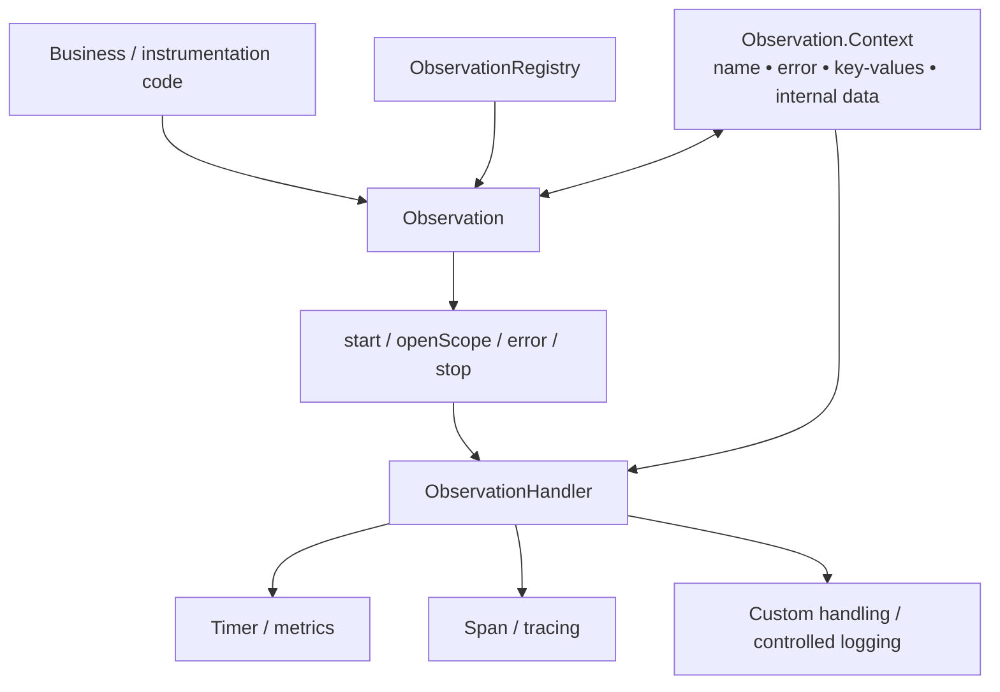

# Observation.Context in Micrometer Observation

## 1. Objectives and Context

In a Spring Boot application, `Observation` represents **an operation being observed**: handling an HTTP request, calling a payment service, querying data, or executing a business step. `Observation.Context` is **the object holding data for that specific operation** so that instrumented code, `ObservationHandler` instances, and custom components can exchange information.

After this lesson, you will be able to:

- Explain what `Observation.Context` stores and why it is needed alongside `Observation`, `ObservationRegistry`, and `Observation.Scope`.
- Use the `put/get/getOrDefault/getRequired/computeIfAbsent` APIs, naming fields, error field, and key-values.
- Distinguish between **internal Context data**, **low-cardinality key-values**, and **high-cardinality key-values**.
- Read and mutate Context across the observation lifecycle, `ObservationHandler`, `ObservationConvention`, and `ObservationFilter`.
- Design Context in Spring Boot for exporting metrics/traces, propagating context across threads or distributed systems, and correlating logs to find errors and latency.

This lesson belongs to the **Micrometer Observation** chapter of the **SPRING_BOOT_OBSERVABILITY** module. The illustrated APIs are based on Micrometer Observation and modern Spring Boot, primarily suited to the Spring Boot 3.x branch; when using Spring Boot 4.x, check the dependencies and configuration property names for your exact version.

## 2. What Role Does Context Play in the Observation Flow?

Suppose the `POST /orders` API calls `inventory.reserve`. Micrometer needs to know the operation name, sales channel group, error (if any), and certain data so handlers can create a Timer or a span. That data may become available at different points in time:

1. At start: knowing the operation is `inventory.reserve`, `channel=web`.
2. During execution: knowing it reached the `database` step.
3. On error: knowing an exception occurred and at which step.
4. At stop: handlers read the total duration, labels, and status to process.

`Observation.Context` stays with **a single observation instance** throughout this entire flow. It is a mutable data store passed to handlers whenever Micrometer fires lifecycle callbacks.



**Context does not generate metrics, traces, or logs on its own.** The handlers registered in the registry decide what actions to take on lifecycle events. An application can use the same `Observation.Context` so multiple handlers can read different perspectives from it.

### Distinguishing four similarly named concepts

| Component | Question answered | Example |
| --- | --- | --- |
| `ObservationRegistry` | Which set of handlers, filters, and conventions does the Observation use? | Registry auto-configured by Spring Boot Actuator |
| `Observation` | Which operation is running, and when did it start/stop? | `inventory.reserve` |
| `Observation.Context` | What data and metadata does this operation have? | `channel=web`, `error`, step `database` |
| `Observation.Scope` | Which Observation is *current* on the active execution context? | Scope of the request currently being processed |

An observation can exist without a scope; a scope can be closed while the observation continues running. **Scope is not Context** and does not replace `stop()`. Context is also not another name for Reactor `Context`, OpenTelemetry `Context`, or logging MDC.

## 3. Structure of `Observation.Context`

`io.micrometer.observation.Observation.Context` is a mutable type with map-like access plus observation-specific metadata. It implements the read-only view interface `Observation.ContextView`.

| Group | Typical API | Meaning |
| --- | --- | --- |
| Identity | `getName()`, `getContextualName()` | Stable name for the observation and human-readable name for span display |
| Labels | `getLowCardinalityKeyValues()`, `getHighCardinalityKeyValues()` | Metadata designed for handlers to translate into signals |
| Status | `getError()` | Exception recorded for the operation |
| Relationship | `getParentObservation()` | Parent observation, if any |
| Arbitrary data | `put(key, value)`, `get(key)`, `remove(key)` | Pass state from instrumentation to handlers |
| Safe reads | `containsKey(key)`, `getOrDefault(key, fallback)`, `getRequired(key)` | Check presence and missing-data policy |
| Lazy computation | `computeIfAbsent(key, function)` | Compute and store a value only if absent |
| Read-only view | `Observation.ContextView` | Used when the receiver only needs to inspect, not modify |

Do not confuse these:
- `context.put("checkout.phase", "database")` stores **internal** data. This **does not automatically create** a metric label or trace attribute.
- `observation.lowCardinalityKeyValue("channel", "web")` adds a **low-cardinality** label for appropriate handlers to process.
- `observation.highCardinalityKeyValue("request.id", "...")` adds a **high-cardinality** label, typically suited for spans when privacy rules allow; do not use it to create metric tags that can grow unboundedly.

### 3.1. Using Context as a key-value data store

```java
import io.micrometer.observation.Observation;

// One Context is created specifically for a single execution.
Observation.Context context = new Observation.Context();
Object stepKey = "inventory.step";

context.put(stepKey, "received");
String current = context.get(stepKey);                  // "received"
String missing = context.getOrDefault("unknown", "n/a"); // "n/a"
boolean exists = context.containsKey(stepKey);          // true

// When the key is guaranteed to exist; missing throws IllegalArgumentException.
String required = context.getRequired(stepKey);

// Invokes the mapping function only if the key is absent.
String owner = context.computeIfAbsent("inventory.owner",
        key -> "stock-service");

context.remove(stepKey);
```

Note: `get(...)` methods infer a generic return type from the call site; authors must keep the **data type** consistent for each key. Mixing `Integer` and `String` under the same key can cause cast errors. You can use dedicated constant keys (`static final Object` or namespaced string constants) to avoid name collisions across handlers. Do not store `null` as a business state; use explicit values or types to represent missing data.

This is a context store for an active operation, **not a long-term store**, not an application cache, and not suitable for holding large payloads or secrets.

### 3.2. Name, contextual name, errors, and parent-child relationships

Example:
- **Name**: `inventory.reserve` — constant across requests, convenient for metric names and rules.
- **Contextual name**: `reserve inventory` — friendlier when reading a single span.
- **Error**: `IllegalStateException` when out of stock; readable via `context.getError()` after the observation records the error.
- **Parent**: if `inventory.reserve` runs inside the `http.server.requests` scope, it can have a parent observation.

Names should not contain `orderId` or URLs with IDs. A parent may not exist, and parent-child linkage also depends on context being propagated properly across thread and network boundaries.

## 4. Observation Lifecycle and When Context Is Used

```text
Create Observation/Context
  │  └─ ObservationPredicate checks whether to create an active observation
  ▼
start()              → ObservationHandler.onStart(context)
  ▼
openScope()          → handler receives scope event; current observation is bound to scope
  ▼
Business execution   → code/handlers can update Context
  ├─ error(exception)→ ObservationHandler.onError(context)
  └─ event(event)     → handler receives event callback
  ▼
close Scope          → handler receives scope-closed event
  ▼
stop()
  ├─ ObservationFilter can transform Context
  └─ ObservationHandler.onStop(context)
```

Key points to remember:

- **`ObservationPredicate` runs at creation** to decide whether to create an active observation or return a no-op. A predicate is not the place to attach data only known after the business logic finishes.
- **`ObservationHandler` receives the Context itself** in matching callbacks: `onStart`, `onError`, `onStop`, etc.; a handler can store auxiliary data in the internal map for use in a later callback.
- **`ObservationFilter` runs before `onStop` callbacks** and can supplement/adjust Context. Data only available at stop time cannot go back in time to influence decisions already made in `onStart`.
- Opening/closing a scope establishes the current observation to link nested work. `Observation.Context` does not automatically copy its map contents into an HTTP header or another thread.
- Mutating Context **after `stop()`** does not guarantee exported metrics/spans will change. Set information early enough so any handler that needs it can use it.

Callbacks only fire for handlers that support the specific Context. If the registry has no metrics/tracing handler, creating a Context alone is not enough to emit those signals.

## 5. Spring Boot Example: Putting Data into Context

To use Observation in a Spring Boot application, you typically include `spring-boot-starter-actuator`. Spring Boot provides an `ObservationRegistry` to inject. The example uses Java 17+, and these APIs do not depend on a specific metrics/traces backend.

```java
import io.micrometer.observation.Observation;
import io.micrometer.observation.ObservationRegistry;
import org.springframework.stereotype.Service;

@Service
public class InventoryReservationService {
    public static final String STEP_KEY = "inventory.step";

    private final ObservationRegistry observationRegistry;

    public InventoryReservationService(ObservationRegistry observationRegistry) {
        this.observationRegistry = observationRegistry;
    }

    public void reserve(String source, Runnable databaseAction) {
        // Bound the label set: only "web" or "other".
        String channel = "web".equals(source) ? "web" : "other";

        Observation.Context context = new Observation.Context();
        context.put(STEP_KEY, "created");

        Observation observation = Observation.createNotStarted(
                        "inventory.reserve",
                        () -> context,
                        observationRegistry)
                .contextualName("reserve inventory")
                .lowCardinalityKeyValue("channel", channel);

        observation.observe(() -> {
            context.put(STEP_KEY, "checking-stock");
            databaseAction.run(); // May throw RuntimeException
            context.put(STEP_KEY, "completed");
        });
    }
}
```

`Runnable databaseAction` keeps the example independent of a specific database or framework. In a real project, replace it with a repository/service call. `observe(Runnable)` manages start, scope, exception recording, and stop for synchronous processing. If `databaseAction` throws an exception, the line setting `completed` does not execute; handlers at the stop phase can read `inventory.step=checking-stock` and `context.getError()`.

If you need manual lifecycle control instead of `observe`, the safe pattern for synchronous work is:

```java
Observation observation = Observation.start("inventory.reserve", observationRegistry);
try (Observation.Scope scope = observation.openScope()) {
    doWork();
} catch (RuntimeException ex) {
    observation.error(ex);
    throw ex;
} finally {
    observation.stop();
}
```

`doWork()` in this example is a business method you implement. With `CompletableFuture` or asynchronous publishers, the caller's `finally` block can run **before the actual work finishes**; in those cases, you must manage the observation's completion point according to the asynchronous lifecycle.

## 6. `ObservationHandler` Reads Context to Do Its Job

A handler is invoked if `supportsContext(context)` returns `true`. Example of writing an operational *debug-level* log based on the last processing step and error state:

```java
import io.micrometer.observation.Observation;
import io.micrometer.observation.ObservationHandler;
import org.slf4j.Logger;
import org.slf4j.LoggerFactory;
import org.springframework.stereotype.Component;

@Component
public class InventoryContextHandler
        implements ObservationHandler<Observation.Context> {

    private static final Logger log =
            LoggerFactory.getLogger(InventoryContextHandler.class);

    @Override
    public boolean supportsContext(Observation.Context context) {
        return "inventory.reserve".equals(context.getName());
    }

    @Override
    public void onStop(Observation.Context context) {
        String step = context.getOrDefault(
                InventoryReservationService.STEP_KEY, "unknown");
        Throwable error = context.getError();

        log.debug("inventory observation: step={}, outcome={}",
                step, error == null ? "success" : "failure");
    }
}
```

Spring Boot registers `ObservationHandler` beans with the auto-configured `ObservationRegistry`, so the handler above is picked up once Actuator/Observation is configured. If using plain Micrometer, you must register it manually:

```java
ObservationRegistry registry = ObservationRegistry.create();
registry.observationConfig()
        .observationHandler(new InventoryContextHandler());
```

The handler above is **only an example of reading data from Context**. In a real application, logging every observation can generate very high volume; consider log levels, selective fields, and avoid logging sensitive values. Adding a custom handler also does not install a tracing exporter or metrics registry by itself.

## 7. Custom Context and ObservationConvention

For large libraries or multiple call sites, a strongly typed specialized Context is often better than spreading arbitrary string keys across many places:

```java
import io.micrometer.observation.Observation;

public final class InventoryObservationContext extends Observation.Context {
    private final String channel;
    private final String operation;

    public InventoryObservationContext(String channel, String operation) {
        this.channel = channel;
        this.operation = operation;
    }

    public String channel() {
        return channel;
    }

    public String operation() {
        return operation;
    }
}
```

A handler can check `context instanceof InventoryObservationContext` and read `channel()` and `operation()`. `ObservationConvention<InventoryObservationContext>` lets you standardize **observation name, contextual name, and key-values** based on the Context type. These rules are useful when an instrumentation is shared across multiple Spring Boot applications: the same group of operations gets consistent names and labels.

Minimal Convention example:

```java
import io.micrometer.common.KeyValues;
import io.micrometer.observation.Observation;
import io.micrometer.observation.ObservationConvention;

public class InventoryObservationConvention
        implements ObservationConvention<InventoryObservationContext> {

    @Override
    public boolean supportsContext(Observation.Context context) {
        return context instanceof InventoryObservationContext;
    }

    @Override
    public String getName() {
        return "inventory.reserve";
    }

    @Override
    public String getContextualName(InventoryObservationContext context) {
        return "reserve inventory";
    }

    @Override
    public KeyValues getLowCardinalityKeyValues(
            InventoryObservationContext context) {
        return KeyValues.of("channel", context.channel());
    }
}
```

One way to create a specialized Context when specifying a name directly:

```java
InventoryObservationContext context =
        new InventoryObservationContext("web", "reserve");

Observation.createNotStarted("inventory.reserve",
        () -> context, observationRegistry)
        .observe(this::doWork);
```

Use the overload accepting `ObservationConvention` when a convention should determine the name and labels. In the example above that creates the observation with a **direct name**, the convention is not automatically applied just because the convention class exists. For Spring MVC/WebFlux HTTP requests, the framework already provides its own context classes and conventions; do not re-instrument the same request unless there is an explicit additional requirement.

## 8. Distinguishing Map Data, Tags, and Carriers

Four types of information that are easy to confuse:

| Data source | Example | Automatically sent to metrics/traces? | Rule |
| --- | --- | --- | --- |
| Internal map of `Observation.Context` | `inventory.step=checking-stock` | **No**. Handlers must explicitly consume it | Do not store large objects, tokens, or payment info |
| Low-cardinality key-values | `channel=web`, `result=ok` | Can become metric tags and span attributes via handlers | Small, bounded, stable value set |
| High-cardinality key-values | Opaque workflow run ID | Usually goes to span attributes, **never use as metric tags** | Must account for sensitivity, retention, and sampling |
| Propagation carrier | HTTP headers, message headers | Only via sender/receiver instrumentation | The propagator decides which headers are injected/extracted |

For example, with 5 channels, 4 outcomes, and 3 deployment regions, there can be up to `5 × 4 × 3 = 60` label combinations before counting instances and other dimensions. Adding `orderId` to low-cardinality tags can cause time series to grow per order, consuming excessive resources in Prometheus or your metrics backend.

When you need to attach shared values to every Context, an `ObservationFilter` can supplement key-values before the stop event. In Spring Boot, `ObservationFilter` beans are registered automatically:

```java
import io.micrometer.common.KeyValue;
import io.micrometer.observation.ObservationFilter;
import org.springframework.context.annotation.Bean;
import org.springframework.context.annotation.Configuration;

@Configuration
class ObservationTagConfiguration {

    @Bean
    ObservationFilter inventoryComponentTag() {
        return context -> {
            if ("inventory.reserve".equals(context.getName())) {
                context.addLowCardinalityKeyValue(
                        KeyValue.of("component", "inventory"));
            }
            return context;
        };
    }
}
```

Because filters run near stop time, do not use them to supply data that a handler **must already know at `onStart`**. To decide whether an observation should be active at all, use `ObservationPredicate` instead of a filter. If you only need to restrict metric labels or series at the metrics registry level, see Micrometer Metrics' `MeterFilter` mechanism.

## 9. Context and Propagating Context Across Threads and Services

These are two separate concerns:

1. **Observation data context** holds the name, error, key-values, and map for one operation.
2. **Context propagation** transfers the *active execution context* (such as current observation/span) across thread boundaries, reactive chains, or networks to preserve trace relationships.

Micrometer Context Propagation can help transfer the current observation across executors/reactive operators when properly integrated. That **does not mean** every `context.put(...)` entry automatically turns into an HTTP header or gets copied to another service.

```mermaid
sequenceDiagram
    participant A as HTTP API
    participant B as Async worker
    participant C as Payment service
    A->>A: Observation A + Context A
    A->>B: Propagate current observation (when configured)
    B->>B: Observation B + Context B
    B->>C: Request + traceparent (when instrumented)
    C->>C: Observation C + Context C
    Note over A,C: Same traceId can link spans; the Contexts remain distinct objects
```

In Spring Boot 3.x with Spring WebFlux, you can enable `spring.reactor.context-propagation=auto` when appropriate for your version and Reactor usage. For `@Async` executors, configure `ContextPropagatingTaskDecorator` on the executor that needs context propagation, for example:

```java
import org.springframework.context.annotation.Bean;
import org.springframework.context.annotation.Configuration;
import org.springframework.core.task.support.ContextPropagatingTaskDecorator;

@Configuration
class AsyncObservationConfiguration {
    @Bean
    ContextPropagatingTaskDecorator contextPropagatingTaskDecorator() {
        return new ContextPropagatingTaskDecorator();
    }
}
```

Verify that your actual executor applies that decorator; auto-configuration behavior can vary across Spring Boot versions. Under concurrent execution, never rely on multiple threads mutating the same Context in a fixed order; design explicit state and lifecycle management.

### 9.1. SenderContext and ReceiverContext

When instrumenting an HTTP client or messaging layer yourself, Micrometer provides specialized Contexts:

- `SenderContext<C>`: holds the **carrier** (request/message) and a header **setter**. A tracing handler can inject `traceparent` or propagation metadata into the carrier.
- `ReceiverContext<C>`: holds the carrier and a header **getter**. A tracing handler can extract the parent context from the incoming request/message.

Direction of flow:

```text
API (SenderContext + HTTP headers)
   └─ traceparent → Payment service (ReceiverContext + HTTP headers)
                      └─ child observation/span linked into trace when matching handler exists
```

These are specialized Contexts for working with transports. For `RestClient` and `WebClient` built from Spring Boot-configured builders, suitable instrumentation is typically already in place; only write custom Sender/Receiver Contexts when building integrations for an unsupported transport. Avoid stuffing arbitrary business data into propagation headers or baggage.

## 10. Using Context to Investigate Errors and Latency

Scenario: `POST /orders` latency increases and some order placements fail.

1. **Metric**: notice that HTTP processing time or `inventory.reserve` duration increased; filter by bounded-cardinality labels such as `channel=web`.
2. **Trace**: pick a trace containing the `inventory.reserve` span and inspect it alongside adjacent database/HTTP spans to pinpoint the slow stage.
3. **Log**: search logs by properly populated `traceId`/`spanId`; read errors by business step.
4. **Context**: handlers can read `inventory.step=checking-stock` and `getError()` to provide extra operational context **if you explicitly configured exporting it**.
5. **Cross-check**: a single trace is an example, not guaranteed to represent all requests; use aggregated metrics to quantify overall impact.

If you need `inventory.step` on a trace, decide how to encode it via `KeyValue` or a suitable handler while bounding the value set and avoiding data leaks. `Context.put` by itself does not guarantee the value appears in a backend.

### Common failure modes

| Symptom | Common cause | What to check |
| --- | --- | --- |
| Handler does not run | Not registered or `supportsContext` returns false | Check registry, bean, name, and Context type |
| `get(key)` returns null | Key not set, wrong key/type, or written to a different Context | Use shared constant keys; check creation and callbacks |
| Metric lacks `inventory.step` label | Data was only stored with `put` | Needs `lowCardinalityKeyValue` or Convention/Filter |
| Tag has millions of values | Dynamic ID/URL put into low-cardinality tags | Switch to bounded labels; audit cardinality |
| Logs have `traceId` but no span | Sampling/exporter/backend did not retain the trace | Check sampling and span export path |
| Trace breaks after executor | Current observation not propagated | Check `TaskDecorator`/reactive propagation |
| Handler sees Context at `stop` missing expected data | Data arrived too late, overwritten, or wrong callback timing | Set data earlier relative to where it is read |
| `Context` contains sensitive data | Uncontrolled storage of request/response or credentials | Trim payloads, classify fields, keep only necessary info |

## 11. Checklist for Designing a Good Context

- **One operation, one Context** with a bounded lifetime; do not reuse a mutable Context across independent requests.
- Keep observation names short and stable; use contextual names for trace readability.
- Choose a **specialized Context type** when there is a clear data contract shared by multiple handlers/conventions.
- Separate internal operational data from data permitted for external export.
- Bound cardinality before promoting information to a metric tag.
- Record errors with `observation.error(ex)` when managing manually; always call `stop()` and close the scope.
- Verify propagation across the exact executor, reactive pipeline, HTTP, or broker boundaries.
- For tracing backends, check samplers, exporters, and retention when correlating metrics, traces, and logs.
- Do not assume every handler sees the same values at every point; test success, error, and asynchronous paths.

## 12. Self-Study Questions

1. Why does `context.put("order.id", "123")` not automatically create an `order.id` tag in Prometheus?
2. How do `Observation.Context` and `Observation.Scope` differ?
3. A handler reads `getError()` in `onStop`, but sees no exception; how would you inspect the error-handling path?
4. When should you create `InventoryObservationContext extends Observation.Context` instead of using string keys?
5. At which stage can `ObservationFilter` add labels, and why is it unsuitable for providing data required by `onStart`?
6. Can you transfer the entire map contents of `Observation.Context` to another service using only W3C `traceparent`? Why or why not?
7. If time series spike sharply after adding `orderId` as a low-cardinality tag, how would you change the instrumentation?
8. Add a custom handler that reads `inventory.step`; verify with both a successful request and a failing request that the final step value and `getError()` match expectations.

## References

- [Micrometer Reference — Observation Components](https://docs.micrometer.io/micrometer/reference/observation/components.html)
- [Micrometer Reference — Instrumentation, Context Propagation, Sender/Receiver Context](https://docs.micrometer.io/micrometer/reference/observation/instrumenting.html)
- [Micrometer Javadoc — Observation.Context](https://javadoc.io/doc/io.micrometer/micrometer-observation/latest/io/micrometer/observation/Observation.Context.html)
- [Spring Boot 3.5 — Observability](https://docs.spring.io/spring-boot/3.5/reference/actuator/observability.html)
- [Spring Framework — Observability Support](https://docs.spring.io/spring-framework/reference/integration/observability.html)
