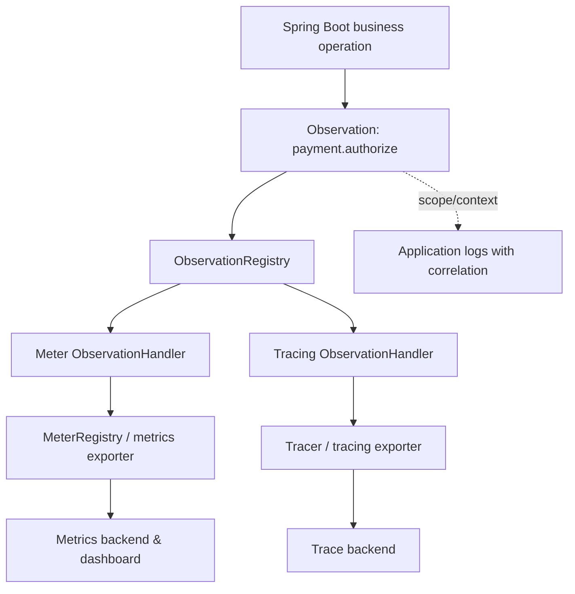

# Observation Name in Micrometer Observation

In the **SPRING_BOOT_OBSERVABILITY** module, we set up observability for Spring Boot using Micrometer Observation, metrics, logs, and distributed tracing. One seemingly small decision that directly affects dashboards, alerts, and incident investigation is **naming an observation**.

**Observation name** answers the question: *"What kind of operation is the system observing?"* For example, `payment.authorize` represents payment authorization logic, regardless of which order is being processed, which provider is called, or how many milliseconds the operation takes. A good name stays identical across thousands of executions; differences between runs are expressed through **key-values**, error status, logs, and traces.

This topic focuses on choosing, using, and maintaining observation names. To understand it properly, distinguish the observation name from a span's display name, metric labels, and identifiers of a specific request.

## 1. What Is an Observation Name?

Micrometer Observation models an activity that has a start and an end, for example:

- Calculating cart prices: `checkout.price.calculate`.
- Reserving stock: `inventory.reserve`.
- Authorizing payment: `payment.authorize`.
- Processing a business message: `order.message.process`.

An observation flows through `ObservationRegistry` and configured `ObservationHandler` instances. Handlers can create a **metric**, a **trace/span**, both, or emit no external signal. The observation name provides a logical identifier used by handlers and naming conventions.

In common Micrometer Metrics setups, the observation name typically becomes the meter name (such as a timer recording operation duration and count); in Micrometer Tracing setups, that name is a fallback source for the span name if no contextual name is provided. Exact behavior also depends on observation conventions, handlers, library versions, and exporters.

**There is no rule saying "every execution gets a new observation name".** Each execution has its own observation instance, yet multiple instances of the same operation **share one stable name**.

```text
Operation at T1: payment.authorize
  provider=bank_a, outcome=approved, duration=120 ms

Operation at T2: payment.authorize
  provider=bank_b, outcome=declined, duration=260 ms

Operation at T3: payment.authorize
  provider=bank_a, outcome=error, duration=1 800 ms

                      same observation name
                              │
                              ▼
             metric by name + bounded labels
             separate spans in individual traces
```

If you want to compute the error rate and p95 latency of *payment authorization*, a stable name lets queries aggregate all runs within the right scope.

## 2. Distinguishing Five Commonly Confused Concepts

| Concept | Question answered | Example | Role |
| --- | --- | --- | --- |
| **Observation name** | What kind of operation is this? | `payment.authorize` | Stable logical identifier, usually linked to meter name |
| **Contextual name** | What readable name should appear in the trace tree? | `authorize payment` | Contextual span name when used by a tracing handler |
| **Low-cardinality key-value** | Which bounded attributes should we group by? | `provider=bank_a`, `outcome=error` | Typically used as metric tags and trace attributes |
| **High-cardinality key-value** | What detailed context is needed for this run? | Permitted internal task ID | Usually useful for tracing; requires privacy controls |
| **Trace ID / span ID** | Which execution is this in the call chain? | ID generated by tracing | Correlation across spans, logs, and services |

For example, when calling `POST /checkout`, the framework may create a server observation named `http.server.requests` with labels such as HTTP method, route template, and status. At the business layer, a service can create the `payment.authorize` observation; in the trace, the span may display as `authorize payment`. Both observations have different scopes and purposes.

Observation names **must not contain** `orderId`, `userId`, `traceId`, timing values, or return values. Those values vary per execution. When you need to diagnose a single run, use appropriate traces and logs while respecting data policies.

## 3. How Names Flow Through the Observability Pipeline



This flow describes **possible** signal correlation, not a guarantee that every component is active. For example:

1. `ObservationRegistry` determines which handlers process the observation.
2. A meter handler can use the **observation name** as the meter name and low-cardinality key-values as tags.
3. A tracing handler can use the **contextual name** to set the span name; if absent, the observation name or a convention may be used instead.
4. Log correlation requires appropriate tracing/MDC setup and a valid execution context; an observation name does not automatically generate trace IDs for logs.
5. Exporters decide how names/labels are formatted for the backend. Sampling decides which traces are collected or exported; it does not mean the observation name changes.

This makes the observation name part of the **telemetry contract**: dashboards, alerts, queries, and operational runbooks can all depend on it.

## 4. Naming Principles: Short, Stable, Behavior-Oriented

A simple and practical convention is lowercase dot-separated segments representing **business domain + action**:

```text
payment.authorize
inventory.reserve
checkout.price.calculate
invoice.reconcile
order.message.process
```

This is a **recommended convention**, not a mandatory syntax across all of Micrometer. When measuring components already supported by the framework, keep the framework's semantic convention names instead of inventing equivalent ones.

| Prefer | Avoid | Reason |
| --- | --- | --- |
| `payment.authorize` | `payment.authorize.ORD-10482` | Transaction IDs cause unbounded name growth |
| `inventory.reserve` | `com.example.InventoryService.reserve()` | Class/method names are implementation details that can change |
| `invoice.reconcile` | `invoice-reconcile-2026-11-22` | Run dates do not define the operation type |
| `order.message.process` | `order.process.failed` for failures | Outcomes belong in tags/status; the same operation needs the same name |
| `checkout.price.calculate` | `process`, `operation` | Overly generic names cause confusion and mix unrelated work |
| Built-in names like `http.server.requests` | Another custom name measuring the exact same server request | Avoid overlapping telemetry |

### Choose boundaries before choosing names

Suppose checkout logic consists of:

```text
POST /checkout
  ├─ validateCart()          -> checkout.cart.validate
  ├─ calculatePrice()        -> checkout.price.calculate
  ├─ reserveInventory()      -> inventory.reserve
  └─ authorizePayment()      -> payment.authorize
       └─ HTTP POST provider -> HTTP client observation provided by framework
```

Only create custom observations when each boundary truly helps answer an operational question, such as: *"Which step caused checkout p95 to rise?"* Not every method needs an observation. Behavior-based names preserve meaning when you refactor class names, switch gateways, or move code.

### Do not put service/environment/instance into the name when dedicated attributes exist

For example, avoid `payment-service-prod-payment.authorize-pod-17`. The operation name is `payment.authorize`; service name, environment, and instance are typically described via resource attributes or tags per backend configuration. This separation lets you query across instances without creating useless new names.

## 5. Naming When Using the Observation API

The following snippet illustrates a Spring Boot application with a properly configured `ObservationRegistry`. `PaymentRequest`, `PaymentResult`, and `PaymentGateway` are **hypothetical business types** of the application; the pattern focuses on the observation lifecycle and naming.

```java
import io.micrometer.observation.Observation;
import io.micrometer.observation.ObservationRegistry;
import org.springframework.stereotype.Service;

import java.util.Locale;

@Service
public class PaymentAuthorizationService {
    private final PaymentGateway gateway;
    private final ObservationRegistry observations;

    public PaymentAuthorizationService(
            PaymentGateway gateway,
            ObservationRegistry observations) {
        this.gateway = gateway;
        this.observations = observations;
    }

    public PaymentResult authorize(PaymentRequest request) {
        // Fixed enum, e.g., BANK_A, BANK_B, SANDBOX.
        String provider = gateway.provider().name().toLowerCase(Locale.ROOT);

        Observation observation = Observation
                .createNotStarted("payment.authorize", observations)
                .contextualName("authorize payment")
                .lowCardinalityKeyValue("payment.provider", provider);

        observation.start();
        try (Observation.Scope scope = observation.openScope()) {
            PaymentResult result = gateway.authorize(request);
            observation.lowCardinalityKeyValue(
                    "outcome", result.approved() ? "approved" : "declined");
            return result;
        } catch (RuntimeException ex) {
            observation.lowCardinalityKeyValue("outcome", "error");
            observation.error(ex);
            throw ex;
        } finally {
            observation.stop();
        }
    }
}
```

**Explanation of each choice:**

1. `createNotStarted("payment.authorize", observations)` assigns **the same name** to every payment authorization call. Each call creates a distinct observation instance.
2. `contextualName("authorize payment")` sets a readable name for tracing context, while metrics can continue binding to `payment.authorize`.
3. `payment.provider` has a bounded value set, sufficient to compare providers. Never pass gateway request URLs or order IDs into the name.
4. `outcome` distinguishes `approved`, `declined`, and `error`. A valid decline is **not necessarily** a technical error.
5. `openScope()` sets the current observation on the thread; the scope is closed and the observation is `stop()`ped even when an exception occurs.
6. `error(ex)` forwards error info to supporting handlers; this does not replace rethrowing the exception to preserve application logic.

**Why is `outcome` attached after calling the gateway?** The result is only known once processing finishes. Standard meter handlers read key-values when the observation stops, so this placement works well; for custom handlers, verify collection timing so no information is missed.

### Name and lifecycle are two independent concerns

The name `payment.authorize` does not automatically decide when measurement starts or stops. If `start()` is placed before acquiring a lock and `stop()` after calling the gateway, duration includes lock wait time. If you only wrap the HTTP client call, the boundary is different. Two observations with the same name but different boundaries produce incomparable figures; you must agree on the **operation definition** alongside its name.

## 6. Naming with `@Observed`

When the boundary to measure is a Spring-managed method, the annotation can declare the name right at the declaration site:

```java
import io.micrometer.observation.annotation.Observed;
import org.springframework.stereotype.Service;

@Service
public class InvoiceReconciliationService {
    private final ReconciliationEngine engine;

    public InvoiceReconciliationService(ReconciliationEngine engine) {
        this.engine = engine;
    }

    @Observed(
            name = "invoice.reconcile",
            contextualName = "reconcile invoice",
            lowCardinalityKeyValues = {"module", "billing"})
    public ReconciliationResult reconcile(InvoiceBatch batch) {
        return engine.reconcile(batch);
    }
}
```

*This illustrates annotation usage; `InvoiceBatch`, `ReconciliationResult`, and `ReconciliationEngine` are hypothetical business types to be replaced by your project's actual types.*

For `@Observed` to take effect in a Spring AOP proxy application, Spring AOP and an `ObservedAspect` configuration compatible with your version/libraries are required. Example:

```java
import io.micrometer.observation.ObservationRegistry;
import io.micrometer.observation.aop.ObservedAspect;
import org.springframework.context.annotation.Bean;
import org.springframework.context.annotation.Configuration;

@Configuration
class ObservationAspectConfiguration {
    @Bean
    ObservedAspect observedAspect(ObservationRegistry registry) {
        return new ObservedAspect(registry);
    }
}
```

Note: **self-invocation** between two methods inside the same bean typically bypasses the Spring AOP proxy, so the annotation may not apply. Do not sprinkle `@Observed` indiscriminately on controllers/filters already instrumented by the framework. When you need to attach dynamic outcomes after computing a result, the manual `Observation` API is usually more direct and explicit.

## 7. Observation Conventions: Centralized Name Management

When multiple places instrument the same kind of operation or when building a shared library, typing string names at every call site easily leads to inconsistencies:

```text
payment.authorize
payment.authorization
authorize.payment
```

Operators may assume these are three separate business operations even though they are one. Standardize on **one canonical name**. You can start with constants:

```java
public final class ObservationNames {
    private ObservationNames() {}

    public static final String PAYMENT_AUTHORIZE = "payment.authorize";
    public static final String INVENTORY_RESERVE = "inventory.reserve";
}
```

For more complex integrations, Micrometer provides **`ObservationConvention`** to derive names, contextual names, and key-values from a specific `Observation.Context` type. This helps maintain a consistent instrumentation contract:

| Input | Unified convention |
| --- | --- |
| Payment operation context | Observation name: `payment.authorize` |
| Provider enum | Low-cardinality key: `payment.provider` |
| Final status | Low-cardinality key: `outcome` |
| Display name in trace | Contextual name: `authorize payment` |

When using default or custom **framework** conventions (e.g., HTTP, messaging), prefer the customization APIs supported by the framework. Only change names via conventions when you understand the impact on dashboards and how the framework creates observations. Overriding names or creating a parallel observation can break compatibility with default metrics or spans.

In a large system, maintain a brief telemetry contract doc for each operation: **name, start/stop boundaries, key-values, allowed value sets, error policy, and owning service**. That information matters more than whether the name lives in a constant or a convention class.

## 8. How Do Dynamic Names Harm Cardinality?

Cardinality does not come only from metric tags; **different metric names also create different series**. Consider code to avoid:

```java
// AVOID: every order generates a new observation name.
Observation.createNotStarted(
        "payment.authorize." + orderId, observationRegistry);
```

With 100,000 orders, this approach could create nearly 100,000 distinct meter names before counting tags and extra dimensions. Dashboards would have to query swarms of different names, storage costs climb, and aggregations become unmaintainable.

Instead:

```java
// PREFER: stable name, bounded labels for grouping.
Observation.createNotStarted("payment.authorize", observationRegistry)
        .lowCardinalityKeyValue("payment.method", "card");
```

With 3 payment methods, 2 providers, and 3 outcome states, the upper bound of combinations from these three labels is **3 × 2 × 3 = 18** (excluding other tags). That provides a concrete basis for estimating cost and controlling series counts.

An attribute with a huge value space like `order.id` or `customer.id` **must never be placed in the observation name or a low-cardinality metric tag**. If you need it in tracing, evaluate using a high-cardinality key-value based on handler capabilities and security policies; avoid recording PII, access tokens, card numbers, or sensitive payloads. Often, a structured log correlated with the trace is the better choice.

### Do not embed outcomes or severity in the name

Avoid splitting into `payment.authorize.success` and `payment.authorize.failure` if both are still **the same kind of operation**. Use a single name plus an outcome label, for example:

```text
name: payment.authorize
outcome: approved | declined | error
```

This lets you compute total calls, technical error rates, or per-outcome latency from the same metric definition. Only consider separate names for *operations with genuinely different boundaries*.

## 9. Observation Name, Span Name, and Context Propagation

When a request traverses multiple components:

```text
Trace for POST /checkout
  └─ span: authorize payment
       observation name: payment.authorize
       └─ span: HTTP POST /payments/authorize
            └─ payment provider span (if propagator and tracing support it)
```

The parent/child linkage above is determined by **tracing context and propagation**, not by two spans having related names. Two services both using `payment.authorize` will not automatically belong to the same trace either. You must configure a compatible tracer and propagator (commonly W3C Trace Context), instrument appropriate clients/consumers, and propagate context across thread or message boundaries.

For asynchronous tasks (`@Async`, `CompletableFuture`, executors, message consumers), the observation scope on the request-handling thread does not automatically flow onto another thread. Use **Micrometer Context Propagation** or the corresponding framework integration. If propagation fails, a span may start a new root trace even though the observation name is completely accurate.

**Sampling** may cause a span not to appear in the backend even when the operation actually ran. If the metrics handler is active, counts and durations can still continue recording for that observation. When checking a name, distinguish among "meter missing", "trace not sampled", "span unlinked from parent trace", and "exporter failed to deliver data".

## 10. Observation Name vs. Exporter-Displayed Name

The name in code and the name shown in monitoring tools may be formatted differently:

| Layer | Example | Note |
| --- | --- | --- |
| Micrometer Observation API | `payment.authorize` | Logical name in code |
| MeterRegistry | `payment.authorize` | Meter handler may create a timer with this name |
| Prometheus exporter | Something like `payment_authorize_seconds_count` | Name may be normalized and suffixed by meter type/version |
| Trace backend | `authorize payment` | May be the span's contextual name |
| Logs | `traceId`, `spanId`, and structured fields | Correlation depends on logger/MDC/tracing config |

Do not assume the Prometheus format in the table is guaranteed across every project. Actual names depend on Micrometer version, meter creation, naming conventions, and exporters. Histogram buckets are also emitted only when distributions/histograms are configured.

If using Spring Boot Actuator with the metrics endpoint configured/exposed, you can inspect with an illustrative command:

```bash
curl http://localhost:8080/actuator/metrics/payment.authorize
```

This endpoint only returns data if a corresponding meter has been recorded and the endpoint is exposed. Missing data may stem from a missing handler, unexecuted operation, unattached registry, endpoint settings, or exporter issues; do not jump to concluding the observation name is wrong.

### Renaming is a data contract change

Changing `payment.authorize` to `payment.authorization` can blind dashboards and alerts querying the old name so they stop seeing new data. Historical metric series remain under the previous name, skewing trend comparisons. In production systems, update dashboards/queries, documentation, and alerts, and verify observability before retiring the old name. Avoid emitting two parallel timers for the same execution just to keep both names during a transition unless you have an explicit plan for double counting.

## 11. Verifying an Observation Name in a Running Environment

Test using **scenarios**, rather than merely reading source code:

| Check | Expected result |
| --- | --- |
| Authorize payments with 2 different order IDs | Both use **the same** observation name `payment.authorize` |
| Call with two providers having fixed codes | Metrics can split by `payment.provider`; name stays unchanged |
| Provider issues a valid decline | `outcome=declined`; no exception recorded when none occurred |
| Provider throws an exception | `outcome=error`, error recorded, observation still stopped |
| Tracing enabled with suitable sampling | Business span has contextual name and links to parent trace when propagation works |
| Inspect metrics backend | Single consistent meter family; no names/tags contain order ID, email, or token |
| Switch instance or environment | Business name stays constant; service/instance attributes differ via tags/resources |

A practical workflow:

1. **Pick a question:** "Which provider is causing payment authorization latency to increase?"
2. **Define the operation:** starts when the payment authorization service runs; ends upon `approved`, `declined`, or technical failure.
3. **Lock in the names:** `payment.authorize`; contextual name: `authorize payment`.
4. **Lock in the tags:** `payment.provider`, `outcome`; enumerate allowed values before deploying.
5. **Generate all three cases:** approved, valid decline, technical error; inspect actual metrics, traces, and logs.
6. **Check exporter, sampling, and propagation:** are metrics recorded, are spans exported, do child spans have the right parent, and do logs carry correlation?
7. **Measure overhead and cardinality** under representative load; verify which alerts and dashboards rely on the name.

In production, measurements under an observation name should tie back to a clear dashboard or operational question. If nobody uses the data, re-evaluate whether the instrumentation is needed and its maintenance cost.

## 12. Applied Exercise

A refund service performs these steps: check refund eligibility, call the payment gateway, update status, and publish an event. Design names for two key boundaries:

1. Measuring the overall create-refund-request business operation.
2. Separately measuring the gateway refund submission step, grouped by provider.

One possible design:

```text
refund.request.create
  └─ refund.gateway.submit
       payment.provider=bank_a | bank_b
       outcome=accepted | rejected | error
```

The names stay identical across orders and requests. `refundId` is only used in traces/logs when compliant with data policies, never added to the observation name. If the HTTP client already instruments calls to the gateway, a custom `refund.gateway.submit` span should only exist if it adds a meaningful business boundary distinct from the network span; otherwise, rely on the built-in signal.

**Self-check:** if `refundId=RF-001` changes to `RF-999`, does the observation name change? If it does, the design embeds a single run's identity into the operation type name and must be fixed.

## 13. Pre-Production Naming Checklist

- The name represents a **stable behavior** consistent with its `start/stop` boundaries.
- Contains no IDs, timestamps, dynamic URLs, payloads, outcomes, or exception messages.
- Does not duplicate the scope of a built-in framework observation.
- Naming is aligned across dev teams, dashboards, SLOs/SLIs, and alerts.
- Contextual name serves traces, low-cardinality tags serve grouping, and trace IDs link individual runs.
- Accounts for name transformations by `MeterRegistry`/exporters and real query ergonomics.
- Verified across error paths, sampling, context propagation, log correlation, and series count under representative load.

**Key point to remember:** An observation name is *the name of the kind of work being observed*. A durable name like `payment.authorize`, paired with low-cardinality labels, a clear contextual name, and properly propagated trace context, enables correlating metrics, logs, and distributed tracing to investigate errors, latency, and Spring Boot behavior in production.
