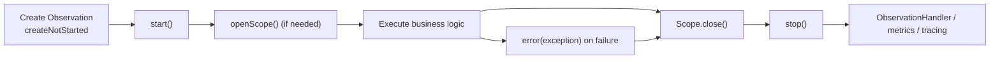

# Observation Start and Stop in Micrometer Observation

> **Chapter:** Micrometer Observation  
> **Module:** `SPRING_BOOT_OBSERVABILITY` — Setting up observability for Spring Boot with Micrometer Observation, metrics, logs, and distributed tracing. This lesson focuses on **the lifecycle of an Observation**: creating, `start()`, placing into scope, recording errors, and `stop()`. This is the foundation for measuring processing duration accurately, preserving trace context, and connecting metrics–traces–logs.

## Learning Objectives

After this lesson, you will be able to:

1. Explain the roles of `ObservationRegistry`, `Observation`, `Observation.Context`, `ObservationHandler`, and `Observation.Scope`.
2. Distinguish between `start()`, `openScope()`, `Scope.close()`, and `stop()`, and understand why these four actions cannot replace one another.
3. Write Spring Boot business logic using `Observation.createNotStarted(...)`, handling both success and exceptions while guaranteeing `stop()` is always called properly.
4. Use `observe(...)` when measuring a single synchronous block, and recognize its limits in asynchronous execution.
5. Nest observations, attach key-values with appropriate cardinality, inspect metrics/traces/logs output, and diagnose common lifecycle bugs.

## 1. Why Are Start and Stop Needed?

Suppose an order API calls an inventory check system. We want to know how long the inventory check took, whether it failed, and how to follow that step in a distributed trace.

Micrometer Observation creates an **observation boundary** around the work. That boundary has a start point and an end point; metadata and errors are recorded in `Observation.Context`, which handlers then process to emit telemetry depending on configuration.



An Observation is **not** synonymous with a metric or a span. It is a common API for notifying handlers about lifecycle events. When integrated with an appropriate meter registry and tracing bridge, the same observation can contribute to a timer metric and a trace span; when logging inside the scope, logs can receive `traceId`/`spanId` from the tracing context.

Key points to remember:

- `start()` signals the beginning of the measured region; `stop()` signals the end and completes the lifecycle.
- `openScope()` makes the observation the current context on the execution thread; closing the scope restores the previous context.
- `error(Throwable)` records a failure on the observation; by itself it does not close the scope or stop the observation.
- `observe(...)` is a convenience method letting Micrometer perform start, scope open/close, exception recording, and stop around a **synchronous** unit of work.

## 2. Components Participating in the Lifecycle

| Component | Responsibility | Key point |
|---|---|---|
| `ObservationRegistry` | Holds configuration, handlers, filters, and conventions; exposes the current observation context | Inject the registry into services instead of creating isolated registries |
| `Observation` | Represents an activity being observed | Has name, lifecycle state, context, error, and key-values |
| `Observation.Context` | Holds metadata for handlers: name, key-values, error, and other context info | Should not be used to store arbitrary sensitive data |
| `ObservationHandler` | Receives lifecycle callbacks and creates/controls telemetry | One handler may produce metrics; another produces tracing |
| `Observation.Scope` | Establishes the current observation context while the scope is open | Scope can end before the observation; only valid on the execution context it is attached to |
| `ObservationConvention` | Convention for names and key-values for a group of observations | Keeps metrics/spans consistent across call sites |

**Separating lifecycle and scope** is the key. An observation can start before work is placed onto the current thread, and can stop when no scope is open. Conversely, an observation can open scopes multiple times if the application genuinely needs to switch contexts; managing those scopes requires care.

In Spring Boot, `spring-boot-starter-actuator` brings in the core observability components. The registry is configured by Spring Boot and injected via the Spring container. If you want to export metrics to Prometheus or traces via OTLP, you must add the corresponding registry/exporter/bridge. **Having an ObservationRegistry does not guarantee a backend is recording telemetry.**

## 3. States and Callbacks: What Does an Observation Go Through?

| Step | API | Lifecycle effect |
|---|---|---|
| Create | `Observation.createNotStarted(name, registry)` | Creates an unstarted observation; can attach name, key-values, contextual name |
| Start | `observation.start()` | Marks start; matching handlers receive the start callback (`onStart`) |
| Enter context | `observation.openScope()` | Observation becomes current observation; handlers receive scope-open callback (`onScopeOpened`) |
| Execute | Business code | Logs, child observations, and instrumented downstream calls can access current context |
| Record error | `observation.error(exception)` | Notifies handlers of the error (`onError`); does not replace `stop()` |
| Leave context | `scope.close()` | Closes the scope and restores the previous observation; scope-close callback (`onScopeClosed`) |
| End | `observation.stop()` | Ends the measured region; handlers receive stop callback (`onStop`) |

**Standard pattern:**

```text
createNotStarted
    -> start
    -> openScope
    -> [business work; error if needed]
    -> close scope
    -> stop
```

You can still use Observation to measure duration without opening a scope, but child instrumentation, MDC, and trace-related behavior may not see the desired context. For a standalone timer-only task that may be fine; for distributed tracing, scope is usually crucial.

Do not call `start()` twice or `stop()` twice to try "splitting phases" on the same observation. If you need to measure multiple independent stages, create multiple observations with parent–child relationships or separate operations. Avoid assuming repeated lifecycle calls are a supported way to capture multiple samples.

## 4. Creating an Observation in Spring Boot

### 4.1. Minimal dependencies

A Spring Boot 3.x application with an appropriate parent/BOM typically needs this dependency for Actuator + Observation support:

```xml
<dependency>
    <groupId>org.springframework.boot</groupId>
    <artifactId>spring-boot-starter-actuator</artifactId>
</dependency>
```

Adding the Prometheus registry lets timers be exposed for Prometheus scraping:

```xml
<dependency>
    <groupId>io.micrometer</groupId>
    <artifactId>micrometer-registry-prometheus</artifactId>
</dependency>
```

For tracing, add the bridge/SDK/exporter compatible with your Spring Boot version and chosen backend. Example for an OpenTelemetry stack:

```xml
<dependency>
    <groupId>io.micrometer</groupId>
    <artifactId>micrometer-tracing-bridge-otel</artifactId>
</dependency>
<dependency>
    <groupId>io.opentelemetry</groupId>
    <artifactId>opentelemetry-exporter-otlp</artifactId>
</dependency>
```

These dependencies merely illustrate a common Spring Boot 3.x architecture; verify starters, property names, and exporter mechanics against the exact Boot version you use. Do not manually create extra `ObservationRegistry` instances or separate independent tracing SDKs when auto-configuration already provides them.

### 4.2. Complete example: manual start and stop

The following service creates an observation for an inventory check step. The example avoids database dependencies to keep the lifecycle clear:

```java
import io.micrometer.observation.Observation;
import io.micrometer.observation.ObservationRegistry;
import org.springframework.stereotype.Service;

@Service
public class StockService {
    private final ObservationRegistry observationRegistry;

    public StockService(ObservationRegistry observationRegistry) {
        this.observationRegistry = observationRegistry;
    }

    public String reserve(String sku, String channel) {
        Observation observation = Observation
                .createNotStarted("inventory.reserve", observationRegistry)
                .contextualName("reserve inventory")
                .lowCardinalityKeyValue("channel", channel);

        observation.start();

        try (Observation.Scope ignored = observation.openScope()) {
            if (sku == null || sku.isBlank()) {
                throw new IllegalArgumentException("SKU is required");
            }

            // Replace with real business logic (DB, HTTP client, ...).
            observation.lowCardinalityKeyValue("outcome", "success");
            return "RESERVED";
        } catch (RuntimeException exception) {
            observation.lowCardinalityKeyValue("outcome", "error");
            observation.error(exception);
            throw exception;
        } finally {
            observation.stop();
        }
    }
}
```

Reading top to bottom:

1. `createNotStarted` builds the observation with the stable technical name `inventory.reserve`.
2. `contextualName` sets a readable description for tracing/spans when supported by handlers; metric names primarily come from the observation name/convention.
3. `lowCardinalityKeyValue` provides an analytical dimension with a bounded set of values suitable as metric labels.
4. `start()` notifies handlers of the start event.
5. `openScope()` makes the observation the current context; `try-with-resources` closes the scope automatically upon exiting the block, even on error.
6. On exception, `error(exception)` records the error event while the exception still propagates out to the caller.
7. `finally` ensures `stop()` is called on both success and error branches.

This example assumes `channel` comes from a normalized enum/value set such as `WEB`, `MOBILE`, `PARTNER`. **Never pass raw user-entered strings** as low-cardinality tags because the value count can grow without bound. If a channel falls outside the known set, map it to `UNKNOWN` or a controlled bucket.

### 4.3. Variant ensuring stop even if opening scope fails

In typical code, `try-with-resources` suffices to ensure the scope closes. If you want to express more explicitly that `stop()` covers opening the scope as well, you can write:

```java
Observation observation = Observation
        .createNotStarted("inventory.reserve", observationRegistry)
        .start();

try {
    try (Observation.Scope scope = observation.openScope()) {
        performReservation();
    }
} catch (RuntimeException exception) {
    observation.error(exception);
    throw exception;
} finally {
    observation.stop();
}
```

`performReservation()` is an illustrative business method. Here, `finally` wraps the scope-opening block; an exception either while opening the scope or while executing business logic still reaches `stop()`. This structure is useful when a manual observation spans code with multiple return paths.

**Important point:** the scope finishes before the observation is stopped, so the previous context is restored before `onStop` is called. Recording an error does not close the scope; `try-with-resources` and `finally` handle two distinct responsibilities.

## 5. Using `observe(...)` When Manual Lifecycle Control Is Not Needed

Micrometer provides the `observe(...)` convenience method for synchronous tasks. You do not need to call `start`, `openScope`, `close`, or `stop` yourself:

```java
public String reserveWithObserve(String sku) {
    return Observation.createNotStarted(
                    "inventory.reserve", observationRegistry)
            .lowCardinalityKeyValue("operation", "reserve")
            .observe(() -> {
                if (sku == null || sku.isBlank()) {
                    throw new IllegalArgumentException("SKU is required");
                }
                return "RESERVED";
            });
}
```

In the method above, `observe` manages the lifecycle around the callback. If the callback throws an exception, the observation records the error and rethrows the exception. The return type is inferred from the lambda; the API also supports void callbacks.

Quick comparison:

| Criterion | Manual `start/stop` management | `observe(...)` |
|---|---|---|
| Code length | Longer; explicit try/catch/finally required | Concise, easy to read |
| Scope | Explicitly opened/closed | Managed around the callback |
| Error handling | Call `error(exception)` yourself when needed | Exceptions thrown by the callback are handled within observe's lifecycle |
| Stop timing | Fully controlled by your logic | When the callback finishes |
| Best suited for | Multi-stage work, callbacks, async tasks with custom coordination | A single synchronous block of logic |

**Do not use `observe(() -> startAsyncWork())` to measure async completion time** if the callback merely returns a `CompletableFuture` or sends a message and returns immediately: the observation will stop when the callback returns, before the actual work finishes.

## 6. Distinguishing `Scope.close()` and `Observation.stop()`

These two operations are very easy to confuse.

Suppose a parent API `checkout.place` is the current observation, and inside it calls `inventory.reserve`:

```text
Request thread
│
├── checkout.place start
│   └── openScope(checkout.place)  ← current = checkout.place
│       ├── inventory.reserve start
│       │   └── openScope(inventory.reserve) ← current = inventory.reserve
│       │       └── call inventory
│       │   └── closeScope(inventory.reserve) ← current = checkout.place
│       └── inventory.reserve stop
│       └── continue checkout
│   └── closeScope(checkout.place) ← restore previous context
└── checkout.place stop
```

`Scope.close()` restores the current observation to the parent; it does not tell handlers that the operation is complete. If you forget `stop()`, timers/spans may never finish properly, producing missing or inaccurate telemetry.

Conversely, calling `stop()` while a scope is still open and continuing to run code inside that scope leaves the active context pointing to an already-stopped observation. That easily leads to hard-to-trace bugs when logs, tracing handlers, or child observations read the current context. Keep the rule: **close scope first, stop second**.

### 6.1. Code example of nested observations

```java
Observation parent = Observation
        .createNotStarted("checkout.place", observationRegistry)
        .start();

try (Observation.Scope parentScope = parent.openScope()) {
    // Inside parent's scope, child can be linked by a tracing handler
    // to the active parent observation.
    Observation child = Observation
            .createNotStarted("inventory.reserve", observationRegistry)
            .start();

    try (Observation.Scope childScope = child.openScope()) {
        callInventory();
    } catch (RuntimeException exception) {
        child.error(exception);
        throw exception;
    } finally {
        child.stop();
    }
} catch (RuntimeException exception) {
    parent.error(exception);
    throw exception;
} finally {
    parent.stop();
}
```

`callInventory()` is an illustrative business method. The example closes `childScope` before `child.stop()` and closes `parentScope` before `parent.stop()`. When `child` throws an exception outward, both `child` and `parent` can record the error within their respective scopes of responsibility; that is intentional, not an automatic duplicate error event in the backend.

**Note:** parent–child relationships in traces also depend on tracing handlers and context propagation. Nesting two observations in code does not guarantee a backend has two spans if tracing is unconfigured or the trace was dropped by sampling.

## 7. When Should You Call `error()`?

`Observation.error(exception)` expresses "an error was detected within this observed region." It does not `throw`, does not determine the HTTP response, and does not automatically roll back an application transaction.

Common cases:

| Situation | Record `error(...)`? | Why |
|---|---|---|
| Callback inside `observe(...)` throws an exception | Usually no need to call manually | `observe` already handles exceptions thrown by the callback |
| Manual code catches an exception and rethrows it | Should call `observation.error(exception)` | Lets handlers observe the error before `stop` |
| Code handles an error and returns a successful fallback | Depends on semantics: should internal errors be surfaced? | Not every retry/fallback is a failure of the outer operation |
| HTTP 404 is treated as a normal business outcome | Not necessarily an exception | Do not equate every non-2xx status with an exception |
| Timeout on a downstream HTTP call | Let instrumentation/catch in the detecting observation record it | Avoid recording unrelated errors on every outer observation |

If you catch an exception to **swallow it** without calling `error(...)`, handlers may treat the observation as successful even though business logic failed. Conversely, calling `error` indiscriminately on every recovered error can skew tracing error rates.

Example using a fallback while still recording the issue on the child operation:

```java
Observation fallback = Observation
        .createNotStarted("inventory.lookup", observationRegistry)
        .start();

try (Observation.Scope scope = fallback.openScope()) {
    return lookupInventory();
} catch (InventoryUnavailableException exception) {
    fallback.error(exception);
    return "UNKNOWN";
} finally {
    fallback.stop();
}
```

`lookupInventory()` and `InventoryUnavailableException` are hypothetical business components. The caller still receives `"UNKNOWN"`, while the observation for the **lookup step** reflects the error. The outer API layer can still succeed if fallback is permitted behavior. The key is aligning observation boundaries with business meaning.

## 8. A Realistic Timeline: What Is Being Measured?

Consider an inventory check step consisting of input validation (2 ms), an HTTP call (120 ms), and response mapping (3 ms):

```text
T0 createNotStarted
T1 start
   ├── T2 openScope
   ├── validation             ~ 2 ms
   ├── outbound HTTP          ~ 120 ms
   ├── response mapping       ~ 3 ms
   └── T3 closeScope
T4 stop                       total ~ 125 ms + overhead
```

The recorded duration is typically tied to `start → stop` by timing handlers; **not just** `openScope → closeScope`. Therefore:

- Calling `start` too early can include wait time that does not belong to the operation.
- Calling `stop` too early cuts off part of the work from the measured duration.
- Any callback running after `stop` is excluded from that observation's duration, even if it touches the same object in code.
- A child observation's duration can overlap within the parent duration. **Never sum the durations of nested spans** and treat the result as total request latency; that double-counts time.

For HTTP server observations instrumented by Spring Boot, prefer the default instrumentation. Create custom observations for specific business steps; do not try to "re-measure" the entire request when `http.server.requests` already exists.

## 9. Attaching Key-Values Before and During the Lifecycle

Observation supports two common metadata groups:

```java
Observation observation = Observation
        .createNotStarted("checkout.payment", observationRegistry)
        .contextualName("charge payment")
        .lowCardinalityKeyValue("payment.provider", "primary")
        .highCardinalityKeyValue("payment.attempt", attemptId);
```

| Group | Meaning | Example |
|---|---|---|
| Low cardinality | Bounded set of values, suitable for grouping metrics | `payment.provider=primary/backup`, `outcome=success/error` |
| High cardinality | Better suited as trace attributes when specific investigation is needed | A **non-sensitive**, approved internal attempt ID |
| Should never enter telemetry | Secrets, PII, or payment details | Tokens, passwords, card numbers, emails, sensitive request bodies |

A trace ID, user ID, or order ID varies on almost every request: **never** use them as low-cardinality metric tags. Even for high-cardinality tags, add them only with a clear diagnostic purpose and proper data-protection policies.

For metadata known upfront, attaching it before `start()` makes it available to handlers from the beginning. Execution outcomes such as `outcome` can be added after the work completes, **before `stop()`**. Exactly which fields end up in a given metric or span still depends on handler timing and behavior; do not assume every exporter handles every field identically.

### 9.1. Observation name and contextual name

- `inventory.reserve`: stable operation name used for grouping/metric naming by convention.
- `reserve inventory`: human-readable contextual name for trace spans when supported.
- `inventory.reserve.sku-123456`: name to avoid because embedding dynamic IDs breaks aggregation and causes high cardinality.

Keep names consistent between local and production so dashboards and alerts do not need rewriting across environments.

## 10. ObservationRegistry and Handler Callbacks

When an application creates an Observation using the Spring-configured registry, the registry holds registered handlers. A handler receives a sequence of callbacks, for example:

```java
public class ExampleObservationHandler
        implements ObservationHandler<Observation.Context> {

    @Override
    public boolean supportsContext(Observation.Context context) {
        return true;
    }

    @Override
    public void onStart(Observation.Context context) {
        // Called when the observation starts.
    }

    @Override
    public void onError(Observation.Context context) {
        // Called when the observation records an error.
    }

    @Override
    public void onStop(Observation.Context context) {
        // Called when the observation stops.
    }
}
```

Required imports:

```java
import io.micrometer.observation.Observation;
import io.micrometer.observation.ObservationHandler;
```

This is a skeleton to understand the lifecycle; the example does not register a bean or store measurements. In real applications, Spring Boot and integrations usually already register handlers for metrics and tracing. Only write a new handler when you have a clear need, and always check whether default instrumentation already covers it.

Typically, emitting metrics/tracing relates to callbacks as follows:

| Callback | Typical meaning |
|---|---|
| `onStart` | Initialize observation data, start timing, or create a span object |
| `onScopeOpened` | Make context/span active so logs or child calls can pick it up |
| `onError` | Attach error info to telemetry |
| `onScopeClosed` | Restore the previous context or span |
| `onStop` | Finish timing/span and hand off data to the export pipeline |

**When** a trace is flushed and visible in the backend also depends on batching, sampling, and exporters; `stop()` does not mean telemetry has already been transmitted successfully over the network.

## 11. How Start/Stop Connects to Metrics, Logs, and Tracing

Assuming Actuator, a meter registry, and a tracing bridge are enabled:

1. `start()` begins an observation, giving handlers the starting point for timing and/or a span per configuration.
2. `openScope()` sets the observation as the current context. When the app logs inside the scope, MDC can carry `traceId`/`spanId` if tracing is configured and the logging layout preserves those fields.
3. Instrumented HTTP clients can pick up the active trace context to propagate downstream.
4. `error(exception)` notifies the tracing handler of an error within that scope.
5. `stop()` closes the measurement region and lets handlers finalize the timer/span; exporters/collectors continue processing asynchronously.

| Signal | What to verify |
|---|---|
| Metrics | A timer matching the observation name; `count` increments, `totalTime`/histogram reflect duration |
| Traces | A span with an appropriate name, duration, and parent link when trace context exists |
| Logs | Logs emitted inside the scope carry `traceId`/`spanId` to search by request |

If the backend has no traces while the timer exists, check the bridge, sampling, exporter, receiver, and propagation. **Having metrics does not guarantee tracing is enabled.** If logs lack trace IDs, check scope/current context, MDC config, and log patterns/structured logging. Observation alone does not force every logger to print trace context.

### 11.1. Local setup for practice

Example for Spring Boot 3.x with `micrometer-registry-prometheus` and OTLP exporter:

```yaml
spring:
  application:
    name: inventory-service

management:
  endpoints:
    web:
      exposure:
        include: health,metrics,prometheus
  tracing:
    sampling:
      probability: 1.0
  otlp:
    tracing:
      endpoint: ${OTLP_TRACES_ENDPOINT:http://localhost:4318/v1/traces}
```

When practicing start/stop locally, you can inspect timers via `/actuator/metrics` without standing up a tracing backend. To view traces, an OTLP backend/Collector must be running to receive data. The OTLP config above illustrates an **HTTP** endpoint with `/v1/traces`; for gRPC, ports and protocols differ.

Invoke a real business endpoint to generate an observation, then inspect:

```bash
curl -s http://localhost:8080/actuator/metrics
curl -s http://localhost:8080/actuator/metrics/inventory.reserve
curl -s http://localhost:8080/actuator/prometheus
```

Meter names exported to Prometheus may be formatted as `inventory_reserve_seconds_count` and `inventory_reserve_seconds_sum`. Check the actual names in your live output, since registry and version affect naming and units. A meter only appears after an observation has actually been processed by a handler.

## 12. Synchronous vs. Asynchronous: Setting the Right Stop Boundary

### 12.1. Synchronous work

For logic running continuously on one thread/callback and finishing before the method returns, `observe(...)` is usually the best choice:

```java
String result = Observation
        .createNotStarted("catalog.lookup", observationRegistry)
        .observe(() -> catalogRepository.findName(sku));
```

`catalogRepository.findName(sku)` is an illustrative method. The observation stops when the callback finishes, so duration reflects the execution time of that callback.

### 12.2. Asynchronous work

Suppose business logic returns a `CompletableFuture` immediately while actual execution runs on an executor. Measuring "completion of the entire task" requires placing `stop()` when the future finishes, not when the future is created.

Illustrative example for a future scheduled on an executor:

```java
import java.util.concurrent.CompletableFuture;
import java.util.concurrent.Executor;

public CompletableFuture<String> reserveAsync(
        String sku, Executor executor) {

    Observation observation = Observation
            .createNotStarted("inventory.reserve.async", observationRegistry)
            .start();

    try {
        return CompletableFuture
                .supplyAsync(() -> {
                    try (Observation.Scope scope = observation.openScope()) {
                        return reserveInDatabase(sku);
                    }
                }, executor)
                .whenComplete((value, failure) -> {
                    if (failure != null) {
                        observation.error(failure);
                    }
                    observation.stop();
                });
    } catch (RuntimeException schedulingFailure) {
        // Example: executor rejects the submitted task.
        observation.error(schedulingFailure);
        observation.stop();
        throw schedulingFailure;
    }
}
```

`reserveInDatabase` is a hypothetical business method. In this example:

- Start is called before submitting the task; duration includes **executor queue wait time** plus execution time. If you only want execution time, start should happen where the task actually begins running.
- Scope is opened on the worker thread and closed when the worker finishes.
- `whenComplete` records any abnormal completion error, then stops the observation.
- The `catch` block ensures `stop()` runs if task submission fails synchronously.

This is a **lifecycle illustration pattern**, not a one-size-fits-all solution for arbitrary callbacks, cancellation, or complex async topologies. Some pipelines run completion callbacks on a different thread; you must manage observation ownership and guarantee `stop()` runs exactly once. `Throwable` in `whenComplete` may be a wrapper exception (such as `CompletionException`); in production telemetry, unwrap thoughtfully to record the root exception per policy.

**Context propagation:** moving an `Observation` object to another thread does not automatically move all ThreadLocal/MDC state from other libraries. When child calls run inside async tasks, configure Micrometer Context Propagation/`ContextPropagatingTaskDecorator`, instrumented executors, or Reactor-specific solutions for your framework version. With parallel subtasks, it is safer to give each branch its own explicit observation and proper context propagation rather than sharing a mutable scope across threads.

### 12.3. Reactive pipelines

In Reactor, assembling a `Mono`/`Flux` happens at a different time from subscription and completion. Calling `start()` at *assembly* and `stop()` right as the method returns the `Mono` only measures pipeline assembly time.

For reactive code, prefer Spring WebFlux/Reactor's built-in instrumentation and compatible operator/context integrations; when writing manual observations, tie the lifecycle to actual reactive signals (completion, error, cancellation) and clean up exactly once. Never treat an outer `try-with-resources` around a reactive chain as closing scopes across async signals.

## 13. Common Mistakes and How to Fix Them

### Mistake A: Forgetting `stop` on exception

**Wrong:**

```java
Observation observation = Observation
        .createNotStarted("order.validate", observationRegistry)
        .start();

validateOrder(order);       // Throws exception -> stop() is skipped.
observation.stop();
```

**Right:**

```java
Observation observation = Observation
        .createNotStarted("order.validate", observationRegistry)
        .start();

try (Observation.Scope scope = observation.openScope()) {
    validateOrder(order);
} catch (RuntimeException exception) {
    observation.error(exception);
    throw exception;
} finally {
    observation.stop();
}
```

### Mistake B: Confusing closing scope with stopping

**Wrong:** using only `try (Scope scope = observation.openScope())` and assuming the timer/span has finished.

**Right:** the scope closes via `try-with-resources`, and the observation stops in `finally`—or use `observe` to manage the whole lifecycle.

### Mistake C: Stopping before async work completes

**Wrong:**

```java
Observation observation = Observation
        .createNotStarted("email.send", observationRegistry)
        .start();

CompletableFuture<Void> future =
        CompletableFuture.runAsync(this::sendEmail, executor);
observation.stop();  // Only measures task submission, not sending the email.
return future;
```

**Fix:** tie `stop()` to the future's completion, record errors/cancellations appropriately, and ensure no path calls `stop()` twice.

### Mistake D: Putting per-request IDs into metric tags

**Wrong:**

```java
observation.lowCardinalityKeyValue("order.id", orderId);
```

**Right:** use a stable categorization dimension, for example:

```java
observation.lowCardinalityKeyValue("order.channel", channelEnum.name());
```

If an order ID must be stored in traces, evaluate data policies and query requirements first, then consider a high-cardinality attribute with appropriate limits; never use it for metric labels.

### Mistake E: Assuming `start` automatically creates the current context

If code calls `start()` and then logs or makes downstream calls without opening a scope, logs or child operations may lack correlation with the intended observation. Open a scope around code that needs the context and close it promptly.

### Mistake F: Assuming every observation produces a span in the backend

Not necessarily: an unconfigured tracing bridge, sampling dropping the trace, exporter failures, or backend ingestion issues can all prevent spans from showing up. `stop()` finishes the in-process lifecycle; it does not mean the backend stored the trace.

## 14. Verifying Lifecycle with Concrete Scenarios

Suppose endpoint `POST /orders` calls `StockService.reserve(...)`. Practice with three scenarios:

| Scenario | Expected behavior |
|---|---|
| Valid SKU | Observation starts/stops; timer count increments; tag `outcome=success` if handler exports metrics |
| Blank SKU | Exception recorded via `error`, scope closes, observation stops; method still throws exception outward |
| Multiple consecutive requests | Timer count increases by the number of completed observations; no operations hang due to missing `stop` |

With tracing active, open a trace for one request and verify:

1. The span for `reserve inventory` has a reasonable duration.
2. When a parent HTTP server span and matching context exist, the child span links cleanly to the trace.
3. While the scope is open, logs can be searched by the request's trace ID (if log format and MDC support it).
4. After closing the scope, subsequent logs/calls do not "stick" to the finished observation.

Compare timer histograms and traces: timers aggregate every execution recorded by the meter handler, while the trace backend may hold only a fraction of requests due to sampling. Therefore, **never treat trace count as request count**. In production, review cardinality, sampling, exporter rules, and data protection before scaling up instrumentation.

## 15. Thought Exercises and Completion Criteria

**Exercise 1 — Choosing boundaries:** A file import API parses (20 ms), validates (30 ms), and writes to DB (100 ms). Propose one parent observation `file.import` and three child observations for each step. Identify where start, openScope, close scope, and stop belong. Explain why the sum of the three child durations does not necessarily equal the parent duration (overhead, orchestration time, and other work).

**Exercise 2 — Handled errors:** `inventory.lookup` times out, yet the service falls back to cache and returns a valid response. Determine which observation should record an error, which observation can succeed, and which outcome labels make sense. Distinguish downstream technical errors from the API's final outcome.

**Exercise 3 — Async:** A job returns a `CompletableFuture` immediately upon submission and executes 400 ms later. If the observation stops right at submission, how is the measurement wrong? If you want to measure queue wait time and execution time separately, what observation boundaries are needed?

**Exercise 4 — Debugging:** The `inventory.reserve` metric count increases, yet the trace backend shows no spans. Check the tracing bridge, sampling, OTLP endpoint, Collector, service identity, and search time window in order; explain why you should not jump to blaming `start()`/`stop()`.

You have completed this lesson when you can write the full lifecycle of an operation across both success and error paths, explain the distinct role of scope, know when `observe` fits, and read measurement evidence across metrics, traces, and logs.

---

## Takeaways

**Observation defines the measurement boundary; scope defines the active context.** `start()` and `stop()` bracket the operation's duration; `openScope()` and `Scope.close()` enable propagation and correlation inside the enclosed code; `error(...)` records failures; `observe(...)` is the concise choice for synchronous blocks. For async work, stop the observation when the work actually finishes. Producing correlated metrics, traces, and logs still depends on Spring Boot's registry, handlers, exporters, sampling, and logging configuration.
