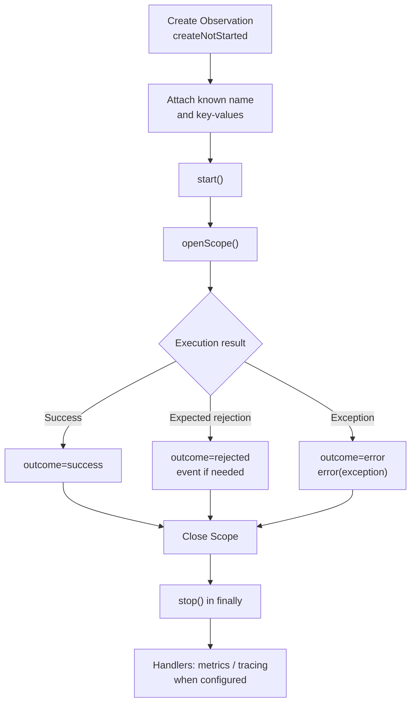
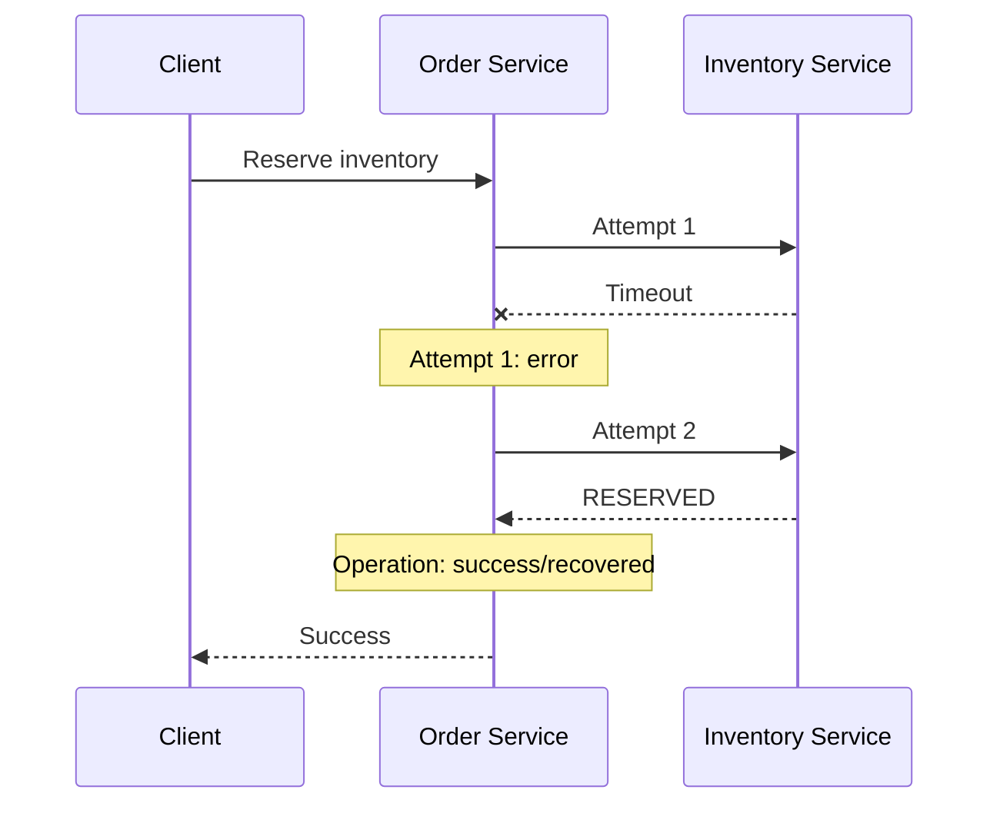

# Observation Success and Failure in Spring Boot

An API returning HTTP 200 has not necessarily completed the business flow as intended; conversely, an operation rejected due to a business rule is not necessarily a technical error. When designing observability, we must clearly distinguish between **an observation that completed**, **the business outcome**, and **an error during execution**. Conflating these three concepts can cause error charts, traces, and logs to lead to wrong conclusions.

In the **Micrometer Observation** chapter of the **SPRING_BOOT_OBSERVABILITY** module, we learn how to set up observability for Spring Boot with Micrometer Observation, metrics, logs, and distributed tracing; understand context propagation, tags/cardinality, exporters, sampling, and how to correlate signals to investigate errors, latency, and application behavior in production. This lesson dives into the lifecycle of an `Observation` when an operation **succeeds**, **fails with an exception**, or **completes normally with an unsuccessful business outcome**.

## 1. Learning Objectives

After this lesson, you will be able to:

- Describe the `start → scope → error/event (if any) → stop` lifecycle and the role of `ObservationRegistry`.
- Distinguish technical errors, expected business rejections, and errors recovered via fallback or retry.
- Record exceptions using `observation.error(exception)`, label outcomes with low-cardinality key-values, and ensure `stop()` is always called.
- Understand how `ObservationHandler` turns observation data into metrics or spans, and the limits of exported results.
- Correlate observations with logging/tracing, avoiding duplicate observations and high-cardinality tags.
- Test success, error, early-return, and retry scenarios.

## 2. What Is an Observation and What Does "Success" Mean?

**Micrometer Observation** is an API describing an observed unit of work: operation name, start/end timestamps, key-values, events, and error info. `ObservationRegistry` holds configuration along with `ObservationHandler` instances notified during the observation lifecycle. Depending on registered handlers, an observation can emit a **timer metric**, a **tracing span**, or another observation behavior. Creating an observation by itself **does not guarantee** metrics/traces have been exported to a backend.

Suppose the `inventory.reserve` operation reserves stock:

| Scenario | Business outcome | Exception thrown? | Suggested representation |
| --- | --- | --- | --- |
| Stock reserved successfully | `RESERVED` | No | `outcome=success` |
| Insufficient stock; system returns expected result | `REJECTED` | No | `outcome=rejected`; do not treat automatically as a technical error |
| Inventory gateway timeout | No valid result | Yes | `outcome=error` + `observation.error(ex)` |
| First call times out, retry succeeds | Final reservation succeeds | Error on first attempt | **Attempt** observation records error; **overall operation** observation records success or `recovered` by convention |

What matters is defining **the boundary of the work**: a single HTTP call, a single attempt to connect to inventory, or the entire order-placement workflow. The same sequence of events can yield different results at those different levels. Observation names and labels must reflect the chosen boundary accurately.

### Three questions to keep separate

1. **Did the lifecycle end?** `observation.stop()` indicates the observed operation finished; calling `stop` alone does not prove success.
2. **What outcome did the operation return?** A bounded outcome set defined by the application, e.g., `success`, `rejected`, `error`.
3. **Was an error recorded?** `observation.error(ex)` notifies interested handlers of a Throwable; an observation can both be marked with an error and carry an application-supplied outcome label.

Do not infer that "no exception thrown" always means success, or that "HTTP 4xx" always means the system is broken. Classification must follow business semantics and the metric's intended purpose.

## 3. Lifecycle of an Observation



Basic steps:

- `Observation.createNotStarted(name, registry)`: creates an unstarted observation; can attach key-values or a contextual name.
- `start()`: begins measurement and notifies handlers.
- `openScope()`: sets the observation as the active scope for the running code; this is critical for linking nested observations, trace context, and MDC when integrations support it.
- `event(...)`: marks a notable milestone, such as switching to a fallback. Events do not replace exceptions.
- `error(exception)`: reports that an error occurred; handlers can use the exception to attach error status/attributes to signals.
- `stop()`: completes the lifecycle so handlers can finish timing or spans; must run even when execution throws an error.

Some integrations and utilities manage the lifecycle automatically, such as `Observation.observe(...)` or framework instrumentation. When you open an observation **yourself**, ensure it stops exactly once, and check whether the framework already creates an observation at that boundary.

### Distinguishing scope and observation

`Observation` describes the work; `Observation.Scope` manages the **current** observation within a processing scope. Closing a scope does not stop the observation. In synchronous code, an easy-to-verify rule is: `start` before the work, `openScope` around the section needing context, close the scope when leaving the `try-with-resources` block, and `stop` in `finally`.

In asynchronous processing, scopes are typically tied to the active execution context/thread. Never pass an open `Scope` blindly from one thread to another; instead, use a **context propagation** mechanism suited to your executor, Reactor pipeline, or message listener.

## 4. Spring Boot Example: Success, Rejection, and Failure

The Java code below uses the Spring-provided `ObservationRegistry`. `InventoryGateway` is a hypothetical application dependency; the `ReserveResult` enum illustrates business outcomes. Each call to `reserve` creates **one** observation for the entire operation.

```java
import io.micrometer.observation.Observation;
import io.micrometer.observation.ObservationRegistry;
import org.springframework.stereotype.Service;

@Service
public class InventoryReservationService {

    private final ObservationRegistry observationRegistry;
    private final InventoryGateway inventoryGateway;

    public InventoryReservationService(
            ObservationRegistry observationRegistry,
            InventoryGateway inventoryGateway) {
        this.observationRegistry = observationRegistry;
        this.inventoryGateway = inventoryGateway;
    }

    public ReserveResult reserve(String sku, int quantity) {
        Observation observation = Observation
            .createNotStarted("inventory.reserve", observationRegistry)
            .contextualName("reserve inventory")
            .lowCardinalityKeyValue("operation", "reserve")
            .start();

        try (Observation.Scope scope = observation.openScope()) {
            try {
                ReserveResult result = inventoryGateway.reserve(sku, quantity);

                if (result == ReserveResult.REJECTED) {
                    observation.lowCardinalityKeyValue("outcome", "rejected");
                    observation.event(
                        Observation.Event.of("inventory.rejected"));
                    return result;
                }

                observation.lowCardinalityKeyValue("outcome", "success");
                return result;
            } catch (RuntimeException ex) {
                observation.lowCardinalityKeyValue("outcome", "error");
                observation.error(ex);
                throw ex;
            }
        } finally {
            observation.stop();
        }
    }
}

enum ReserveResult {
    RESERVED,
    REJECTED
}

interface InventoryGateway {
    ReserveResult reserve(String sku, int quantity);
}
```

**Code analysis:**

1. The name `inventory.reserve` describes a meaningful unit of work. `operation=reserve` has a bounded value set and fits as a low-cardinality key-value.
2. For `RESERVED`, the code sets `outcome=success`, returns the result, and still runs `finally` to stop the observation.
3. For `REJECTED`, the system handles an expected business condition; the code attaches `outcome=rejected` and may emit an event. Do not fabricate an exception just to make a trace turn red.
4. For `RuntimeException`, the code sets `outcome=error`, calls `observation.error(ex)` **before rethrowing**, and then stops the observation in `finally`.
5. `try-with-resources` closes the scope upon leaving the block. `finally` ensures `stop()` executes both on return and on thrown exceptions.

In real applications, clarify whether the gateway can return `null` or another result. The example assumes the gateway always returns one of the two enum constants; if an indeterminate result is possible, define a separate classification so an unknown state is not logged as "success".

**Never put `sku`, transaction IDs, `userId`, full URLs, or exception messages into low-cardinality key-values.** High-variance data can generate excessive time series in metrics. You can record request identifiers in logs or high-cardinality context when needed and privacy-reviewed, though high-cardinality key-values can be consumed by tracing handlers and increase trace attributes. Control both length and sensitivity.

### Minimal version when an operation has only two branches

For simple code, you can use `observe` so Micrometer manages `start`, scope, thrown errors, and `stop`:

```java
Observation.createNotStarted("inventory.check", observationRegistry)
    .lowCardinalityKeyValue("operation", "check")
    .observe(() -> inventoryGateway.reserve(sku, quantity));
```

The snippet above illustrates an operation returning a value per `observe`'s `Supplier` signature; use it when you want to observe the entire lambda without setting outcomes manually across multiple branches. For a **business rejection that does not throw**, you must explicitly add classification if dashboards need to distinguish it from success—in which case, fall back to the explicit observation management pattern above.

Note: the `observe(...)` API already records exceptions thrown during execution and finishes the observation; do not also wrap the same lambda with `observation.error(...)` unless you want to record the same error twice. When implementing in a real project, check the exact behavior of your Micrometer version and handlers.

## 5. How Are Success and Failure Reflected in Metrics?

When a meter observation handler is configured, the observation can produce a **timer** for `inventory.reserve` with low-cardinality key-values such as `operation` and `outcome`. Timers help answer how many times the operation ran, how long it took, and whether latency trends are shifting. Percentiles/histograms also depend on distribution settings in Micrometer and your backend.

For example, if 100 reservation attempts occur during a window:

| Outcome | Count | Meaning |
| --- | ---: | --- |
| `success` | 90 | Stock reserved successfully |
| `rejected` | 7 | Rejected by expected business conditions |
| `error` | 3 | Technical failure with an exception |

We can compute the technical error rate of the operation:

\[
\text{technical error rate} =
\frac{\text{count(outcome = error)}}{\text{count(all outcomes)}} =
\frac{3}{100} = 3\%
\]

If the goal is the **non-successful reservation rate** from the user's perspective, include `rejected`:

\[
\text{non-success rate} =
\frac{7+3}{100}=10\%
\]

These two indicators have **different meanings**; dashboards and alerts must name them accurately. A business team may want to monitor out-of-stock rejection rates without treating them as operational outages.

### Key points when creating labels

Values like `outcome=success|rejected|error` and `operation=reserve` are bounded sets. By contrast, `exception.message`, `sku`, `requestId`, or `traceId` vary per request and are unsuitable as metric labels. Even `exception.class` may need normalization into a stable group set (`timeout`, `dependency_error`, `validation`) rather than arbitrary exception names.

Not every error shows up automatically in metrics: an error caught and turned into a successful fallback can disappear from the outer metric, while the dependency/attempt metric records the failure. Clarify **which operation level** each metric measures.

## 6. When an Observation Fails, What Do Tracing and Logs Show?

With Micrometer Tracing integrated, an observation can correspond to a tracing span. `observation.error(ex)` notifies handlers of the error; a tracing handler can attach error info to the span and mark its status depending on implementation, config, and exporter. That does **not** mean every backend displays it identically or every trace is exported: trace sampling may drop a portion of traces.

| Signal | Success | Technical error |
| --- | --- | --- |
| **Metric** | Timer/count with `outcome=success` | Timer/count with `outcome=error` if recorded by handler |
| **Trace** | Span with name/context and duration | Span carrying error info if tracing handler processes `error(ex)` |
| **Log** | Success event at appropriate level | Failure event, stable error code, and stack trace at the right handling boundary |

Observation **does not automatically emit an application log line** when you call `observation.error(ex)`. When diagnostic logs are needed, use the application logger:

```java
catch (RuntimeException ex) {
    observation.lowCardinalityKeyValue("outcome", "error");
    observation.error(ex);
    log.error("event=inventory_reservation_failed reason=DEPENDENCY_ERROR", ex);
    throw ex;
}
```

This shows how to add logging to the `catch` branch of the earlier example, assuming the service declares an SLF4J logger. Avoid logging the same exception with a full stack trace at every layer before rethrowing, which creates noise and makes one incident look like several independent failures.

When Spring Boot's log format includes **`traceId` and `spanId`** from MDC in log entries, operators can search logs by trace to investigate. The observation must have an active scope/context, and logging/tracing must be configured; calling `openScope` alone cannot turn logs into distributed telemetry.

### Relationship between HTTP errors and business errors

At the HTTP server boundary, Spring Boot and its instrumentation may already record an observation for the request reflecting the HTTP status. A `409 Conflict` due to insufficient stock may appear as an unsuccessful HTTP status code, while the business observation `inventory.reserve` has `outcome=rejected`. Conversely, the system might return HTTP 200 containing a `REJECTED` payload. The classification of an **HTTP observation** and a **business observation** can differ, and both are valid within their own contexts.

Do not modify or override framework-created HTTP observations just to match business labels. If you need a business view, create an observation at the business boundary, name it clearly, and document its outcomes.

## 7. Retries, Fallbacks, and Recovered Errors

With retries, it is very easy to miscount errors:



Decide explicitly what you want to observe:

- **Overall operation observation:** measures from receiving the request until returning the final outcome; can attach `outcome=success` plus `recovered=true` if the label set is bounded. This metric closely reflects user experience.
- **Attempt-level observation:** measures each downstream call; attempt 1 gets `outcome=error`, attempt 2 gets `outcome=success`. This metric closely reflects dependency stability.

An error on the first attempt **does not have to** turn the outer operation's observation into an error if operational rules consider the operation recovered and fulfilled. Still, keep evidence that a retry happened—such as a fixed-name event, a retry counter, or an attempt-level observation. When an error on the final attempt fails the entire operation, the outer observation should record `outcome=error` and report the corresponding exception.

Checkpoints:

1. Avoid creating a new observation per retry and using them to count user requests; the number of attempts can exceed the number of requests.
2. Do not unconditionally call `observation.error(ex)` on the outer observation when a retry succeeded and "success" is defined by the final outcome. Organizational conventions may vary, but stay consistent.
3. If a fallback returns degraded data, explicitly define `outcome=degraded` or `recovered` instead of silently recording an undifferentiated success.
4. Avoid unbounded spans/tags/events per retry count; keep costs and sensitive data under control.

## 8. Common Mistakes in the Observation Lifecycle

| Design mistake | Consequence | Fix |
| --- | --- | --- |
| Forgetting `stop()` on exception or early return | Handlers never notified of completion; timers/spans may be missing | Always stop in `finally` or use the `observe(...)` API |
| Calling `stop()` before work actually finishes | Inaccurate duration, mismatched context scope | Set boundaries properly and close scope before `stop` |
| Using `try/finally` without recording `error(ex)` | Duration is recorded, but handlers don't know about the error | Catch exception, call `error(ex)`, then rethrow |
| Using exceptions alone to define failure | Valid business rejections become invisible | Classify outcomes per the business contract |
| Treating every `REJECTED` as a system error | Noisy alerts and skewed operational error rates | Separate business rejections from technical errors |
| Putting `requestId` or `sku` into low-cardinality keys | Metric cardinality explosion | Use bounded labels only; put IDs in logs/traces if permitted |
| Creating duplicate observations at an already-instrumented boundary | Double counting and redundant spans | Check HTTP, database, and client instrumentation before wrapping manually |
| Losing context across `@Async`/executors | Broken parent-child spans, logs missing `traceId` | Configure Micrometer Context Propagation for your environment |
| Assuming `error(ex)` writes logs or always exports traces | Expected evidence is missing | Configure logging, handlers, exporters, sampling, and verify the pipeline |

### Notes on exceptions and data flows

The `catch (RuntimeException ex)` pattern above fits gateways whose contract throws runtime exceptions. If an API declares **checked exceptions**, handle those exception types according to the method signature and call `observation.error(ex)` before rethrowing or translating them in a controlled way. Never catch `Throwable` broadly just to log and keep going: serious errors must propagate so the system handles them properly.

If code uses reactive streams (`Mono`/`Flux`), the logical lifecycle of the operation can extend **past when the method returns the publisher**. Creating, starting, and stopping an observation synchronously when constructing the publisher only measures *publisher assembly time*, not execution time on subscribe. Use Reactor-compatible instrumentation/operators and context propagation, ensuring observation completion is tied to completion, error, or cancellation signals.

## 9. Practice and Verification Workflow

A small but production-like scenario:

**Setup:** Spring Boot with Micrometer Observation; add Spring Boot Actuator, a meter registry if exporting metrics, and a tracing bridge/exporter if exporting traces. Keep dependency versions aligned with the Spring Boot BOM. Create a gateway with three modes: returning `RESERVED`, returning `REJECTED`, and throwing a simulated timeout exception.

**Execution:** Call the service three times. Record the external response, timer/metric with `outcome` label, trace (if sampled and exported), and logs.

| Test case | Gateway behavior | Expected result |
| --- | --- | --- |
| A — Success | Returns `RESERVED` | One cleanly stopped observation; `outcome=success`; `error` not called |
| B — Business rejection | Returns `REJECTED` | One cleanly stopped observation; `outcome=rejected`; event present if configured handler inspects it |
| C — Technical error | Throws `RuntimeException` | Observation receives `error(ex)`, `outcome=error`; exception continues propagating; `stop()` still runs |
| D — Recovered retry | First attempt fails, next succeeds | First attempt records error; outer level records success or `recovered` per convention |
| E — Execution via executor | Hands off work to worker thread | Trace context and log correlation remain intact if propagation is configured |

**Verification steps:**

1. Inspect metrics under `inventory.reserve` and the `outcome` labels. When histograms/percentiles are enabled, compare latency between success and error; do not assume default config always enables p95.
2. Inspect traces for the expected span and contextual name; if no trace appears, check tracing bridge, exporter, Collector, sampling, and context continuity.
3. Search logs by trace ID to inspect error events. Do not confuse application logging with an `ObservationHandler` receiving `onError`.
4. Exercise early-return and exception cases; confirm no unstopped observations remain and no scope/MDC leaks into subsequent requests.
5. Verify tags contain no dynamic IDs or sensitive data. Compare operation count with attempt count when retries are enabled.

### Self-check questions

1. A method throws no exception yet returns `REJECTED`—how should you mark `outcome` and `error`, and why?
2. Why is `finally { observation.stop(); }` still necessary when `try` has multiple `return` branches?
3. When a retry succeeds on attempt 2, how do the dependency error rate and the user-experience error rate differ?
4. If metrics show `outcome=error` while the trace backend shows no matching error span, which causes should you check?
5. Why is `traceId` useful in logs yet dangerous as a metric label?

## 10. Takeaways

**Observation completion** and **operation success** are two distinct concepts. With Micrometer Observation, set clear work boundaries, ensure complete `start/stop` pairing, record `error(ex)` when exceptions should be reflected, and attach a small-cardinality `outcome` label to distinguish success, business rejection, and technical error. With retries and fallbacks, define outcomes separately for individual attempts and for the overall operation.

When `ObservationHandler` instances, the metrics registry, tracing bridge, exporters, and logging are properly configured, this information connects into actionable operational signals: metrics measure frequency and latency, traces show execution paths and where errors arise, and logs describe concrete events. Controlling context propagation, cardinality, and sampling keeps investigation results trustworthy in production.
