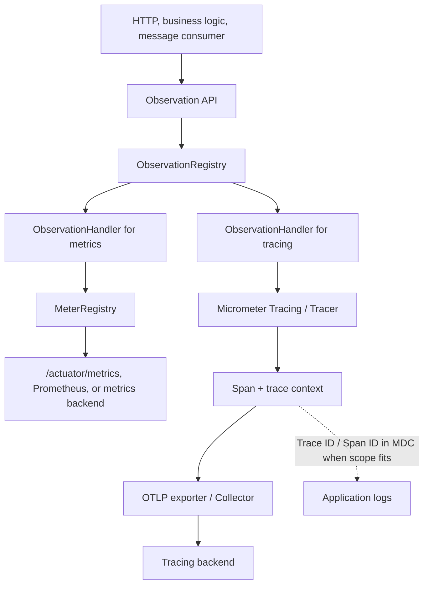
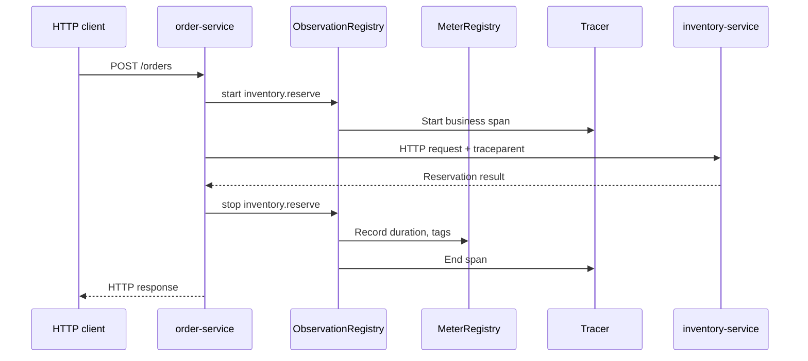

# Observation for Metrics and Traces in Spring Boot

In Spring Boot Observability, **Micrometer Observation** is a way to describe an application activity so that monitoring systems can collect related signals. The same activity, such as `inventory.reserve`, can contribute a **metric for execution count and duration** while also creating a **span** to track a request's path across multiple services. This combination lets you detect the blast radius of errors or latency using metrics, then use traces and logs to pinpoint which part of the processing flow needs investigation.

This lesson belongs to the **Micrometer Observation** chapter of the **SPRING_BOOT_OBSERVABILITY** module. The focus is on the Observation API, how handlers connect to metrics and distributed tracing, principles of context propagation, tags/cardinality, exporters, and sampling, along with a verification workflow in a real Spring Boot environment.

## 1. Why Share a Single Observation?

Suppose the `POST /orders` API needs to check inventory. The operations team wants to answer two questions:

- **At the system level:** how long does reserving inventory take at p95/p99? What is the error rate over the last 15 minutes?
- **At the individual request level:** did a slow request wait on `inventory-service`, the database, or another HTTP call?

**Metrics** aggregate measurements by metric name, unit, and tag set. For instance, the `inventory.reserve` Timer reports execution count and total duration; the backend can compute rates or percentiles when suitable histogram data is enabled. **Traces** display a tree of spans with start/end timestamps and parent–child relationships; a trace shows the path of a single specific request.

If you create metrics with `Timer` and traces with `Tracer` in two separate places in code, developers have to manually keep names, tags, error states, and lifecycles in sync. Observation provides a **single activity boundary** so configured handlers can convert it into the corresponding signals.

| Aspect | Metric from Observation | Span from Observation |
| --- | --- | --- |
| Question | How often does the activity happen, and how long does it usually take? | Where did this execution go, and which step was slow? |
| Identity | Meter name + low-cardinality tags | Trace ID, Span ID, relationships to other spans |
| Data | Count, total time, histogram data if enabled | Start/end timestamps, attributes, error, context |
| Coverage | Can record every execution if the metrics handler is active | Depends on tracing handler, instrumentation, sampling, and exporter |
| Impact of transaction IDs | Never put individual IDs in tags | Can carry specific attributes per data policy, though storage/security must be weighed |

**An Observation does not automatically guarantee both signals are produced.** The application needs appropriate configuration: a metrics handler and `MeterRegistry` to record metrics; a tracing handler and tracer/bridge to create spans; an exporter and backend to view traces remotely.

## 2. Components and Data Flow



Each component plays a distinct role:

1. **`Observation`** represents an activity and its lifecycle. It holds the name, context, key-values, and recorded error information.
2. **`ObservationRegistry`** is the central place holding Observation configuration: handlers, predicates, filters, and conventions. The registry is not a trace store or a metrics storage system.
3. **`ObservationHandler`** receives lifecycle events such as start, scope open/close, error, and stop. Metrics handlers typically turn activities into meter data; tracing handlers manage spans.
4. **`MeterRegistry`** collects meters such as Timer, Counter, and Gauge. A Prometheus registry or another backend registry determines how metrics are exposed.
5. **Micrometer Tracing bridge** connects Observation to an actual tracer/SDK, such as OpenTelemetry. The exporter ships spans to a Collector or tracing backend.
6. **Context propagation** preserves context as execution crosses methods, threads, HTTP requests, or messaging systems. It determines whether a new span links properly to the active span or breaks into a disconnected trace.

In Spring Boot with observability configured, many components are created and wired automatically. Applications can inject `ObservationRegistry` without manually registering every handler. When using plain Micrometer outside Spring Boot, developers typically configure handlers on the registry explicitly.

### Is an Observation the same as a metric or a span?

No. **An Observation is a lifecycle-aware description of an activity**, whereas metrics and spans are observation outputs that handlers can generate. One Observation often creates one Timer on the metrics side and one span on the tracing side, yet there is no absolute rule that every Observation always creates exactly one meter and one span: that depends on handler types, conventions, predicates, instrumentation type, and sampling decisions.

With only `spring-boot-starter-actuator`, an application Observation can produce metrics even without a tracer. When a matching bridge/exporter and tracing handler are configured, that same Observation can also emit spans. Conversely, adding an exporter alone does not turn every Java method into a span: activities must be instrumented and context must propagate properly.

## 3. Lifecycle of an Observation

Typical lifecycle:

```text
Create Observation
      |
Attach name and contextual info
      |
start()
      |
openScope() -> becomes current Observation in scope
      |
Execute business work
      |
Record error via error(exception) if any
      |
close() scope
      |
stop() -> finishes, handlers record results
```

A concise approach is using `observe(...)`. This method manages the lifecycle for the wrapped code, including opening the scope, recording thrown errors, and stopping the Observation.

```java
import io.micrometer.observation.Observation;
import io.micrometer.observation.ObservationRegistry;
import org.springframework.stereotype.Service;

@Service
public class PriceCalculationService {

    private final ObservationRegistry observationRegistry;

    public PriceCalculationService(ObservationRegistry observationRegistry) {
        this.observationRegistry = observationRegistry;
    }

    public long calculateTotal(long subtotalCents, String salesChannel) {
        String channel = "mobile".equals(salesChannel)
                ? "mobile"
                : "web";

        Observation observation = Observation
                .createNotStarted("checkout.calculate_total", observationRegistry)
                .contextualName("calculate checkout total")
                .lowCardinalityKeyValue("channel", channel);

        return observation.observe(() -> {
            try {
                if (subtotalCents < 0) {
                    throw new IllegalArgumentException("Subtotal must be non-negative");
                }

                long total = Math.addExact(subtotalCents, 250L);
                observation.lowCardinalityKeyValue("outcome", "success");
                return total;
            } catch (RuntimeException exception) {
                observation.lowCardinalityKeyValue("outcome", "error");
                throw exception;
            }
        });
    }
}
```

In this example:

- `checkout.calculate_total` is the **stable technical name**; a metrics handler can use it as the Timer name.
- `contextualName("calculate checkout total")` supplies a descriptive name for the active context, which a tracing handler can use as the span name.
- `channel` and `outcome` are reduced to small value sets suitable as low-cardinality key-values.
- `observe(...)` manages start/scope/stop. When the lambda throws an exception, the error is recorded by the Observation; the code does not need to call `error(...)` again for the same exception.
- The arithmetic merely illustrates the API. In real systems, custom Observations are usually more valuable at meaningful business boundaries such as `inventory.reserve`, `payment.authorize`, or an approval workflow.

There are no direct calls to `Timer` or `Tracer` here. If both handler types are configured, the same Observation can feed both metrics and tracing.

### 3.1. Manual lifecycle control

Sometimes an operation spans multiple steps, needs explicit scope handling, or must stop in a `finally` block:

```java
import io.micrometer.observation.Observation;
import io.micrometer.observation.ObservationRegistry;

public class ReservationWorkflow {

    private final ObservationRegistry registry;

    public ReservationWorkflow(ObservationRegistry registry) {
        this.registry = registry;
    }

    public void execute(Runnable reservationAction) {
        Observation observation = Observation.start("inventory.reserve", registry);

        try (Observation.Scope scope = observation.openScope()) {
            reservationAction.run();
        } catch (RuntimeException exception) {
            observation.error(exception);
            throw exception;
        } finally {
            observation.stop();
        }
    }
}
```

**Points to get right:** `start()` begins the activity, `openScope()` activates the current context for code inside the scope, `Scope.close()` restores the previous context, and `stop()` finishes the Observation. Never leak scopes past a request, and never call `stop()` multiple times as a form of error handling. For simple methods, `observe(...)` is usually shorter and less error-prone.

An Observation can start and stop without opening a scope; handlers can still measure duration, though code running inside will not necessarily see the Observation as the current context. That distinction is especially important when creating **child spans**.

## 4. Names, Key-Values, Conventions, and Cardinality

Information commonly carried with an Observation:

| Property | Usage | Example |
| --- | --- | --- |
| **Name** | Stable name describing the activity type; typically the meter name | `payment.authorize` |
| **Contextual name** | Readable name in traces reflecting the work | `authorize payment` |
| **Low-cardinality key-values** | Tags with bounded value sets, usually usable for metrics and tracing | `payment.method=card/wallet` |
| **High-cardinality key-values** | More detailed attributes suited for traces if safe and genuinely needed | Approved internal correlation ID |
| **Error** | Exception raised during execution | Recorded timeout or business error |
| **Observation.Context** | Contextual data and state read by handlers/conventions | Context for HTTP server/client or custom logic |

**Cardinality** is the number of distinct values of a tag. Adding `order.id` to a Timer can turn each order into its own time series; memory and query costs in the metrics backend can spike sharply. Use fixed values such as `channel=web/mobile`, `result=success/failure`, or `region=apac/eu` when segmentation is truly needed.

Micrometer Observation separates two APIs:

```java
observation.lowCardinalityKeyValue("payment.method", "card");
observation.highCardinalityKeyValue("operation.ref", approvedReference);
```

Here, `approvedReference` is merely an illustrative variable representing a value permitted in observation telemetry; it does not represent personal data or secrets. In standard metrics/tracing integrations, low-cardinality key-values become metric tags and trace attributes; high-cardinality key-values are reserved for traces and excluded from Timer tags. Custom handlers may use key-values differently.

**High cardinality is not an exemption from security policies.** Never put passwords, access tokens, API keys, card numbers, email addresses, raw request bodies, full payloads, or sensitive customer data into span attributes or baggage. Bound lengths and enforce appropriate retention, sampling, and source filtering.

### 4.1. When to use ObservationConvention?

When multiple places in a system create the same kind of Observation, manually repeating names and tags at every call site easily leads to drift. **`ObservationConvention`** centralizes how the name, contextual name, and key-values are derived from an `Observation.Context` type. For example, all `inventory.reserve` operations can standardize on `channel`, `result`, and `warehouse.region`; metrics and tracing handlers share the same convention.

`ObservationFilter` can supplement or adjust Observation data under a shared policy; `ObservationPredicate` decides which Observations are processed at all. Use them carefully to avoid creating high-cardinality tags or disabling signals needed for investigation.

**Do not abuse conventions to automatically copy every HTTP request field into tags.** Maintain an allowlist of attributes with stable values and clear operational meaning.

## 5. Configuring Spring Boot for Both Metrics and Traces

The snippets below target **Spring Boot 3.x** with Spring Boot dependency management. Starter names or properties can differ in other Spring Boot lines, so match your project's version.

### 5.1. Dependencies

Maven example, assuming the application already includes an appropriate web starter:

```xml
<dependencies>
    <!-- ObservationRegistry, Actuator, metrics auto-configuration -->
    <dependency>
        <groupId>org.springframework.boot</groupId>
        <artifactId>spring-boot-starter-actuator</artifactId>
    </dependency>

    <!-- Bridge for Micrometer Tracing via OpenTelemetry -->
    <dependency>
        <groupId>io.micrometer</groupId>
        <artifactId>micrometer-tracing-bridge-otel</artifactId>
    </dependency>

    <!-- Export spans over the OTLP protocol -->
    <dependency>
        <groupId>io.opentelemetry</groupId>
        <artifactId>opentelemetry-exporter-otlp</artifactId>
    </dependency>

    <!-- Optional: expose metrics in Prometheus format -->
    <dependency>
        <groupId>io.micrometer</groupId>
        <artifactId>micrometer-registry-prometheus</artifactId>
    </dependency>
</dependencies>
```

Actuator provides Observation integration and metrics; the OTel bridge enables tracing; the OTLP exporter sends spans to a compatible receiver; the Prometheus registry is only needed if exposing a Prometheus scrape endpoint. If your system uses a different metrics backend, add the matching `MeterRegistry`.

### 5.2. Development application configuration

```yaml
spring:
  application:
    name: order-service

management:
  endpoints:
    web:
      exposure:
        include: health,info,metrics,prometheus
  tracing:
    sampling:
      probability: 1.0   # For lab/dev; tune for production
  otlp:
    tracing:
      endpoint: http://localhost:4318/v1/traces
```

Commonly used endpoints:

- `GET /actuator/metrics`: lists available meter names.
- `GET /actuator/metrics/checkout.calculate_total`: inspects Timer details after the example has run and the metrics handler has recorded it.
- `GET /actuator/prometheus`: exposes metrics in Prometheus format when the registry is present and the endpoint is enabled.
- Tracing backend: search spans by `service.name=order-service`, operation name, or Trace ID.

The `http://localhost:4318/v1/traces` endpoint above assumes an **OTLP/HTTP receiver** is running at that address. Port 4318 is typically OTLP/HTTP; port 4317 is typically OTLP/gRPC. Match protocol, endpoint, and exporter—do not mix the two protocols interchangeably. If the app runs inside a container, `localhost` refers to the app container itself; use a DNS/hostname reachable by the app to talk to the Collector or backend.

In production, secure Actuator endpoints with proper access policies, tune sampling and retention to traffic volume, and ensure the exporter/Collector uses TLS, authentication, and appropriate resource limits. Using 100% sampling in examples is solely for easy verification in development.

### 5.3. Should you declare your own ObservationRegistry?

With Spring Boot and the right dependencies, **inject the framework-managed `ObservationRegistry`**. Creating a separate `ObservationRegistry.create()` inside a service can bypass the handlers, meter registry, and tracer auto-configured by Spring Boot.

Creating a registry/handler manually only makes sense when using Micrometer outside Spring Boot or when designing an intentionally isolated instrumentation scope. Adding a new registry bean without handlers will not magically produce metrics or spans.

## 6. How Does an Observation Create a Metric and a Span?

Consider a call where `order-service` receives an order, runs `inventory.reserve`, and calls `inventory-service` through an instrumented HTTP client.



The telemetry can be read from two perspectives:

**Metrics perspective.** After multiple executions, a Timer named `inventory.reserve` (or the convention-defined name) reflects completion counts and durations. Tags such as `channel=mobile` or `result=reserved` allow comparing request cohorts. In Prometheus, meter names and units are typically converted to backend naming conventions and do not necessarily match the raw Observation name spelling.

**Tracing perspective.** In a sampled trace, the `inventory.reserve` span shows the exact time that specific request spent in the reservation step. With HTTP client and server spans on the inventory service, the backend also displays the cross-service call when context propagation is working.

Things to keep in mind:

- A meter generally exists once the activity completes and is processed by the metrics handler. Completed spans must be processed by the tracing handler/SDK before the exporter ships them to the backend.
- A trace may be absent due to sampling or export errors while the metric still increments normally.
- A Timer metric does not carry a per-request Trace ID on its own. To jump from a metric to a trace, use **exemplars** if your registry, backend, instrumentation, and sampler support them; otherwise, query traces by service, operation, and time window.
- Errors recorded by Observation can surface differently in metrics and traces depending on conventions, handlers, and semantic conventions. An HTTP 4xx response does not automatically imply an exception or an `ERROR` span status.

### 6.1. Distinguishing `name` and `contextualName`

Keep names consistent for easy querying:

```java
Observation observation = Observation
        .createNotStarted("payment.authorize", observationRegistry)
        .contextualName("authorize payment")
        .lowCardinalityKeyValue("method", "card");
```

`payment.authorize` is the stable operation name, suitable for aggregating figures. `authorize payment` helps when reading traces. The exact span name comes from how the tracing handler applies contextual names. Never use names like `payment.authorize.order-12345` or embed URLs with individual IDs, as that inflates operation names and breaks aggregation.

## 7. Scope, Context Propagation, and Distributed Tracing

An Observation with an open scope can become the active activity for inner operations to reference. Tracing handlers use this context to parent new spans under the active span. When `order-service` calls `inventory-service`, **trace context** must be injected into HTTP headers and extracted on the receiving side.

W3C Trace Context example:

```http
traceparent: 00-4bf92f3577b34da6a3ce929d0e0e4736-00f067aa0ba902b7-01
```

Across services participating in the same trace, the **Trace ID stays the same**, while each span has its own **Span ID**. The header also carries flags related to the sampling decision. Trace propagation and trace export are two independent parts: sending a valid header does not prove the Collector received any spans.

### 7.1. Using Spring-managed HTTP clients

In Spring Boot 3.2+, you can build a `RestClient` from the Spring-provided builder:

```java
import org.springframework.context.annotation.Bean;
import org.springframework.context.annotation.Configuration;
import org.springframework.web.client.RestClient;

@Configuration
class DownstreamClientConfiguration {

    @Bean
    RestClient inventoryClient(RestClient.Builder builder) {
        return builder
                .baseUrl("http://inventory-service")
                .build();
    }
}
```

When the builder has observability configured, calls through the client are instrumented and propagate context properly. Similarly, use Spring-managed `WebClient.Builder` or `RestTemplateBuilder` on compatible stacks and versions. Constructing clients manually or bypassing Boot customizers can drop HTTP client spans and `traceparent` headers.

### 7.2. Across thread switches or messaging

Context can be lost when part of the work runs in `@Async`, custom thread pools, Reactor pipelines, scheduled jobs, or message listeners. In compatible environments, use Micrometer Context Propagation and Spring integrations such as `ContextPropagatingTaskDecorator` on supporting executors:

```java
import org.springframework.context.annotation.Bean;
import org.springframework.context.annotation.Configuration;
import org.springframework.core.task.support.ContextPropagatingTaskDecorator;
import org.springframework.scheduling.concurrent.ThreadPoolTaskExecutor;

@Configuration
class AsyncTaskConfiguration {

    @Bean("observedExecutor")
    ThreadPoolTaskExecutor observedExecutor() {
        ThreadPoolTaskExecutor executor = new ThreadPoolTaskExecutor();
        executor.setCorePoolSize(4);
        executor.setMaxPoolSize(8);
        executor.setTaskDecorator(new ContextPropagatingTaskDecorator());
        return executor;
    }
}
```

This example targets Spring Framework versions supporting the decorator, such as 6.1+. When using `@Async("observedExecutor")`, the application must also enable `@EnableAsync` in the relevant configuration. Context propagation requires properly registered accessors/instrumentation; a decorator alone does not automatically cover every library or async pattern.

For Kafka/RabbitMQ, producer and consumer instrumentation must inject/extract headers accordingly. Batching and fan-out may require span links instead of assuming a single parent span. Verify with real Trace IDs and span relationships across thread, message, and service boundaries.

**Simply copying a Trace ID string into MDC does not establish parent–child span relationships.** MDC handles log correlation; distributed tracing requires real span context and propagation. Baggage can travel across multiple services, so restrict sensitive data and avoid forwarding it to untrusted external partners.

## 8. Sampling Affects Traces Without Replacing Metrics

If `management.tracing.sampling.probability` is set to `0.10`, a probabilistic sampling decision where the policy applies will select roughly 10% of traces over the long run; the exact count over a small window need not equal 10%. Upstream sampling decisions and sampler policies can also affect the outcome.

```yaml
management:
  tracing:
    sampling:
      probability: 0.10
```

**Observations can still record metrics for activities that were not sampled as traces.** That is a major strength of pairing metrics with tracing: metrics provide the complete system picture, while traces provide detailed sample journeys.

| Scenario | Metrics | Traces |
| --- | --- | --- |
| Valid Observation, metrics/tracing configured, sampled | Timer records if handler runs | Span can be exported to backend |
| Observation processed by metrics handler, not sampled by tracer | Timer still records | No span exported |
| Tracer created span, but exporter/Collector fails | Metrics unaffected | Span may be missing from backend |
| Metrics handler/registry not wired | Expected Timer missing | Traces can still exist if tracing is configured |

In high-traffic systems, evaluate **head sampling** at trace entry to reduce overhead, or **tail sampling** in the Collector/backend to retain error/slow traces among collected data. Tail sampling requires buffering resources and cannot recover spans already dropped upstream by head sampling. Never extrapolate overall error rates from a biased sample of traces; use system-wide metrics for that analysis.

## 9. Correlating Metrics, Traces, and Logs in Incident Investigation

Suppose dashboards show `POST /orders` processing time jumping, and the `inventory.reserve` Timer shows p95 for the stock-reservation step rising in step.

1. **Metrics narrow the scope:** identify the service, operation, tags, and time window where latency spiked. Check histograms, error rates, and traffic volume to avoid drawing conclusions from sparse counts.
2. **Traces localize the bottleneck:** search traces around that time window and open slow or failing requests. Inspect the `inventory.reserve` span and inner HTTP/DB spans to see where wait time accumulates.
3. **Logs add detail:** use `traceId` and `spanId` from MDC/log patterns emitted inside active tracing scopes to inspect timeouts, retries, or business messages.
4. **Cross-check multiple signals:** check connection pool saturation, retry counts, downstream error rates, and other traces before concluding root cause.

Correlated logs may look like:

```text
INFO  [order-service,4bf92f3577b34da6a3ce929d0e0e4736,00f067aa0ba902b7] Start checkout
WARN  [order-service,4bf92f3577b34da6a3ce929d0e0e4736,df37a09623a1be77] Inventory call retrying
```

This format is **illustrative**. Exact `traceId`/`spanId` fields and their placement in logs depend on versions, logging patterns, and active tracing context. Observing one slow trace only suggests a hypothesis and does not by itself prove a dependency fault: there may also be networking issues, DB locks, pool exhaustion, thread starvation, or clock skew.

## 10. Hands-on: Verifying an Observation Produces Both Metrics and Traces

Prepare a Spring Boot 3.x app with Actuator, a metrics registry, a tracing bridge, and an OTLP exporter as configured earlier. Run an OTLP receiver with a compatible tracing backend; in development, set sampling to `1.0` for easy verification. Then execute these steps:

1. Create the sample `PriceCalculationService` from Section 3 and an HTTP endpoint calling `calculateTotal(...)`. Send requests with `salesChannel=mobile` and `salesChannel=web` to observe both tag cohorts.
2. Query `GET /actuator/metrics` and locate the `checkout.calculate_total` meter. Open `GET /actuator/metrics/checkout.calculate_total` to inspect measurements and available filter tags. The Timer may only appear after at least one request completes.
3. If using the Prometheus registry, inspect `GET /actuator/prometheus`; identify timer series renamed under Prometheus conventions. Verify only a small set of `channel` and `outcome` values exist.
4. In the tracing backend, filter by `order-service` and open a trace from an endpoint call. Find the span for `checkout.calculate_total` and confirm it sits inside the HTTP server span when tracing context is active.
5. Send a request with a negative `subtotalCents` to throw an exception. Verify `outcome=error` in metrics handler data and check the exception in traces/logs; how errors appear on spans depends on the tracing handler and backend.
6. Add an `@Async` step or an HTTP call to a second service. Ensure Trace IDs and parent-span relationships remain consistent, then observe where traces break when propagation is missing.
7. Set sampling to `0.10` and send a burst of requests. Compare metrics against displayed traces; explain why not every request has a trace even though the Timer count keeps growing.
8. Audit tags and span attributes to ensure no user IDs, tokens, or sensitive data appear. Remove any dynamic IDs from **low-cardinality** metric tags.

### Verification checklist

| What to prove | Sign of success |
| --- | --- |
| Observation executed | Measurement data appears in metrics backend after calling endpoint |
| Metrics handler works | Operation Timer and expected tags appear |
| Tracing handler works | Matching span appears in sampled traces |
| Context propagation valid | HTTP/operation/downstream spans share Trace ID and proper hierarchy |
| Error handling recorded | Failing operations show appropriate error info in metrics/traces/logs |
| Cardinality controlled | Tags have stable value sets and contain no per-request IDs |
| Sampling understood | Lowering sampling reduces traces while aggregated metrics remain complete |
| Exporter/Collector working | Spans are ingested by the backend and searchable in the right time window |

If metrics appear while traces do not, check the bridge, sampling, exporter endpoint, Collector, and backend. If traces appear while metrics do not, check `MeterRegistry`, the metrics handler, Observation predicates/filters, and whether the operation stopped. If both appear yet traces break between services, inspect HTTP client instrumentation and propagation headers.

## 11. Common Pitfalls

| Pitfall | Consequence | Fix |
| --- | --- | --- |
| Calling `ObservationRegistry.create()` in a service under Spring Boot | Bypasses Boot-configured handlers; metrics/spans never appear | Inject Spring's `ObservationRegistry` |
| Assuming an `Observation` guarantees a trace in the UI | Overlooks bridge, sampling, exporter, or Collector | Verify instrumentation, sampling, and export pipeline step by step |
| Creating an Observation around every getter or loop iteration | Too many spans, extra overhead, unreadable traces | Pick operations with business meaning, clear boundaries, and measurable duration |
| Putting order/user IDs into low-cardinality key-values | Series explosion in metrics backend | Use small, stable value cohorts |
| Forgetting `stop()` or `Scope.close()` on error paths | Skewed durations, leaked context, or unfinished spans | Use `observe(...)` or `try/finally` with `try-with-resources` |
| Using `@Observed` without configuring annotation support | Annotation produces no Observations | Configure AOP/`ObservedAspect` or use the Observation API directly |
| Writing a custom Observation duplicating built-in instrumentation | Duplicate metrics/spans, confusing analysis | Define distinct business boundaries; don't double-instrument the same operation |
| Assuming new threads automatically preserve context | New spans become disconnected roots; logs lack Trace ID | Use framework-supported context propagation |
| Confusing sampling with data export | Trace context exists, yet spans are absent from backend | Inspect sampler, exporter, Collector, and backend independently |

## 12. Takeaways

**Observation is the shared instrumentation boundary** capable of feeding both metrics and traces through configured handlers. When instrumenting an operation like `payment.authorize` or `inventory.reserve`:

- Keep operation names stable and use contextual names for readable traces.
- Attach low-cardinality tags for metrics; put only controlled detail into span attributes.
- Manage start, scope, error, and stop completely; prefer `observe(...)` for concise synchronous blocks.
- Use Spring Boot's built-in `ObservationRegistry` together with the matching metrics registry, tracing bridge, and exporter.
- Preserve trace context across HTTP/async/messaging boundaries; verify by Trace ID rather than just log text.
- Remember that sampling reduces stored traces while metrics continue capturing full activity.
- Combine **metrics to spot trends**, **traces to localize slow or failing paths**, and **logs to verify details** before making operational decisions.

When these pieces work in concert, a single Observation at a business boundary becomes both system-wide aggregated telemetry and a connected link inside the distributed trace of a real request.
