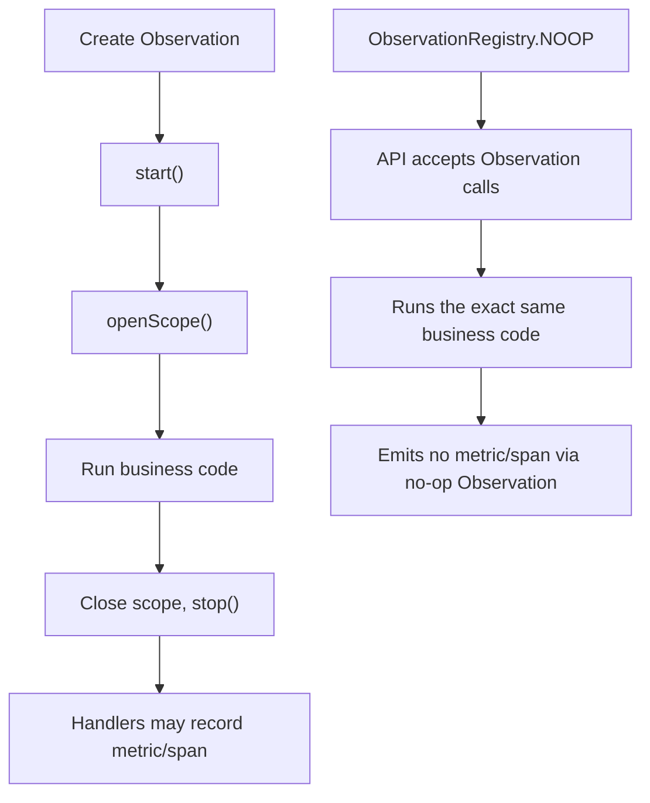
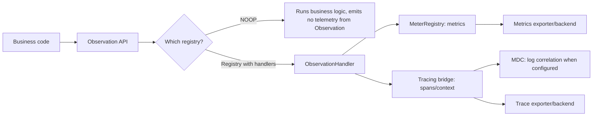
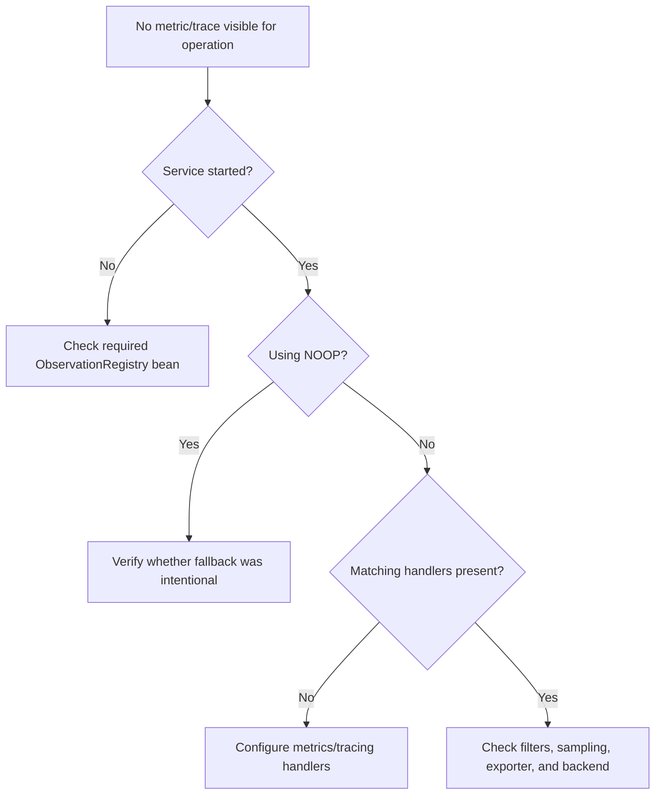

# No-op When Registry Is Missing in Micrometer Observation

In Spring Boot, a business operation can be wrapped with **Micrometer Observation** to measure duration, attach attributes, record errors, and create spans when tracing is configured. However, not every environment has an active `ObservationRegistry`: standalone programs, unit tests, reusable libraries, or apps where observability is not enabled may not register one.

The **"No-op When Registry Is Missing"** lesson belongs to the **Micrometer Observation** chapter of the **SPRING_BOOT_OBSERVABILITY** module. Its goal is to explain the *no-op* mechanism (producing no observation side effects), preserve business behavior when a registry is absent, distinguish a missing bean from a missing handler/exporter, and verify the impact on metrics, logs, distributed tracing, propagation, tags/cardinality, and sampling in real environments.

## 1. What Is No-op, and Why Is It Needed?

A **no-op** (*no operation*) is an object that still satisfies the API contract's methods without performing the corresponding measurement or telemetry recording side effects.

With Micrometer Observation, we usually want business code to keep a single consistent shape:

```java
return Observation.createNotStarted("order.validate", registry)
        .observe(() -> validateOrder());
```

In an environment with an active registry and appropriate handlers, the operation can produce meters, spans, and linked trace context. In an environment that does not need observability, we still want `validateOrder()` to run exactly once and return its exact value or exception, **without needing `if` branches around every business block**.

Micrometer provides:

```java
ObservationRegistry.NOOP
```

This is an `ObservationRegistry` intended for deliberately skipping collection via Observation. It provides a valid API execution path so Observation-using code continues running with minimal telemetry overhead. However, *no-op* does not mean the method inside `observe(...)` is skipped.

> **Important distinction:** A missing `ObservationRegistry` bean in Spring does not automatically turn every call into a no-op. Only when code supplies a valid fallback registry (such as `ObservationRegistry.NOOP`) does Observation usage get a clean fallback path.

## 2. "Missing Registry" Can Describe Four Different Situations

| Situation | What actually happens | Does business logic still run? | Metrics/traces from that Observation |
| --- | --- | --- | --- |
| No `ObservationRegistry` bean, while constructor requires injection | Spring fails to initialize the dependent bean and the app fails to start | Never reaches business code | None |
| Code explicitly uses `ObservationRegistry.NOOP` | Observation API receives fallback registry; observation actions become no-ops | Yes, assuming business code itself runs normally | None emitted from this no-op Observation path |
| `ObservationRegistry.create()` exists, but no matching `ObservationHandler` is registered | A real registry exists, but no handler converts events into metrics/spans | Yes | Typically no signals from that Observation |
| Registry, handlers, and exporter exist, yet exporter/backend fails | Observation may still run and generate internal data; failure is in transport/storage | Usually yes, depending on error config and pipeline handling | Data may not appear in backend |

The middle two rows may look identical on a dashboard (neither shows data), yet they are **not equivalent in lifecycle, configurability, or cost**. `ObservationRegistry.NOOP` is an explicit choice to bypass instrumentation; `ObservationRegistry.create()` is a live registry capable of holding handlers, filters, conventions, and predicates.

Also distinguish a missing bean from a missing **dependency**. If the project lacks `micrometer-observation` on the classpath altogether, Java cannot even compile imports for `Observation` and `ObservationRegistry`. `NOOP` only addresses situations where the code already has the Micrometer API while a live registry is unavailable or unconfigured.

### Why not pass `null`?

Do not assume that:

```java
Observation.createNotStarted("order.validate", null); // Do not do this
```

will automatically be converted to a no-op by Micrometer. `null` is not a valid registry guaranteed by the normal usage contract; the outcome can be a runtime error depending on call site and version. Normalizing to a fallback once at the dependency boundary is clearer and safer.

## 3. Execution Mechanics: What Is No-op and What Still Runs?

A normal Observation follows this lifecycle:



Key points to grasp:

1. **`observe(...)` still executes the callback.** If the callback returns a value, that value is returned to the caller. If the callback throws an exception, do not treat no-op as swallowing exceptions.
2. **No observation side effects through the no-op registry.** Actions like starting/stopping the observation, attaching key-values, recording errors, and opening scopes produce no meters or spans through the no-op registry.
3. **Business side effects still occur.** Database calls, outbound HTTP requests, developer-written log lines, state mutations, and thrown exceptions still happen normally.
4. **No propagation magic.** A no-op registry does not create new spans or supply a tracing handler to inject context into cross-service calls. Another active tracer outside that block might still hold its own context; do not infer that all traces across the app vanish just because one Observation uses no-op.
5. **No-op does not mean zero Java cost.** Argument expressions, lambda allocations, and business code still execute under Java semantics. What is skipped is telemetry work for the no-op Observation.

Java-level verification example:

```java
import io.micrometer.observation.Observation;
import io.micrometer.observation.ObservationRegistry;
import java.util.concurrent.atomic.AtomicInteger;

ObservationRegistry registry = ObservationRegistry.NOOP;
AtomicInteger executions = new AtomicInteger();

String result = Observation.createNotStarted("example.noop", registry)
        .observe(() -> {
            executions.incrementAndGet();
            return "done";
        });

// result.equals("done") == true
// executions.get() == 1
// No metrics/spans created by the no-op Observation.
```

The snippet above illustrates the logic and can be placed inside an appropriate test method. Understand "emits no metric/span" as a property of **this Observation path**; explicit developer logs and independent instrumentation from other libraries can still run.

## 4. Simple Fallback in Plain Java

Suppose a library provides `calculateTotal` without wanting to force every calling application to configure observability. You can normalize the registry right in the constructor:

```java
import io.micrometer.observation.Observation;
import io.micrometer.observation.ObservationRegistry;

public final class PriceCalculator {
    private final ObservationRegistry registry;

    // null at the boundary becomes an explicit fallback.
    public PriceCalculator(ObservationRegistry providedRegistry) {
        this.registry = providedRegistry != null
                ? providedRegistry
                : ObservationRegistry.NOOP;
    }

    public int calculateTotal(int unitPrice, int quantity) {
        return Observation.createNotStarted("pricing.calculate", registry)
                .lowCardinalityKeyValue("operation", "multiply")
                .observe(() -> Math.multiplyExact(unitPrice, quantity));
    }
}
```

Two ways to use it:

```java
PriceCalculator withoutTelemetry = new PriceCalculator(null);
int total = withoutTelemetry.calculateTotal(250, 3); // 750

ObservationRegistry configured = ObservationRegistry.create();
PriceCalculator withRegistry = new PriceCalculator(configured);
int anotherTotal = withRegistry.calculateTotal(250, 3); // 750
```

In the second example, `ObservationRegistry.create()` is **not enough on its own** to export metrics or traces: you also need to register matching `ObservationHandler` instances (e.g., metrics or tracing handlers) along with a suitable meter registry, tracer, and exporter.

`Math.multiplyExact` can throw `ArithmeticException` on overflow. That exception is still thrown even with `NOOP`; the fallback does not alter the return/error contract of `calculateTotal`.

### When should you use this kind of fallback?

- **Shared libraries:** wanting Observation to be optional without scattering conditionals throughout the code.
- **Unit tests or demo programs:** testing business logic independently of an observability pipeline.
- **Small CLI/batch utilities:** using the Micrometer API without an attached observability backend.
- **Intentional telemetry-off mode:** needing a clear operational contract even when not collecting signals.

For production applications where metrics and tracing are required for operations, do not silently fall back to no-op when essential configuration is broken. Failing fast at startup usually catches missing observability much earlier.

## 5. Safe Fallback with Spring Boot Dependency Injection

If a `@Service` constructor directly requires `ObservationRegistry`:

```java
@Service
public class PaymentService {
    public PaymentService(ObservationRegistry registry) {
        // ...
    }
}
```

and the Spring context **has no matching bean**, the application may fail while initializing the service. Placing `ObservationRegistry.NOOP` elsewhere will not rescue this constructor injection.

When the registry is genuinely optional, use Spring's `ObjectProvider<ObservationRegistry>` to obtain the bean if present and fall back to `NOOP` otherwise:

```java
import io.micrometer.observation.Observation;
import io.micrometer.observation.ObservationRegistry;
import org.springframework.beans.factory.ObjectProvider;
import org.springframework.stereotype.Service;

@Service
public class CheckoutService {
    private final ObservationRegistry registry;

    public CheckoutService(ObjectProvider<ObservationRegistry> registries) {
        this.registry = registries.getIfAvailable(
                () -> ObservationRegistry.NOOP
        );
    }

    public int totalAmount(int price, int quantity) {
        return Observation.createNotStarted("checkout.calculate", registry)
                .lowCardinalityKeyValue("checkout.step", "total")
                .observe(() -> Math.multiplyExact(price, quantity));
    }
}
```

Here `ObjectProvider` is a dependency Spring can always supply; `getIfAvailable(...)` invokes the fallback supplier if no `ObservationRegistry` bean is found.

Expected behavior table:

| Spring context configuration | `CheckoutService` uses | Behavior of `totalAmount(...)` |
| --- | --- | --- |
| No `ObservationRegistry` bean | `ObservationRegistry.NOOP` | Calculation runs; observation block emits no metrics/spans |
| `ObservationRegistry` bean and handlers present | Real bean | Calculation runs; handlers can emit signals |
| `ObservationRegistry` bean present without handlers | Real bean | Calculation runs; metrics/spans may not appear |
| Multiple unresolvable beans of the same type | `ObjectProvider` may fail with non-unique bean error | Use `@Primary`/`@Qualifier` or fix bean wiring |

**Avoid registering a global `ObservationRegistry.NOOP` `@Bean` fallback** without evaluating auto-configuration ordering. A no-op bean registered too early can suppress Spring Boot's auto-configuration from creating the real `ObservationRegistry`, causing silent loss of observability even in production. Local fallbacks inside a service or library are much easier to scope safely.

### Does Spring Boot create a registry automatically?

With Spring Boot Actuator/Micrometer and the relevant auto-configurations, an application typically receives a Spring-managed `ObservationRegistry`. Yet having that bean **does not guarantee** tracing exports spans or metrics reach Prometheus. Depending on version, dependencies, and properties, you still need a metrics registry, tracing bridge, exporter, endpoints, and backend.

When observability is mandatory, prefer direct constructor injection so misconfiguration surfaces at startup. Use optional injection only when the system is explicitly allowed to run without telemetry.

## 6. Connecting to Metrics, Logs, and Distributed Tracing

In the **SPRING_BOOT_OBSERVABILITY** module, Micrometer Observation models the operation; each signal comes from its specific pipeline:



### Metrics

A metrics handler can update timers/counters with labels from the Observation. With `NOOP`, no metrics are created **by that Observation**. This does not stop JVM, HTTP server, or other custom `MeterRegistry` metrics if those components are configured independently.

Even while using no-op, define labels properly in code so that when a real registry is enabled, the system avoids **cardinality** problems:

- Use bounded values: `operation=calculate`, `payment.method=card`, route template `/orders/{id}`.
- Avoid high-variance values in metric labels: `orderId`, `userId`, `traceId`, full URLs, or exception messages.
- Distinguish `lowCardinalityKeyValue` from `highCardinalityKeyValue` by semantics, not by whether the registry happens to be no-op right now.

### Logs

Explicit logs written via SLF4J/Logback still appear:

```java
log.info("Calculated total amount for order");
```

However, a no-op registry **does not create a span or correlation ID** for that work. Consequently, logs may lack `traceId`/`spanId` in MDC. If the application already has a trace context from other instrumentation, logs may still carry that ID; verify actual runtime context and logger configuration.

### Traces and context propagation

With a tracing bridge and proper instrumentation, an Observation can join a trace and create spans while propagating context across HTTP clients, message consumers, or async tasks. With an Observation using a no-op registry, you cannot expect a span for that operation or automatic context injection/extraction through it.

Do not confuse a **no-op registry** with **sampling probability = 0**:

| No-op registry | Registry with tracer, sampler decides not to record trace |
| --- | --- |
| Does not run tracing handlers for that Observation | Tracing handlers/instrumentation may still run |
| Creates no span via the no-op Observation path | Trace context and sampling decision can still exist even if span is dropped |
| Does not manage propagation itself | Propagation can still function depending on tracing SDK/instrumentation |
| Unrelated to a sampling probability | Governed by sampler rules and export/storage policies |

If an HTTP request traverses three services and one service accidentally uses `NOOP`, the trace waterfall may miss a segment or break linkage if that segment was responsible for propagation. That is an observability issue, **not necessarily** a business bug.

### Exporters and backends

Having `ObservationRegistry` and handlers is still not enough: data must reach the collector/backend. An OTLP exporter failing to send spans, or Prometheus failing to scrape an endpoint, is a **transport/collection failure**, not a no-op registry case. Never "fix" an exporter error by switching the registry to `NOOP`; doing so simply discards even more diagnostic data.

## 7. Diagnosing "Observation Runs, Yet No Data Appears"

Suppose `CheckoutService.totalAmount(...)` returns the right result, yet dashboards show no timer or trace. Check in order, from application outward to backend:

1. **Identify the actual registry.** Did the constructor receive a real bean or fall back to `ObservationRegistry.NOOP`? In environments where no-op is permitted, log a startup warning when falling back so operators know.
2. **Verify handlers.** A registry created with `ObservationRegistry.create()` may have no metrics/tracing handlers attached. Having a registry does not equal having signals.
3. **Check Observation name and tags.** Is `checkout.calculate` actually created when the method runs? Does a filter/predicate disable it? The final meter name may also be normalized by the exporter.
4. **Check the metrics pipeline.** Does `MeterRegistry` have a matching handler? Is the endpoint or exporter enabled? Is the backend querying the exact name, labels, and time range?
5. **Check the tracing pipeline.** Are a tracer bridge, tracer/exporter, instrumentation, and collector present? Did sampling drop the trace you are looking for? Is `traceId` propagated across service boundaries?
6. **Check log correlation.** Does MDC hold `traceId`/`spanId` when logs are emitted? Do the encoder and pipeline retain those fields? Did an executor/reactive/messaging boundary drop context?
7. **Check environment differences.** Do tests use `NOOP` while production has handlers? Or did production accidentally pick up a no-op bean from config? Compare wiring and runtime indicators.

We can sketch a decision tree:



In production, put reliable operational monitoring on mandatory signals; a single startup log line aids diagnosis but does not replace monitoring the telemetry pipeline.

## 8. Verifying No-op Behavior with Practical Cases

The scenarios below focus on the *behavioral contract* rather than testing Micrometer's internal implementation:

| Case | Setup | Expected observation |
| --- | --- | --- |
| Returning a value | Use `ObservationRegistry.NOOP`, callback returns `"ok"` | Returns `"ok"`; callback runs exactly once |
| Business side effect | Callback increments an in-memory counter | Counter still increments |
| Business failure | Callback throws `IllegalStateException` | Caller still receives the exception; not swallowed by no-op |
| Empty registry | `ObservationRegistry.create()` with no handlers | Business logic runs, yet dashboards receive no metrics/spans |
| Metrics handler present | Configure metrics handler and matching registry | Timer/count updates with expected name/tags |
| Tracing handler present | Configure tracer and tracing handler | Spans/context visible when instrumentation, sampler, and exporter work |
| Backend unavailable | Stop export target in test environment | Distinguish exporter failure from a no-op registry |

Minimal example for the exception case:

```java
ObservationRegistry registry = ObservationRegistry.NOOP;

try {
    Observation.createNotStarted("example.failure", registry)
            .observe(() -> {
                throw new IllegalStateException("Business rule failed");
            });
} catch (IllegalStateException expected) {
    // Business error still propagates outward.
}
```

When wrapping code with `Observation.observe(...)`, avoid catching and swallowing errors just to "keep observability happy"; Observation error recording is meaningful when registries/handlers are active, but never replaces application error handling.

### Hands-on in a Spring Boot service

1. Run the service with a Spring-provided `ObservationRegistry` and configured handlers; invoke an endpoint containing a custom observation.
2. Observe metrics/spans from the operation. If missing, isolate registry, handlers, exporter, and sampling per Section 7.
3. In a test environment **where a missing bean is allowed**, use the `ObjectProvider` constructor from Section 5 to fall back to `NOOP`; confirm business results and exceptions stay identical.
4. Re-enable the registry/handlers. Verify labels do not cause uncontrolled cardinality, context propagates cleanly across services, and logs correlate when tracing is active.
5. Document the policy explicitly: which environments permit no-op, and which environments must fail when telemetry is missing.

## 9. Common Mistakes and Fixes

| Claim or practice | Problem | Right understanding / fix |
| --- | --- | --- |
| "If registry injection fails, Micrometer auto-no-ops" | Spring can fail bean creation before business code ever runs | Use intentional optional dependencies or ensure the real bean exists |
| "Passing `null` is the same as `NOOP`" | `null` is not a safe API fallback | Normalize to `ObservationRegistry.NOOP` at the boundary |
| "Having `ObservationRegistry.create()` produces metrics" | Empty registry has no handlers/exporters | Wire handlers, meter registry, and backend |
| "No-op skips the callback so the task won't run" | Confuses telemetry with business execution | `observe(...)` callbacks still run, return values, and throw normally |
| "Disabling sampling equals using a no-op registry" | Context propagation, span lifecycle, and sampler rules differ | Diagnose registry and sampling independently |
| "Seeing logs proves Observation is active" | Logs are emitted by code or independent logging setups | Verify correlation IDs, handlers, and backend data |
| "Just silently fall back in production to be safe" | Hides misconfiguration and monitoring blind spots | Fall back only if telemetry is truly optional; otherwise fail fast or surface status |
| "Any tag is fine while using no-op" | Enabling real handlers later creates massive metric series | Standardize low-cardinality tags while writing instrumentation |

## 10. Self-Check Questions

1. Why can an app with constructor `PaymentService(ObservationRegistry registry)` fail to start if Spring lacks the bean, even though Micrometer has `ObservationRegistry.NOOP`?
2. When a callback inside `observe(...)` throws an exception, should a no-op registry turn the callback into a success? Why or why not?
3. What is the difference between `ObservationRegistry.create()` with no handlers and `ObservationRegistry.NOOP`?
4. Why does a request still appear in application logs even when that operation's Observation uses `NOOP`?
5. After switching from `NOOP` to a real registry, how do `userId` or `orderId` tags impact metric series counts?
6. Why must traces disappearing after changing sampling config be investigated differently from traces disappearing due to a `NOOP` fallback?
7. In production Spring Boot apps, when is a fallback good design, and when should dependency injection fail to expose misconfiguration?

## Conclusion

**`ObservationRegistry.NOOP` keeps Observation calls executable without generating telemetry through that registry; business code inside `observe(...)` still executes and obeys its return and error contracts.** "Missing registry", "registry without handlers", "trace dropped by sampling", and "exporter failure" are four distinct states requiring distinct diagnostics. In Spring Boot, make fallback decisions explicit at dependency boundaries, keep metric labels low-cardinality from the start, and define clearly which environments allow no-op so the system stays resilient without silently going blind.
