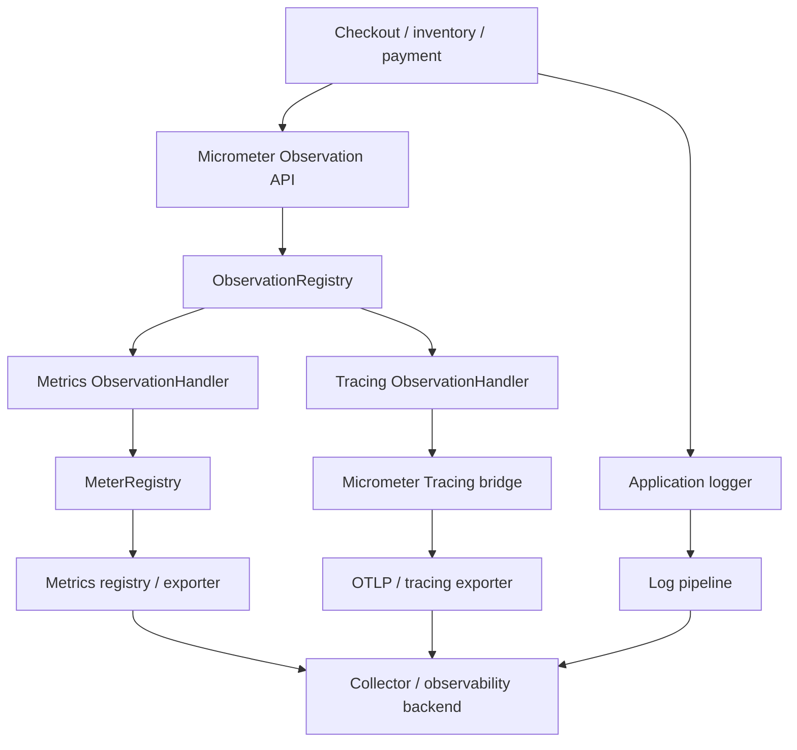
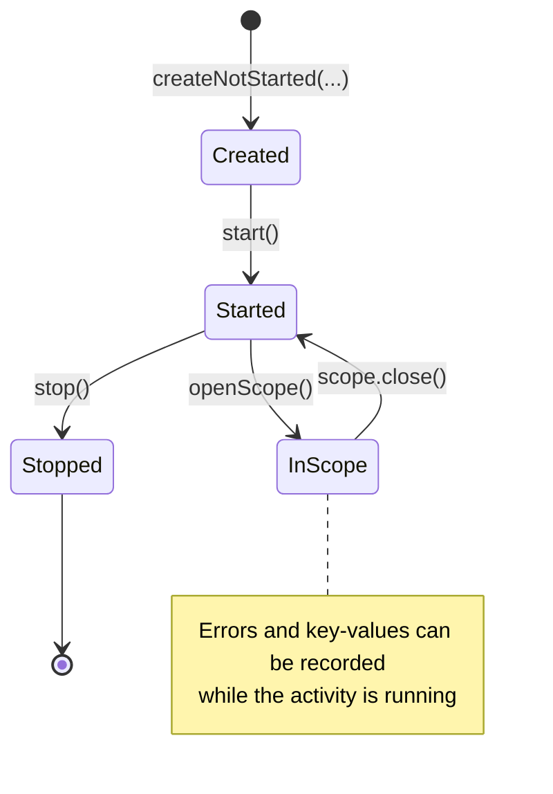
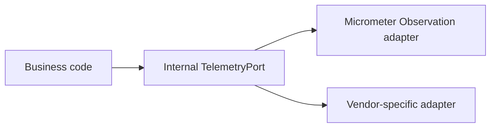

# Observation API vs. Vendor API in Spring Boot

In a Spring Boot application, measuring latency, counting errors, and tracking request paths often begins right next to business logic. For example, when creating an order, we want to know how long the inventory reservation call took, how many times it failed, and which services the request traversed. The trouble starts when every piece of business code calls a specific monitoring system's SDK directly: switching backends can force edits across dozens of places in the application.

**Micrometer Observation API** solves part of this problem by letting the application describe **the activity to observe** through one unified API. Components configured outside business code decide how to turn that activity into **metrics** and **traces**. By contrast, a **vendor API** is tied to a specific product, agent, or SDK; calling it directly often unlocks specialized features at the cost of stronger vendor lock-in.

This lesson belongs to the **Micrometer Observation** chapter of the **SPRING_BOOT_OBSERVABILITY** module, covering how to set up observability for Spring Boot using Micrometer Observation, metrics, logs, and distributed tracing, while connecting concerns such as context propagation, tags/cardinality, exporters, sampling, and signal correlation when investigating real applications.

## 1. Terms You Must Distinguish

| Concept | Role | Example |
| --- | --- | --- |
| **Observation API** | API for describing an observed activity, lifecycle, and context without picking a backend upfront | `io.micrometer.observation.Observation` |
| **ObservationRegistry** | Manages configuration and `ObservationHandler` instances processing observation lifecycle events | `ObservationRegistry` injected into the app |
| **ObservationHandler** | Reacts when an observation starts, stops, errors, or opens/closes scope; can create measurements or spans | Metrics or tracing handler |
| **Micrometer Metrics API** | API working directly with counters, gauges, timers, and other meters | `MeterRegistry`, `Counter`, `Timer` |
| **Micrometer Tracing API** | Abstraction focused on spans, tracers, and baggage; typically bridged to a tracing implementation | `io.micrometer.tracing.Tracer` |
| **OpenTelemetry API** | Standard tracing/telemetry API, **not a proprietary single-vendor API** | `io.opentelemetry.api.trace.Tracer` |
| **Vendor API/SDK** | A vendor's API or extension for calling product-specific features, collecting, or shipping telemetry | Proprietary SDK recording business transactions/events |
| **Exporter/registry/backend** | Components that transport, expose, store, or visualize telemetry | Prometheus, OTLP Collector, Tempo, Jaeger, commercial backends |

The word **vendor** in this lesson refers to a **monitoring tool provider**. OpenTelemetry is an open-source standard and ecosystem supporting many backends; calling the OpenTelemetry API directly still couples business code to **a specific span model and SDK**, though it does not mean lock-in to a single vendor.

The key distinction is between **the business action you want to observe** and **how signals are recorded and exported**. The Observation API focuses on the former; direct tracing, metrics, or vendor APIs give finer control over the latter.

## 2. Why Avoid Calling Vendor APIs Directly Across the Application?

Suppose `checkout-service` uses monitoring system A, and a year later the organization decides to migrate tracing to system B. If every controller/service layer creates transactions using A's API, business code is filled with A-specific imports, method calls, and tag formats. Migration requires auditing every call site; dashboards and queries may also depend on those same names.

When the application describes operations with the Observation API:

1. Business code specifies the operation name, context, and meaningful attributes.
2. Registered `ObservationHandler` instances record metrics and/or tracing.
3. The registry, tracing bridge, exporter, and collector ship signals to the target system.
4. When switching to a compatible backend, you typically adjust dependencies, configuration, and export pipelines; observation-describing business logic can often remain untouched.



The diagram shows a configurable flow—**it does not promise every observation emits both a metric and a trace**. Without matching handlers, registries/exporters, or when dropped by sampling, specific signals may not appear in the backend. **Business logs are emitted by the logger**, not automatically generated simply because code creates an `Observation`.

## 3. Lifecycle of an Observation

An observation typically consists of:

- **Name:** stable technical name of the activity, e.g., `checkout.inventory.reserve`, used for grouping and as the basis for metric names.
- **Context:** state and metadata carried during observation. You can use `Observation.Context` or a custom context subclass.
- **Low-cardinality key-values:** attributes with few distinct values, suitable as metric labels.
- **High-cardinality key-values:** attributes with many values, helpful when inspecting individual traces; requires security and cost control.
- **Start/stop:** defines execution timing boundaries.
- **Scope:** sets the observation as current in context so nested operations can link to it.
- **Error:** records exceptions or error states when the application explicitly reports them to the observation.



When using `observe(...)`, the API wraps the work in the observation lifecycle. When you need explicit control over `try/catch`, scopes, or when key-values are added, call `start()`, `openScope()`, and `stop()` explicitly.

**An observation is not a trace.** Observation is an application-level activity model; a trace is a structure of spans. When a tracing handler is present, the observation lifecycle can map to a corresponding span. Without a tracing handler, the application still runs without necessarily emitting any spans.

## 4. Spring Boot Example: Creating a Vendor-Neutral Observation

The example below measures stock reservation using the Micrometer Observation API. `InventoryGateway` represents an adapter calling the inventory store; the interface is included so the example reads standalone.

```java
import io.micrometer.observation.Observation;
import io.micrometer.observation.ObservationRegistry;
import org.springframework.stereotype.Service;

interface InventoryGateway {
    boolean reserve(String sku, int units);
}

@Service
public class CheckoutService {
    private final InventoryGateway inventoryGateway;
    private final ObservationRegistry observationRegistry;

    public CheckoutService(
            InventoryGateway inventoryGateway,
            ObservationRegistry observationRegistry) {
        this.inventoryGateway = inventoryGateway;
        this.observationRegistry = observationRegistry;
    }

    public boolean reserveForCheckout(String sku, int units) {
        return Observation.createNotStarted(
                "checkout.inventory.reserve", observationRegistry)
            .lowCardinalityKeyValue("operation", "reserve")
            .lowCardinalityKeyValue("source", "checkout")
            .observe(() -> inventoryGateway.reserve(sku, units));
    }
}
```

In this example:

1. `checkout.inventory.reserve` describes **what is being measured**, not the name of a monitoring vendor.
2. `ObservationRegistry` arrives via dependency injection; the application does not instantiate a vendor SDK inside the service.
3. `operation` and `source` have bounded value sets, making them suitable as low-cardinality tags.
4. `observe(...)` ensures the observation stops when execution finishes, even if the wrapped code throws an exception.
5. Whether metrics or spans are produced depends on registry, handler, and tracing sampling config; this code expresses only the business instrumentation.

Do not add `sku`, order IDs, emails, or request IDs as **low-cardinality keys**. A SKU catalog can have hundreds of thousands of values; putting them straight into metric labels drives up time series counts sharply. When you need to locate a specific transaction, use a correlation ID or controlled trace attributes alongside business systems when querying identifiers.

### When explicit error and scope handling is required

Some operations must distinguish three outcomes: succeeded, rejected by business rules, or threw an exception. In those cases, manage the lifecycle explicitly:

```java
import io.micrometer.observation.Observation;
import io.micrometer.observation.ObservationRegistry;

public final class ReservationOperation {
    private final ObservationRegistry registry;
    private final InventoryGateway gateway;

    public ReservationOperation(ObservationRegistry registry,
                                InventoryGateway gateway) {
        this.registry = registry;
        this.gateway = gateway;
    }

    public boolean execute(String sku, int units) {
        Observation observation = Observation.createNotStarted(
                "checkout.inventory.reserve", registry)
            .lowCardinalityKeyValue("operation", "reserve")
            .start();

        try (Observation.Scope ignored = observation.openScope()) {
            boolean accepted = gateway.reserve(sku, units);
            observation.lowCardinalityKeyValue(
                "outcome", accepted ? "accepted" : "rejected");
            return accepted;
        } catch (RuntimeException ex) {
            observation.error(ex);
            observation.lowCardinalityKeyValue("outcome", "error");
            throw ex;
        } finally {
            observation.stop();
        }
    }
}
```

**`rejected` differs from `error`**: an out-of-stock request can be legitimately rejected by business logic without being a technical error. Consistent `outcome` tagging lets you query rates for each result. How handlers surface exceptions as metric labels or span status can vary with configuration; verify in actual output.

Opening a scope matters when inner code uses tracing/logging correlation. The active scope **does not automatically propagate to another thread, executor, or message consumer**; matching instrumentation and context propagation mechanisms are required.

## 5. Comparing Against Direct Tracing API Usage

An engineering team might want to create spans directly with the OpenTelemetry API instead of the Observation API. The snippet below uses the **standard OpenTelemetry API** purely to illustrate direct tracing; it is not a proprietary vendor SDK example.

```java
import io.opentelemetry.api.trace.Span;
import io.opentelemetry.api.trace.StatusCode;
import io.opentelemetry.api.trace.Tracer;
import io.opentelemetry.context.Scope;

public final class DirectTracingExample {
    public static boolean reserve(
            Tracer tracer,
            InventoryGateway gateway,
            String sku,
            int units) {

        Span span = tracer.spanBuilder("checkout.inventory.reserve")
            .startSpan();

        try (Scope ignored = span.makeCurrent()) {
            span.setAttribute("operation", "reserve");
            return gateway.reserve(sku, units);
        } catch (RuntimeException ex) {
            span.recordException(ex);
            span.setStatus(StatusCode.ERROR);
            throw ex;
        } finally {
            span.end();
        }
    }
}
```

Running this code requires the OpenTelemetry API dependency and a properly configured `Tracer`. The snippet creates a **span** with OpenTelemetry context; it **does not automatically create a Micrometer Timer** to aggregate latency. To get the corresponding metric, you must add separate instrumentation or a dedicated metrics collection path.

These two examples illustrate two levels of abstraction:

| Criterion | Micrometer Observation API | Direct OpenTelemetry API | Proprietary Vendor API |
| --- | --- | --- | --- |
| Intent in code | Observe a business activity | Control specific spans/tracing | Drive product-specific transactions, events, or features |
| Dependency in business layer | Micrometer Observation | OpenTelemetry API | Vendor's SDK |
| Emit metrics from the same activity | Possible via metrics handler | Starting a span does not create Micrometer metrics | Depends on SDK and features |
| Emit traces | Possible via tracing handler/bridge | Yes when Tracer/SDK/exporter configured | Depends on SDK and agent |
| Switching monitoring backend | Usually localized to handlers, registry, bridge, exporter | Can swap exporter/backend via SDK | May require editing call sites and data conventions |
| Access to specialized features | Via extensions or dedicated APIs when needed | Features within OTel standard | Usually broadest for that vendor's own features |

There is no rule saying "always use the Observation API" in every situation. If you genuinely need span links, fine-grained span events, specialized baggage, or capabilities Observation does not model cleanly, using the tracing API directly inside an **adapter/infrastructure layer** can make sense. If you need telemetry types supported only by a vendor SDK, isolate that dependency behind a cleanly bounded adapter.

## 6. Relationship Among Observation API, MeterRegistry, and Tracer

These three APIs are related yet solve different needs:

- **Observation API:** ideal for activities with a start and end, such as processing checkout, calling inventory, or confirming payment. Handlers can emit timers and spans together.
- **MeterRegistry:** ideal for metrics without an operation lifecycle, such as a gauge of queue depth, a counter of skipped records, or a distribution summary of payload sizes.
- **Tracing API:** ideal when you need explicit span manipulation, trace links, context exchange, or high-detail span events.

For instance, `queue.depth` is an instantaneous state, naturally measured with a gauge. Conversely, `checkout.inventory.reserve` is an operation with a duration, so expressing it via the Observation API is more natural.

Moving from `MeterRegistry` to the Observation API is **not a one-to-one replacement**: a well-defined business counter should sometimes remain a counter. Observation unifies activity instrumentation rather than replacing the entire metrics model.

## 7. ObservationConvention: Keeping Names and Tags Systematic

When multiple controllers/services describe the same kind of operation, a common risk is each spot picking slightly different names and labels:

```text
checkout.inventory.reserve
checkout.inventory.reservation
inventory.reserve.checkout
```

These names can produce separate metric series and span groups despite having nearly identical meaning. The fix is defining a unified **observation convention**: stable operation names, consistent tag names, bounded value sets, and outcome classification rules.

Micrometer supports `ObservationConvention` alongside context types to specify:

- Observation name and contextual name matching the measurement's purpose.
- Low-cardinality key-values for aggregation.
- High-cardinality key-values for tracing diagnostics, depending on handler support.
- Default values and tag-extraction logic from context, avoiding copy-paste across methods.

For instrumentation reused in many places, writing a convention makes sense. For a small example, calling `lowCardinalityKeyValue(...)` directly stays easy to follow. Keep in mind actual metric names also follow rules of the metrics handler and registry; span names can likewise come from contextual names or conventions. Verify the output format of both.

### Tag cardinality determines operational viability

Suppose a metric has `operation` (3 values), `outcome` (3 values), and `region` (4 values). Each instance can generate up to **3 × 3 × 4 = 36 combinations** for that label set alone before extra tags. Adding `orderId` with 1 million potential values multiplies combinations exponentially.

| Label / attribute | Usually suitable type | Reason |
| --- | --- | --- |
| `operation=reserve` | Low-cardinality | Few, stable values |
| `outcome=accepted/rejected/error` | Low-cardinality | Easy to aggregate and alert on |
| `region=ap-southeast-1` | Low-cardinality if region set is bounded | Enables regional analysis |
| `http.route=/orders/{id}` | Low-cardinality | Route templates have a bounded value set |
| `orderId`, `requestId` | Never use as metric labels | Nearly unique per request |
| Non-sensitive correlation ID of one run | Can be a controlled trace attribute | Useful for finding one case, but should not be recorded unboundedly |

High cardinality does not mean permission to store personal data. Identifying fields may need encryption, masking, complete removal, or storage strictly in business databases per security requirements. Tracing backends also enforce limits on attribute counts, sizes, and retention.

## 8. From Observation to Exporters and Backends

Application code defining observations alone does not ensure signals reach dashboards. A Spring Boot architecture using Micrometer may look like:

```text
Business code
   └─ Observation API
       └─ ObservationRegistry + handlers
           ├─ Micrometer Metrics → MeterRegistry
           │    └─ Prometheus scrape or another registry/exporter
           └─ Micrometer Tracing → bridge (e.g., OpenTelemetry)
                └─ SDK/exporter → OTLP Collector → trace backend

Business code → Logger → log collector → log backend
```

For experimentation, on Spring Boot 3.x learners commonly encounter these dependencies depending on build setup and version:

```gradle
dependencies {
    implementation("org.springframework.boot:spring-boot-starter-actuator")
    runtimeOnly("io.micrometer:micrometer-registry-prometheus")
    implementation("io.micrometer:micrometer-tracing-bridge-otel")
    runtimeOnly("io.opentelemetry:opentelemetry-exporter-otlp")
}
```

This is an **illustrative dependency set**; use the proper BOM/version management and check the auto-configuration behavior of your Spring Boot version. You can swap Prometheus for another registry or point OTLP to a compatible backend/collector. Never assume every Spring Boot release shares identical dependency or property names.

An example Spring Boot 3.x configuration when using a tracing exporter supporting OTLP HTTP:

```yaml
management:
  endpoints:
    web:
      exposure:
        include: health,info,prometheus
  tracing:
    sampling:
      probability: 0.1
  otlp:
    tracing:
      endpoint: http://otel-collector:4318/v1/traces
```

**Verify your version:** property keys, exporter wiring, endpoints, and auto-configuration behavior can vary across Spring Boot releases. The example only illustrates the concept and is not a complete config for every environment.

In a real system:

1. Check Actuator/registry for expected metrics and exact names/units.
2. Check the trace backend for spans with the right service name, parent–child relationships, and reasonable durations.
3. Check application logs for `traceId`/`spanId` when tracing correlation is configured.
4. Check exporters, collectors, and backends for ingestion errors or dropped data.
5. Restrict Actuator endpoint access and enforce sensitive-data and retention controls.

**Sampling:** if configured to sample 10% of traces, an observation can still contribute to metrics without a corresponding stored trace. Exact results depend on the instrumentation/export pipeline and sampling policy; seeing a trace ID in a log also does not guarantee that trace exists in the backend.

## 9. Correlation and Context Propagation Are Not Just an API Swap

In a distributed system, a `POST /checkout` request may flow through `checkout → inventory → payment`. When tracing handlers are active and HTTP clients/servers are properly instrumented, trace context is typically propagated via headers such as W3C `traceparent`. That allows downstream spans to link back to upstream spans.

**Creating an Observation is necessary but not sufficient to guarantee propagation.** Situations that break the link:

- Spawning raw threads, using uninstrumented executors, or running async work without context propagation.
- Using hand-rolled HTTP clients or messaging protocols without injecting/extracting trace context.
- Logging outside a scope or before correlation IDs are bound to the logging context.
- Mixing unintegrated tracers/SDKs, splitting traces apart.

Across async boundaries, use context propagation mechanisms suited to your framework and tools. Across HTTP/messaging boundaries, instrument both sender and receiver. Never try to serialize and send an entire `Observation` object over the network.

When correlation works, three views reinforce each other:

| Signal | Sample data | Effect |
| --- | --- | --- |
| Metric | `checkout.inventory.reserve` p95 spikes, `outcome=error` rises | Detects severity and timing |
| Trace | `traceId` links checkout and inventory spans, showing inventory took 1.4 seconds | Pinpoints where slowness sits |
| Log | Same `traceId`, `inventory.timeout` event and exception class | Shows failure details at that exact moment |

Metrics usually aggregate by cohort rather than storing per-request `traceId` values. Some pipelines support **exemplars** to link data points or histogram buckets to a trace ID, provided the registry, exporter, and backend all support them; metric-to-trace links do not appear automatically in every stack.

## 10. When Is Calling a Vendor API Directly Acceptable?

The Observation API fits general instrumentation, yet low-level or vendor-specific APIs still have a place. For example, a vendor may offer a proprietary event structure to track session transaction state; if the business genuinely needs that capability and it cannot be expressed via Observation/Micrometer or standard OpenTelemetry, a dedicated adapter can call that SDK.



This is an **architectural option**, not a mandate to create a `TelemetryPort` in every application. A small app can inject `ObservationRegistry` directly. When vendor features are needed across many places, an adapter keeps vendor imports and behavior confined to one boundary.

| Need | Reasonable starting choice |
| --- | --- |
| Time an activity and emit metrics/traces | Micrometer Observation |
| Count business events or measure queue gauges | Micrometer Metrics API |
| Control spans or detailed span events | Micrometer Tracing or OpenTelemetry API, depending on your stack |
| Use a vendor's proprietary feature | Vendor SDK behind a clean adapter boundary |
| Only changing where traces/metrics are stored | Inspect exporter/registry/collector before editing instrumentation |

Also weigh the cost of abstraction: a common API cannot expose **every feature** of every backend; certain attributes, statuses, or conventions can differ when swapping registries or bridges. A vendor-neutral architecture reduces how many call sites need editing, yet never guarantees a backend swap requires zero updates to dashboards, alerts, queries, and pipelines.

## 11. Real-World Scenario: Switching Tracing Backends and Investigating Slow Checkout

**Hypothetical scenario:** A Spring Boot app ships traces to backend A while Prometheus scrapes metrics. The operations team decides to migrate tracing to OTLP-compatible backend B while preserving measurements of `checkout.inventory.reserve`.

Because business code uses the Observation API:

1. **Preserve the observation contract:** the `checkout.inventory.reserve` name, `outcome` semantics, and cardinality limits stay intact.
2. **Verify tracing bridge/exporter:** confirm the OTLP/Collector pipeline receives new spans and that endpoint and authentication settings are valid.
3. **Verify propagation:** send a request through checkout and inventory and confirm spans share the same trace.
4. **Verify metrics independently:** observation rates and latencies continue arriving in the metrics registry.
5. **Verify log correlation:** when logs carry `traceId`, confirm you can jump to the corresponding trace if it was sampled and exported.
6. **Update backend-dependent layers:** dashboards, queries, alerts, retention, access permissions, or attribute mappings may still need adjustments.

After switching backends, metrics reveal checkout p95 climbing. Stored traces show the inventory span taking 1.4 seconds; logs with the matching trace ID report timeouts. That forms an **investigative hypothesis**: the inventory system or network path to it may be degraded. Check across multiple requests, downstream metrics, and recent deployments before concluding root cause.

Mental model: **The Observation API keeps business code consistent; exporters and backends ingest and display signals; correlation lets operators stitch the pieces of evidence together**.

## 12. Common Mistakes When Selecting and Integrating APIs

| Symptom | Possible cause | Verification / fix |
| --- | --- | --- |
| Code creates Observations, yet no metrics appear | Missing metrics handler/registry, or metric name differs from expected | Check dependencies, registry, Actuator, and exported output |
| Metrics appear, yet no traces appear | Missing tracing handler/bridge/exporter, or traces not sampled | Check tracing config, sampling, and collector |
| Traces split into disconnected fragments | Context lost across HTTP/async/message boundaries | Check client/server instrumentation and context propagation |
| Logs lack trace ID | Logging correlation unconfigured or logged outside scope | Check MDC, logging pattern, and when logs emit |
| Time series count spikes suddenly | Unique IDs placed in low-cardinality tags | Remove high-cardinality labels and audit tag design |
| Spans exist, yet names are unreadable | Missing naming convention or suitable contextual name | Standardize observation/span names and verify in backend |
| Added OTel API, yet metrics never appear | Code only creates spans; creates no Meter/Observation metrics | Use an Observation handler or add appropriate meters |
| Switched vendor, dashboards/alerts broke | Query language, metric names, and attribute mappings differ | Test mappings, dashboards, alerts, and telemetry conventions |

When an exporter disconnects, data may be dropped or delayed depending on SDK buffering and retries. Monitor observability as its own pipeline; never treat "no trace found" as proof that a request never ran.

## 13. Self-Check Exercises

**Question 1.** A developer wants to measure `checkout.inventory.reserve` processing time and may switch from backend A to backend B in the future. Which API should they start with?

*Hint:* The Observation API fits because code describes the activity, while handlers, bridges, and exporters determine signals and backends. Names and tags still must remain consistent.

**Question 2.** Tracing dependencies were added and the Observation API is used, yet zero spans appear in the trace backend. Can you conclude the `Observation` code is buggy?

*Hint:* Not yet. Check registry/handlers, sampling, bridge, exporter, endpoint, collector, service name, and retention/time window.

**Question 3.** A method uses OpenTelemetry's `spanBuilder(...)` and `span.end()`. Does this guarantee a Prometheus metric for the method's duration?

*Hint:* No. The OpenTelemetry tracing API creates spans; Prometheus metrics require a separate instrumentation/registry or metrics pipeline.

**Question 4.** A vendor SDK offers an advanced business-event feature that Observation cannot express. Must you strictly avoid that SDK?

*Hint:* No. You can use it behind a cleanly bounded adapter; document the dependency footprint to assess future vendor-swap costs.

**Question 5.** Why shouldn't `orderId` be a low-cardinality key even though it makes looking up an order fast?

*Hint:* Every unique ID creates a new label combination, exploding time series counts. Use business systems or controlled traces/logs to look up individual transactions.

## 14. Key Takeaways

- **Micrometer Observation API** describes the lifecycle and context of a business activity; `ObservationRegistry` and handlers can turn observations into metrics and traces.
- **Vendor APIs** unlock proprietary capabilities while introducing vendor coupling into code. The OpenTelemetry API is a **vendor-neutral standard**, though calling it directly still couples code to the tracing model.
- **Observation, metrics, tracing, and logs** are related concepts that do not wholly replace each other: observations do not automatically emit logs; spans do not automatically create metrics.
- **Low-cardinality tags, naming conventions, context propagation, and sampling** directly govern the value, accuracy, and cost of observability data.
- **Backends can change without rewriting business logic** when instrumentation boundaries are clean, though exporters, mappings, dashboards, and alerts still require verification after any change.
