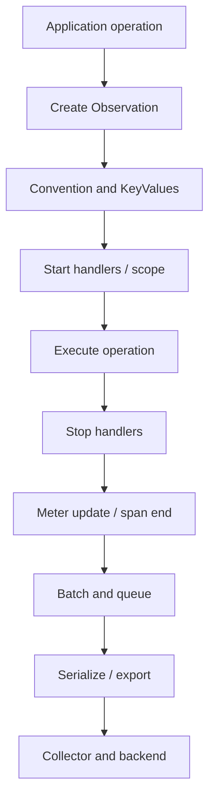
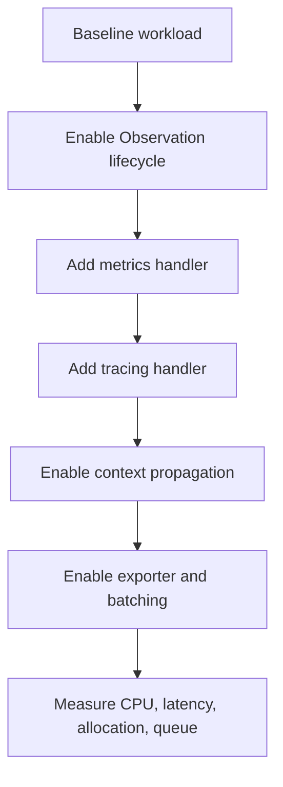

# Cost of Creating an Observation in Spring Boot

Micrometer Observation provides a unified instrumentation point for an application to record metrics, traces, and related context. Each Observation helps standardize how an operation is described, but creating and recording telemetry also consumes CPU, memory, allocations, network, and storage. When request volume is high or instrumentation is placed too deep in the call graph, this overhead can impact latency and throughput.

**The cost of creating an Observation** is not just the time spent calling the API to create the object. It includes the start/stop lifecycle, processing conventions and KeyValues, running ObservationHandlers, creating meters/spans, propagating context, exporting batches, and storing data in the backend. You need to evaluate the entire pipeline and weigh it against the operational value the telemetry provides.

The lesson **“Cost of Creating an Observation”** belongs to the **Observability Performance** chapter of the **SPRING_BOOT_OBSERVABILITY** module. The module teaches how to set up observability for Spring Boot using Micrometer Observation, metrics, logs, and distributed tracing; you will learn context propagation, tags/cardinality, exporters, sampling, and signal correlation to investigate errors, latency, and application behavior in production environments.

## 1. What Does an Observation Consume?

An Observation can go through the following steps:

1. Check predicates and create/initialize the Observation.
2. Assign name, context, and metadata from conventions.
3. Run handlers on start.
4. Set scope/current observation and propagate context.
5. Execute the operation.
6. Run handlers on error/event/stop.
7. Update meters or end the span.
8. Enqueue telemetry into the exporter queue/batch.
9. Serialize, compress, and send data to the Collector/backend.



Not every Observation creates both a metric and a span. The outcome depends on the registry, handlers, predicates, tracing configuration, and sampling. However, even when a span is not exported, instrumentation and context handling can still incur overhead.

## 2. CPU and Allocation Cost

In-process overhead can include:

- Creating Observation/context and related objects.
- Creating or concatenating KeyValues.
- Looking up handlers and invoking callbacks.
- Reading/writing current context or ThreadLocal/Reactor Context.
- Creating spans, attributes, events, and links.
- Updating Counter/Timer/Histogram.
- Internal synchronization within the registry or exporter queue.
- Serializing telemetry during export.

A single Observation is usually cheap compared to a database/network call, but at tens of thousands or millions of operations per second, small repeated allocations become significant. Instrumentation inside every loop or per item in a batch can generate far greater telemetry volume than instrumentation at the batch boundary.

Do not assume every implementation/version has the same allocation profile. Measure on your application's actual JDK, Micrometer, tracing bridge, and registry.

## 3. No-op Observation and Recording Observation

Micrometer can handle an Observation depending on the registry and handlers configuration. If there is no matching handler or a predicate excludes the operation, the cost can be lower than the recording path. However, you should not treat no-op as completely free: code that creates context, invokes APIs, or evaluates predicates can still execute depending on how it is used.

A recording Observation incurs additional cost because handlers update metrics, create spans, manage context scopes, and export data.

| Case | Work that may occur |
| --- | --- |
| No recording handler | Lifecycle may be no-op or lighter, but calls/conventions can still incur cost |
| Metrics handler | Updates Counter/Timer/Histogram and tags |
| Tracing handler | Creates span, attributes, scope, and ends the span |
| Metrics + tracing | Both handler types process the lifecycle together |
| Predicate excludes Observation | Skips recording by policy, though the predicate must still be evaluated |

If you need to exclude a type of operation, use `ObservationPredicate` or an appropriate filtering mechanism rather than creating millions of spans and expecting the backend to drop them after ingest.

## 4. Observation Count and Instrumentation Placement

The number of Observations is often more important than the cost of a single Observation.

For example, an HTTP request calls 3 services, runs 5 database operations, and processes 100 records. If you only instrument the HTTP boundary and outbound calls, the Observation count remains relatively small. If you create an Observation for every loop iteration or field conversion, telemetry volume can increase hundreds of times.

| Boundary | Relative count | Recommendation |
| --- | --- | --- |
| HTTP server request | Per inbound request | Usually a necessary boundary |
| Outbound HTTP call | Per dependency exchange | Valuable for latency/correlation |
| Database operation | Per query/operation | Select meaningful operations |
| Batch processing | Per batch | Add batch size instead of a span per item unless needed |
| Inner loop/item mapping | Potentially thousands per request | Avoid creating an Observation per item without a specific need |

Place Observations at operation boundaries that are meaningful for diagnostics. For internal details, use events/logs or appropriate metrics if creating a separate span adds no additional value.

## 5. Metrics Cardinality and Memory Cost

Metrics cost grows with the number of meters and time series. A single meter with many tag combinations can generate thousands or millions of series.

Unsafe example:

```java
registry.counter(
        "orders.processed",
        "order.id", orderId,
        "customer.id", customerId
).increment();
```

Each order/customer can create a new series. Replace with bounded tags:

```java
registry.counter(
        "orders.processed",
        "channel", channel,
        "outcome", outcome
).increment();
```

Cardinality impacts:

- Heap/memory of the process registry.
- CPU for updating and exporting meters.
- Network payload and ingest throughput.
- Backend index/storage/query cost.
- Dashboard query latency and alert evaluation.

Observation low-cardinality KeyValues are typically used for metrics. High-cardinality values can be used for traces depending on policy, but should not be placed into meter tags.

## 6. Where Does Tracing Sampling Reduce Cost?

Sampling decides which spans are recorded/kept along the tracing pipeline. Sampling can reduce:

- The number of exported spans.
- Network traffic to the Collector/backend.
- Storage/indexing/query cost.
- CPU/memory in downstream telemetry infrastructure.

Sampling does not necessarily eliminate all cost before the sampling decision is applied. Client instrumentation may still create context, perform propagation, evaluate the sampler, and run part of the handlers. Span attributes or scopes required for trace context can also carry overhead.

| Sampling type | Decision timing | Impact |
| --- | --- | --- |
| Head sampling | Decided when the span/trace starts | Reduces spans recorded/exported early |
| Tail sampling | Decided after the Collector observes the trace | Keeps traces by latency/error policy, but the Collector must buffer and process |
| Parent-based sampling | Follows the parent context's decision | Preserves consistency across the trace tree |
| Always-on | Records every trace | Highest telemetry volume and cost |
| Always-off | Does not export spans | Instrumentation/context overhead may still remain depending on implementation |

Do not use sampling to solve metric cardinality. Metrics typically do not follow the trace sampling decision; meter tags and filters must be managed separately.

## 7. Context Propagation Also Has a Cost

Observation scope may be stored in `ThreadLocal` or a framework context mechanism. With reactive/async execution, context may be captured/restored across Reactor Context, executors, or thread boundaries.

Costs can come from:

- Capturing and restoring context.
- `ThreadLocal` access.
- Context snapshots and wrappers.
- Propagation across schedulers/executors.
- Injecting/extracting headers in HTTP/messaging calls.

Do not disable context propagation just to save a few microseconds if it breaks trace parentage or log correlation. Instead, measure the overhead, propagate only necessary context, and avoid storing large payloads/objects in context.

## 8. Exporters, Batching, and Backpressure

After a span/meter is updated, the exporter must serialize and send the data. Batching reduces the number of network calls, but queues and batches have limits.

Costs/risks:

- Serialization and compression CPU.
- Network I/O and TLS.
- Queue memory.
- Retries when the Collector/backend is unavailable.
- Dropped telemetry when the queue is full or during shutdown.
- Backpressure and thread contention if the exporter is misconfigured.

Configure batch size, schedule delay, queue capacity, timeout, and retries according to throughput and backend capacity. Do not grow the queue indefinitely to avoid drops; a huge queue can cause heap usage to spike when the backend goes down.

## 9. Logs and Metrics Have Different Costs

Logs typically create individual event records, format/encode messages, and send them to an appender/collector. Traces create spans with attributes/events/links. Metrics update aggregate structures and periodically export snapshots/deltas.

| Signal | Prominent cost | Common optimizations |
| --- | --- | --- |
| Metrics | Meter count, cardinality, histogram buckets | Reduce tag combinations, choose histograms intentionally |
| Traces | Span creation, attributes, sampling, export | Sampling, choosing boundaries and attributes |
| Logs | Message formatting, allocation, I/O, ingestion | Log levels, structured logging, redaction, and async appenders |

Do not use logs instead of metrics for every count/latency; log volume is usually large and query aggregation is expensive. Also do not create a span for every log event when correlation fields are sufficient.

## 10. Histogram and Percentile Cost

Histograms can create many buckets/time series for each tag combination. Percentile histograms are useful for latency SLOs but increase memory, payload size, and backend storage.

Choose histograms based on need:

- Only need throughput/error rate: a Counter may suffice.
- Need latency distribution: Timer with an appropriate histogram.
- Need accurate percentiles in the backend: enable histograms within series and retention limits.
- Need client-side percentiles: understand the memory/CPU and semantics of the implementation.

Do not enable percentile histograms globally for every meter if the number of tag combinations is large. Select critical operations and set bucket boundaries according to latency objectives.

## 11. ObservationPredicate and Filtering

`ObservationPredicate` can decide whether an Observation is created/recorded based on context. This is the place to filter out operations with no telemetry value, such as health probe noise or a high-volume type of internal polling.

Conceptual example:

```java
@Bean
ObservationPredicate skipInternalPolling() {
    return (name, context) ->
            !name.equals("internal.polling.noise");
}
```

API/bean wiring should follow your Micrometer version and how the registry is configured. Predicates should be simple, deterministic, and cheap; do not make database/network calls inside a predicate.

Do not exclude all health checks or errors just to cut volume. Keep telemetry needed for liveness/readiness, SLOs, and incident investigation. You can filter by operation name or stable metadata.

## 12. Reducing Cost Through Metadata Design

A good convention lowers downstream costs by controlling cardinality and attribute size:

- Use stable service/operation names.
- Limit the number of low-cardinality tag values.
- Do not attach raw URL/query, user ID, order ID, or message payloads.
- Limit the number of span events/links/attributes.
- Avoid recording repeated stack traces for expected errors at every layer.
- Redact sensitive data before export.
- Do not put large objects into context.
- Avoid duplicate instrumentation in both the framework and custom wrappers if both measure the same boundary.

Minimal yet meaningful metadata makes queries faster and reduces ingest/storage costs.

## 13. Properly Benchmarking Observation Cost

To measure overhead, compare cases with the same workload:

1. Baseline without instrumentation.
2. Observation with no-op/minimal handlers.
3. Metrics handler only.
4. Tracing handler with sampling off/low.
5. Metrics + tracing.
6. Full export pipeline with Collector/backend.
7. Same workload with increased cardinality or attributes to measure sensitivity.

Measure:

- Throughput (requests/operations per second).
- p50/p95/p99 latency.
- CPU utilization.
- Allocation rate and GC pauses.
- Heap usage.
- Export queue size/dropped telemetry.
- Network bytes and backend ingest rate.

Use JMH for microbenchmarks when measuring small operations, and load tests/integration benchmarks for the end-to-end pipeline. Warm up the JVM, keep the dataset/workload fixed, run multiple iterations, and compare distributions rather than a single run.

Do not benchmark with just a single local request; JIT, connection warm-up, GC, and network variance can skew the results.

## 14. Layer-by-Layer Overhead Analysis

A practical approach is to toggle components on/off one by one to isolate the source of overhead:



If cost jumps sharply when adding the tracing handler, inspect span count, attributes, events, and sampling. If it rises when enabling metrics, check cardinality/histograms. If it rises when enabling the exporter, inspect serialization, queues, compression, and network. If it rises in async workloads, examine context propagation and wrappers.

Change only one variable per measurement to identify the cause. After optimizing, re-run the entire pipeline because components can interact.

## 15. Optimizing While Preserving Investigation Capability

Several principles:

- Instrument high-value inbound/outbound boundaries first.
- Use a shared Observation for operations that need both metrics and tracing.
- Use the Counter/Timer API directly for business metrics with distinct semantics.
- Keep tags low-cardinality and naming stable.
- Choose a sampling policy aligned with traffic and error/latency investigation needs.
- Use batch exporters with reasonable queue bounds.
- Avoid a span per item in a batch if links/batch metadata suffice.
- Limit attributes and events.
- Retain error traces per policy when needed; do not drop all errors.
- Monitor dropped telemetry and exporter health as part of the observability pipeline.

Optimization should not be judged solely by how many spans were cut. If sampling/filtering removes the ability to find the root cause of rare errors, operational incident costs can increase.

## 16. Diagnosing High Observability Overhead

| Symptom | Possible cause | How to check |
| --- | --- | --- |
| CPU increases after enabling tracing | Too many spans/attributes/events | Measure spans per request and sampling |
| Heap grows continuously | High cardinality or large exporter queue | Meter count, queue capacity, and heap profile |
| GC increases | Allocations from contexts, spans, log formatting | Allocation profiling |
| Metrics backend ingest spikes | Tag combinations/histogram buckets | Series count and tag review |
| p99 latency spikes when backend is down | Exporter blocking/retry/queue pressure | Async export, timeout, and bounded queue |
| Traces missing but CPU still rises | Sampling decision happens after partial instrumentation | Check sampler and span creation path |
| Batch workload has high telemetry volume | Observation created per record | Instrument batch boundary, use batch size |
| Context propagation consumes CPU | Overly broad capture/restore | Profile scheduler/executor boundaries |
| Log volume spikes | DEBUG/TRACE or duplicate appenders | Check logger levels and appender config |
| Export payload too large | Unbounded attributes, events, or payloads | Attribute allowlist and redaction |

Workflow:

1. Establish a baseline workload and SLOs.
2. Identify which signal/handler generates the overhead.
3. Measure Observations/spans/meters per request.
4. Check cardinality and histogram configuration.
5. Profile allocation, CPU, and GC.
6. Check exporter queue/retry/network.
7. Adjust sampling, filtering, or instrumentation boundaries.
8. Re-run benchmarks and verify trace usefulness.

## 17. Lab Exercise: Measuring and Optimizing Observation Cost

Perform in local/staging:

1. Create a Spring Boot endpoint that handles a stable operation.
2. Run a baseline load test without custom Observation enabled.
3. Enable Observation with a minimal/no-op handler if applicable.
4. Add `MeterObservationHandler` and re-measure.
5. Add a tracing bridge with a chosen sampling policy.
6. Add a few low-cardinality tags, then test high cardinality in an isolated test to observe the difference.
7. Enable a histogram for one Timer and measure series count/storage impact.
8. Enable exporter batching, simulate a backend slowdown, and observe queue/drop behavior.
9. Try an `ObservationPredicate` to exclude a noisy operation.
10. Compare CPU, throughput, p95/p99, allocation rate, GC, and telemetry volume.
11. Verify that traces for test errors can still be found after sampling/filtering.
12. Choose a configuration that meets SLOs and the telemetry budget.

Do not send sensitive data or run high-cardinality stress tests against a production backend.

## 18. Self-Check Questions

1. What layers make up the cost of creating an Observation?
2. Why is Observation count often more important than looking only at the cost of one object?
3. Is a no-op Observation completely free?
4. What types of overhead do metrics handlers and tracing handlers add?
5. Why do high-cardinality tags increase heap and backend storage?
6. How does head sampling differ from tail sampling in decision timing?
7. Does sampling eliminate all instrumentation overhead?
8. What overhead does context propagation across Reactor/executors introduce?
9. What does exporter batching help with, and what risks does it introduce?
10. How do histogram buckets affect series count?
11. How should an `ObservationPredicate` be designed?
12. Why should you avoid creating an Observation for every item in a batch?
13. How should a benchmark measure p95/p99, CPU, allocation, and queues?
14. How do you determine whether tracing, metrics, or the exporter is the main source of overhead?
15. How can aggressive sampling optimization affect investigating rare errors?

## References

- [Micrometer Observation](https://docs.micrometer.io/micrometer/reference/observation.html): Observation lifecycle, handlers, predicates, and conventions.
- [Micrometer Counters](https://docs.micrometer.io/micrometer/reference/concepts/counters.html): Counter semantics.
- [Micrometer Timers](https://docs.micrometer.io/micrometer/reference/concepts/timers.html): Timer, histogram, and percentile configuration.
- [Spring Boot — Metrics](https://docs.spring.io/spring-boot/reference/actuator/metrics.html): MeterRegistry, filters, and metrics export.
- [OpenTelemetry — Sampling](https://opentelemetry.io/docs/concepts/sampling/): head/tail sampling concepts and trade-offs.
- [OpenTelemetry Collector — Performance](https://opentelemetry.io/docs/collector/scaling/): Collector pipeline, batching, and scaling.
- [JMH](https://openjdk.org/projects/code-tools/jmh/): JVM microbenchmark harness.

## Conclusion

**The cost of creating an Observation comes from the entire telemetry lifecycle and processing pipeline, not just instantiating an object.** Metrics handlers update meters; tracing handlers create spans and context; propagation captures/restores state; exporters serialize, batch, and transmit data; and cardinality determines memory and storage footprint.

Place Observations at high-value boundaries, keep metric tags low-cardinality, bound attributes/events, configure sampling and exporter queues within budget, and benchmark each layer on realistic workloads. Do not sacrifice essential context or error signals just to cut volume. The goal is telemetry that is sufficiently useful for investigation while keeping CPU, memory, latency, and storage costs within operational limits.
