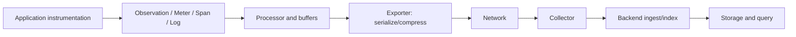

# Telemetry Export Cost in Spring Boot

**Telemetry export cost** is the resource usage and operational expense incurred when an application collects, processes, transmits, and stores metrics, logs, and distributed traces. Exporting telemetry consumes CPU to create/serialize data, memory for buffers and queues, network bandwidth to transmit payloads, and storage/indexing capacity in the Collector and backend. In Spring Boot, Micrometer Observation connects instrumentation to metrics and tracing handlers, yet each signal pipeline has its own cost that must be measured and controlled.

In the **SPRING_BOOT_OBSERVABILITY** module, the goal is not merely to collect lots of data, but to collect the right data to investigate errors, latency, and application behavior within a reasonable budget. This lesson belongs to the **Observability Performance** chapter, focusing on the components that drive export cost, cardinality, sampling, batching, queues/backpressure, exporter retry/timeout, Collector topology, benchmarking, and optimizing around operational goals.

## 1. What Does Telemetry Export Consume?

A telemetry event passes through multiple stages: instrumentation creates the data, handlers turn an observation into a meter/span/log record, a processor or registry holds the data, an exporter serializes and sends it, a Collector may process it further, and the backend ingests/indexes/stores it before serving queries.



Costs can arise at every step:

| Resource | Where it arises | Manifestation |
| --- | --- | --- |
| CPU | Instrumentation, tag lookup, serialization, compression | CPU usage, request latency |
| Heap memory | Span objects, metric state, queues, batch buffers | Heap pressure, GC |
| Network | OTLP/Prometheus/log shipping | Bandwidth, retransmission |
| Storage | Metrics time series, trace spans, log records | Retention cost, disk growth |
| Indexing/query | Backend processing | Ingest lag, query latency |
| Operations | Collector/backend capacity and maintenance | Infrastructure and service cost |

Not all costs reside in the application. The backend can cost more than the application due to indexing, replication, retention, and querying.

## 2. Distinguishing Costs by Signal

Metrics, traces, and logs have different storage characteristics.

| Signal | Characteristics | Primary cost drivers |
| --- | --- | --- |
| Metrics | Aggregated measurements by series and tags | Number of time series, scrape/write rate, retention |
| Traces | Spans per operation/request | Span volume, attribute size, sampling, indexing |
| Logs | Events with detailed content | Log rate, message size, parsing/indexing, retention |
| Baggage/context | Metadata propagated across requests/messages | Header size, propagation overhead, span/log duplication |

Metrics are typically kept continuously with controlled dimensions; traces are typically sampled; logs can have high line counts and large payloads. Applying the same policy across all three signals often leads to unnecessary cost or loss of essential data.

### 2.1. Observation Is Not Free

Micrometer Observation is an abstraction for producing consistent signals. The Observation itself still requires allocation, scope management, key-value processing, and handler execution. If a tiny method is called millions of times per minute, adding an observation to every invocation can introduce substantial overhead regardless of how well the exporter batches.

Only instrument operations with operational value. Use load tests to measure overhead before and after enabling instrumentation on a representative workload.

## 3. Cardinality Is a Major Cost Driver for Metrics

Each combination of metric name and tag values can create a distinct time series. A single tag with thousands of values can make the series count grow rapidly; multiple tags combined can produce a Cartesian product of combinations.

Example of avoiding raw URLs:

```text
http.server.requests{uri="/orders/1001"}
http.server.requests{uri="/orders/1002"}
http.server.requests{uri="/orders/1003"}
```

Use a route template instead:

```text
http.server.requests{uri="/orders/{id}"}
```

| Tag | Cardinality | Recommendation |
| --- | --- | --- |
| HTTP method | Low | Use |
| Route template | Low if normalized | Use |
| Status/outcome | Low | Use a bounded set |
| Region/environment | Low if allowlisted | Use under control |
| User ID/order ID | Very high | Do not use as a metric tag |
| Trace ID/span ID | Very high | Keep in tracing/log correlation |
| Raw query string | High and potentially sensitive | Do not use |
| Exception message | Unbounded | Normalize into an error category |

### 3.1. Estimate Series Count Before Deployment

You can estimate cardinality by multiplying the possible values of each tag. For example, 5 methods, 40 routes, 6 statuses, and 4 regions create up to 4,800 combinations for a single metric name if every combination occurs. This is an upper-bound estimate; the actual series count depends on the observed combinations.

Set limits and review tag keys before adding custom metrics. A single new tag can sharply increase backend costs even with a tiny code change.

### 3.2. Cardinality Is Not Sample Count

One series can record many samples over time. Cardinality measures the number of concurrent series; sample/write rate measures the volume of measurements sent over time. Both must be monitored because they impact the backend differently.

## 4. Trace Volume and Sampling

Each request can create multiple spans: server, client, database, messaging, and custom spans. If traffic increases, span count can grow with both the request rate and the number of operations per request.

Head sampling selects traces early, usually at the trace root. For example, a ratio sampler retains a fraction of traces:

```yaml
management:
  tracing:
    sampling:
      probability: 0.10
```

Specific properties depend on the Spring Boot version and tracing implementation. The 10% example is illustrative only; do not use it as a production default without evaluating traffic and investigation needs.

Sampling reduces exported spans but does not replace metrics. If you need full-traffic request counts and error rates, metrics must still record everything with appropriate dimensions.

### 4.1. Parent-Based Sampling

Parent-based sampling ensures child spans follow the parent's sampled decision, preventing broken traces caused by each service making independent random choices. In distributed systems, propagating the sampled decision and aligning policies across services is essential.

### 4.2. Tail Sampling

Tail sampling at the Collector can decide whether to keep a trace after observing multiple spans—for example, keeping traces with errors or high latency. However, to apply tail sampling, applications typically must send initial spans to the Collector; therefore, network/Collector costs before the sampling decision still exist. Do not treat tail sampling as a free way to ship all traces.

## 5. Log Volume and Detail Level

Logs can consume significant storage because each record usually includes a timestamp, metadata, and message. DEBUG/TRACE logging under heavy traffic can cause volume spikes.

Manage log cost by:
- Choosing log levels per environment and component.
- Avoiding logging the same exception at multiple layers.
- Not logging payloads/request bodies by default.
- Using structured fields with an allowlist.
- Sampling or rate-limiting repetitive logs when appropriate.
- Keeping meaningful ERROR/WARN logs without dropping incident signals.
- Setting retention based on investigation needs and data regulations.

Do not use log sampling to discard rare errors. You can retain error logs, aggregate repetitive events, or apply rate limiting that counts dropped events.

## 6. Batching and Batch Size

Exporters typically group multiple records before sending to reduce network requests and per-request overhead. Small batches reduce wait time and per-batch memory; large batches improve throughput but increase memory usage, payload size, and export latency.

Factors to consider:
- Maximum batch size.
- Schedule delay/flush interval.
- Queue capacity.
- Export timeout.
- Payload byte size.
- Collector receiver throughput.
- Shutdown flush budget.

Do not size batches by record count alone; a span with many attributes or a log record with a large body is much heavier than many small records.

### 6.1. Batch Processor Configuration Example

The OpenTelemetry SDK provides `BatchSpanProcessor`; illustrative example:

```java
BatchSpanProcessor processor =
        BatchSpanProcessor.builder(spanExporter)
                .setScheduleDelay(Duration.ofSeconds(5))
                .setMaxQueueSize(2048)
                .setMaxExportBatchSize(512)
                .setExporterTimeout(Duration.ofSeconds(10))
                .build();
```

APIs/methods and defaults depend on the OpenTelemetry SDK version. The values above are only a lab starting point, not production sizing.

### 6.2. Flush Interval

Flushing too frequently creates many small requests. Flushing too infrequently increases queue occupancy, telemetry delay, and the amount of data lost if the process crashes. Choose the interval based on freshness requirements, batch throughput, and shutdown behavior.

## 7. Queues, Backpressure, and Dropped Telemetry

If the exporter or Collector is slower than the telemetry production rate, the queue grows. When the queue fills up, the processor may drop records or block depending on the implementation. Blocking on request threads can turn a telemetry outage into a business outage.

Monitor:
- Queue occupancy/utilization.
- Export success/failure.
- Dropped spans/log records.
- Export latency and timeouts.
- Collector receiver refused/failed records.
- Backend ingest lag.

### 7.1. Never Let Telemetry Slow Down the Business Path

Prefer asynchronous/batched export when the integration supports it. Set bounded queues, timeouts, and shutdown budgets. Never invoke a synchronous network exporter from a custom `ObservationHandler` on a request thread.

If the telemetry backend has an outage, the application must continue serving business requests according to policy. Losing some telemetry within acceptable bounds is tolerable, whereas taking down the entire service simply because an exporter is unresponsive is not.

### 7.2. Large Queues Do Not Solve Insufficient Throughput

Increasing queue size only delays when the queue fills up if the production rate continues to exceed the export rate. You must reduce volume, increase exporter/Collector capacity, improve the network, or tune sampling/batching. Large queues also consume heap and lengthen drain time.

## 8. Retries, Timeouts, and Network Overhead

Retries handle transient errors but also generate extra network traffic and prolong drain time. Unbounded retries can trigger a retry storm when the backend recovers.

Design requirements:
- Timeout for each export request.
- Bounded retries and exponential backoff with jitter if supported by the exporter.
- Classification of retryable vs. non-retryable errors.
- Limit on concurrent exports.
- Tracking retry counts and dropped records.
- Considering load shedding when the receiver is overloaded.

Do not assume all exporters share identical retry semantics. Verify your actual SDK/exporter version and Collector pipeline.

### 8.1. Compression

Compression reduces network bytes but consumes CPU and can add latency for small payloads. Measure compression ratio, CPU cost, and end-to-end export latency before enabling or changing algorithms.

### 8.2. Protocol and Connection Reuse

OTLP/gRPC uses HTTP/2; OTLP/HTTP uses HTTP. Protocol configuration must match the receiver/proxy. Reusing connections and avoiding repeatedly creating new exporters/channels reduces handshake and allocation overhead.

## 9. Collector Topology and Cost

The OpenTelemetry Collector can run as an agent alongside the application or as a centralized gateway.

| Model | Advantages | Trade-offs |
| --- | --- | --- |
| Agent/sidecar | Local hop, workload isolation | Consumes resources per pod/node |
| Node agent/DaemonSet | Shared agent per node | Requires managing isolation and routing |
| Gateway | Centralized processing, tail sampling, routing | Concentrates load and adds a network hop |
| Direct to backend | Fewer intermediate tiers | Applications depend on backend and credentials |

The Collector can batch, filter, transform, redact, sample, and route. Each processor adds CPU/memory overhead. A gateway enables centralized policy management but requires capacity, redundancy, and autoscaling.

### 9.1. Combining Agent and Gateway

A common topology is applications sending to a node/sidecar agent, which forwards to a gateway that performs tail sampling and exports to the backend. This can reduce connections from hundreds of pods to the backend, but adds a network hop and requires queue management at each tier.

### 9.2. The Collector Is Not a Storage Engine

The Collector receives and forwards telemetry; the backend is typically responsible for retention/indexing/querying. Scaling up Collector replicas will not fix a storage/index bottleneck if backend ingest is saturated.

## 10. Attribute Size and Payload Design

Spans with hundreds of attributes, long event descriptions, or huge exception stack traces create heavy payloads. Logs with serialized objects or request bodies can be even larger.

Principles:
- Choose attributes with investigative value.
- Use enums/categories instead of free-form text.
- Do not serialize object graphs.
- Do not attach full request/response bodies.
- Limit exception details per policy.
- Avoid duplicating metadata across Resource, span, and log unnecessarily.
- Control the number of events per span.

Even a small attribute appearing across millions of spans has cumulative cost. Evaluate both byte size and repetition count.

## 11. Metrics Export: Scrape and Push

Micrometer can export metrics via a pull/scrape model like Prometheus or push via another registry/exporter. Each model carries different costs.

**Pull:** the backend scrapes on an interval; the scrape interval determines sample frequency and network load. Scraping too frequently increases backend ingest; scraping too infrequently delays change detection.

**Push:** the application/agent sends metrics per step/interval; it must handle batching, network failures, and buffering.

Do not expose the same metrics pipeline to multiple backends without a clear purpose. Duplicate scraping/exporting can double ingestion and costs.

### 11.1. Scrape Interval

Choose the interval based on how quickly incidents need to be detected. Business trend metrics rarely need per-second resolution; saturation/latency metrics may require shorter intervals. Balance freshness, retention, and sample volume.

### 11.2. Histogram Buckets

Histograms generate multiple series per bucket, plus count/sum and tag combinations. Too many buckets combined with high cardinality causes series counts to explode. Choose buckets according to the SLO/latency distribution you need to analyze; do not enable every bucket for every metric.

## 12. Retention and Backend Cost

Storage cost depends on:
- Ingestion rate (samples, spans, log bytes).
- Cardinality and indexing strategy.
- Replication factor.
- Retention period.
- Compression/storage tier.
- Query concurrency and index maintenance.

Different retention policies can be used:
- Keep aggregated metrics longer for trend analysis.
- Keep traces shorter or sample them by policy.
- Apply dedicated retention for audit/security logs per organizational requirements.
- Keep high-detail diagnostic data short-lived and access-controlled.

Do not reduce retention arbitrarily if audit or incident investigation requirements exist. Policies must be agreed upon by data owners and operations.

## 13. Cost-Aware Sampling and Filtering

Sampling/filtering should be driven by investigation goals:
- Metrics provide full-traffic coverage with low-cardinality tags.
- Traces sample most normal traffic while increasing the chance of keeping error/slow traces if the architecture supports it.
- Logs retain important events while reducing repetitive debug noise.
- Filter health checks/noisy internal endpoints if there is no analytical need.

Do not exclude all health checks if they are important signals for availability. Do not drop error traces just to cut costs if they are a primary source for investigation; consider tail sampling or error-prioritizing policies.

### 13.1. Sampling Is Not a Security Filter

Sampling decides which records are kept; it does not remove PII from retained records. Redaction and data minimization must happen before export.

## 14. Measuring Overhead in a Spring Boot Application

Evaluate cost with a representative workload. Compare a baseline without extra instrumentation against the target metrics/tracing/logging configuration.

Measure these indicators:
- Request throughput and p50/p95/p99 latency.
- CPU utilization.
- Heap usage, allocation rate, and GC pauses.
- Network bytes/requests to the Collector.
- Export queue occupancy and dropped records.
- Collector CPU/memory/ingest rate.
- Backend ingest lag and storage growth.

Tests should keep the workload, dataset, JVM options, and environment stable. Run long enough to observe steady-state and GC behavior, and test both a healthy backend and a slow/disconnected backend.

### 14.1. Layer-by-Layer Comparison

Vary one factor at a time:
1. Instrumentation only.
2. Metrics handlers/export.
3. Tracing with sampling ratio.
4. Logging volume.
5. Batch/queue configuration.
6. Compression and Collector topology.

This helps pinpoint whether cost comes from instrumentation, serialization, network, or backend. Avoid changing multiple parameters at once and losing track of which change caused the effect.

## 15. Cost Budgets and Alerting

Establish budgets for both the application and pipeline:
- Metric series count per service.
- Samples/sec or write rate.
- Spans/sec and bytes/sec.
- Log bytes/sec.
- Export failure/drop rate.
- Collector queue utilization.
- Backend ingest lag.
- Storage growth and retention.

Alerts should cover both directions: pipeline overload and lost telemetry. Unusually low backend ingest might indicate an exporter failure rather than a drop in traffic.

### 15.1. Do Not Alert on Cost Alone

Combine cost metrics with coverage checks:
- Are there enough sampled error traces to investigate issues?
- Are full-traffic metrics available for SLOs?
- Is log sampling dropping critical events?
- Is any service failing to export telemetry?
- Is trace continuity across services broken?

Cutting costs at the expense of losing incident detection capability is a poor trade-off.

## 16. Troubleshooting Telemetry Export Cost

| Symptom | Possible cause | How to check |
| --- | --- | --- |
| CPU increases after enabling tracing | Span creation, attribute processing, serialization | Compare baseline vs. instrumented profiles |
| Heap/GC increases | Large queues, batch buffers, large payloads/attributes | Check allocations and queue occupancy |
| Network bytes increase | High sampling rate, span/log volume, or large payloads | Measure bytes/sec per signal |
| Metrics backend series grow rapidly | Dynamic tags/raw URIs/IDs | Inspect top-cardinality dimensions |
| Export queue stays full | Producer rate exceeds exporter/Collector throughput | Reduce volume or increase capacity |
| Dropped spans increase | Queue full, timeout, or exporter failure | Check processor/exporter diagnostics |
| Request latency rises when Collector is slow | Synchronous export or queue pressure | Check handlers and async export |
| Backend ingest lag | Collector/backend overloaded | Compare receiver accepted vs. backend ingest |
| Retry storm | Unbounded retries or poor backoff | Check retry count and timeout |
| Compression drives high CPU | Small payloads or CPU-bound compression | Benchmark compressed vs. uncompressed |
| Low trace coverage | Overly strict sampling/filter policy | Compare trace volume against request/error metrics |
| Logs storage spikes | DEBUG/TRACE or duplicate exception logs | Check log levels and duplicate events |
| Telemetry lost on shutdown | Insufficient flush budget or process kill | Check close lifecycle and termination grace |
| Tail sampling does not reduce app network | Sampling happens after Collector receives spans | Review where sampling sits in the topology |

### Investigation Workflow

1. Identify which signal increased cost: metrics, traces, or logs.
2. Measure instrumentation overhead on application CPU/latency.
3. Check cardinality, attribute count, and payload size.
4. Check sampling/filtering policies and signal coverage.
5. Check batch processor, queue, timeout, retry, and dropped records.
6. Measure network throughput and compression CPU.
7. Compare Collector receiver rate with exporter/backend rate.
8. Inspect backend indexing, retention, and storage growth.
9. Adjust one parameter at a time in a controlled benchmark.
10. Document the cost/coverage trade-off after optimization.

## 17. Lab Exercise: Building a Telemetry Export Budget

The objective is to measure overhead and find a configuration that balances cost with investigation capability.

### Preparation

- Spring Boot service with Micrometer Observation.
- `MeterRegistry` and a tracing bridge/exporter.
- Lab OpenTelemetry Collector.
- Metrics/traces backend or test receiver.
- Load generator with a repeatable workload.
- Baseline JVM/CPU/memory measurements.

### Step 1 — Measure Baseline

Run the workload with existing instrumentation and record throughput, p95/p99 latency, CPU, heap, GC, and network.

### Step 2 — Enable Metrics

Enable metrics export and measure series count, samples/sec, and network bytes/sec. Check route templates and tag cardinality.

### Step 3 — Enable Tracing

Enable tracing with a low sampling ratio in the lab. Measure spans/sec, bytes/sec, CPU, and latency. Verify Trace ID continuity.

### Step 4 — Increase Sampling in Controlled Steps

Test several different sampling ratios. Compare trace coverage, exporter load, and backend ingest. Keep the workload unchanged across runs.

### Step 5 — Test Logs

Raise/lower log levels under a controlled workload. Measure log bytes/sec and backend ingest. Check for duplicate exception logs and payload size.

### Step 6 — Tune Batch/Queue

Test different batch sizes, schedule delays, and queue capacities. Monitor queue occupancy, export latency, drops, and heap.

### Step 7 — Simulate a Slow Collector

Throttle the receiver or disconnect it in a controlled manner. Confirm business requests are not blocked indefinitely and dropped telemetry is observable.

### Step 8 — Test Compression

Compare CPU, network bytes, and export latency with compression enabled vs. disabled.

### Step 9 — Check Backend Retention

Estimate storage growth from ingest rate and retention. Define separate policies for metrics, traces, and logs.

### Step 10 — Finalize the Budget

Record configuration, throughput, p95/p99, CPU, memory, series count, spans/sec, log bytes/sec, drop rate, and coverage. Select a policy that satisfies SLOs and incident investigation needs.

### Acceptance Checklist

| What to verify | Expected outcome |
| --- | --- |
| Cost model | Identifies CPU, memory, network, storage, and indexing |
| Metrics | Cardinality and sample rate are measured |
| Traces | Sampling and spans/sec are measured |
| Logs | Log volume/retention are controlled |
| Batching | Batch/queue settings fit the workload |
| Backpressure | A full queue does not block the business path indefinitely |
| Retries | Timeout/backoff/drop behavior is clear |
| Collector | Agent/gateway topology has sufficient capacity |
| Backend | Ingest, index, and retention are monitored |
| Benchmark | Compares baseline with instrumented workload |
| Coverage | Optimization does not lose necessary signals |
| Privacy | Secrets/PII are never exported, rather than hidden to save cost |

## 18. Key Principles to Remember

1. **Telemetry export has costs across the whole pipeline.** Measure from instrumentation to backend, not only application CPU.
2. **Metrics cardinality is critical.** Use route templates and bounded tags; avoid IDs/raw values.
3. **Metrics, traces, and logs require different policies.** Metrics for coverage, traces for investigating sampled requests, logs for detailed events.
4. **Sampling reduces trace volume but does not replace metrics.** Tail sampling still requires transporting spans to the Collector before the decision.
5. **Batching improves throughput but consumes memory and increases wait time.** Size by both record count and byte size.
6. **Queues must be bounded with clear backpressure/drop policies.** A telemetry outage should never halt the business path.
7. **Retries, compression, and Collector processors also have costs.** Benchmark instead of enabling them by intuition.
8. **Backend indexing and retention can consume most of the budget.** Track ingest, storage, and query costs.
9. **Measure overhead with a representative workload.** Compare throughput, latency, CPU, heap, GC, network, and dropped records.
10. **Cost optimization must preserve sufficient coverage.** Monitor trace continuity, error visibility, and SLO metrics.
11. **Redaction is independent of sampling.** Never rely on sampling to handle PII.

Telemetry export cost can be controlled when the engineering team understands volume, cardinality, payload size, and throughput at each tier. With Spring Boot, instrument selectively, keep metric dimensions bounded, sample traces purposefully, batch/export asynchronously with bounded queues, and measure both the Collector and backend. A sound telemetry budget balances cost against the system's ability to detect, investigate, and recover from incidents.
