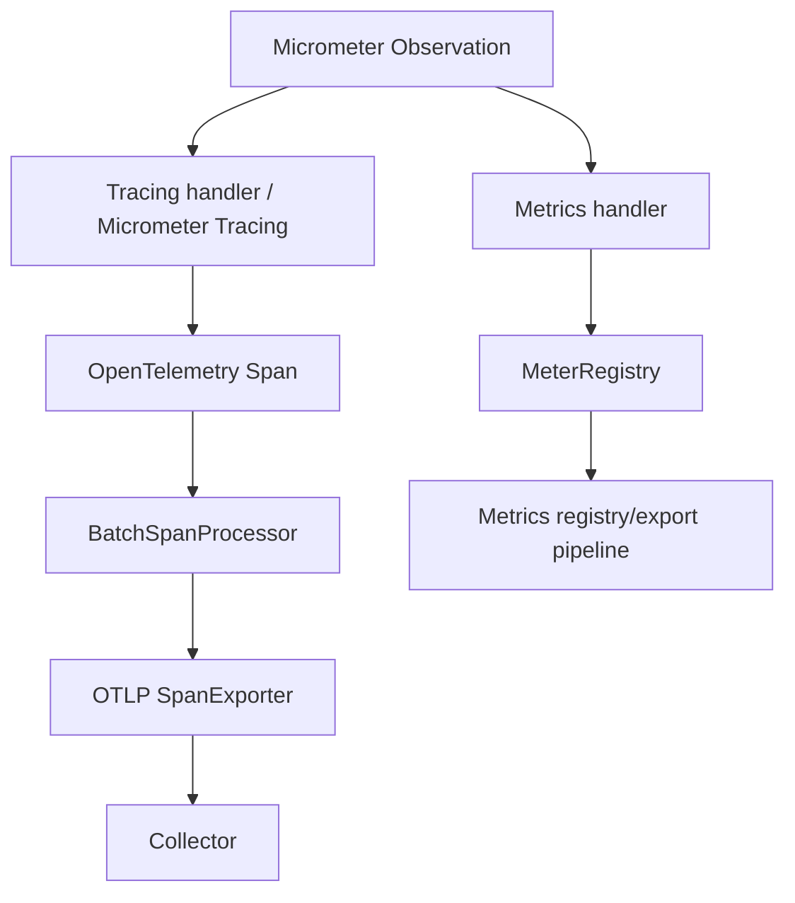
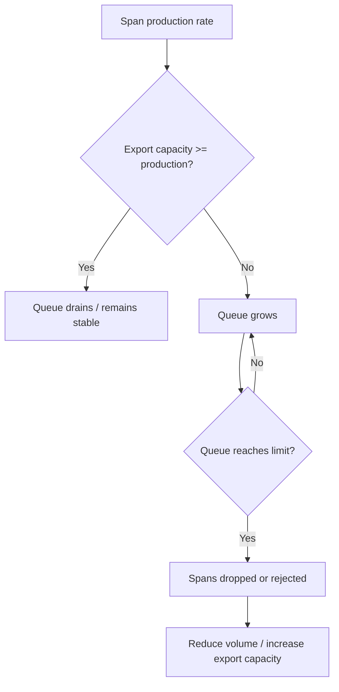

# Batch Exporter in Observability

A Spring Boot application can generate thousands of observations and spans per second. If each span were sent immediately as a separate network request, the application would pay extra costs for connections, serialization, TLS, and syscalls; the collector would also receive many tiny requests. A batch exporter groups multiple telemetry records into a batch and sends them together, reducing overhead and increasing throughput. However, batching requires buffer memory, introduces a delay before export, and needs clear policies when the queue is full, the exporter fails, or the process shuts down.

A **batch exporter** is a component that collects telemetry records into a buffer/queue and then sends them in batches based on batch size, wait time, or flush conditions. In a Spring Boot architecture using Micrometer Observation with Micrometer Tracing and the OpenTelemetry bridge, Observation creates data at the application layer; the tracing SDK/processor and OTLP exporter are responsible for processing, batching, and transporting spans. Metrics have their own pipeline through `MeterRegistry` and the corresponding registry/exporter; batch span exporting and metrics publishing should not be treated as the same mechanism.

Designing a batch exporter is a balancing act among throughput, latency, memory, and reliability. A batch that is too small increases export frequency; a batch that is too large increases memory usage, wait time, and payload size. A queue that is too small drops data easily when the backend slows down; a queue that is too large can mask incidents and increase memory pressure.

This lesson belongs to the **Observability Performance** chapter of the **SPRING_BOOT_OBSERVABILITY** module. The module teaches how to set up observability for Spring Boot using Micrometer Observation, metrics, logs, and distributed tracing; you will learn context propagation, tags/cardinality, exporters, sampling, and signal correlation to investigate errors, latency, and application behavior in production environments. This lesson focuses on the batch exporter, how to configure and tune it, how to monitor queues, and how to ensure telemetry is flushed within shutdown limits.

## Learning Objectives

After this lesson, you will be able to:

1. Explain why an exporter needs batching when telemetry volume is high.
2. Distinguish Observation creation, span processing, batching, and export.
3. Understand the roles of OpenTelemetry `BatchSpanProcessor` and the OTLP exporter.
4. Distinguish batch size, schedule delay, export timeout, and queue capacity.
5. Evaluate trade-offs among throughput, export latency, and memory.
6. Understand queue saturation, backpressure, retries, and dropped telemetry.
7. Configure batch span processing in Spring Boot according to your version.
8. Distinguish tracing batch export from metrics push/pull pipelines.
9. Test flush, shutdown, collector outages, and exporter timeouts.
10. Use exporter metrics to tune based on real-world data.

## 1. Why Is a Batch Exporter Needed?

Telemetry is often produced faster than individual request handling alone suggests. One inbound HTTP request can generate a server span, service spans, client spans, and database spans. If every span were exported immediately, each record would add transport and serialization overhead.

Batching groups multiple records:


Batching can:
- Reduce the number of network export calls.
- Improve payload efficiency.
- Reduce per-span overhead.
- Decouple span creation speed from collector send speed over a short window.
- Absorb temporary telemetry bursts.

Batching does not reduce the number of spans created. Sampling, filtering, and span design are what affect pre-batch volume.

### 1.1. Batching Is Not Sampling

| Mechanism | Impact |
|---|---|
| Batching | Groups multiple records into fewer export requests |
| Sampling | Selects which records/traces are kept |
| Filtering | Drops records based on policy |
| Compression | Reduces transmitted bytes |
| Aggregation | Aggregates measurements, typically used for metrics |

If an application creates 10,000 spans and sampling retains 10%, the processor receives roughly 1,000 spans to process; batching splits those 1,000 spans into several export batches. Batch size does not alter the sampling decision.

### 1.2. Batching Does Not Guarantee Delivery

A batch exporter may retry within bounds, but an in-memory queue is not durable storage. Process crashes, OOMs, or forced shutdowns can lose unexported records. If higher durability is required, an appropriate collector/agent/queue architecture is needed, along with accepting its corresponding cost.

## 2. Where Batching Sits in the Spring Boot Telemetry Pipeline

With Micrometer Observation, application code creates an Observation. Handlers can record metrics or create spans. When using Micrometer Tracing with the OpenTelemetry bridge, spans are forwarded to the OpenTelemetry SDK; the span processor decides between synchronous or batched processing; the exporter transmits data to the OTLP endpoint.



Key points to remember:
- The Observation API does not itself define a batch queue for every signal.
- `BatchSpanProcessor` is the OpenTelemetry SDK component that processes spans.
- The OTLP exporter handles the export protocol/transport.
- Metrics are typically recorded into `MeterRegistry`; the registry may expose a pull scrape endpoint or push on a step interval.
- Logs have their own pipeline depending on the logging backend/OTel integration.

### 2.1. BatchSpanProcessor vs. SimpleSpanProcessor

The OpenTelemetry SDK typically provides two processor types:
- **SimpleSpanProcessor:** forwards ended spans directly to the exporter; useful for tests/debugging, but can add overhead on application threads.
- **BatchSpanProcessor:** enqueues ended spans and exports them in batches; suited for production workloads needing lower overhead.

Class/package names and configuration depend on the OTel SDK version. Do not create a second processor if Spring Boot/OTel auto-configuration already configures one.

### 2.2. Exporter and Processor Have Distinct Responsibilities

The processor manages lifecycle, batching, and scheduling. The exporter serializes/transports data to the backend. Changing endpoints/credentials is usually exporter configuration; changing queue/batch size is processor configuration. Separating these two layers helps pinpoint root causes when exports slow down or drop data.

## 3. Key Batch Parameters

A batch span processor typically has these common parameters:

| Parameter | Meaning | Primary impact |
|---|---|---|
| `maxQueueSize` | Maximum spans waiting for export | Memory and burst absorption |
| `maxExportBatchSize` | Maximum spans in a single batch | Payload size and export efficiency |
| `scheduleDelay` | Maximum wait interval between scheduled exports | Export latency and batch fill |
| `exporterTimeout` | Maximum duration for one export operation | Wait time and shutdown behavior |

Defaults vary by OTel SDK version/distribution. Check the SDK docs and effective runtime configuration instead of relying on defaults from another version.

### 3.1. Queue Size

A larger queue absorbs longer bursts when the collector is slow, but consumes more memory. When the queue is full, the processor may drop new spans or behave according to its implementation. A large queue does not fix sustained backend under-capacity.

### 3.2. Batch Size

A larger batch size reduces export calls, but produces larger payloads, requires more memory for serialization, and may exceed proxy/collector request limits. Batch size must align with collector limits, network MTU/HTTP behavior, and the exporter implementation.

### 3.3. Schedule Delay

Schedule delay determines how often the processor checks the queue to export. A short delay delivers spans to the backend sooner but may send many small batches. A long delay increases the chance of full batches but keeps telemetry in memory longer.

### 3.4. Export Timeout

Timeout caps how long an export waits. Too short a timeout causes failures during transient network/backend slowness; too long a timeout prolongs worker/export shutdown and delays queue draining. Coordinate this with proxy, collector, and process termination budgets.

## 4. Tuning Batch Size and Queue

There is no single optimal batch configuration for every service. Start from span generation rate, average span size, collector capacity, network throughput, and memory budget.

One way to estimate:

```text
queued_span_count ≈ spans_per_second × tolerated_export_delay_seconds

queue_memory ≈ queued_span_count × average_in_memory_span_size

batches_per_second ≈ spans_per_second / effective_batch_size
```

These are initial estimates; in-memory span object size and serialized payload size differ, and the queue itself has overhead. Measure actual heap usage in load tests.

### 4.1. Sizing Example

Suppose a service generates an average of 2,000 spans/second and wants to absorb roughly 3 seconds of collector slowdown:

- The queue needs to hold at least around 6,000 spans, plus headroom for bursts.
- With a batch size of 512, a full queue represents roughly 12 batches.
- Memory must be measured with heap profiling because spans vary in attributes/events.

These illustrative numbers are not a recommended configuration. If the collector slows down for 30 seconds, a 6,000-span queue will not suffice; you need to lower volume, add capacity, or design downstream buffering.

### 4.2. Tuning for Bursts

Average throughput does not capture bursts. Load tests should simulate traffic spikes, fan-out to multiple dependencies, and error storms because exception events can make spans larger than usual. The queue needs enough headroom for peak rates during the window in which the backend can recover.

### 4.3. Avoid Growing the Queue Indefinitely

An unbounded or huge queue can turn an exporter outage into heap exhaustion. Pick explicit bounds, monitor dropped spans, and set alerts to detect queue saturation early.

## 5. Configuring the OpenTelemetry Batch Processor

Configuration depends on the Spring Boot version, OTel starter/SDK, and bridge in use. In many Spring Boot setups with the OpenTelemetry SDK, the batch processor is auto-configured; OTel SDK environment variables or properties can adjust queue, batch, and delay settings.

Illustrative example via OpenTelemetry SDK environment variables:

```yaml
environment:
  OTEL_BSP_MAX_QUEUE_SIZE: "8192"
  OTEL_BSP_MAX_EXPORT_BATCH_SIZE: "512"
  OTEL_BSP_SCHEDULE_DELAY: "5000"
  OTEL_BSP_EXPORT_TIMEOUT: "30000"
```

The `OTEL_BSP_*` variables are standard `BatchSpanProcessor` settings in the OpenTelemetry SDK. Verify units and support against your SDK version/distribution. Do not put these values into application YAML as Spring properties unless the runtime binds environment variables that way; the example above depicts container environment variables.

### 5.1. Spring Boot Configuration

Spring Boot can manage the OpenTelemetry SDK via starter/auto-configuration or the Micrometer Tracing bridge depending on version. Before adding a custom SDK bean:
1. Identify what creates the `OpenTelemetry` instance.
2. Identify whether a processor is already registered.
3. Identify the active exporter.
4. Check property/environment binding.
5. Customize in one place only to avoid two processors exporting simultaneously.

### 5.2. Do Not Register Duplicate Processors/Exporters

If auto-configuration already adds a `BatchSpanProcessor` and custom code adds a second processor, every ended span may be exported twice. Test span counts and instrumentation scopes after configuring. When replacing a processor, ensure the old exporter is no longer registered.

### 5.3. Endpoint and Protocol

The OTLP exporter can use gRPC or HTTP/protobuf depending on dependencies/configuration. Endpoint, TLS, authentication headers, and timeouts must match the Collector receiver. The batch processor cannot fix endpoint, certificate, or protocol mismatch errors.

## 6. Backpressure and Queue Saturation

A batch queue decouples producers from the exporter over short intervals, but producers still emit spans at a given rate. If the sustained production rate exceeds the export rate, the queue grows until it hits its limit.



Common causes:
- Overloaded Collector/backend.
- Network latency or packet loss.
- Frequent export timeouts.
- Sudden span volume surge from traffic/error storms.
- Heavy attributes/events inflating payloads.
- Congested Collector receiver or downstream exporter.

### 6.1. Backpressure Does Not Always Propagate to Requests

`BatchSpanProcessor` typically enqueues non-blockingly to avoid slowing down application requests. When the queue is full, telemetry may be dropped instead of blocking business threads. This choice protects application latency at the expense of observability completeness.

Do not assume increasing the queue will create useful backpressure for the application. Measure dropped spans and queue occupancy.

### 6.2. Reduce Volume Before Increasing Buffers

If telemetry volume is too high, consider sampling, excluding unhelpful spans, trimming attributes/events, fixing duplicate instrumentation, or avoiding per-record spans in batch jobs. Growing the queue only absorbs bursts; it does not fix a sustained throughput mismatch.

## 7. Retries, Failures, and Delivery Semantics

The OTLP exporter may retry certain transient errors depending on implementation, retry policy, and timeouts. The batch processor also has export lifecycle limits. Do not assume every failure retries infinitely or provides exactly-once delivery.

An export can:
- Succeed, with the collector receiving the batch.
- Time out, even though the collector may have received part or all of the payload.
- Be rejected due to authentication, payload size, or protocol issues.
- Fail due to network/collector unavailability.
- Be dropped when the queue is full or the process stops before flushing.

### 7.1. Retries and Duplicate Delivery

When a client retries after a timeout, not every protocol/path guarantees deduplication. Backends often identify spans by trace/span IDs, but you should not rely on that to assume exactly-once semantics. Monitor exporter errors and collector ingestion.

### 7.2. Persistent Queue at the Collector

If durable buffering across restarts is needed, a persistent queue can be configured at a downstream Collector/exporter when that component supports it. This differs from the in-memory `BatchSpanProcessor` in the application. Persistent queues require disk capacity, retention, permissions, and recovery policies.

## 8. Shutdown and Force Flush

When Spring Boot stops, the SDK needs to flush remaining queued spans and shut down the exporter. If the process is killed before flushing completes, queued spans may be lost.

Factors to coordinate:
- Application shutdown hook invoking SDK shutdown.
- Force flush before closing the exporter if required by the lifecycle.
- Export timeout.
- Spring lifecycle timeout.
- Container termination grace period.
- Kubernetes SIGTERM and SIGKILL timing.

### 8.1. Do Not Force Flush After Every Request

Calling force flush after every request defeats batching, increases latency, and raises network overhead. Only invoke flush at meaningful boundaries such as controlled shutdown or tests; never call it on the hot path.

### 8.2. Shutdown Budget

The termination grace period must be long enough for the application to stop accepting work, finish in-flight operations, and flush telemetry within timeout bounds. If the shutdown budget is too short, the exporter may be killed mid-flush. If it is too long, rollouts and scale-in events are delayed.

### 8.3. Testing Flush

Create spans in a test, invoke flush/shutdown per the SDK lifecycle, and verify the exporter receives the records. Also test export timeouts/failures to ensure application shutdown never hangs indefinitely.

## 9. Metrics Pipelines Differ from Span Batching

Micrometer metrics are typically recorded in `MeterRegistry`. With a pull registry like Prometheus, the scraper reads a snapshot on an interval; it does not send every measurement through a batch span processor. With a push registry, the registry uses a step interval and publishes/aggregates according to its implementation.

| Signal | Common pipeline | Batching/aggregation |
|---|---|---|
| Traces | Span processor → span exporter → Collector | Batches spans |
| Metrics pull | MeterRegistry → scrape endpoint | Scrapes snapshot; registry aggregates measurements |
| Metrics push | MeterRegistry → push registry | Step-based publish/aggregation |
| Logs | Logging appender/OTel log exporter → Collector | Depends on appender/exporter implementation |

Do not apply `OTEL_BSP_*` settings to tune metrics or logs. Use the proper configuration for each pipeline.

## 10. Observing Exporter Performance

To tune effectively, measure:
- Spans ended/produced per second.
- Exported spans per second.
- Queue occupancy/capacity.
- Dropped spans.
- Export duration/latency.
- Export failure/timeout count.
- Collector receiver accepted/refused records.
- Payload size and network throughput.
- Application heap/GC pauses.

Exact metric names depend on the SDK/agent/collector version. Some SDKs expose internal telemetry metrics; inspect enabled instrumentations and actual metrics endpoints.

### 10.1. Queue Occupancy

Steadily rising queue occupancy indicates the exporter cannot keep up with producers. A queue rising and draining after a burst is acceptable if drops remain zero and latency stays within limits.

### 10.2. Export Latency

High export latency can stem from network, TLS, serialization, collector processing, or the backend. Separate application processor/exporter metrics from collector receiver/exporter metrics to locate the bottleneck.

### 10.3. Dropped Spans

Dropped spans are a critical signal because trace dashboards can still appear functional while silently missing data. Alert when the drop rate stays non-zero or spikes, and correlate with queue occupancy and exporter errors.

## 11. Testing the Batch Exporter

A test suite should cover:

1. **Normal throughput:** producer rate below exporter capacity; stable queue.
2. **Batch fill:** create enough spans to hit max batch size and verify export.
3. **Schedule delay:** create fewer spans and verify export occurs after the delay.
4. **Burst:** generate a spike, observe queue growth and post-burst drain.
5. **Slow collector:** inject latency to verify queue growth behavior.
6. **Collector unavailable:** verify timeouts, retries, and dropped spans.
7. **Queue saturation:** exceed capacity and verify drop metrics/behavior.
8. **Large spans:** add many attributes/events to assess payload size.
9. **Shutdown flush:** stop the SDK/app after creating spans and verify records are flushed.
10. **Duplicate processor:** verify a single span is not exported twice.

### 11.1. In-Memory Test Exporter

Use an in-memory/test exporter to validate span processor behavior without needing a live backend. Test OTLP connectivity separately in integration/staging against a compatible Collector.

### 11.2. Load Testing

Load tests should capture both business request latency and telemetry exporter metrics. If enabling the batch processor raises p99 request latency, check whether the exporter is blocking application threads, causing queue lock contention, or adding serialization overhead. Tracing must never destabilize the business system when the collector slows down.

## 12. Diagnosing Batch Exporter Issues

| Symptom | Possible cause | How to investigate |
|---|---|---|
| Traces arrive late at backend | Long schedule delay or large queue | Processor config and export latency |
| Queue keeps growing | Export capacity lower than production | Queue occupancy, collector throughput |
| Dropped spans rising | Full queue or export failures | SDK internal metrics and logs |
| Many small export requests | Low batch size or short schedule delay | Effective processor settings |
| Export timeouts | Slow Collector/network/backend | Export duration, receiver metrics |
| Batches rejected | Payload too large or protocol mismatch | Collector logs, payload size |
| Missing traces on shutdown | Insufficient flush/shutdown budget | Lifecycle hooks and termination grace |
| Spans exported twice | Two processors/exporters registered | SDK wiring and span IDs |
| App latency rises when collector is down | Blocking processor/exporter or custom sync path | Thread dumps, request latency |
| Heap grows during bursts | Oversized queue or heavy span objects | Heap profile, queue capacity |
| Metrics present but traces missing | Metrics pipeline independent from tracing exporter | Tracing bridge/processor/exporter |
| Only one replica loses traces | Different config or resource pressure | Effective config and per-instance metrics |

### Investigation Workflow

1. Identify the active pipeline: Micrometer Tracing bridge, OTel SDK, agent, or a combined setup.
2. Inspect the active processor and number of registered exporters.
3. Read effective batch size, queue size, schedule delay, and timeout.
4. Compare span production rate with export rate.
5. Check queue occupancy, dropped spans, export failures, and latency.
6. Inspect Collector receiver/exporter logs and capacity.
7. Check payload size, attributes/events, and duplicate instrumentation.
8. Inspect heap, GC, and thread dumps when the queue grows.
9. Check force flush/shutdown and container termination grace.
10. Adjust one set of parameters, re-run load tests, and monitor business latency.

## 13. Anti-Patterns to Avoid

| Anti-pattern | Consequence | Appropriate approach |
|---|---|---|
| Using SimpleSpanProcessor in high-volume production | Export overhead on span end | BatchSpanProcessor |
| Queue too small | Drops spans during bursts | Size based on peak rate and delay |
| Extremely large queue | Heap pressure/OOM | Bounded queue and alerting |
| Batch size exceeding collector limit | Payloads rejected | Align with collector limits |
| Schedule delay too long | Traces appear late | Choose within latency budget |
| Infinite/overly long timeout | Blocks shutdown/export worker | Finite timeout |
| Force flush on every request | Loses batching benefits | Flush at shutdown/test boundaries |
| Adding a second processor when auto-config already adds one | Duplicate spans | Inventory SDK wiring |
| Increasing queue instead of sampling | Fails to handle sustained high volume | Reduce volume appropriately |
| Treating in-memory queue as durable | Loses spans on crash | Downstream persistent queue if needed |
| Using BSP config for metrics | Tuning the wrong pipeline | Configure per signal |
| Checking only the backend UI | Fails to notice dropped spans | Monitor exporter/collector metrics |

## 14. Production Checklist

1. **Pipeline:** are Observation, tracing bridge, SDK processor, and exporter clearly defined?
2. **Ownership:** are only the necessary processors/exporters active without duplicate registration?
3. **Batch:** does max batch size fit collector payload limits?
4. **Queue:** is the bounded queue large enough to absorb bursts within the memory budget?
5. **Delay:** does schedule delay meet trace visibility requirements?
6. **Timeout:** is the export timeout finite and aligned with network/collector timeouts?
7. **Volume:** are sampling/filtering/attributes controlled before batching?
8. **Backpressure:** are queue saturation and drop behaviors well understood?
9. **Retries:** are failure/retry semantics free of false exactly-once assumptions?
10. **Collector:** are receiver capacity, downstream exporters, and persistent queues properly sized?
11. **Metrics:** are exporter/queue/drop metrics exposed and alerted on?
12. **Shutdown:** do SDK flush/shutdown fit inside the termination grace period?
13. **Signals:** do metrics and logs have their own properly configured pipelines?
14. **Testing:** have bursts, outages, saturation, timeouts, and shutdown flush been tested?
15. **Performance:** are business p95/p99, heap, and GC unaffected beyond acceptable bounds?
16. **Runbook:** is there guidance for distinguishing app processor, network, and Collector bottlenecks?

## 15. Self-Assessment Questions

**Question 1.** What problem does a batch exporter solve?

**Hint:** It groups multiple telemetry records to reduce export calls and transport/serialization overhead.

**Question 2.** How does batching differ from sampling?

**Hint:** Batching groups already-retained records; sampling decides which records/traces are retained.

**Question 3.** What is the role of `BatchSpanProcessor`?

**Hint:** It queues spans and exports them by batch/delay/timeout; the exporter performs transport.

**Question 4.** What happens if the queue size is too small?

**Hint:** The queue fills easily during bursts or collector slowdowns, resulting in dropped spans.

**Question 5.** What is the risk of an overly large queue size?

**Hint:** Higher heap usage and potential memory pressure/OOM during prolonged exporter outages.

**Question 6.** What does schedule delay affect?

**Hint:** The delay before spans are exported and the likelihood that batches fill completely.

**Question 7.** Why shouldn't you force flush after every request?

**Hint:** It breaks batching, increases network calls, and raises request latency.

**Question 8.** Does `OTEL_BSP_*` configure metrics export?

**Hint:** No. Those settings configure `BatchSpanProcessor` for spans; metrics have a separate pipeline.

**Question 9.** Does an in-application queue guarantee no data loss on crash?

**Hint:** No. In-memory queues lose data on process crash/kill; downstream persistent buffering is required if durability is needed.

**Question 10.** What should you check when the queue grows continuously?

**Hint:** Compare span production vs. export rates, exporter latency/errors, collector capacity, payload size, and dropped spans.

## Conclusion

**A batch exporter groups spans into batches to reduce overhead and improve telemetry transport efficiency.** In a Spring Boot pipeline, Micrometer Observation creates data, the tracing bridge converts it into spans, `BatchSpanProcessor` manages queueing/batching, and the OTLP exporter sends batches to the Collector. Tune queue size, batch size, schedule delay, and timeout according to production rate, collector capacity, memory budget, and latency requirements. Monitor queue occupancy, export latency, failures, and dropped spans; test bursts, collector outages, and shutdown flushes. Metrics and logs have separate pipelines, so configuring a batch span processor does not replace tuning those signals.
