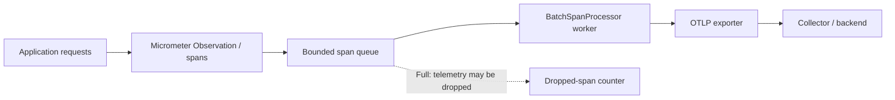

# Exporter Queue in Observability

A Spring Boot application creates many spans during traffic spikes. The exporter sends telemetry to a Collector over the network, yet the Collector may be slow or temporarily unavailable. If the application sent each span synchronously on the request path, business request latency could increase and telemetry errors could impact the application. Therefore, tracing SDKs typically use a **bounded queue** to decouple span creation from exporting. The queue absorbs short bursts while a background worker batches and sends data to the exporter.

A queue is not durable storage. When the queue fills up, the SDK usually has to drop new telemetry or apply configured behavior; you cannot assume every span will be kept until the backend recovers. Queue design requires balancing throughput, memory, export latency, and acceptable telemetry loss during an incident.

The **Exporter Queue** lesson belongs to the **Observability Performance** chapter of the **SPRING_BOOT_OBSERVABILITY** module. The module focuses on setting up observability for Spring Boot using Micrometer Observation, metrics, logs, and distributed tracing; you will learn context propagation, tags/cardinality, exporters, sampling, and signal correlation to investigate errors, latency, and application behavior in production environments.

## 1. Learning Objectives

After this lesson, you will be able to:

- Explain why exporters use queues and batch processing.
- Distinguish a tracing span processor queue from metrics push/export pipelines.
- Understand OpenTelemetry `BatchSpanProcessor` and queue/batch/timeout parameters.
- Estimate queue capacity from span production rate and exporter slowdown duration.
- Recognize queue saturation, dropped spans, and export failures.
- Monitor queue utilization, export latency, and exporter errors.
- Choose sampling and batch settings appropriate for traffic/SLOs.
- Design responses when the Collector or backend is unavailable.

## 2. Why Is a Queue Needed Before the Exporter?

Observation/tracing instrumentation creates telemetry directly during application execution. The exporter serializes and sends telemetry to a Collector or backend. Those two speeds are not always equal: an application can generate thousands of spans per second while the exporter/network has lower throughput; the Collector may restart, throttle, or return errors; DNS, TLS, connection establishment, or remote storage can slow down exports.

A queue decouples producers (threads creating spans) from the consumer (the export worker):



When the exporter slows temporarily, the queue accumulates ended spans. When the exporter recovers, the worker sends batches to reduce per-request overhead. If span creation exceeds export throughput for long enough, the queue will fill.

## 3. Bounded Queue, Not a Durable Buffer

An in-process queue usually holds telemetry objects in memory. It is bounded to prevent unbounded memory growth, volatile so process restarts/crashes can lose unexported items, asynchronous so application threads generally do not wait for remote exports, and lossy under pressure because the SDK may drop spans when the queue is full.

Do not use this queue as a message broker or durable event store. If business requirements demand guaranteed zero event loss, use transactional messaging/outbox or a separate durable pipeline; tracing telemetry typically accepts controlled sampling/drops.

| State | Meaning |
| --- | --- |
| Span created | Instrumentation starts tracking an operation |
| Span ended | Span is ready for processor handling |
| Span enqueued | Span waits in the queue for export |
| Batch exported | Exporter sends a batch to the Collector |
| Collector received | Collector accepted the request; backend durable storage is not yet guaranteed |
| Backend stored/queryable | Telemetry can be queried per backend semantics |

Do not treat an enqueued span as exported, and do not treat HTTP 200 from the Collector as proof that all downstream storage succeeded.

## 4. OpenTelemetry BatchSpanProcessor

In the OpenTelemetry Java SDK, `BatchSpanProcessor` is the standard processor for batched span export. It receives ended spans, puts them in a bounded queue, and runs a worker that exports periodically or once a batch is large enough.

| Parameter | Meaning |
| --- | --- |
| `maxQueueSize` | Maximum spans waiting in the queue |
| `maxExportBatchSize` | Maximum spans in a single export call |
| `scheduleDelay` | Interval the worker waits before exporting a partial batch |
| `exportTimeout` | Maximum time allowed for one export call |

Builder method names/APIs may vary by OpenTelemetry SDK version. `maxExportBatchSize` should not exceed `maxQueueSize`. Large batch sizes can raise throughput by cutting request overhead, but also increase memory per export, payload size, and batching latency. Small batches reduce wait time but can increase send frequency.

Queue size determines burst-absorption capacity, not export speed. Increasing the queue only delays filling up if long-term throughput remains lower than span creation rate.

## 5. Illustrative Configuration for the OpenTelemetry SDK

If an application configures the OpenTelemetry SDK directly, you can build `BatchSpanProcessor` with queue/batch settings:

```java
SpanExporter exporter = OtlpGrpcSpanExporter.builder()
    .setEndpoint("http://otel-collector:4317")
    .setTimeout(Duration.ofSeconds(5))
    .build();

SpanProcessor processor = BatchSpanProcessor.builder(exporter)
    .setMaxQueueSize(4096)
    .setMaxExportBatchSize(512)
    .setScheduleDelay(Duration.ofSeconds(2))
    .setExporterTimeout(Duration.ofSeconds(10))
    .build();

SdkTracerProvider tracerProvider = SdkTracerProvider.builder()
    .addSpanProcessor(processor)
    .build();
```

This is an SDK-level example illustrating processor settings. Verify imports and builder APIs for your OpenTelemetry version; exporter builder and timeout method names may differ across releases. If Spring Boot auto-configures the tracing SDK, do not construct an extra standalone SDK unintentionally, as it can create two pipelines or cause spans to bypass the same registry.

### Spring Boot and Micrometer Tracing

In a Spring Boot application, the Micrometer Tracing bridge can connect Micrometer Observation to Brave or OpenTelemetry. OTLP exporter and SDK properties are configured according to your Spring Boot/Micrometer version and dependency set. OpenTelemetry SDK queue settings may require a customizer/SDK customization rather than a single global property across all versions.

Do not assume the OTel Java agent, a manually configured OpenTelemetry SDK, and Spring Boot Actuator share the same property namespace. Identify which component owns the SDK before changing queue settings.

## 6. Queue Sizing: Estimating from Rate and Outage Duration

A first estimate for queue capacity:

\[
Q \approx R \times T
\]

Where `Q` is the number of spans to buffer, `R` is the post-sampling span rate (spans/second), and `T` is how long the exporter falls behind (seconds).

For example, if an application produces 800 spans/second after sampling and wants to absorb a 5-second exporter slowdown:

\[
Q \approx 800 \times 5 = 4000 \text{ spans}
\]

This is an initial sizing estimate before accounting for bursts, safety margins, span size, and concurrent exports. If each span carries large attributes/events, a 4,000-span queue can consume substantial memory.

### Calculating Long-Term Throughput

A queue stays stable only if average export throughput exceeds span arrival rate:

\[
\text{Export throughput} > \text{Span arrival rate}
\]

If the application generates 1,000 spans/second while the exporter can only ship 700 spans/second, the queue will grow by roughly 300 spans/second until full. Increasing queue size does not fix a long-term throughput deficit.

### Span Size Matters Too

Span count alone does not capture memory usage. Spans with many attributes, events, links, or stack traces can be far larger than simple spans. Trim unnecessary payloads/attributes and never attach request bodies to spans.

## 7. Batch Delay, Export Timeout, and Retries

- **Schedule delay:** affects how long the worker waits to form a batch when the queue is not full.
- **Export timeout:** caps how long a single export attempt may run.
- **Retry:** how the exporter/Collector handles errors and resends, depending on exporter implementation/protocol.

Not all SDK exporters retry identically or indefinitely. Some exporters support retries/backoff depending on protocol/configuration; the processor queue remains bounded. Read the documentation for your specific exporter and monitor dropped telemetry rather than assuming retries will preserve every span.

If the timeout is too long, the worker can stay tied up in an export call and the queue fills up easily. Too short a timeout can trigger false failures during normal network latency. Choose timeouts aligned with network SLOs and Collector capacity.

## 8. What Happens When the Queue Is Full?

With a bounded batch span processor, once the queue has no room left, new spans may be dropped. Application requests normally continue because telemetry export is decoupled from business execution, but trace completeness drops.

Consequences:

- Traces may miss spans during peak load.
- Root/parent spans may survive while child spans are dropped.
- Debugging incidents becomes harder because telemetry is lost precisely when needed most.
- Increasing the queue can raise memory pressure and GC activity.

This is a trade-off that must be monitored. Do not try to save every span with an enormous queue if process memory cannot support it; sampling and export capacity must be designed together.

## 9. Metrics and Logs for Monitoring the Exporter Queue

Useful metrics depending on the SDK/exporter version can include:

| Metric concept | Meaning |
| --- | --- |
| Queue size / utilization | Number of waiting spans and percentage of capacity used |
| Queue capacity | Queue limit |
| Dropped spans | Spans discarded due to full queue or processor shutdown |
| Export batch size | Spans per batch |
| Export duration | Duration of a batch export |
| Export failures | Count of exporter errors |
| Export timeout | Count of export timeouts |

Actual metric names depend on your OTel SDK version and instrumentation/exporter. Verify them via `MeterRegistry`/Actuator or SDK telemetry instead of guessing names.

### Alert on Trends, Not Just One Threshold

Brief queue growth can be normal during a burst. Useful alerts should combine sustained high queue utilization, rising dropped spans, increasing export failures/timeouts, export throughput trailing span arrival rate, and signs of Collector receiver/exporter queue saturation.

If you only alert when the queue hits 100%, operations may be notified only after spans have already been dropped. Use a lower warning threshold and watch trends.

## 10. Tracing Queues Differ from Metrics Export Pipelines

Not every telemetry signal flows through the same queue:

| Signal | Typical handling | What to distinguish |
| --- | --- | --- |
| Traces | Span processor queue, batch span exporter | Queue holds ended spans awaiting export |
| Metrics pull | Registry stores aggregations; Prometheus scrape reads snapshots | Does not necessarily have a per-measurement queue |
| Metrics push/OTLP | Meter registry exports on step/interval | Has push intervals and aggregation state |
| Logs | Logging appender/OTel log processor may have its own queue | Separate queue, batching, and drop policy |

Increasing `BatchSpanProcessor.maxQueueSize` does not change the OTLP metrics exporter queue or an async logging appender queue. When metrics go missing, investigate the metrics registry/exporter pipeline; when logs go missing, investigate the logging appender/processor.

## 11. Sampling and Queue Capacity

Sampling decides how many spans are recorded and enter the export pipeline. If sampling reduces span count, the queue arrival rate drops as well. However, overly aggressive sampling can lose traces needed to investigate rare errors.

Combine head sampling to control span volume at trace start, parent-based sampling to keep decisions consistent across service boundaries, tail sampling at the Collector when trace selection must inspect outcome/latency, and span attribute allowlists/event limits to shrink payload size.

Tail sampling requires the Collector to buffer spans while awaiting a decision; queue/memory pressure can shift to the Collector. Do not treat tail sampling as free or as purely an application-exporter change.

## 12. Shutdown and Flush

When the process shuts down, spans still in the queue may not have been exported yet. SDKs typically expose shutdown/`forceFlush` semantics to attempt sending remaining telemetry within a timeout.

In Spring Boot, ensure the tracing SDK/exporter lifecycle is closed properly. If constructing the SDK/processor manually, the application must manage shutdown hooks and avoid closing the exporter too early. In container orchestration, the termination grace period must cover both application draining and flushing necessary telemetry.

Do not set a flush timeout longer than the entire termination grace period; the platform may kill the process before export finishes. Flushing also does not guarantee durable backend storage if the Collector/network is failing.

## 13. Troubleshooting

| Symptom | Possible cause | How to investigate |
| --- | --- | --- |
| Queue utilization steadily rises | Span arrival rate exceeds export throughput | Compare span creation rate and export rate |
| Dropped spans rising | Full queue or processor falling behind | Check queue size, batch size, and Collector |
| Export timeouts | Slow Collector, network/TLS/DNS, or timeout too low | Measure export duration and check connectivity |
| Export failures rising | Wrong endpoint, auth/TLS error, Collector unavailable | Check exporter logs and Collector receiver |
| Traces missing spans at peak traffic | Queue saturation or sampling | Compare dropped counters and sampling rate |
| Memory/GC rises after increasing queue | Queue holds many/large span objects | Assess span size, queue capacity, and heap |
| Export batches too small | Short schedule delay or low traffic | Inspect batch size distribution and network overhead |
| Export latency rises despite low queue | Collector/network slow while arrival rate is modest | Check export duration and backend |
| Metrics present but traces missing | Tracing exporter/processor pipeline error | Investigate `BatchSpanProcessor` separately |
| Shutdown loses final spans | SDK does not flush or termination too fast | Check lifecycle, `forceFlush`, and grace period |
| Exported twice | Duplicate SDK/processor configuration | Check auto-configuration and custom SDK |
| Still dropping after increasing queue | Long-term throughput still below arrival rate | Increase export capacity/cut span rate, not just queue |

### Investigation Checklist

1. Identify the active pipeline: OTel SDK, Java agent, or Spring Boot auto-configuration.
2. Measure post-sampling spans/second.
3. Check queue capacity, queue utilization, and dropped spans.
4. Measure batch size, export duration, failures, and timeouts.
5. Check Collector receiver/exporter queues and backend health.
6. Verify retry/backoff and endpoint/TLS/auth configuration.
7. Evaluate span size, attributes/events, and sampling policy.
8. Check flush/shutdown behavior during deployments or restarts.

## 14. Lab Exercise: Handling Exporter Queue Saturation

**Scenario:** `order-service` generates about 800 spans/second after sampling. During a Collector restart, the exporter stalls for around 5 seconds and dropped spans increase. The team needs to pick queue/batch settings and verify telemetry recovery.

### Part A — Preparation

1. Identify who owns the OpenTelemetry SDK and `BatchSpanProcessor`.
2. Record current queue size, batch size, schedule delay, and export timeout.
3. Enable necessary metrics/logs to monitor queue occupancy, dropped spans, and export errors.
4. Estimate baseline capacity: 800 × 5 = 4,000 spans, then add a safety margin fitting memory limits.
5. Confirm Collector endpoint, TLS/auth, and resource limits.

### Part B — Verification

| Case | Action | Expected observation |
| --- | --- | --- |
| A — Normal | Send steady traffic | Low queue, export throughput keeps pace with arrival rate |
| B — Collector delay | Pause Collector for 5 seconds | Queue grows without filling up under sizing |
| C — Recovery | Restore Collector | Worker drains queue, export failures drop |
| D — Saturation | Drive controlled load above capacity | Dropped spans increase and are recorded |
| E — Batch | Change batch size | Compare export duration, payload, and throughput |
| F — Sampling | Lower sampling in test | Arrival rate/queue pressure decreases |
| G — Shutdown | Graceful restart | Processor flushes remaining queue within timeout |
| H — Signal isolation | Check metrics and logs separately | Changing span queue does not confuse other pipelines |

### Part C — Self-Assessment Questions

1. Why should an exporter queue be bounded?
2. A queue absorbs bursts, so why can't it fix long-term throughput?
3. How does `maxQueueSize` differ from `maxExportBatchSize`?
4. Which stages do schedule delay and export timeout affect?
5. When the queue is full, why can business requests still succeed while traces are incomplete?
6. How do you estimate queue capacity from spans/second and exporter downtime?
7. Why does span size affect memory even if queue count stays unchanged?
8. How does sampling affect queue arrival rate?
9. Why does increasing the `BatchSpanProcessor` queue not fix metrics/logs exporter queues?
10. Within what limit must shutdown flush telemetry?

## 15. Key Takeaways

**The exporter queue** decouples telemetry creation from sending data to the Collector/backend. For tracing, OpenTelemetry `BatchSpanProcessor` uses a bounded queue and a batch worker to absorb short bursts and reduce per-span export overhead. Queue capacity, batch size, schedule delay, and export timeout control different parts of the pipeline.

Estimate the queue from span arrival rate and exporter outage duration, while always accounting for memory by span size and safety margin. If long-term export throughput is lower than span creation rate, the queue will fill even if enlarged. Monitor queue utilization, dropped spans, export duration/failures, and Collector health; combine with sampling to regulate the span rate. Tracing, metrics, and logs have distinct pipelines/queues, so always investigate the right signal. Finally, manage flush/shutdown to minimize telemetry loss during deployments, keeping in mind that an in-process queue is not durable storage.
