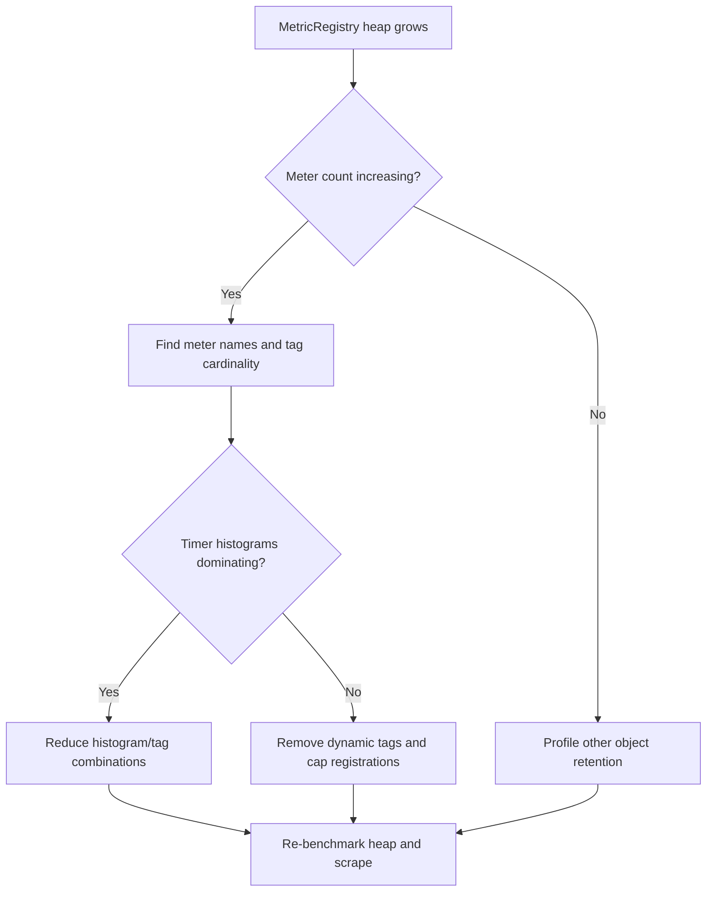

# MetricRegistry Memory in Spring Boot

Micrometer stores meters in a registry before they are scraped or exported. Each `Counter`, `Timer`, `Gauge`, or `DistributionSummary` needs its own metadata and state; tag combinations create independent meter instances/time series. Therefore, **the memory footprint of `MetricRegistry` depends heavily on meter count and cardinality**, not merely on the number of lines of instrumentation code.

An application can run steadily with a few hundred meters, yet spike in heap usage if every request introduces a new tag value such as a user ID, order ID, or full URL. The registry typically retains registered meters for the lifetime of the application; a request finishing does not mean its corresponding meter is freed.

The **“Metric Registry Memory”** lesson belongs to the **Observability Performance** chapter of the **SPRING_BOOT_OBSERVABILITY** module. The module teaches how to set up observability for Spring Boot using Micrometer Observation, metrics, logs, and distributed tracing; you will learn context propagation, tags/cardinality, exporters, sampling, and signal correlation to investigate errors, latency, and application behavior in production environments.

## 1. What Does MeterRegistry Store?

`MeterRegistry` manages meters by an identity formed from name, tags, and meter type. Each meter can hold its name and metadata such as description/base unit, tag keys/values, state such as counter values or timer accumulators, histogram buckets/percentile state if enabled, plus references and structures supporting lookup/export.

A registry holds multiple distinct meters even with the same name if tag values differ. For example:

```text
http.server.requests{method="GET",status="200",uri="/orders"}
http.server.requests{method="GET",status="500",uri="/orders"}
http.server.requests{method="POST",status="200",uri="/orders"}
```

These are three separate meter identities. When you add a user ID tag, each user can create another identity.

There is no fixed byte count per meter that applies across all applications. Memory depends on the Micrometer version, registry implementation, tag count/length, meter type, histogram configuration, and JVM.

## 2. Cardinality Is the Fastest Driver of Memory Growth

Cardinality is the number of distinct tag-value combinations for a meter. If a metric has three tags:

- method: 4 values.
- status: 6 values.
- region: 5 values.

The theoretical maximum number of combinations is:

\[
4 \times 6 \times 5 = 120
\]

If you add a user ID with 100,000 values, the theoretical limit becomes 12 million combinations. Not every combination may occur, yet even a single nearly unique tag can make series count climb rapidly.

Dangerous example:

```java
registry.counter(
        "orders.processed",
        "order.id", orderId
).increment();
```

Each order ID can create a separate meter. Replace with bounded dimensions:

```java
registry.counter(
        "orders.processed",
        "channel", channel,
        "outcome", outcome
).increment();
```

Use an enum/allowlist for tag values such as `web`, `mobile`, `success`, `failure`. Never use user ID, order ID, email, trace ID, request ID, raw URL, or exception message as metric tags.

## 3. Why Don't Meters Disappear After a Request?

`MeterRegistry` typically retains registered meters so subsequent recordings reuse the same identity. For example, the first request creates a `Counter` for customer ID 123; when the request ends, the registry keeps that `Counter`. The next request for another customer can register yet another meter.

This behavior is necessary for aggregation, yet it also means dynamic tags cause cumulative memory growth.

Do not treat meter registration as a per-request object. Avoid this pattern:

```java
public void process(String tenantId) {
    registry.counter("job.processed", "tenant", tenantId).increment();
}
```

If `tenantId` has tens of thousands of values, the registry can retain that many meters. Replace it with a metric without the `tenant` tag, or group tenants into a few governed categories.

## 4. Estimating Meter Count from Tag Dimensions

A rough first forecast is multiplying the possible values of each tag.

| Tag | Value count |
| --- | ---: |
| method | 5 |
| status | 6 |
| outcome | 4 |
| region | 3 |
| Maximum total combinations | 360 |

If the meter is a `Timer` with histogram buckets, each identity also creates distribution state/bucket data depending on the implementation. Consequently, 360 `Timer` identities can be much costlier than 360 `Counter` identities.

This estimate does not replace measurement. Filters may exclude some combinations; some registries export multiple series for a single meter (e.g., histogram buckets/sum/count). Distinguish the number of meters in-process from the number of time series seen by the backend.

## 5. Timers and Histograms Enlarge the Footprint

A `Counter` typically holds a single accumulated value. A `Timer` records both count and total time; depending on implementation/configuration, it can also maintain max, histogram buckets, percentile accumulators, and rolling window state.

Histogram buckets increase exported series counts and memory for distribution state. Enabling histograms on a high-cardinality meter multiplies cost by both the number of identities and the number of buckets.

For example, a `Timer` with 100 tag combinations and 20 histogram buckets can produce bucket data for every combination, in addition to count/sum and related series. Exact series counts depend on registry/backend conventions.

Principles:

- Enable histograms only on latency metrics with clear SLO goals.
- Pick bucket boundaries suited to the latency range.
- Never enable percentile histograms globally without assessing cardinality first.
- Trim tag dimensions before increasing bucket resolution.
- Compare memory/series count before and after changes.

## 6. Gauges and Object References

A `Gauge` typically observes an object or a value supplied by an object. Depending on the registration overload/API and implementation, it may retain a reference to the observed object.

If you register a gauge per request or for short-lived objects, the registry may retain more meters/references than expected. Avoid creating dynamic gauges per entity.

An appropriate example is a gauge for queue depth or cache size:

```java
Gauge.builder("worker.queue.size", queue, Queue::size)
        .register(registry);
```

Register once for a stable resource. Do not create a new gauge for every queue item or request. Check the lifecycle of the object referenced by a gauge to avoid unintended memory retention.

## 7. Naming and Tag Design

Metric identity must stay stable over time. Never encode dynamic values into meter names:

```text
orders.customer.123.processed
orders.customer.456.processed
```

Use a single meter name and controlled tags:

```text
orders.processed{channel="web"}
orders.processed{channel="mobile"}
```

Tag keys should describe meaningful dimensions, and tag values must be bounded. Use logical service/dependency names rather than dynamic hostnames or ephemeral IPs. For HTTP metrics, prefer route templates like `/orders/{id}` over paths containing individual IDs.

Before adding a tag, ask:

1. Does the value belong to a finite set?
2. Can it vary per request/user/entity?
3. Do you genuinely need to filter/group dashboards by this dimension?
4. Can it be derived from logs/traces instead of metrics?
5. What is the expected maximum number of combinations?

## 8. MeterFilter to Bound the Registry

Micrometer supports `MeterFilter` to customize or reject meters at registration time. You can use filters to deny meter names, cap meter counts, or normalize metadata by policy.

Example of denying a deprecated metric:

```java
@Bean
MeterRegistryCustomizer<MeterRegistry> meterPolicy() {
    return registry -> registry.config()
            .meterFilter(MeterFilter.denyNameStartsWith("legacy.debug"));
}
```

Filters must be configured early before meters are registered so policies apply consistently. A deny filter does not replace fixing instrumentation that emits high-cardinality tags; it is only an additional guardrail.

Some filters can limit maximum allowable tags/values depending on API/version. Check semantics: a filter may reject new meters past a threshold, causing metrics to be missing. Add alerts/tests to detect rejected meter registrations.

## 9. Registry Memory and Backend Time Series Are Not Identical

There are two separate storage layers:

- **In-process registry:** meter objects and recording state living in the application heap.
- **Backend time-series database:** scraped/exported series, indexes, labels, samples, and retention data.

Reducing registry memory generally reduces meter count/recording state; reducing backend storage also depends on scrape interval, retention, compression, and backend indexing.

A single meter can export into multiple time series. For example, a `Timer` histogram exports bucket series, sum/count, and potentially percentile series. Therefore, do not use JVM meter count to predict backend series count directly.

## 10. Exporting and Scraping Also Incur Cost

When Prometheus scrapes or a registry pushes exports, the system must iterate over meters, snapshot/format measurements, and serialize output. Many meters increase CPU during scrape/export, response payload size, network bytes, Collector/backend ingest rate, and query/indexing cost.

If the scrape interval is too short and the registry holds hundreds of thousands of series, exporting can impose significant load. Balance scrape frequency with freshness/SLOs and capacity.

Do not solve scrape latency by increasing timeouts indefinitely. First reduce meter count/cardinality, review histograms, and shard scrape targets if architecture requires.

## 11. Distinguishing Memory Leaks from Cardinality Growth

Growing heap does not automatically mean a classic memory leak. The registry can grow steadily because new meter identities are continuously created; this is observable cardinality growth.

| Indicator | Cardinality growth | Other memory leak |
| --- | --- | --- |
| Meter count | Grows over time | May stay stable |
| Tag values | New values appear continuously | Not necessarily changing |
| Heap dominator | Many meter/tag/registry objects | Another object graph retains references |
| Reproduction | Sending varied IDs/tenant values grows count | May depend on another lifecycle |
| Remediation | Eliminate dynamic tags, cap meters | Fix object retention/resource lifecycle |

Use a heap dump/profiler to inspect the dominator tree and object histogram. If many objects belong to `MeterRegistry`/`Meter`/`Tag`/`Timer` distributions, check cardinality before hunting for leaks in business objects.

## 12. Monitoring Meter Count and Registry Behavior

You can check the number of meters from the registry in tests/diagnostics:

```java
int meterCount = registry.getMeters().size();
```

This is the count of meter objects in the registry at read time, not the backend series count. Do not call `getMeters()` repeatedly on the hot path just for monitoring; enumeration can consume CPU and add overhead.

You can observe meter counts in tests or low-frequency periodic diagnostic jobs. In production, prefer built-in registry/exporter diagnostics and verify version-specific support.

## 13. Sizing and Budgeting for the Metric Registry

There is no universal meter count limit for every application. Budgets should be based on heap, meter types, tags, histogram configuration, throughput, and scrape/export frequency.

Sizing workflow:

1. Measure baseline heap and registry meter count at startup.
2. Run a representative workload with realistic tag distributions.
3. Measure meter count after each load phase.
4. Inspect histogram-enabled meters separately.
5. Profile heap to determine retained size of the registry.
6. Measure CPU/latency during scrape/export.
7. Set meter/series budgets aligned with capacity and backend quotas.
8. Alert when meter count grows abnormally or series count exceeds budget.

Internal budgets must come from your own application's load tests and heap measurements, not by copying a generic threshold.

## 14. Testing Cardinality and Memory

A test can simulate dynamic tag values in an isolated registry:

```java
SimpleMeterRegistry registry = new SimpleMeterRegistry();

for (int i = 0; i < 10_000; i++) {
    registry.counter(
            "orders.processed",
            "order.id",
            "order-" + i
    ).increment();
}

assertThat(registry.getMeters()).hasSize(10_000);
```

This test demonstrates that every new tag value can create a new meter identity. Never run it against a production registry. Add a control test with finite tag values:

```java
SimpleMeterRegistry registry = new SimpleMeterRegistry();

for (int i = 0; i < 10_000; i++) {
    registry.counter(
            "orders.processed",
            "outcome",
            i % 2 == 0 ? "success" : "failure"
    ).increment();
}

assertThat(registry.getMeters()).hasSize(2);
```

Actual counts depend on how the test initializes and structures meter identity; the goal is to verify that finite tags reuse meters rather than creating one per entity.

To benchmark memory, use a forked JVM/load test and heap profiling; do not infer retained bytes by multiplying meter count by an arbitrary constant.

## 15. Diagnosing High Registry Memory

| Symptom | Possible cause | How to check |
| --- | --- | --- |
| Heap grows with traffic | Dynamic tag values creating new meters | Track meter count and tag values |
| Timers consume lots of heap | Histograms/percentiles across many identities | Inspect distribution config |
| Registry count grows continuously | Per-request/entity meter registration | Search code calling registry with dynamic IDs |
| Large scrape responses | Many meters/buckets/tags | Measure payload size and series count |
| High scrape CPU | Registry enumeration and serialization | Profile scrape path |
| Backend series grow while meter count stays flat | One meter exports into multiple series | Inspect histogram/registry mapping |
| Gauge retains large objects | Improper reference lifecycle | Heap dominator/reference analysis |
| Meters missing after filter | `MeterFilter` rejecting registrations | Check filters and registration logs |
| Memory stays flat after traffic drops | Registry retains registered meters | Cardinality identities do not auto-expire |

Investigation workflow:

1. Capture baseline heap and meter count.
2. Identify meter names with the most identities.
3. Analyze tag values to find nearly unique dimensions.
4. Inspect `Timer`/histogram and `Gauge` references.
5. Compare meter count with backend series count.
6. Profile retained heap of the registry.
7. Fix instrumentation/tag design and add a `MeterFilter` guardrail.
8. Re-run load tests and monitor heap/series growth.



## 16. Lab Exercise: Measuring Registry Memory Footprint

Run locally/in test:

1. Create a small application with `SimpleMeterRegistry` or a test registry.
2. Register a `Counter` with two finite tag values and record the meter count.
3. Register a `Counter` across 10,000 entity IDs in an isolated registry; compare meter counts.
4. Create a `Timer` with histogram disabled then enabled; compare heap/series output.
5. Register a `Gauge` for a stable resource and check object lifecycle.
6. Test `MeterFilter` deny/maximum tags according to API/version.
7. Run a load test and capture a heap histogram/dominator tree.
8. Measure scrape response size and scrape duration.
9. Replace dynamic tags with an allowlist; re-run the same workload.
10. Set alert budgets for meter count and backend series.

Expected outcome: observe the relationship among tag cardinality, meter count, histogram state, heap footprint, and export volume; learn to spot cardinality growth before the registry pressures memory.

## 17. Self-Check Questions

1. What metadata and state does `MeterRegistry` store?
2. Why does meter identity depend on name and tags?
3. How is multi-tag cardinality estimated?
4. Why don't meters automatically disappear when a request finishes?
5. What extra cost does a `Timer` histogram incur compared to a `Counter`?
6. What objects might a `Gauge` hold references to?
7. How does registry meter count differ from backend time-series count?
8. How can `MeterFilter` protect a registry, and what are its limitations?
9. Why does scraping/exporting consume more CPU when meter count is large?
10. How do you distinguish cardinality growth from a memory leak?
11. Which tags should never be used in metrics?
12. How should you benchmark retained heap of a registry?
13. Why shouldn't you enumerate all meters on the hot path?
14. When should you reduce histogram buckets instead of increasing heap?
15. How do you set meter/series budgets based on service capacity?

## References

- [Micrometer — Meter](https://docs.micrometer.io/micrometer/reference/concepts/meters.html): meter identity, registry, and meter types.
- [Micrometer — Meter Filters](https://docs.micrometer.io/micrometer/reference/concepts/meter-filters.html): deny/accept filters and distribution configuration.
- [Micrometer — Counters](https://docs.micrometer.io/micrometer/reference/concepts/counters.html): Counter semantics.
- [Micrometer — Timers](https://docs.micrometer.io/micrometer/reference/concepts/timers.html): Timer, histogram, and percentile behavior.
- [Spring Boot — Metrics](https://docs.spring.io/spring-boot/reference/actuator/metrics.html): `MeterRegistry` auto-configuration and registry customization.
- [Prometheus — Metric and label naming](https://prometheus.io/docs/practices/naming/): metric/label design and cardinality guidance.
- [Java Flight Recorder](https://docs.oracle.com/en/java/javase/21/jfapi/): profiling allocation, CPU, and runtime behavior.

## Conclusion

**`MetricRegistry` memory grows with the number of meter identities and the state each meter must retain.** Dynamic tag values create new meters, and the registry generally keeps them after requests complete. `Timer` histograms, percentiles, many tags, and `Gauge` references can enlarge the footprint further; exporting/scraping also consumes CPU, memory, and network.

Keep metric tags within finite allowlists, enable histograms selectively, register stable meters rather than per-request ones, use `MeterFilter` as a guardrail, and measure heap with a profiler. Distinguish registry memory from backend series storage so you choose the right mitigation. When cardinality is controlled at the instrumentation level, Spring Boot can maintain useful metrics without letting the registry grow beyond budget.
