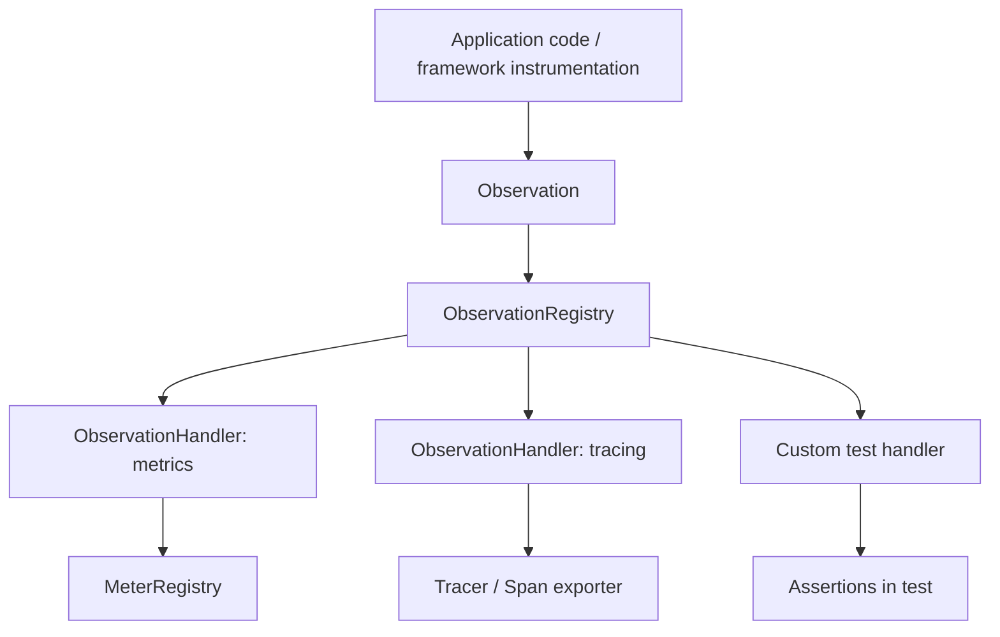

# Test ObservationRegistry in Spring Boot

A Spring Boot service can create observations for HTTP requests, business methods, database calls, and scheduled tasks. When adding instrumentation, you need to verify that observations start and stop at the right time, carry the right name/context/key-values, record exceptions, and are converted into metrics or spans as configured. If a test only verifies that an endpoint returns HTTP 200, it can miss cases where no observation was created, handlers did not run, or context was lost across an async boundary.

**Testing ObservationRegistry** means testing the behavior of the registry and the handlers that process observations. You can use a real registry with test handlers, an in-memory MeterRegistry, or a test tracing exporter to observe the lifecycle and generated data. The goal is to verify that application instrumentation produces the right telemetry at the right boundaries, independent of a production observability backend.

In Micrometer, ObservationRegistry coordinates the observation lifecycle. An Observation is created from the API or built-in instrumentation, and matching handlers receive callbacks such as start, scope opened/closed, error, and stop. Tests must distinguish between the registry receiving an observation and the metrics/tracing exporter actually receiving data.

This lesson belongs to the **Testing observability** chapter of the **SPRING_BOOT_OBSERVABILITY** module. The module teaches how to set up observability for Spring Boot using Micrometer Observation, metrics, logs, and distributed tracing; covering context propagation, tags/cardinality, exporters, sampling, and signal correlation to investigate errors, latency, and application behavior in real environments. This lesson focuses on how to test ObservationRegistry, handlers, context, metrics, and tracing in Spring Boot applications.

## Learning objectives

1. Explain the role of ObservationRegistry in Micrometer Observation.
2. Distinguish between the registry, Observation, ObservationHandler, and MeterRegistry.
3. Create a test handler to record the observation lifecycle.
4. Verify observation name, contextual name, and key-values.
5. Verify exceptions/errors and stop callbacks.
6. Test metrics generated from observations.
7. Test tracing span, kind, parent, and context propagation.
8. Use Spring Boot tests to verify wiring in the application context.
9. Control registry state and avoid test pollution.
10. Test async/reactive boundaries and missing instrumentation cases.

## 1. ObservationRegistry in the observability architecture

ObservationRegistry is where an Observation is registered and dispatched to matching handlers. A single observation can produce multiple signals through handlers: a metrics handler records meters, a tracing handler creates spans, or a custom handler records events.



| Component | Responsibility | What to test |
|---|---|---|
| Observation | Represents an operation lifecycle | Start/stop/error/context |
| ObservationRegistry | Dispatches observations to handlers | Registry wiring and dispatch |
| ObservationHandler | Handles callbacks | Handler is invoked at the right time |
| MeterRegistry | Stores metrics/meters | Meter name, tags, count, duration |
| Tracer/Span exporter | Creates and exports spans | Span name, kind, parent, status |
| ObservationConvention | Standardizes names and key-values | Convention output/cardinality |

A registry does not produce metrics or spans on its own without the corresponding handlers. A test handler receiving callbacks also does not prove that an OTLP exporter or production backend is working.

## 2. Creating a registry for unit tests

You can create a standalone registry:

```java
ObservationRegistry registry = ObservationRegistry.create();
```

Then create an observation:

```java
Observation.createNotStarted("inventory.lookup", registry)
        .lowCardinalityKeyValue("operation", "lookup")
        .observe(() -> inventoryService.find("SKU-42"));
```

A standalone registry lets you test instrumentation logic without starting the entire Spring context. However, an empty registry does not automatically include metrics/tracing handlers. To assert callbacks, register a test handler; to assert metrics, add a metrics handler and MeterRegistry; to assert spans, configure a tracing handler/test exporter.

### 2.1. Default registry and Noop behavior

If the code does not receive a proper registry or uses a no-op observation path, the business operation can still run while no telemetry is generated. Tests should inject the registry explicitly to verify instrumentation. A succeeding business method alone does not prove the registry was active.

### 2.2. Using an isolated registry per test

Create a new registry in each test or reset handlers/meters after the test. A shared registry can retain state, observations, or meters from previous tests and make assertions depend on execution order.

## 3. Writing a test ObservationHandler

A test handler is a direct way to observe the lifecycle. You can implement ObservationHandler for a specific context or use a general handler matching the Micrometer version API.

Example of a simple handler:

```java
class RecordingObservationHandler
        implements ObservationHandler<Observation.Context> {

    private final List<String> events = new ArrayList<>();

    @Override
    public boolean supportsContext(Observation.Context context) {
        return true;
    }

    @Override
    public void onStart(Observation.Context context) {
        events.add("start:" + context.getName());
    }

    @Override
    public void onStop(Observation.Context context) {
        events.add("stop:" + context.getName());
    }

    List<String> events() {
        return events;
    }
}
```

This is an illustrative example; imports and API signatures should be checked against your Micrometer version. A test handler should be thread-safe if observations can execute concurrently.

Registering the handler:

```java
ObservationRegistry registry = ObservationRegistry.create();
RecordingObservationHandler handler =
        new RecordingObservationHandler();

registry.observationConfig().observationHandler(handler);
```

Executing the operation:

```java
Observation.createNotStarted("inventory.lookup", registry)
        .observe(() -> "found");
```

Assertions can verify that both start and stop occur in order. With multiple handlers, do not depend on callback ordering across handlers unless guaranteed by the API.

### 3.1. Testing lifecycle

Callbacks typically needing verification:
- onStart: the observation starts.
- onScopeOpened / onScopeClosed: the context enters and leaves the current scope.
- onError: the operation encounters an exception.
- onStop: the lifecycle completes.

Not every handler needs to override every callback. Test according to the handler contract and the API version in use.

### 3.2. Testing contextual name and key-values

Read the context inside the handler to verify the observation name, contextual name, low-cardinality key-values, and high-cardinality values. Low-cardinality values will be added to metrics; do not place request IDs, user IDs, or raw URLs in this group.

### 3.3. Testing scope cleanup

After the observation completes, the current observation must be restored/cleared per the scope lifecycle. Verify that the scope closes even when the callback throws an exception so context does not leak into the next operation on the same thread.

## 4. Testing error handling

Observations must reflect failed operations:

```java
RuntimeException expected =
        new IllegalStateException("inventory unavailable");

assertThrows(IllegalStateException.class, () ->
        Observation.createNotStarted("inventory.lookup", registry)
                .observe(() -> {
                    throw expected;
                }));
```

The test handler can record the exception from onError and confirm onStop is still called according to the lifecycle. Check the exception class/status; avoid exporting messages containing sensitive data.

### 4.1. Exceptions caught inside the operation

If the code catches an exception and returns a fallback result, the observation may complete normally. This can be the right semantics if the operation succeeded under the fallback contract. To distinguish degraded/fallback outcomes, add a key-value with a bounded set of values or a custom event.

### 4.2. Errors not recorded twice

Multiple layers might log the same exception. Decide which boundary is responsible for recording errors and avoid having one failure recorded across controller, service, repository, and global handler with unnecessary duplicate payloads.

## 5. Testing metrics from Observation

To test metrics, pair ObservationRegistry with a MeterRegistry and the appropriate metrics observation handler. Micrometer provides a handler that converts observations into timers/counters depending on convention and configuration.

Example test configuration:

```java
SimpleMeterRegistry meterRegistry = new SimpleMeterRegistry();
ObservationRegistry registry = ObservationRegistry.create();

registry.observationConfig().observationHandler(
        new DefaultMeterObservationHandler(meterRegistry));
```

Class/package names and constructors depend on the Micrometer version. In a Spring Boot application, the handler is usually auto-configured; integration tests should inject the configured registry rather than registering the handler again manually.

Running the observation:

```java
Observation.createNotStarted("inventory.lookup", registry)
        .lowCardinalityKeyValue("operation", "lookup")
        .observe(() -> inventoryService.find("SKU-42"));
```

Then inspect the timer/meter according to the actual convention. Meter names, suffixes, and tags can differ by handler/registry; use meterRegistry.getMeters() or find meters by verified names.

### 5.1. Asserting count and duration

For a timer, verify that count increments once and total time is greater than or equal to 0. Do not assert duration with an exact absolute value because scheduler/JVM timing varies. Use a reasonable range or simply assert that the timer was recorded.

### 5.2. Asserting cardinality

Run the operation with two different request IDs but the same operation. Verify that the number of time series does not grow with request ID. Only low-cardinality tags should go into meters; high-cardinality values belong in the tracing context when needed.

### 5.3. Avoiding meter name confusion

Framework integrations may use their own meter names. Before hard-coding assertions, inspect the meter registry in a test and verify the names/tag keys for your dependency version. Avoid tests expecting a meter created by a custom handler when the context already has a different handler.

## 6. Testing tracing from Observation

A tracing handler turns observations into spans. Tests can use an in-memory span exporter or a test tracer to inspect spans without needing a production collector/backend.

Properties to verify:
- Span name and kind.
- Trace ID and span ID.
- Parent span relationship.
- Start/end timestamps.
- Status/error events.
- Attributes and instrumentation scope.
- No secrets or out-of-policy high-cardinality metric tags.

### 6.1. Root and child observations

Create a parent observation and then create a child observation within the parent's scope. Verify that the child span belongs to the same trace and its parent span ID points to the parent span. If the child runs outside the scope or async context is not propagated, it can become a new root span.

### 6.2. Testing propagation across executors

If an operation runs on an executor, test context propagation using the mechanism configured by the application, such as Micrometer Context Propagation or an appropriate executor decorator. Do not only assert ThreadLocal on the origin thread; verify the observation/trace context on the worker thread and cleanup after completion.

### 6.3. Sampling and test expectations

A sampler can drop spans before the exporter. If a test aims to verify that instrumentation creates spans, configure the sampler to keep all traces during the test. If testing sampler behavior, write a separate test for sampling decisions; do not let random sampling make tracing tests flaky.

## 7. Testing ObservationConvention

ObservationConvention standardizes observation names and key-values. Test the convention independently to confirm that names are stable, contextual names are readable and free of dynamic IDs, low-cardinality keys have bounded values, high-cardinality fields do not become metric tags, and missing/null values are handled according to contract.

Example convention mapping an operation type:

```java
class InventoryObservationConvention
        implements ObservationConvention<InventoryObservationContext> {

    @Override
    public boolean supportsContext(Observation.Context context) {
        return context instanceof InventoryObservationContext;
    }

    @Override
    public String getName() {
        return "inventory.operation";
    }

    @Override
    public KeyValues getLowCardinalityKeyValues(
            InventoryObservationContext context) {
        return KeyValues.of(
                KeyValue.of("operation", context.operation()));
    }
}
```

This is a conceptual illustration; constructors and context types depend on the codebase. Test with multiple inputs to be sure the convention does not put SKU/customer IDs into low-cardinality tags.

## 8. Spring Boot integration tests

Unit testing the registry does not verify auto-configuration. Use a Spring Boot test to check that the application context configured ObservationRegistry, handlers, MeterRegistry, and the tracer properly.

Example:

```java
@SpringBootTest
class InventoryObservationIntegrationTest {

    @Autowired
    ObservationRegistry observationRegistry;

    @Autowired
    MeterRegistry meterRegistry;

    @Test
    void registryIsAvailable() {
        assertNotNull(observationRegistry);
        assertNotNull(meterRegistry);
    }
}
```

Dependencies and test configuration must match your Spring Boot version. Having the registry bean does not prove every handler is attached; execute a real operation and assert meter/span output.

### 8.1. Avoiding duplicate handler registration in tests

If Boot already auto-configures a metrics observation handler, registering an extra DefaultMeterObservationHandler can record duplicate meters. Check handler wiring or use a test-specific registry/context instead of adding handlers to the production registry in tests.

### 8.2. Test slices and full context

Test slices may not load full tracing/Actuator auto-configuration. Use slices for narrow behavior; use @SpringBootTest or explicit imports when verifying end-to-end wiring. Make clear which layer each test is verifying.

## 9. Testing HTTP server and client observations

For an HTTP server, send a request to the test application and verify that a server observation/span is created with the expected method, route template, and status. For an HTTP client, call a mock server and check the client observation, status/outcome, and outbound trace headers.

A test should verify that the inbound request creates the right server boundary, the outbound exchange creates a client span if the client is instrumented, the client span has the right parent/current context, downstream receives the trace context header, errors/timeouts are recorded per convention, and URI tags do not contain raw IDs/queries.

Do not assert a fixed total span count if the test inadvertently enables other instrumentation such as security/filters/agents. Identify the expected boundaries and assert by span name/kind/scope.

## 10. Testing async and reactive observations

An observation scope is usually bound to an execution context. When work switches to another thread or reactive pipeline, you need to ensure context propagation follows the chosen integration.

### 10.1. Executor

Test a task running on a worker thread, checking that the current observation/trace context is transferred and cleaned up after completion. If propagation is not desired, verify that the worker starts an independent root operation by design.

### 10.2. Reactor

With WebFlux/Reactor, context can be stored in the Reactor Context rather than only ThreadLocal. Test that the publisher is subscribed and terminal signals success/error/cancel work. Creating a Mono/Flux without subscribing does not guarantee the observation executes.

### 10.3. Cancellation

Verify that cancellation closes the scope and ends the observation/span per the integration's behavior. Avoid covering only the success path because cancellation can leave tasks/resources running.

## 11. Testing for no sensitive data leaks

Telemetry tests need negative assertions for passwords/tokens/cookies. Inject a synthetic secret into the request and verify it does not appear in logs, span attributes/events, baggage, metric tags, or exported exception messages.

Do not use production secrets in tests. Check nested values and encoded forms as well if instrumentation might serialize payloads.

## 12. Isolating tests and avoiding flaky behavior

- Create a separate ObservationRegistry/MeterRegistry for tests needing isolation.
- Clear/reset state after tests if a registry is shared.
- Do not assert exact durations.
- Do not depend on callback order between handlers if the contract does not guarantee it.
- Use latches/futures with finite timeouts for async tests.
- Keep sampling deterministic.
- Disable or enable the agent consistently per test goal.
- Do not use long Thread.sleep calls to wait for exporters; use flush/latch/test exporters.
- Avoid running tests in parallel if they mutate the same shared registry/global tracer.

## 13. Diagnosing failing ObservationRegistry tests

| Symptom | Possible cause | How to check |
|---|---|---|
| Handler does not receive callbacks | Observation uses a different registry | Check registry injection |
| Start exists but stop is missing | Operation lifecycle/scope abandoned | Exception/cancel path |
| Meter does not appear | Missing metrics handler or registry | Handler wiring and meter registry |
| Meter count doubled | Duplicate handler registration or duplicate instrumentation | Inspect registry handlers |
| Span does not appear | Tracing handler/bridge/sampler | Tracer, sampler, and exporter |
| Child span becomes root | Context lost across async boundary | Executor/Reactor propagation |
| Flaky test | Nondeterministic sampling or timing | Deterministic sampler and latches |
| Annotation does not work | AOP proxy/self-invocation | Bean proxy and invocation path |
| Meter tag contains dynamic ID | Convention misuses low-cardinality | Inspect KeyValues |
| Secret appears in span | Unsafe attribute/header capture | Span events/attributes and redaction |
| Integration test missing bean | Test slice did not load auto-config | Test configuration/context |
| Span exists but missing in backend | Exporter/collector pipeline | In-memory exporter vs OTLP test |

### Investigation workflow

1. Identify which registry the test is using.
2. Check that the observation is created on that exact registry.
3. Attach a recording handler to observe the lifecycle.
4. Check the metrics handler and MeterRegistry.
5. Check the tracing bridge, sampler, and test exporter.
6. Assert span kind/name/parent instead of only counting total spans.
7. Check async/reactive context and subscription.
8. Check whether the test slice is missing auto-configuration.
9. Check whether handlers or agents are registered twice.
10. Search for synthetic secrets across all captured signals.

## 14. Anti-patterns to avoid

| Anti-pattern | Consequence | Recommended approach |
|---|---|---|
| Only asserting the ObservationRegistry bean exists | Does not prove handlers work | Run an operation and assert signals |
| Using a global registry for all tests | Test pollution/flakiness | Isolated registry or reset |
| Registering an extra metrics handler on Boot's registry | Duplicate meters | Check auto-configuration first |
| Asserting duration with exact numbers | Test depends on scheduler/JVM | Assert count and duration range |
| Using a random sampler in tests | Flaky span assertions | Deterministic sampler |
| Testing only success | Misses error/cancel lifecycle | Test failure and cancellation |
| Not testing context propagation | Child spans can become roots | Executor/Reactor integration tests |
| Not subscribing to WebClient/Mono | Operation never runs | Trigger the publisher in tests |
| Testing only without Java Agent | Misses production duplicates | Test profile with agent when needed |
| Asserting raw total span count | Easily breaks due to valid sibling instrumentation | Assert kind/name/scope/parent |
| Using real secrets in tests | Risk of data exposure | Synthetic credentials |
| Calling OTLP backend in every unit test | Slow tests dependent on infrastructure | In-memory exporter; separate integration |

## 15. Observability testing checklist

1. **Registry:** does the test clearly verify which registry is injected?
2. **Lifecycle:** are start, scope, error, and stop verified?
3. **Context:** are observation name/context/key-values correct?
4. **Handlers:** are metrics/tracing handlers attached exactly once?
5. **Metrics:** are meter name, tags, count, and duration asserted?
6. **Cardinality:** do dynamic IDs stay out of low-cardinality tags?
7. **Tracing:** are span name/kind/parent/status asserted?
8. **Propagation:** does trace context cross HTTP/executor/reactive boundaries?
9. **Errors:** are exceptions and fallback outcomes accurate?
10. **Cancellation:** are scopes/resources cleaned up?
11. **AOP:** are annotation/proxy paths checked?
12. **Security:** do synthetic secrets stay out of telemetry?
13. **Isolation:** does registry/tracer state avoid leaking between tests?
14. **Sampling:** is the test sampler deterministic?
15. **Auto-configuration:** do integration tests verify Spring Boot wiring?
16. **Agent:** do tests reflect the Java Agent if production uses it?
17. **Export:** are in-memory tests and OTLP integration tests separated?
18. **Flakiness:** do async waits have timeouts without relying on long sleeps?

## 16. Self-assessment questions

**Question 1.** What is the role of ObservationRegistry?

**Hint:** Coordinates the observation lifecycle across registered ObservationHandlers.

**Question 2.** Does the registry create metrics and spans on its own?

**Hint:** No. It requires the corresponding handlers and configured registries/tracers/exporters.

**Question 3.** What does a test handler help verify?

**Hint:** Start, scope, error, and stop callbacks along with the observation's context/key-values.

**Question 4.** Why shouldn't you only assert that the registry bean exists?

**Hint:** Bean existence does not prove observations are created or that handlers/export pipelines work.

**Question 5.** How do you test metrics produced by an observation?

**Hint:** Use an in-memory MeterRegistry and a metrics observation handler; assert meter/tags/count/duration.

**Question 6.** How do you test tracing without a backend?

**Hint:** Use a test tracer or in-memory span exporter and assert span attributes/parent relationships.

**Question 7.** Why can a child span become a root when running asynchronously?

**Hint:** Current context is not propagated across the executor/reactive boundary.

**Question 8.** Why is a deterministic sampler needed in tests?

**Hint:** Avoids randomly dropped traces that cause unstable assertions.

**Question 9.** Why shouldn't you arbitrarily register an extra metrics handler in a Spring Boot integration test?

**Hint:** Boot may have already auto-configured the handler, and adding another can record duplicate meters.

**Question 10.** What should you verify when testing instrumentation for production environments using a Java Agent?

**Hint:** Run smoke/integration tests with an agent equivalent to production, checking spans/metrics per boundary and duplicate instrumentation.

## Conclusion

**Testing ObservationRegistry must verify the behavior of observations and handlers, not merely the existence of the registry bean.** Use a recording handler to check lifecycle/context, an in-memory MeterRegistry to assert metrics, and a test span exporter to verify tracing, parent relationships, and propagation. Spring Boot integration tests should confirm that auto-configuration attaches the right handlers; unit tests should isolate registries and use deterministic samplers/timing. Cover errors, cancellation, async/reactive boundaries, and negative assertions for secrets so telemetry is accurate, cardinality-safe, and free from depending on a production backend in every test.
