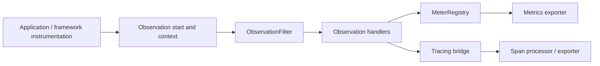

# Test ObservationFilter in Spring Boot

**Testing ObservationFilter** means verifying that Micrometer Observation metadata filters work properly before an observation is converted into metrics, spans, or other signals. `ObservationFilter` is commonly used to normalize or enrich key-values, remove disallowed metadata, and protect telemetry from unbounded cardinality or sensitive data.

In the **SPRING_BOOT_OBSERVABILITY** module, testing filters ensures that metadata policies are applied consistently across both framework-created and application-created observations. This lesson belongs to the **Testing observability** chapter and focuses on filter lifecycle, processing order, wiring into `ObservationRegistry`, checking low/high-cardinality values, verifying results in metrics/tracing handlers, regression tests, and troubleshooting.

## 1. What does ObservationFilter do?

Micrometer Observation has a lifecycle and a context carrying key-values that describe the operation. `ObservationFilter` lets you adjust `Observation.Context` before handlers process the context according to Micrometer's mechanics.

Common use cases:
- Normalizing metadata to avoid multiple spellings for the same dimension.
- Removing disallowed key-values.
- Adding technical metadata from a trusted source.
- Restricting metadata passed along to metrics or tracing.
- Applying a shared policy to observations from multiple instrumentation points.

A filter is part of the instrumentation pipeline. It does not replace authentication, authorization, or redaction at ingress. If PII has already been written to logs or sent through another exporter before the filter, `ObservationFilter` cannot retract that copy.

### 1.1. Position in the pipeline



The filter modifies the context according to the API and timing applied by Micrometer. Do not assume it modifies all metadata in logs, baggage headers, or custom telemetry outside the Observation pipeline.

## 2. Distinguishing ObservationFilter from conventions and handlers

| Component | Responsibility | When to use |
| --- | --- | --- |
| ObservationConvention | Sets initial name and key-values for a type of observation | Standardizing metadata per operation |
| ObservationFilter | Adjusts `Observation.Context` per shared policy | Filtering/normalization across many observations |
| ObservationHandler | Reacts to start/stop/error lifecycle | Recording metrics, spans, or custom signals |
| MeterFilter | Adjusts meters when registering into `MeterRegistry` | Limiting meter names/tags at the metrics layer |
| Tracing processor | Processes spans before export | Redaction/filtering in the tracing pipeline |

Do not use `ObservationFilter` as a substitute for `MeterFilter` if the policy applies only to metrics. Similarly, filtering the context does not guarantee every tracing SDK span attribute created outside Micrometer is filtered.

## 3. Configuring ObservationFilter on the registry

`ObservationFilter` must be registered with the `ObservationRegistry` actually used by instrumentation. In Spring Boot, the registry is normally managed by the application context; exact configuration depends on the Spring Boot/Micrometer version.

Example of a simple filter:

```java
@Bean
ObservationFilter normalizeObservationValues() {
    return context -> {
        String region = context.get("region");
        if (region != null) {
            context.addLowCardinalityKeyValue(
                    KeyValue.of("region", normalizeRegion(region)));
        }
        return context;
    };
}
```

The snippet illustrates the idea; context access/mutation APIs and bean registration must match the Micrometer version in use. Verify whether Spring Boot auto-detects `ObservationFilter` beans or requires explicit registration on the registry.

### 3.1. Registering directly on ObservationRegistry

At the Micrometer level, the registry provides a way to register filters. Conceptual example:

```java
observationRegistry.observationConfig()
        .observationFilter(observationFilter);
```

Use the exact registry shared by framework instrumentation and custom observations. If the filter is added to a different registry, direct filter tests may pass while HTTP/database observations in the application remain unaffected.

### 3.2. Avoiding double registration

If a filter is both auto-configured and manually added, the policy may execute multiple times. With a non-idempotent filter, values may be transformed repeatedly or produce unintended metadata. Check wiring and registration order.

## 4. Designing a testable policy

Before writing tests, define clearly:
- Which keys are allowed.
- Which keys must be removed.
- Which values must be normalized.
- Which key-values are low-cardinality.
- Whether metadata is enriched and which sources are trusted.
- Behavior when a value is null, empty, too long, or invalid.
- Whether the filter may mutate existing context keys or only add new fields.

Example policy:

| Key | Input | Expected |
| --- | --- | --- |
| region | ap-southeast | Keep as is |
| region | AP-SOUTHEAST | Normalize to `ap-southeast` |
| region | unknown text | Remove or map to `other` |
| user.email | person@example.test | Remove |
| authorization | Bearer token | Remove |
| request.id | UUID | Exclude from metric tags |
| tenant-tier | enterprise | Keep if in allow-list |
| arbitrary | value | Remove if not in allow-list |

The policy must be consistent with `ObservationConvention` and handlers. If the filter only removes low-cardinality values while leaving the same PII in high-cardinality values, telemetry can still leak it.

## 5. Unit testing the filter

Unit tests should test the filter independently of the Spring context to verify policy for each input. You can create a concrete `Observation.Context`, add key-values, and apply the filter.

Pseudocode test example; adjust context APIs for your Micrometer version:

```java
@Test
void removesSensitiveValues() {
    Observation.Context context = new Observation.Context();
    context.addHighCardinalityKeyValue(
            KeyValue.of("user.email", "person@example.test"));
    context.addLowCardinalityKeyValue(
            KeyValue.of("region", "AP-SOUTHEAST"));

    Observation.Context filtered = filter.map(context);

    assertThat(filtered.getHighCardinalityKeyValues())
            .noneMatch(kv -> kv.getKey().equals("user.email"));
    assertThat(filtered.getLowCardinalityKeyValues())
            .anyMatch(kv -> kv.getKey().equals("region")
                    && kv.getValue().equals("ap-southeast"));
}
```

This is an illustrative structure; the `ObservationFilter` API may accept/return `Observation.Context` directly as a function. Write assertions using the getter APIs available in your actual version.

### 5.1. Testing both low and high cardinality

Check both groups separately:
- Low-cardinality key-values can go into metric tags.
- High-cardinality key-values can be placed into span attributes.

Do not only assert that the filter returns a different object. Assert that forbidden keys/values are actually absent from the context.

### 5.2. Testing null, empty, and malformed values

Include cases for:
- Null or blank values.
- Values exceeding length limits.
- Disallowed Unicode/control characters.
- Keys not in the allow-list.
- Duplicate keys.
- Out-of-enum values.

The filter should have deterministic behavior and must not throw exceptions due to invalid request metadata.

## 6. Testing registry wiring

A unit test calling the filter directly does not prove the filter is registered on the `ObservationRegistry` that Spring Boot uses.

Create a Spring context test and inject the registry:

```java
@SpringBootTest
class ObservationFilterWiringTest {

    @Autowired
    ObservationRegistry observationRegistry;

    @Test
    void registryIsAvailable() {
        assertThat(observationRegistry).isNotNull();
    }
}
```

This test only confirms the registry exists. To verify filter wiring, create an observation via the registry, attach sensitive/invalid metadata, and inspect the context received by a test handler after filtering.

### 6.1. Testing a handler observing the final context

You can register a test `ObservationHandler` or a handler recording the context at lifecycle callbacks. Verify that the handler receives the context after the filter has processed it.

Callback order and when filters apply depend on the Micrometer lifecycle/version. Design tests around the actual contract of the API in use, without assuming every handler callback sees the same snapshot.

## 7. Testing that metrics do not receive forbidden tags

If the policy protects metrics cardinality, inspect meters after the observation completes. Use `SimpleMeterRegistry` or the appropriate test registry to inspect actual tags.

Conceptual example:

```java
SimpleMeterRegistry registry = new SimpleMeterRegistry();

// Register the observation handlers used by the application.
// Create and stop an observation through the configured registry.

// Assert that the resulting meter has normalized tags
// and contains no user-specific or unbounded values.
```

Tests must verify:
- The `region` tag is normalized.
- No email, user ID, or request ID appears.
- Tag key counts remain within policy.
- No separate meter is created per input value.
- Timer/counter is created with the expected name and outcome.

Do not inspect only `Observation.Context`; other handlers or conventions may add tags after the filter depending on pipeline/version.

## 8. Testing that tracing does not receive forbidden attributes

If the filter protects span attributes, use an in-memory/test span exporter or test tracing handler to inspect finished spans.

Verify:
- Span name is stable.
- Low-cardinality metadata is normalized.
- Sensitive high-cardinality metadata is removed.
- Trace ID/parent relationships remain intact.
- Error status and timing are still recorded.
- No PII appears in span events or exception attributes outside policy.

`ObservationFilter` only filters `Observation.Context`. If code creates spans directly via the OpenTelemetry API, attributes added directly may bypass `ObservationFilter`. Test that instrumentation path as well and apply an appropriate tracing processor/redaction.

## 9. Testing filters with HTTP instrumentation

HTTP server observations are normally created by the framework. Integration tests should send requests through an embedded server or WebTestClient/MockMvc matching the application stack, then inspect telemetry.

Check:
- Route template replaces raw path IDs.
- Method/status/outcome have stable values.
- Sensitive headers do not become tags/attributes.
- Request URI/query string is not placed verbatim into metrics.
- The filter applies to framework-created observations.

If a test only invokes a service method directly, it does not prove HTTP instrumentation uses the same registry or filter.

## 10. Testing async and reactive observations

With Reactor, context can cross thread/scheduler boundaries. An observation lifecycle can finish when the publisher completes, errors, or cancels. Tests must verify the filter applies to the observation's context and metadata is not re-added inside callbacks.

Cases to test:
- `Mono` success/error/cancel.
- `Flux` complete/cancel.
- Scheduler switching.
- Async callback/future completion.
- Context propagation across WebClient or messaging.
- Baggage separate from Observation key-values.

Do not confuse `ObservationFilter` with propagators. Filters modify observation context; W3C propagators govern how trace context/baggage are injected into carriers.

## 11. Testing idempotency and filter order

When multiple filters run, order can affect the result. For example, filter A normalizes `region`, and filter B only allow-lists normalized values. If B runs before A, uppercase values might be stripped instead of normalized.

Design filters so they:
- Have an explicit registration order.
- Prefer idempotent transformations.
- Do not overwrite trusted-source values with untrusted input.
- Do not create duplicate keys.
- Have tests covering filter combinations.
- Do not rely on iteration order not guaranteed by the API.

### 11.1. Idempotency test

Apply the same policy twice to an already filtered context and verify the result does not change. This reduces risk if configuration accidentally registers the filter twice.

## 12. Security and privacy regression tests

Create a test dataset containing synthetic values:
- Email, phone, and address.
- Authorization bearer token.
- Cookie/session ID.
- Customer/account ID.
- Raw request body marker.
- SQL bind value marker.
- Non-allow-listed trace baggage.

After creating the observation, export test telemetry and search for forbidden markers in meter tags, span attributes, events, and related structured logs.

Use unique markers in tests for easy detection, but never use real production data. Check both application exporter output and Collector output when verifying end-to-end.

## 13. Troubleshooting ObservationFilter tests

| Symptom | Possible cause | Investigation direction |
| --- | --- | --- |
| Unit test passes but app still leaks tag | Filter not registered on the actual registry | Check Spring beans and `ObservationRegistry` wiring |
| Filter runs twice | Auto-configuration and manual registration both active | Check beans/configuration |
| Metrics still have forbidden key | Meter created from another path or different filter timing | Check handlers, conventions, and `MeterFilter` |
| Span still has PII | Attribute added directly via tracing API | Check span processor and instrumentation |
| HTTP observations unfiltered | HTTP instrumentation uses another registry or filter not applied | Test through a real web context |
| Async metadata lost | Wrong context propagation/lifecycle | Check Reactor Context and callbacks |
| Region not normalized | Wrong filter order or key-values | Test filter composition |
| Duplicate keys | Filter adds value without replacing/removing old one | Check API update semantics |
| Test sees no meters | Observation not stopped or handler missing | Check lifecycle and registry |
| PII still appears in logs | Logs do not pass through `ObservationFilter` | Redact at the logging boundary |
| Version-dependent test | API/context getters differ | Check Micrometer dependency version |
| Trace correlation lost | Filter accidentally deleted tracing metadata | Filter only policy keys; preserve trace context |

### Investigation workflow

1. Confirm the Micrometer version and `ObservationFilter` API.
2. Verify the filter is created and registered exactly once.
3. Confirm framework instrumentation uses the same `ObservationRegistry`.
4. Create a test observation through that exact registry.
5. Inspect the post-filter context using a test handler.
6. Inspect actual meter tags in the test registry.
7. Inspect span attributes via a test exporter.
8. Test HTTP/reactive/messaging paths separately.
9. Look for direct instrumentation bypassing the Observation pipeline.
10. Check logs and Collector/backend under their own policies.

## 14. Practice: testing a PII-stripping filter

The goal is to verify that an `ObservationFilter` normalizes `region` and strips sensitive metadata before metrics/tracing handlers process the context.

### Preparation

- Spring Boot application with Micrometer Observation.
- Spring-managed `ObservationRegistry`.
- `SimpleMeterRegistry` or test `MeterRegistry`.
- Test `ObservationHandler` or in-memory span exporter.
- An HTTP/service observation test path.

### Step 1 — Write the policy

Allow-list `region` and `tenant-tier` with finite values. Reject email, token, cookie, user ID, and arbitrary values.

### Step 2 — Implement the filter

Write the filter using your project's Micrometer version API. Ensure it does not throw on null/invalid input and has clear behavior for duplicate keys.

### Step 3 — Unit test

Test normalization, allow-listing, rejection, length limits, null/blank handling, and idempotency.

### Step 4 — Register the filter

Register the filter with the `ObservationRegistry` used by Spring Boot. Verify no manual registration duplicates auto-configuration.

### Step 5 — Test final context

Create an observation through the registry and use a test handler to verify the context is filtered before handlers process it per the version's lifecycle contract.

### Step 6 — Test metrics

Use a test registry to verify meter tags contain only permitted low-cardinality values.

### Step 7 — Test tracing

Use a test span exporter to verify span attributes contain no PII markers and trace correlation remains intact.

### Step 8 — Test HTTP/reactive

Send requests through HTTP instrumentation and a reactive operation. Confirm the filter applies to framework-created observations.

### Step 9 — Test bypass paths

Create a span directly via the tracing API or a separate log record to prove `ObservationFilter` does not replace redaction in those pipelines. Apply appropriate filters at each boundary.

### Step 10 — Regression testing

Re-run the full suite after upgrading Spring Boot/Micrometer or adding instrumentation dependencies. Compare meter tags and exported span attributes against policy.

### Acceptance checklist

| What to prove | Expected outcome |
| --- | --- |
| Filter policy | Clear allow-list/reject/normalize rules |
| Registry wiring | Filter attached once to the right registry |
| Unit tests | Null, malformed, duplicate, and idempotency |
| Context | Handlers receive filtered metadata |
| Metrics | No sensitive or high-cardinality tags |
| Tracing | Span attributes free of PII |
| HTTP | Framework observations are filtered |
| Reactive | Lifecycle/context preserved properly |
| Bypass paths | Logs/direct spans have dedicated redaction |
| Correlation | Trace ID and parent relationships unchanged |
| Version | Tests match the actual Micrometer API |
| Regression | Tests re-run after dependency upgrades |

## 15. Principles to remember

1. **`ObservationFilter` modifies `Observation.Context`.** It does not automatically filter all logs, baggage headers, or spans created outside the Observation pipeline.
2. **Register the filter on the right `ObservationRegistry`.** Standalone filter unit tests do not prove the application uses the filter.
3. **Distinguish conventions, filters, handlers, and `MeterFilter`.** Each acts at a different layer.
4. **Test low- and high-cardinality key-values separately.** Metrics and tracing carry different risks.
5. **Verify actual handler outputs.** A filtered context does not guarantee another instrumentation path does not re-attach metadata.
6. **Keep filters idempotent and ordering explicit.** Avoid duplicate registrations and duplicate key-values.
7. **Test HTTP, reactive, and messaging paths.** Framework-created observations must be verified through integration tests.
8. **Preserve valid Trace Context.** Do not strip Trace ID/parent metadata when only trying to remove PII.
9. **Redact at every pipeline boundary.** Logs, direct OpenTelemetry spans, and baggage each need their own policy.
10. **Use regression tests after upgrades.** Micrometer/Spring integrations can change APIs or wiring.

Testing `ObservationFilter` must prove the policy is applied on the right registry and before handlers actually record metrics/traces. Combining unit tests for transformations with integration tests across HTTP/reactive paths and inspecting meter/span outputs catches both filter bugs and instrumentation paths that bypass the filter. This keeps metadata cardinality controlled, lowers PII exposure risk, and preserves the trace correlation needed for incident investigation.
