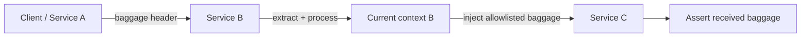

# Test baggage propagation in Spring Boot

## 1. Objectives and context

Distributed tracing often needs to pass a small amount of context across multiple services. Trace context defines trace/span relationships; baggage carries additional key-value pairs that downstream services can use within the same request flow. Valid examples include non-sensitive classifications such as `tenant-tier=gold` or `workflow=checkout`. If baggage is lost, downstream services do not receive expected context; if baggage is propagated too broadly, sensitive data can cross trust boundaries.

**Testing baggage propagation** means testing the entire baggage lifecycle: values are created or extracted from inbound requests, attached to the current context, preserved across operations, injected into outbound requests when permitted, and isolated from leaking across requests or tenants.

This lesson belongs to the **Testing observability** chapter of the **SPRING_BOOT_OBSERVABILITY** module. The module teaches how to set up observability for Spring Boot using Micrometer Observation, metrics, logs, and distributed tracing; covering context propagation, tags/cardinality, exporters, sampling, and signal correlation to investigate errors, latency, and application behavior in real environments.

After this lesson, you can:
1. Distinguish trace context from baggage.
2. Test baggage extraction from inbound headers.
3. Test baggage injection into outbound HTTP requests.
4. Verify allow-listed remote fields and correlation fields.
5. Test propagation across multiple service hops.
6. Detect context loss/leaks in executors and Reactor.
7. Verify security, size, and payload limits on propagated data.
8. Write repeatable integration tests independent of a real tracing backend.

**Baseline:** Spring Boot 3.5.x, Java 17+, Micrometer Tracing, and an appropriate tracing bridge (Brave or OpenTelemetry). Specific properties/APIs must match the bridge and version managed by Spring Boot dependency management.

## 2. How do trace context and baggage differ?

| Component | Purpose | Example |
| --- | --- | --- |
| Trace context | Links spans in the same distributed trace | trace ID, parent/span ID, sampling flags |
| Baggage | Carries extra key-value context across process boundaries | `tenant-tier=gold` |
| MDC/correlation fields | Puts selected context into the current log event | `tenant-tier=gold` in logs |

Trace context serves trace/span relationships. Baggage is application metadata that can be serialized into HTTP headers for downstream services. Baggage does not automatically become a span attribute, metric tag, or MDC field; each integration must be configured explicitly.

Never use baggage as a replacement for authentication/authorization. Downstream services must not trust a tenant/user value merely because it arrived in a baggage header.

## 3. Configuring baggage propagation

Spring Boot provides tracing baggage properties. Example declaring fields permitted for remote propagation and fields included in logging correlation:

```yaml
management:
  tracing:
    baggage:
      remote-fields:
        - tenant-tier
        - workflow
      correlation:
        fields:
          - tenant-tier
```

`remote-fields` specifies baggage fields propagated across process boundaries by the tracing integration. `correlation.fields` instructs the integration to populate fields into the logging correlation context when supported. These serve two distinct purposes: a field can be propagated without appearing on every log line.

Check properties against your Spring Boot version and tracing bridge. Do not assume arbitrary baggage keys are automatically injected; allow-list configuration and propagation format govern this.

## 4. W3C Baggage header

In W3C Baggage, the header is comma-separated key-value pairs:

```http
baggage: tenant-tier=gold,workflow=checkout
```

Values may require percent-encoding per the specification. Never concatenate header strings manually from unvalidated input on requests. Baggage has member count and size limits; intermediaries may drop oversized headers.

Do not place passwords, access tokens, emails, account numbers, raw tenant payloads, or personal data in baggage. Because headers can traverse multiple proxies, services, and vendors, propagate only minimal, approved metadata.

## 5. Testing inbound extraction

Integration tests should send an inbound request containing a baggage header to the application and verify baggage is present in the request handler's context. Exact retrieval depends on the tracing bridge and Micrometer version; inspect through the abstraction/handler used by the application rather than reading private `ThreadLocal` state.

Example test probe controller using Micrometer Tracing's `BaggageManager` to read the current field:

```java
import io.micrometer.tracing.Baggage;
import io.micrometer.tracing.BaggageManager;
import org.springframework.web.bind.annotation.GetMapping;
import org.springframework.web.bind.annotation.RestController;

@RestController
class BaggageProbeController {
    private final BaggageManager baggageManager;

    BaggageProbeController(BaggageManager baggageManager) {
        this.baggageManager = baggageManager;
    }

    @GetMapping("/test/baggage")
    String baggage() {
        Baggage baggage = baggageManager.getBaggage("tenant-tier");
        return baggage == null ? "missing" : baggage.get();
    }
}
```

This probe is strictly for test/example endpoints, not a production endpoint echoing baggage. If the baggage field is not configured or extracted, the result can be null.

MockMvc example:

```java
mockMvc.perform(get("/test/baggage")
        .header("baggage", "tenant-tier=gold"))
    .andExpect(status().isOk())
    .andExpect(content().string("gold"));
```

Tests must run with tracing auto-configuration and real remote baggage fields. If using a test slice that skips tracing configuration, tests may fail to reflect production.

## 6. Testing outbound injection

Successful extraction does not prove outbound propagation works. Make an outbound HTTP call inside the same request context and verify that a mock server receives the baggage header.

Example `WebClient` configuration using Spring Boot's managed builder:

```java
@Component
class InventoryClient {
    private final WebClient webClient;

    InventoryClient(WebClient.Builder builder) {
        this.webClient = builder
                .baseUrl("http://localhost:9091")
                .build();
    }

    Mono<String> lookup() {
        return webClient.get()
                .uri("/inventory")
                .retrieve()
                .bodyToMono(String.class);
    }
}
```

In an integration test, run a mock HTTP server on a dynamic port, point the client's base URL to that port, invoke the application endpoint, and assert the received request includes a `baggage` header containing `tenant-tier=gold`. Use the auto-configured `WebClient.Builder` so observation/tracing customizers are applied.

Do not only assert the header is present; parse its members and confirm only allow-listed keys were sent. Member ordering in the header should not be a test requirement.

## 7. Testing multi-hop propagation

In an A → B → C system, baggage must be verified at each boundary:



Tests should verify:
- A sends valid baggage members.
- B extracts the values into context.
- B does not arbitrarily add out-of-policy fields.
- B injects allowed fields when calling C.
- C receives the expected value and corresponding trace context.
- Fields dropped at B do not appear at C.

Check carefully when B calls external services outside the trust boundary: internal tenant/workflow baggage may need to be stripped at that outbound boundary.

## 8. Testing allow-lists and disallowed data

Negative tests are just as important as success tests. Suppose an inbound header contains:

```http
baggage: tenant-tier=gold,workflow=checkout,secret-token=DO_NOT_PROPAGATE
```

Outbound requests should carry only fields configured for remote propagation. Assert that `secret-token` does not appear in outbound headers, logs, span attributes, or test exporter payloads.

Check these cases:
- Fields outside the allow-list.
- Malformed keys/values or invalid percent-encoding.
- Repeated headers or multiple members.
- Baggage exceeding size limits.
- Empty or overly long values.
- Requests without baggage.
- Callers attempting to send unauthorized tenant-identifying fields.

The application must fail closed per policy: drop invalid fields or reject the request when the field is a business requirement; never blindly trust values.

## 9. Baggage and async execution

Context can be lost when a request switches to an executor or `CompletableFuture`. A simple test calling a synchronous method will miss this bug.

Testing:
1. Receive a request with baggage.
2. Submit work to the executor used by the application in production.
3. Read baggage inside the worker task or make an outbound call from that task.
4. Verify context is propagated properly.
5. Run two requests with different values concurrently.
6. Verify there is no context bleed between tasks.

Use context propagation integrations matching Spring Boot/Micrometer and executor decoration. Never copy `ThreadLocal` manually without restoring/clearing on all exit paths.

## 10. Baggage in Reactor/WebFlux

Reactor does not guarantee a request always runs on the same thread. Baggage must follow the reactive context/observation context across operator chains and scheduler switches.

Tests with `WebTestClient`/WebFlux should:
- Send a baggage header to a reactive endpoint.
- Perform an outbound `WebClient` call after one or more `publishOn`/`subscribeOn` operators if the app uses them.
- Assert the outbound mock server receives the baggage.
- Run multiple concurrent subscriptions with different values.
- Verify cancel/error does not leak context into other subscriptions.

Do not use `ThreadLocal`/MDC directly in reactive code and assume it stays accurate. Use Micrometer context propagation/Reactor integration per version.

## 11. Baggage, logs, and metrics

Correlation fields in MDC help search logs by baggage key, but configure only safe, necessary fields. Inspect log output to confirm:
- Fields appear on logs for the right request.
- Fields are cleared/restored after the request.
- Concurrent requests do not mix values.
- Sensitive fields do not appear.

Do not put high-cardinality baggage values into metric tags. For example, `tenant-tier` with a few controlled values can be a finite dimension; `tenant-id` with thousands of values is usually unsuitable for metrics. If tenant-level diagnostics are required, use a backend with access control and query scoping.

Baggage does not automatically become a metric label. Tagging must be done intentionally through observation conventions/customizations.

## 12. Unit tests vs. integration tests

| Test type | Goal | Component |
| --- | --- | --- |
| Unit | Verify allow-list/normalization policy | Baggage policy service |
| MVC integration | Verify inbound extraction | MockMvc + tracing context |
| HTTP client integration | Verify outbound injection | MockWebServer/WireMock |
| Multi-hop | Verify B → C propagation | Two applications or test services |
| Async | Verify executor context | Real configured executor |
| Reactive | Verify Reactor context | WebTestClient + WebClient |
| Security | Verify secret/unknown fields dropped | Captured headers/logs/spans |

Prefer integration tests using the same auto-configuration and bridge as production. Unit tests for policy are still helpful, but they do not prove HTTP instrumentation actually injects headers.

## 13. Troubleshooting

| Symptom | Possible cause | How to resolve |
| --- | --- | --- |
| Inbound baggage always null | Remote field not configured or propagation type mismatch | Check `management.tracing.baggage.remote-fields` and header format |
| B reads it but C does not receive it | Outbound client uninstrumented or field not allow-listed | Use Boot's builder and inspect outbound headers |
| Baggage header too large/dropped | Too many members or long values | Limit keys/bytes and propagate minimal metadata |
| Baggage appears in external requests | Remote fields configured too broadly | Separate trust boundaries and outbound policies |
| Async task loses baggage | Executor does not propagate context | Use a context-aware/decorated executor |
| Reactive call loses baggage after scheduler hop | Reactor context integration missing/misconfigured | Check Micrometer context propagation |
| Logs show previous request's baggage | MDC/ThreadLocal not restored/cleared | Use scoped contexts and concurrent tests |
| Secret appears in outbound header | Missing allow-list or trusting inbound values | Allow-list, validate, and add negative tests |
| Tests pass but production fails | Test slice missing tracing auto-configuration or different bridge | Use full integration context/matching version |
| Baggage missing from spans | Span processor/attribute mapping not configured | Check tracing bridge; baggage does not auto-become span attributes |

## 14. Production checklist

- [ ] Baggage keys are explicitly allow-listed.
- [ ] Inbound values are trusted only after validation/authorization.
- [ ] `remote-fields` contains only metadata permitted across boundaries.
- [ ] Baggage contains no secrets, PII, or payloads.
- [ ] Key/value counts and header sizes are bounded.
- [ ] Outbound HTTP clients use auto-configured builders.
- [ ] Multi-hop tests verify extraction and injection at each service.
- [ ] External trust boundaries have policies stripping internal baggage.
- [ ] Async executor and Reactor context propagation are tested.
- [ ] MDC correlation is cleaned up and does not bleed between requests.
- [ ] Baggage is not used as high-cardinality metric labels.
- [ ] Negative tests exist for unknown fields, malformed, and oversized headers.

## 15. Self-practice questions

1. How does trace context differ from baggage in purpose?
2. What does `management.tracing.baggage.remote-fields` control?
3. Why is `correlation.fields` not synonymous with remote propagation?
4. How do you test inbound baggage extraction?
5. Why should you assert outbound headers on a mock server?
6. Which boundaries must a multi-hop test verify?
7. Why is baggage not an authentication context?
8. Why are negative tests needed for secret/unknown fields?
9. How can an async executor lose or leak baggage?
10. How does Reactor context differ from `ThreadLocal`?
11. Why are baggage values generally unsuitable as metric labels?
12. What should you check when tests pass but production propagation fails?

## References

- [Spring Boot 3.5 — Tracing](https://docs.spring.io/spring-boot/3.5/reference/actuator/tracing.html)
- [Spring Boot 3.5 — Common Application Properties](https://docs.spring.io/spring-boot/3.5/appendix/application-properties/index.html)
- [Micrometer Tracing — Baggage](https://docs.micrometer.io/tracing/reference/api.html)
- [Micrometer Context Propagation](https://docs.micrometer.io/context-propagation/reference/)
- [W3C — Baggage](https://www.w3.org/TR/baggage/)
- [OpenTelemetry — Context Propagation](https://opentelemetry.io/docs/concepts/context-propagation/)
