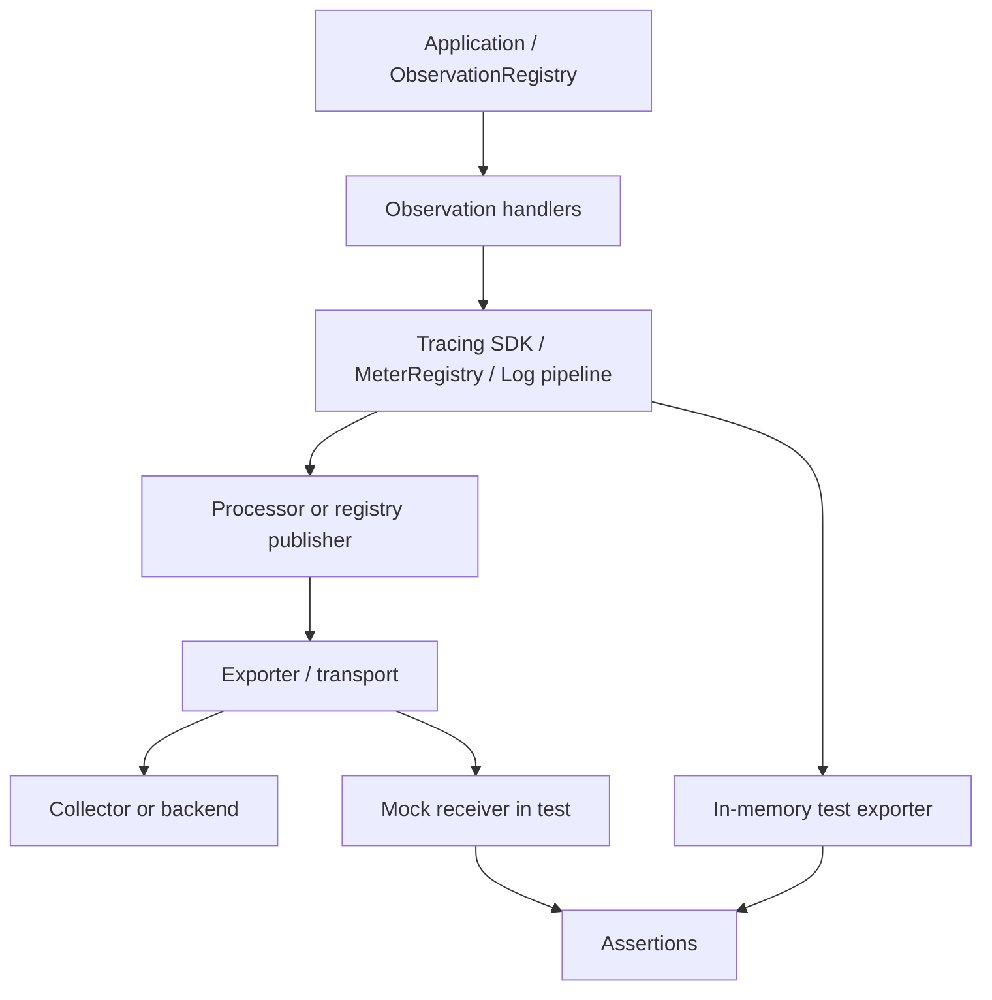

# Test exporters with mocks in Spring Boot

A Spring Boot application can generate metrics, spans, and logs and send them to an observability backend over HTTP, gRPC, or a custom protocol. Calling a real production backend during tests slows them down, depends on network/credentials, and makes error conditions hard to reproduce. A mock exporter or mock server lets you verify the generated data, outbound requests, response handling, and transport error behavior without production telemetry infrastructure.

**Testing exporters with mocks** means verifying the export boundary using a simulated component or local server with controllable behavior. Distinguish an in-memory exporter from a mock transport server: an in-memory exporter receives spans directly in-process to inspect span contents; a mock OTLP server receives real HTTP/gRPC requests to inspect serialization, headers, endpoints, and response handling. Both answer different questions and complement each other.

In the **SPRING_BOOT_OBSERVABILITY** module, Micrometer Observation creates operation contexts; metrics/tracing handlers turn observations into signals; registries, SDK processors, and exporters handle storage or transport. This lesson belongs to the **Testing observability** chapter and focuses on testing exporters with mocks in Spring Boot applications using Micrometer Observation, metrics, logs, and distributed tracing. It helps verify the exporter boundary, payloads, network failures, timeouts, retries, and test stability.

## Learning objectives

1. Distinguish exporters, processors, registries, and backends.
2. Choose between an in-memory exporter and a mock transport server based on test goals.
3. Inspect span payloads, resource attributes, events, and parent contexts.
4. Use a mock HTTP server or local receiver to verify OTLP requests.
5. Assert endpoints, protocols, headers, and authentication metadata without real secrets.
6. Test success responses, HTTP/gRPC errors, timeouts, and server unavailability.
7. Verify retry/timeout behavior per exporter implementation.
8. Test metrics and log exports with appropriate mock tools.
9. Keep tests deterministic, isolated, and independent of production backends.
10. Diagnose faults across instrumentation, processors, exporters, and transport.

## 1. Where does the exporter sit in the pipeline?

`ObservationRegistry` dispatches observations to handlers. A tracing handler creates spans; the SDK processor receives ended spans and forwards them to the exporter. Metrics flow through `MeterRegistry` and registry-specific publishing/scraping. Logs flow through logging appenders or log exporters.



Each layer has its own responsibility:

| Component | Role | Suitable mock/test |
|---|---|---|
| `ObservationRegistry` | Coordinates observation lifecycle | Recording `ObservationHandler` |
| `MeterRegistry` | Stores and queries meters | `SimpleMeterRegistry` or test registry |
| Span processor | Processes ended spans, batching/sampling | Test SDK/processor |
| Span exporter | Receives spans and ships them | In-memory exporter or mock OTLP receiver |
| OTLP transport | HTTP/gRPC serialization and networking | Mock web server/local receiver |
| Log appender/exporter | Sends log events to a sink | List appender or mock log receiver |

A test using only an in-memory exporter does not test HTTP serialization. A mock HTTP server receiving requests does not by itself prove business instrumentation created spans properly; assert both payloads and operation boundaries.

## 2. Choosing the right mock type

### 2.1. In-memory exporter

An in-memory exporter holds spans in memory for tests to read and assert. It is suitable when targeting:
- Span name, kind, status, and attributes.
- Parent/child relationships.
- Resource attributes and instrumentation scope.
- Exception events.
- Verifying a span is created exactly once.

It does not test OTLP wire format, endpoint URLs, HTTP headers, TLS, gRPC statuses, or network retries.

### 2.2. Mock transport server

A mock server or local OTLP receiver accepts requests like a real backend at the HTTP/gRPC boundary. It is suitable for checking:
- Requests reach the expected endpoint.
- Content type/protocol is accurate.
- Headers and auth metadata are attached.
- Payloads contain expected resource/scope/spans/metrics/log records.
- HTTP/gRPC responses are handled properly.
- Timeout, unavailability, and retry behavior.

A mock server does not need long-term telemetry persistence; tests can retain received requests in memory for assertions.

### 2.3. Mock object vs. fake server

A mock exporter object can check call counts and arguments. A fake server tests serialization and transport more realistically. Choose based on the boundary you need to verify; do not build a complex mock backend for every unit test.

## 3. Testing spans with an in-memory exporter

With the OpenTelemetry SDK, you can configure a test SDK with an in-memory span exporter and a sampler that keeps spans. Class names/APIs depend on the OTel SDK version; versions may supply `InMemorySpanExporter` in a testing artifact or require a custom exporter collecting spans.

Conceptual example:

```java
List<SpanData> exported = new CopyOnWriteArrayList<>();

SpanExporter testExporter = new SpanExporter() {
    @Override
    public CompletableResultCode export(Collection<SpanData> spans) {
        exported.addAll(spans);
        return CompletableResultCode.ofSuccess();
    }

    @Override
    public CompletableResultCode flush() {
        return CompletableResultCode.ofSuccess();
    }

    @Override
    public CompletableResultCode shutdown() {
        return CompletableResultCode.ofSuccess();
    }
};
```

This illustrates the API; signatures vary by OpenTelemetry SDK version. In tests, attach the exporter to a dedicated test SDK and end spans/flush the processor before reading results.

### 3.1. Asserting span data

Verify span name, kind, status, attributes, events, trace ID, span ID, parent span ID, and resource attributes. Do not only assert that the exported list has one element; other instrumentations may legitimately produce spans during the same operation.

### 3.2. Sampling

A sampler can drop spans before the exporter receives them. Set a deterministic keep-all sampler when testing exporter content assertions. Write separate sampling tests to verify drop/keep policies.

### 3.3. Flushing before asserting

`BatchSpanProcessor` exports asynchronously. Call `forceFlush` or use an appropriate latch/test synchronization before reading the exporter. Avoid fixed `Thread.sleep` calls because they can be flaky and slow down tests.

## 4. Mock OTLP HTTP receiver

A mock HTTP server can record requests sent to the OTLP HTTP endpoint. Tests must know whether the exporter uses OTLP HTTP/protobuf or JSON/protobuf per configuration and dependencies.

A transport test should verify:
1. Requests hit the expected path/port.
2. Method and content type match.
3. `ResourceSpans`/`ScopeSpans` contain the expected spans.
4. Required headers are present.
5. Success responses are accepted by the exporter.
6. HTTP errors/timeouts are handled per policy.
7. No authorization tokens/passwords appear in captured payloads or log output.

Do not hardcode raw wire payloads if encoders/versions change; prefer parsing with the OTLP protobuf model or using a compatible test receiver.

### 4.1. Endpoint path

OTLP HTTP commonly uses signal-specific paths such as `v1/traces`, `v1/metrics`, and `v1/logs`, while base URL and path resolution depend on SDK/exporter configuration. Verify the final URL produced by the exporter, especially when configuring a base endpoint vs. a signal-specific endpoint.

### 4.2. Content type and encoding

Verify `Content-Type` and encoding per chosen protocol. Do not assume every exporter uses the same payload format. For binary protobuf, parse the payload using its schema instead of comparing fixed raw bytes.

### 4.3. Response codes

The mock server should return deliberate responses: success, transient server error, permanent client error, invalid response, and delayed response. Verify whether the exporter implementation retries based on status/transport errors; do not assume all errors trigger retries.

## 5. Mock gRPC receiver

If the exporter uses OTLP/gRPC, an HTTP mock server is insufficient. Use a local gRPC test service implementing OTLP `ExportTraceService` or a compatible test receiver.

Verify:
- Correct RPC method/service.
- Valid `ResourceSpans` payload.
- Metadata headers transmitted properly.
- Status codes: success, unavailable, deadline exceeded.
- Channel shutdown and deadline behavior.

Do not assert protobuf content via serialized byte sequences if field ordering/encoding can vary. Parse the message and assert fields.

## 6. Configuring Spring Boot tests to use a mock endpoint

In integration tests, point the exporter endpoint to the test's local server. Never put production endpoints or production credentials into test configuration.

Conceptual example via test properties:

```yaml
management:
  otlp:
    tracing:
      endpoint: http://localhost:4318/v1/traces
```

Property prefixes and endpoint semantics vary by Spring Boot/Micrometer Tracing version and exporter dependency. Some setups use `OTEL_EXPORTER_OTLP_ENDPOINT` or `OTEL_EXPORTER_OTLP_TRACES_ENDPOINT`. Inspect effective configuration and confirm requests actually reach the mock server.

### 6.1. Dynamic ports

Bind the mock server to a dynamic port to avoid test collisions when running in parallel. Inject the actual URL into the application context via `@DynamicPropertySource` or an equivalent test property mechanism. Do not hardcode ports that another process might occupy.

### 6.2. Context lifecycle

Ensure the mock server starts before the exporter/client and stops after the SDK/exporter shuts down. If Spring caches contexts across tests, manage endpoint/port lifetimes so a cached context does not hold the URL of a stopped server.

### 6.3. Never sending to production

Test profiles must explicitly override the endpoint and fail fast if the mock server is uninitialized. Never allow fallback to a production endpoint when test configuration is missing.

## 7. Testing headers and authentication

Exporters may send headers such as `Authorization`, API keys, or tenant metadata. Use synthetic values in tests, never real credentials.

The mock server can assert:
- Correct header key.
- Proper scheme/value format.
- Headers are not written to logs.
- Credentials do not appear in span attributes or metric tags.
- Headers are not propagated to unexpected endpoints.

Never log raw request headers in test failure messages; test reports may be retained long-term and accessed broadly.

## 8. Testing exporter failures, timeouts, and retries

Create a mock server with controllable responses:
- **Success:** accepts batch and returns success.
- **Unavailable:** refuses connections or returns server errors.
- **Timeout:** delays responses longer than the exporter timeout.
- **Permanent failure:** returns client errors or protocol errors.
- **Recovery:** initially fails, then succeeds.

Check request counts, completion times, error metrics/logs, and processor queue behavior. Retry policy depends on the exporter; avoid asserting fixed retry counts unless the SDK version/backoff configuration is pinned in the test.

### 8.1. Queue saturation

To test a full queue, reduce queue capacity in the test SDK and make the mock server slow or unavailable. Generate spans faster than the drain rate, then assert dropped/failed behavior if the SDK exposes an appropriate metric/hook. Do not use a production-sized queue for unit tests.

### 8.2. Exporters must not break business operations

Some processors enqueue spans non-blockingly; export failures do not necessarily fail requests. Test business results independently of exporter results per policy. If the application uses a custom synchronous exporter, test latency/failure isolation since behavior can differ.

### 8.3. Retries do not mean exactly-once

A timeout can occur after the receiver already ingested the payload. Client retries can cause the receiver to see the same batch multiple times. Test receivers should log requests and span IDs to analyze duplicate delivery; do not assume exporters/backends guarantee exactly-once delivery.

## 9. Testing metrics exporters

Metrics have a different pipeline from tracing. For pull registries, use `SimpleMeterRegistry` or a Prometheus test registry to inspect meter names, tags, and measurements; test the scrape endpoint when verifying exposition. For push/OTLP metrics exporters, mock receivers must inspect export requests for protocol compliance and step/flush lifecycles.

Useful assertions:
- Metric name and unit.
- Resource attributes and dimensions.
- Counter/timer/histogram values.
- No high-cardinality IDs or secrets in labels.
- Publishing/scraping occurs on the expected schedule/step.

Do not use a mock span exporter to conclude that a metrics exporter works.

## 10. Testing log exporters/appenders

If logs ship through an appender or the OpenTelemetry Logs SDK, use a test appender or mock log receiver. Assert severity, body, timestamp, resource/scope attributes, and trace/span correlation fields.

Do not assume log appenders flush on the exact same lifecycle as the tracing SDK. Test shutdown/flush separately for the logging pipeline. Avoid capturing full log output if it contains test credentials; use synthetic values and negative assertions.

## 11. Testing payloads and privacy

A mock receiver storing payloads helps catch unwanted data before it ever reaches a real backend.

Use synthetic secrets in tests, then search:
- Span attributes/events.
- Metric labels.
- Log bodies/attributes.
- Baggage/resource attributes.
- Export headers and serialized payloads.
- Error messages when the exporter fails.

Never put real passwords/tokens into tests. Test redaction at the source and exporter boundaries; collector/backend redaction is only an additional layer.

### 11.1. Schema assertions over raw snapshots

Full payload snapshots break easily when SDKs add fields or versions alter encoding. Parse payloads into a data model and assert meaningful fields. Only use snapshots when schema/version are pinned and changes are reviewed.

## 12. Test isolation and deterministic behavior

- Create a separate mock server per test class or test context.
- Use dynamic ports.
- Configure a deterministic sampler.
- Flush/shutdown the exporter before reading payloads or stopping the server.
- Do not rely on fixed sleeps.
- Reset request journals between tests.
- Do not run tests in parallel if the mock receiver shares non-thread-safe state.
- Pin exporter/SDK versions in test dependencies.
- Use synthetic credentials.
- Set finite timeouts on all async waits.

If tests use Spring context caching, ensure the mock server stays alive for the entire context lifetime or close the context before stopping the server.

## 13. Diagnosing failing mock exporter tests

| Symptom | Possible cause | How to check |
|---|---|---|
| In-memory exporter has no spans | Sampling dropped trace or spans not ended/flushed | Sampler, span lifecycle, `forceFlush` |
| Mock server receives no requests | Exporter unconfigured or processor not flushed | Effective endpoint, SDK wiring |
| Requests hit wrong port/path | Wrong base endpoint/path resolution | Capture URL and protocol |
| HTTP server receives request but fails parsing | Content type/protobuf mismatch | Exporter protocol and schema |
| gRPC mock receives no RPCs | Exporter uses HTTP or wrong service binding | Protocol and service descriptor |
| Auth header missing | Header supplier/config not bound | Effective headers and test properties |
| Test passes but production fails TLS | Mock does not verify TLS trust chain | Separate staging TLS integration test |
| Export timeout never triggers | Server delay insufficient or different timeout | Effective exporter timeout |
| Retry count varies | Backoff/version/async scheduling | Pin config, assert range/behavior |
| Payload sent twice | Retry after timeout or duplicate processor/exporter | Request journal and span IDs |
| Test hangs on shutdown | Exporter flush waiting on long timeout | Shutdown budget and deadlines |
| Secret in failure output | Test logs raw request headers/body | Redact test diagnostics |

### Investigation workflow

1. Identify the signal under test: traces, metrics, or logs.
2. Inspect exporter, processor, and registry wiring.
3. Confirm the final protocol and endpoint.
4. For in-memory exporters, verify sampling, span end, and flush.
5. For mock servers, check request count, path, content type, and status.
6. Parse payloads and inspect span/resource/scope attributes.
7. Inspect auth headers and check for secret leakage.
8. Reproduce timeout/unavailable/recovery with controlled responses.
9. Check retries, queue/drop metrics, and shutdown lifecycle.
10. Run separate TLS/Collector integration tests when real infrastructure verification is needed.

## 14. Anti-patterns to avoid

| Anti-pattern | Consequence | Recommended approach |
|---|---|---|
| Using production backend in unit tests | Slow, flaky, credential-dependent | In-memory exporter/mock receiver |
| Using in-memory exporter to test HTTP | Misses serialization/transport | Mock OTLP server |
| Using HTTP mock for gRPC exporter | Tests wrong protocol | Local gRPC receiver |
| Comparing raw protobuf bytes | Fragile across encodings/versions | Parse messages and assert fields |
| Hardcoding ports | Test collisions | Dynamic ports |
| Not calling `forceFlush` before asserting | Async export incomplete | Flush/latch with timeout |
| Using production secrets in tests | Credential exposure risk | Synthetic credentials |
| Logging full mock requests on failure | Test reports may leak tokens | Redacted diagnostics |
| Assuming every error retries | Assertions mismatch exporter policy | Pin version/config and test behavior |
| Allowing test fallback to production endpoint | May ship real telemetry | Fail-fast test endpoint override |
| Testing only traces | Misses metrics/log exports | Test each signal pipeline |
| Never shutting down exporter | Leaks threads/requests | Close SDK/appender/context per lifecycle |

## 15. Exporter testing checklist

1. **Boundary:** does the test clearly target registry, processor, exporter, or transport?
2. **Mock type:** is an in-memory exporter or mock receiver right for the goal?
3. **Protocol:** are HTTP/gRPC and encoding accurate?
4. **Endpoint:** is the dynamic test endpoint bound before the exporter starts?
5. **Payload:** are span/resource/scope/metric/log fields parsed and asserted?
6. **Headers:** is auth metadata accurate and never logged or sent elsewhere?
7. **Sampling:** is it deterministic when testing content?
8. **Flush:** are async exports flushed before assertions?
9. **Failures:** are success, unavailable, timeout, and permanent error cases tested?
10. **Retry:** is behavior verified per version/configuration?
11. **Queue:** are saturation/drop behaviors tested when needed?
12. **Privacy:** are synthetic secrets absent across all signals?
13. **Isolation:** are request journals and SDK state reset?
14. **Shutdown:** do exporters/appenders close and flush within timeout?
15. **No production:** can tests never send data to production endpoints?
16. **TLS:** is TLS/auth integration tested separately in staging when needed?

## 16. Self-check questions

**Question 1.** How does an in-memory span exporter differ from a mock OTLP receiver?

**Hint:** An in-memory exporter inspects `SpanData` in-process; a mock receiver tests request serialization and transport to an endpoint.

**Question 2.** Why can't a mock HTTP server test a gRPC exporter?

**Hint:** gRPC uses its own RPC protocol/service contract; a compatible local gRPC receiver is needed.

**Question 3.** Why is `forceFlush` needed before asserting?

**Hint:** Batch processors export asynchronously; spans may still sit in the queue when assertions run.

**Question 4.** Should you compare raw protobuf bytes?

**Hint:** Usually no. Parse protobuf and assert fields so tests do not depend on encoding/field ordering.

**Question 5.** How do you test auth headers without leaking credentials?

**Hint:** Use synthetic tokens, assert headers in memory, and never log raw requests.

**Question 6.** Can exporter timeouts cause duplicate deliveries?

**Hint:** Yes. The receiver may have ingested the payload before the response timed out; client retries can resend the batch.

**Question 7.** Does an in-memory exporter test the OTLP endpoint?

**Hint:** No. It does not check URLs, HTTP/gRPC, TLS, or wire serialization.

**Question 8.** Why must metrics and traces have separate exporter tests?

**Hint:** They have different registries, processors, protocols, and lifecycles.

**Question 9.** How do you prevent tests from accidentally sending telemetry to production?

**Hint:** Override the endpoint with a dynamic mock URL, fail fast if the mock is not ready, and disable production fallbacks.

**Question 10.** When a mock receiver receives no data, in what order should you check?

**Hint:** Registry/handler, processor/flush, exporter wiring, protocol, endpoint, and mock server lifecycle.

## Conclusion

**Mock exporter tests verify telemetry at the export boundary without requiring a production backend.** In-memory exporters are suited for inspecting span contents; mock HTTP/gRPC receivers are suited for testing serialization, endpoints, headers, and response handling. Identify the exact signal and protocol, flush processors before asserting, use dynamic endpoints with synthetic credentials, test failure/timeout/retry paths, and ensure tests cannot fall back to production. Metrics, traces, and logs have separate pipelines and should be tested against each signal's registry/exporter. Clearly separating instrumentation, processing, and transport makes tests pinpoint whether a bug lies in telemetry content or delivery.
