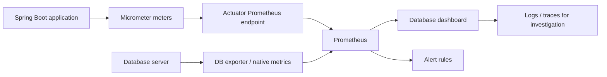

# Database Dashboard for Spring Boot

## 1. Objectives and Context

The database is often a critical dependency of a Spring Boot application. When response times climb, the cause may lie in slow queries, an exhausted connection pool, lock contention, an overloaded database, or the network between the application and the database. A good database dashboard enables operations teams to see these signals side by side, determine the blast radius, and move from symptoms to root cause.

The dashboard needs to combine application-side metrics with database server metrics. Spring Boot/Micrometer can provide connection pool, JDBC, and datasource observations depending on configuration; database exporters or dedicated monitoring systems provide CPU, disk, locks, replication, and transaction metrics. You should not infer database health from a single application-side meter alone.

This lesson belongs to the **Dashboard and Alert** chapter of the **SPRING_BOOT_OBSERVABILITY** module. The module guides you through setting up observability for Spring Boot using Micrometer Observation, metrics, logs, and distributed tracing; learning context propagation, tags/cardinality, exporters, sampling, and correlating signals to investigate errors, latency, and application behavior in production environments.

After this lesson, you will be able to:
1. Identify the essential panels for a database dashboard.
2. Monitor connection pool usage, pending threads, and timeouts.
3. Analyze query throughput, latency, and errors.
4. Combine application metrics with database server metrics.
5. Write PromQL for rates, saturation, and latency histograms.
6. Configure alerts based on symptoms, duration, and SLOs.
7. Avoid high cardinality and metric misinterpretation.

**Baseline:** Spring Boot 3.5.x, Java 17+, Actuator, Micrometer, and Prometheus. Connection pool examples use HikariCP (the common default pool for Spring Boot JDBC/JPA). Actual meter names depend on the pool, driver, registry, and version.

## 2. Which Questions Should a Database Dashboard Answer?

The dashboard should be organized around four questions:

| Question | Signal Group | What You Need to Know |
| --- | --- | --- |
| Can the application connect? | Connection pool, connection errors, DB health | Is the pool working; are timeouts rising? |
| Is the database processing fast enough? | Query latency, throughput, errors | Which queries are slow; are p95/p99 changing? |
| Are resources saturated? | Pool saturation, DB CPU, locks, I/O | Is the bottleneck in the application or the database? |
| Are users impacted? | Request latency, error rate, SLO | Which endpoints are affected by DB degradation? |

A dashboard should not be a collection of dozens of gauges without context. Panels need units, windows, labels, thresholds, and links to logs/traces.

## 3. Data Architecture



Application metrics describe what the application observes: pool usage, JDBC operations, and request impact. Database metrics describe server-side resources and engine behavior. Use both to locate the bottleneck at the right layer.

## 4. Enabling Datasource and Connection Pool Metrics

Spring Boot Actuator can auto-instrument datasources/connection pools when the corresponding dependencies and instrumentation are present. With HikariCP, meters typically have the `hikaricp.connections` prefix; JDBC datasource metrics may have the `jdbc.connections` prefix.

Example Prometheus registry and endpoint configuration:

```yaml
management:
  endpoints:
    web:
      exposure:
        include: health,prometheus
  metrics:
    enable:
      hikaricp: true
```

Not every project needs to declare `metrics.enable.hikaricp`; meter availability depends on binders and auto-configuration. Before writing queries, open `/actuator/prometheus` to verify the actual metric names and tags.

Key pool signals:

| Signal | Meaning | How to Read |
| --- | --- | --- |
| Active connections | Connections currently in use | Sustained levels near max can signal pool pressure |
| Idle connections | Ready connections | Zero is not automatically an error if active is low |
| Max connections | Pool limit | Used as the denominator for utilization |
| Pending/waiting threads | Threads waiting for a connection | Continuous growth indicates the pool cannot keep up |
| Connection timeout count | Failed connection acquisitions due to timeout | Increases are a direct symptom users may experience |

With Hikari, metric names typically include `hikaricp_connections_active`, `hikaricp_connections_idle`, `hikaricp_connections_max`, `hikaricp_connections_pending`, and `hikaricp_connections_timeout_total` after Prometheus naming conversion. Verify the actual exposition since versions/binders may differ.

## 5. Connection Pool Panels

### 5.1. Active / max connections

The panel should display active, idle, and max together. Absolute active shows how many connections are in use; the active/max ratio indicates utilization.

Illustrative PromQL:

```promql
hikaricp_connections_active
```

Utilization:

```promql
100 * hikaricp_connections_active
/ clamp_min(hikaricp_connections_max, 1)
```

If metrics have labels like `pool`/`instance`, keep the same label dimensions in both numerator and denominator. Use `clamp_min` to avoid division by zero when metrics are not yet present or the pool is not initialized.

### 5.2. Pending threads and timeouts

```promql
hikaricp_connections_pending
```

```promql
rate(hikaricp_connections_timeout_total[5m])
```

Sustained growth in pending threads is usually more significant than a brief spike. If active is near max, pending is climbing, and timeouts appear concurrently, the pool is likely saturated.

Do not increase max pool size immediately. A larger pool can send more concurrent work to the database and worsen server-side contention. Check query duration, transaction length, DB max connections, and replica count before tuning.

## 6. Query Throughput and Latency Panels

Datasource pool metrics alone do not tell you which query is slow. For query-level insight, you need JDBC instrumentation/Observation, custom timers, or database-native query statistics.

Panels to include:
- Query/operation rate by bounded operation name.
- Query duration p50/p95/p99 if histograms are enabled.
- Error/timeout rate by operation and outcome.
- Slow query count by threshold.
- Top query fingerprints by total time or execution count, if supported by the backend.

For example, a custom timer named `app.db.operation` with bounded tags `operation` and `outcome`. Illustrative Prometheus histogram query:

```promql
histogram_quantile(0.95,
  sum by (le, operation) (
    rate(app_db_operation_seconds_bucket[5m])
  )
)
```

Query rate:

```promql
sum by (operation) (rate(app_db_operation_seconds_count[5m]))
```

Error rate:

```promql
sum by (operation) (rate(app_db_operation_errors_total[5m]))
```

The metric names in this example are a custom application contract, not default meters guaranteed by Spring Boot. Standardize and document the schema before building dashboards.

## 7. Combining Database Server Metrics

To pinpoint bottlenecks, combine application and database server metrics:

| Database Signal | Operational Meaning | Signs to Investigate |
| --- | --- | --- |
| CPU utilization | CPU usage of the DB host/instance | High CPU alongside rising query latency |
| Active sessions/connections | Workload running on the DB | High sessions, rising wait events |
| Lock waits/deadlocks | Transaction contention | Latency/error spikes by table/operation |
| Buffer/cache hit ratio | Engine cache efficiency | Rising disk reads and rising latency |
| Disk IOPS/latency | Storage pressure | Slow queries even when the pool is not saturated |
| Replication lag | Replica delay | Read-after-write issues or stale reads |
| Transaction/log growth | Transaction log/WAL pressure | Storage growth, slow checkpoints/commits |

Metrics and naming depend on the engine (PostgreSQL, MySQL, SQL Server, Oracle) and exporter. Do not apply the same threshold to every database engine or workload.

## 8. Recommended Dashboard Layout

### Row 1 — User impact
- Request rate, error rate, and p95/p99 latency of endpoints using the database.
- SLO burn rate if the service has latency/availability SLOs.

### Row 2 — Application connection pool
- Active/idle/max connections.
- Pool utilization percentage.
- Pending threads.
- Connection timeout rate.

### Row 3 — Database operations
- Query rate by operation.
- p95/p99 query duration.
- Query errors/timeouts.
- Slow query count or top fingerprints.

### Row 4 — Database server
- CPU, memory, disk latency/IOPS.
- Active sessions, lock waits/deadlocks.
- Cache hit ratio and replication lag if applicable.

### Row 5 — Diagnostics
- Links to logs by service/instance/traceId.
- Traces with slow database spans.
- Deployment annotations and database failover events.

Provide dashboard variables for environment, service, instance, pool, and database cluster. Only expose a tenant filter when the storage/query backend enforces appropriate authorization.

## 9. Alert Design

Alerts should be based on meaningful symptoms and require action. Examples:

| Alert | Illustrative Condition | Meaning |
| --- | --- | --- |
| Pool saturation | Utilization > 90% for 5 minutes and pending > 0 | Sustained connection pressure |
| Connection timeouts | Timeout rate > 0 for 2–5 minutes | Requests may be failing to acquire connections |
| Query latency | p95 exceeds SLO for 5 minutes | Slow DB operations impacting requests |
| Query errors | Error ratio exceeds threshold for 5 minutes | Query/connection failures increasing |
| Database unavailable | Health check DOWN continuously | Dependency unable to serve |
| Replication lag | Lag exceeds freshness objective | Read replicas may be stale |

Thresholds are only starting points. Choose thresholds based on baselines, traffic, SLOs, database engine, and load capacity. Use a `for` duration to avoid alerting on brief spikes.

### 9.1. Example Prometheus alert rules

```yaml
groups:
  - name: database-observability
    rules:
      - alert: HikariPoolSaturated
        expr: |
          (hikaricp_connections_active
           / clamp_min(hikaricp_connections_max, 1)) > 0.9
          and hikaricp_connections_pending > 0
        for: 5m
        labels:
          severity: warning
        annotations:
          summary: Hikari connection pool is saturated

      - alert: HikariConnectionTimeouts
        expr: rate(hikaricp_connections_timeout_total[5m]) > 0
        for: 2m
        labels:
          severity: critical
        annotations:
          summary: Application cannot acquire database connections
```

Alert expressions must be adjusted to match actual labels and metric names. When running multiple replicas, decide whether to alert per instance/pool or aggregate by service so an unhealthy instance is not masked.

## 10. Cardinality and Sensitive Data

Do not use the following values as labels:
- Raw SQL statements or SQL parameter values.
- User IDs, high-cardinality tenant IDs, emails, or account numbers.
- Raw URLs/query strings, exception messages.
- Transaction IDs or trace IDs.

Prefer normalized operation names/query fingerprints with bounded value sets. Query fingerprints also require a policy to avoid exposing sensitive table/column names.

Database dashboards are often shared across multiple teams. Restrict access to dashboards, logs, and traces; do not allow panels to display raw SQL/bind values without controls.

## 11. Investigating a Typical Incident

Suppose API p95 rises from 120 ms to 1.8 s:

1. The user impact row shows only endpoints calling the database are slow.
2. The pool panel shows active connections hitting max and pending threads rising.
3. The query latency panel shows `order.search` p95 spiking sharply.
4. The database panel shows rising lock waits while CPU is not high.
5. Open a sample trace to find the slow query span; open logs by `traceId` to see the operation context.
6. Check recent deployments/query plan/transaction changes and the lock holder.

This chain of evidence separates a pool sizing issue from a query/locking issue. Simply increasing pool max might push even more concurrency onto the database while lock contention persists.

## 12. Testing Dashboards and Metrics

Before publishing a dashboard:
1. Call `/actuator/prometheus` and verify actual meter names/tags.
2. Generate workloads covering connection acquisition, query success, query error, and timeout.
3. Verify Counters increment and Timers/histograms have buckets when configured.
4. Check that PromQL returns expected results for a sample window.
5. Test pool utilization when the pool is idle, active, and saturated.
6. Test alert firing/resolution using synthetic metrics or rule tests.
7. Verify labels do not contain IDs, raw SQL, PII, or secrets.
8. Verify dashboard variables and access permissions.

Do not assert absolute p95 numbers in unit tests where execution timing depends on the machine. Test metric semantics and use load tests/production baselines to evaluate thresholds.

## 13. Troubleshooting

| Symptom | Possible Cause | Resolution |
| --- | --- | --- |
| No Hikari metrics | Not using Hikari, binder not registered, or datasource not initialized | Check pool implementation and endpoint exposition |
| Active exceeds max or abnormal ratio | Query labels mismatched or wrong aggregation | Keep consistent dimensions and inspect raw series |
| High pending but low DB CPU | Lock waits, long transactions, or pool leak | Inspect DB waits, transactions, and connection lifecycle |
| High query latency but normal pool | Slow DB execution, network, or result mapping | Open traces and DB-native query stats |
| Timeouts rising without higher query rate | Connection leak, DB unavailable, or max connections reached | Check pool leak detection and DB connection limits |
| Empty dashboard after version upgrade | Meter name/tag schema changed | Inspect endpoint and update queries |
| p95 has no data | Histogram buckets not enabled or low traffic | Enable histograms selectively; check sample count |
| Alert always firing | Inappropriate threshold or metric labels span many series | Cross-check baseline and aggregate at the right scope |
| Alert not firing despite exhausted pool | Pending/timeout metric not scraped or wrong query | Test rule with sample data and check target health |
| One failing replica hidden by average | Dashboard only aggregates service-wide | Add per-instance panels/alerts |
| Dashboard exposes SQL/PII | Labels or logs contain raw values | Normalize tags and enforce access controls |

## 14. Production Checklist

- [ ] Dashboard has user-impact, pool, query, and database-server panels.
- [ ] Pool active/idle/max/pending/timeout metrics are scraped.
- [ ] Query latency/throughput/error metrics use stable operation names.
- [ ] Histograms are enabled only for latency metrics requiring percentiles.
- [ ] Database exporter provides appropriate CPU, locks, I/O, and replication signals.
- [ ] PromQL uses labels verified from actual exposition.
- [ ] Alerts include duration, severity, owner, and runbook.
- [ ] Per-instance view exists to detect a single saturated replica.
- [ ] No raw SQL, bind values, PII, or high-cardinality IDs in labels.
- [ ] Dashboard and diagnostic links have access control.
- [ ] Dashboard tested against success, error, timeout, and saturation scenarios.

## 15. Self-Study Questions

1. Why do we need to combine application metrics with database server metrics?
2. What do sustained active connections near max indicate?
3. How do pending threads differ from connection timeout count?
4. Why does increasing max pool size not always solve a bottleneck?
5. Which Hikari/JDBC metrics can Spring Boot expose?
6. Why does query-level latency require separate instrumentation?
7. How do histogram buckets support p95/p99 in Prometheus?
8. Which database server signals help identify lock/storage pressure?
9. Which signal should a pool saturation alert combine with utilization?
10. Why does a dashboard need a per-instance view?
11. Which label values should be avoided in database metrics?
12. How do you test PromQL and alerts before production?

## References

- [Spring Boot 3.5 — DataSource Metrics](https://docs.spring.io/spring-boot/3.5/reference/actuator/metrics.html)
- [Spring Boot 3.5 — Prometheus Endpoint](https://docs.spring.io/spring-boot/3.5/reference/actuator/metrics.html#actuator.metrics.export.prometheus)
- [Micrometer — JVM and Database Metrics](https://docs.micrometer.io/micrometer/reference/reference/jvm.html)
- [Micrometer — Timers](https://docs.micrometer.io/micrometer/reference/concepts/timers.html)
- [Prometheus — Querying Basics](https://prometheus.io/docs/prometheus/latest/querying/basics/)
- [Prometheus — Histograms](https://prometheus.io/docs/practices/histograms/)
- [Grafana — Dashboards](https://grafana.com/docs/grafana/latest/dashboards/)
