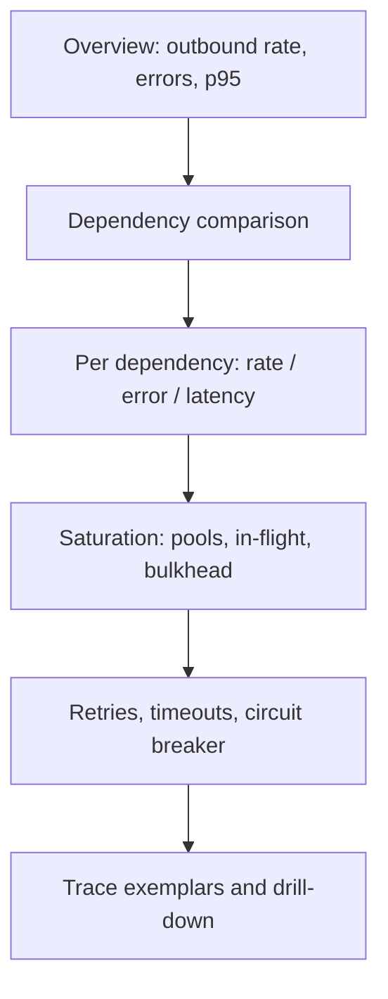

# External Calls Dashboard in Spring Boot

An external calls dashboard tracks outbound calls from Spring Boot to HTTP APIs, database clients, message brokers, and internal services. The dashboard helps identify slow or failing dependencies, request rates, retries, circuit breakers, and their impact on end-to-end latency.

In the **SPRING_BOOT_OBSERVABILITY** module, this dashboard connects Micrometer metrics with distributed traces to investigate individual requests. This lesson belongs to the **Dashboard and Alert** chapter and focuses on traffic, error rate, duration, saturation, SLOs, PromQL, drill-down, cardinality, and alert testing.

## 1. Dashboard Objectives

The dashboard must answer:
- Which dependency receives the most outbound calls?
- Are error and timeout rates increasing for any dependency?
- Are p95/p99 latencies exceeding budget?
- Are retries multiplying request volume?
- Are connection pools or bulkheads saturated?
- Are circuit breakers closed, open, or half-open?
- Is a slow dependency pulling up inbound API latency?
- Are there sample traces available to pinpoint the exact cause?

Looking at total service latency alone is not enough to identify which dependency is causing the problem. You must distinguish between caller errors, client/network issues, and downstream issues.

## 2. Dependency and Operation Inventory

Catalog HTTP clients, JDBC/R2DBC, Kafka/RabbitMQ producers, RPC clients, caches, identity/payment/search services, and external SDKs.

Each dependency needs a stable logical name, such as `inventory`, `payment`, `identity`, or `orders-db`. Do not use dynamic hostnames, full URLs, or IPs as default metric dimensions.

| Dimension | Example | Rule |
| --- | --- | --- |
| dependency | inventory | Stable logical name |
| operation | inventory.lookup | Normalized name |
| client type | webclient, jdbc, kafka | Bounded set of values |
| destination | inventory-api | Must not contain dynamic hosts |
| outcome | success, error, timeout | Bounded set of values |
| HTTP method | GET, POST | Low cardinality |
| status class | 2xx, 4xx, 5xx | Easy to aggregate |
| raw URL/query | URL containing order/user ID | Do not use as metric tag |
| request/trace ID | UUID | Do not use as metric tag |

A dependency can have multiple operations. Tracking both dependency and operation helps pinpoint which endpoint within a service is slow.

## 3. Core Metric Set

| Group | Metrics | Question |
| --- | --- | --- |
| Traffic | Calls/sec, requests by dependency/operation | Where is traffic going? |
| Errors | Error rate, timeout rate, retry/failure count | Is the dependency failing? |
| Duration | p50/p95/p99, max/long-running calls | How slow is it? |
| Saturation | In-flight, pool pending, connection usage | Is the client running out of resources? |

Actual metric names depend on instrumentation and client libraries. Spring Boot/Micrometer may name meters and tags differently across versions/implementations. List available meters and verify tags before writing queries.

### 3.1. RED method

RED stands for:
- **Rate:** number of calls per unit of time.
- **Errors:** proportion of failed calls.
- **Duration:** distribution of completion times.

Apply RED individually to each dependency/operation. Combine with saturation to understand why a client cannot serve additional calls.

## 4. Dashboard Layout



### 4.1. Overview row

Place at the top of the dashboard: total outbound calls/sec, total error/timeout rate, p95 outbound duration, count of degraded dependencies/open circuits, retry rate or retry amplification, and SLO status/burn rate if applicable.

### 4.2. Dependency comparison row

Use a table or time series grouped by dependency: rate, error percentage, p95/p99 duration, timeout count, retry count, and circuit breaker state. Sort by error rate or latency to spot anomalous dependencies.

### 4.3. Dependency detail row

When a dependency is selected, display calls/sec by operation, error rate by outcome/status class, latency histogram, in-flight calls, pool/bulkhead usage, retry attempts, timeouts, circuit transitions, and exemplars linking to traces.

## 5. Traffic and Error Rate

Increased traffic can overload a dependency; a sudden drop in traffic can indicate an open circuit breaker or a routing failure.

PromQL example by dependency:

```promql
sum by (dependency) (rate(outbound_client_requests_total[5m]))
```

Error ratio:

```promql
sum by (dependency) (rate(outbound_client_requests_total{outcome="error"}[5m]))
/
sum by (dependency) (rate(outbound_client_requests_total[5m]))
```

The metric name and labels `dependency`/`outcome` are an illustrative schema. Replace them with actual meters and tags.

### 5.1. Error classification

Separate timeouts, connection refused/unavailable, DNS/TLS/network errors, HTTP 5xx, HTTP 4xx per business contract, serialization errors, pool acquisition timeouts, and circuit breaker rejections.

Do not treat every 4xx as a dependency outage. For example, 400/404 may be valid responses under the API contract.

## 6. Latency and Histograms

Latency must be viewed as a distribution. Averages can mask a cohort of very slow requests. Use histogram buckets to calculate quantiles in backends supporting Prometheus.

p95:

```promql
histogram_quantile(
  0.95,
  sum by (le, dependency) (
    rate(outbound_client_request_duration_seconds_bucket[5m])
  )
)
```

p99:

```promql
histogram_quantile(
  0.99,
  sum by (le, dependency) (
    rate(outbound_client_request_duration_seconds_bucket[5m])
  )
)
```

Metric names are illustrative; verify whether the actual timer/histogram exports buckets. If only summaries/client-side percentiles exist, queries and aggregation capabilities will differ.

### 6.1. Choosing buckets aligned with SLOs

If a dependency's timeout budget is 500 ms, the histogram should have sufficient resolution around that region, such as 100, 200, 300, 500 ms, and appropriate higher tiers. Choose boundaries based on latency distribution/SLOs. Many buckets increase the number of time series.

## 7. Comparing Outbound and Inbound Latency

Place HTTP server request duration, outbound client duration by dependency, database query duration, queue/pool wait, and total request rate/error rate side by side.

If inbound p95 rises at the same time `payment` client p95 rises, that is a signal to drill down—not yet proof that all duration adds directly. There may be concurrency, retries, or async execution.

Traces show timing and parent-child relationships between spans, confirming whether the dependency call lies on the critical path.

## 8. Retry Amplification and Timeouts

Retries can improve reliability during transient faults, but they increase outbound traffic when a dependency is weak. Monitor logical operations/sec, actual attempts/sec, retry attempts per operation, timeout rate, retry exhaustion, and cancelled calls.

```text
retry_amplification = actual_attempts / logical_operations
```

If one logical operation generates an average of 3 attempts, the dependency can receive three times the business load. Distinguish logical calls from network attempts if instrumentation provides both.

### 8.1. Timeout budget

Outbound timeouts must fit within the inbound latency budget. If the total request budget is 2 seconds, do not give each sequential dependency a 2-second timeout without accounting for cumulative time and retries.

## 9. Circuit Breakers and Bulkheads

If using Resilience4j or an equivalent mechanism, the dashboard should show circuit breaker state, failure/slow-call rate, calls rejected, buffered/permitted calls in half-open, bulkhead available/max concurrent calls, bulkhead rejections, and state transitions.

An open circuit breaker can cause the outbound call rate to drop while the rejection count climbs. Looking only at downstream request rate might mislead operators into thinking traffic dropped naturally.

Use stable breaker names by dependency/operation; do not generate dynamic names per user/request.

## 10. Connection Pool and In-Flight Saturation

A dependency can appear slow due to a client-side pool before a request ever reaches downstream:
- HTTP connection pool pending/acquired/idle.
- JDBC/R2DBC pool acquired/idle/pending.
- Max connections and acquire timeouts.
- In-flight requests.
- Event-loop/thread saturation.

If pool pending increases while downstream server latency does not rise correspondingly, the bottleneck may be in the client pool. If acquired is near max, pending rises, and acquire timeouts occur, inspect pool sizing, connection lifecycle, and connection hold times.

Do not just increase max pool size based on the dashboard. Dependencies have connection limits, and increasing concurrency can overload downstream further.

## 11. Exemplars and Drill-Down to Traces

Metrics dashboards show aggregate trends; traces show which dependencies a specific request traversed and where time was spent. If the backend supports exemplars, sample Trace IDs can be attached to histogram observations.

The dashboard should support clicking from a dependency/latency panel to a trace exemplar, filtering traces by service/operation/outcome, comparing successful/failed calls, inspecting timeout/retry/downstream span attributes, and determining whether a dependency call is on the critical path or runs in parallel.

Do not add Trace ID as a metric label. Use exemplars or trace links to connect metrics with traces without causing cardinality explosion.

### 11.1. How sampling affects drill-down

If traces are sampled out, the dashboard still has metrics, but there may be no matching trace. Set a sampling policy that retains enough samples for investigation; prioritize error/slow traces if a tail-sampling architecture is supported. Metrics still need to cover all traffic to compute error rates and SLOs.

## 12. PromQL for Common Panels

The following queries are examples with hypothetical metric names/tags. Replace them with actual meters after checking Actuator or Prometheus scrapes.

Outbound rate:

```promql
sum by (dependency) (
  rate(outbound_client_requests_total[5m])
)
```

Error percentage:

```promql
100 *
sum by (dependency) (
  rate(outbound_client_requests_total{outcome="error"}[5m])
)
/
sum by (dependency) (
  rate(outbound_client_requests_total[5m])
)
```

p95 duration:

```promql
histogram_quantile(
  0.95,
  sum by (le, dependency) (
    rate(outbound_client_request_duration_seconds_bucket[5m])
  )
)
```

Timeout rate:

```promql
sum by (dependency) (
  rate(outbound_client_requests_total{error_type="timeout"}[5m])
)
```

Retry attempts:

```promql
sum by (dependency) (
  rate(outbound_client_retry_attempts_total[5m])
)
```

In-flight calls:

```promql
sum by (dependency) (outbound_client_requests_in_flight)
```

Do not copy queries before verifying metric names, label names, counter/gauge semantics, and histogram buckets. Syntactically valid queries with wrong metric semantics will still produce misleading dashboards.

## 13. Alerting from the External Calls Dashboard

Dashboards are for exploration; alerts must fire on symptoms impacting users or SLOs. Avoid alerting on a single failed request.

Alerts can consider: error ratio exceeding threshold over a sufficiently long window with minimum traffic, p95/p99 exceeding the dependency latency budget, steadily rising timeout rate, circuit breaker open for too long, rising pool pending/acquire timeouts, retry amplification exceeding threshold, and outbound errors driving up inbound SLO burn rate.

### 13.1. Alerts with a traffic guard

An error ratio on a single request can be 100%, which is not worth paging for if it was just a test call. Combine error ratio with a minimum request rate/count or an absolute error count within the window.

### 13.2. SLO and burn rate

If a dependency has an availability or latency SLO, use error budget burn rate to detect sustained violations. Payment/auth have different criticality than analytics/recommendation.

Alert annotations should state dependency, operation, observed rate/latency, dashboard link, and runbook. Do not put payloads, user IDs, or raw queries in alert labels.

## 14. Cardinality and Naming

Dimensions should be stable: dependency alias, operation name/template, HTTP method, status class, and normalized exception category.

Do not use full URLs, dynamic hostnames, IPs, request IDs, user IDs, message IDs, exception messages, or raw SQL as labels. If there are many dynamic destinations, group by service class or logical dependency.

## 15. Designing Dashboards by Role

| User | Question | Appropriate Panels |
| --- | --- | --- |
| On-call | Which dependency is degrading the service? | Overview, errors, p95, circuit state |
| Service owner | Which operations are frequently slow? | Per-dependency/operation latency |
| Platform team | Are clients/pools/Collectors saturated? | In-flight, pools, exporter health |
| SRE | Are SLOs/burn rate impacted? | Error budget, latency SLO |
| Developer | Where is a specific request slow? | Exemplars and trace drill-down |

Keep the main dashboard concise; put detailed panels in a separate dependency dashboard. Use dashboard variables for allowlisted service, environment, and dependency values.

## 16. Troubleshooting the External Calls Dashboard

| Symptom | Possible Cause | How to Check |
| --- | --- | --- |
| Dependency missing | Client instrumentation disabled or meter not yet created | Exercise client path and check registry |
| Rate is 0 despite successful requests | Wrong metric name/tag or instrumentation bypassed | Check actual meters |
| Error ratio abnormally high | Valid 4xx counted as errors | Check outcome classification |
| p95 increases while average stays flat | Tail latency on a subset of requests | Inspect histogram and traces |
| Outbound rate multiplies | Retry amplification or duplicate calls | Compare logical operations vs. attempts |
| Circuit open while rate drops | Calls rejected before hitting network | Check breaker state/rejection count |
| Pool pending increases | Client pool saturation | Compare acquired/idle/max/acquire timeout |
| Inbound p95 rises with downstream p95 | Dependency may be on the critical path | Drill down into trace spans |
| No exemplars | Sampling or missing exemplar support/config | Check tracing/export/backend |
| Series count explodes | Dynamic URL/IDs/hosts used as labels | Check top-cardinality labels |
| False positive alerts | Low traffic or short window | Add a traffic guard |
| PromQL returns no data | Wrong counter/gauge/histogram semantics or labels | Inspect metric metadata |
| Retry alert mismatch | Metric counts logical calls instead of attempts | Verify instrumentation boundary |
| Latency exceeds budget while breaker stays closed | Different threshold/state policies | Cross-check breaker configuration |

### Investigation workflow

1. Select the affected service, environment, and dependency.
2. Confirm meter names, tags, and metric types.
3. Compare outbound rate, error ratio, and p95/p99.
4. Check timeouts, retry attempts, and circuit breaker state.
5. Check in-flight calls, pool usage, and acquire latency.
6. Compare against inbound request latency/error rate.
7. Open exemplars/traces to confirm the dependency is on the critical path.
8. Check downstream status, network errors, and server-side metrics.
9. Review cardinality and query correctness.
10. Evaluate alert thresholds against traffic volume and SLOs.

## 17. Hands-on Exercise: Building an External Calls Dashboard

The goal is to monitor an inventory API and a payment API while linking metrics to traces.

### Preparation

- A Spring Boot service with HTTP client instrumentation.
- A Micrometer registry and Prometheus/Grafana or an equivalent backend.
- A Micrometer Tracing exporter and a trace backend.
- Two lab dependencies capable of generating controlled latency/errors.
- Stable operations such as inventory lookup and payment authorize.

### Step 1 — Inspect meters

Invoke each dependency at least once. List Actuator metrics and identify the actual timers/counters, tags, and histogram buckets.

### Step 2 — Normalize dependency names

Assign stable aliases for `inventory` and `payment`. Verify raw hosts, URLs, query strings, and request IDs do not become metric labels.

### Step 3 — Create overview panels

Add total outbound rate, error ratio, p95 duration, and count of open circuit breakers. Use the same time range and refresh interval.

### Step 4 — Create a comparison table

Group by dependency to compare rate, errors, p95/p99, and retry rate. Sort by the highest-priority symptom.

### Step 5 — Add latency panels

Configure histogram buckets aligned with dependency SLOs. Create p95/p99 queries and verify results against histogram data.

### Step 6 — Add saturation panels

Display in-flight calls, HTTP/database pool pending/acquired, and bulkhead rejections if applicable.

### Step 7 — Add retry/breaker panels

Track attempts, timeouts, and circuit state. Distinguish logical operations from individual network attempts.

### Step 8 — Link traces

Enable exemplars or trace links. Send requests through `inventory`/`payment` and verify you can drill down from metrics to traces.

### Step 9 — Create alert rules

Simulate latency/error spikes. Add a traffic guard, duration window, and annotations with dependency/runbook context.

### Step 10 — Test cardinality

Send requests with many different IDs/URLs under the same operation templates. Verify series counts do not grow with identifiers.

### Acceptance checklist

| What to Prove | Expected Outcome |
| --- | --- |
| Inventory | List of dependencies and operations exists |
| Traffic | Calls/sec by dependency |
| Errors | Error/timeout ratio with correct semantics |
| Latency | p50/p95/p99 from appropriate histograms |
| Saturation | In-flight, pool, and bulkhead metrics |
| Retries | Logical calls distinguished from attempts |
| Circuit breaker | State/rejection transitions displayed |
| Correlation | Exemplar/trace drill-down works |
| Cardinality | No dynamic URLs/IDs in metric tags |
| Alerts | Traffic guard and SLO-aware thresholds included |
| Privacy | No payloads/PII placed in labels |
| Validation | Queries verified against actual meters |

## 18. Principles to Remember

1. **Track outbound calls by stable dependency and operation.** Do not use dynamic URLs/hostnames/IDs as metric dimensions.
2. **Use RED and saturation.** Rate, errors, duration, and pool/in-flight signals reveal both symptoms and resource pressure.
3. **Use histograms for tail latency.** Choose buckets aligned with SLOs and control series cost.
4. **Distinguish logical calls from retry attempts.** Retry amplification can overload downstream systems.
5. **Observe circuit breakers and pools.** A dropping rate may be due to calls rejected before the network; rising pending may indicate client-side saturation.
6. **Place outbound latency alongside inbound latency.** Use traces to confirm whether a dependency lies on the critical path.
7. **Use exemplars/trace links instead of Trace ID metric labels.** Keep cardinality low while preserving drill-down.
8. **Alert on symptoms, traffic, and SLOs.** Avoid paging on a single error during low traffic.
9. **Verify metric semantics before writing PromQL.** Counters, gauges, histograms, and tags must match the query.
10. **Test dashboards with fault injection.** Create latency, timeout, retry, and circuit-open scenarios to prove panels and alerts react accurately.

An external calls dashboard helps operators identify which dependency is slowing down or failing a Spring Boot service, and whether retries, pool saturation, and circuit breakers are amplifying the incident. When metrics are grouped by stable dependency/operation, latency is measured with histograms, alerts tie to SLOs, and traces support drill-down, the dashboard becomes an actionable investigation tool rather than just a collection of charts.
