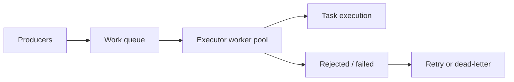
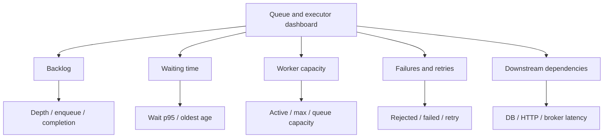

# Queue and Executor Dashboard in Spring Boot

Queues and executors determine an application's ability to absorb load and execute asynchronous work. A queue holds pending tasks; an executor picks up tasks and runs them on worker threads. When the enqueue rate exceeds the processing rate, queue depth and queue age increase. When the worker pool saturates, active threads hit their limit and tasks wait longer or get rejected.

The dashboard must answer: is the backlog growing or shrinking, how long has the oldest task been waiting, do workers still have capacity, is throughput keeping up with ingress, and are any tasks being rejected or timing out? **Queue depth alone is not enough to assess health**: a small, rapidly growing queue whose task age exceeds SLA can be more dangerous than a large queue that is draining.

The lesson **"Queue and Executor Dashboard"** belongs to the **Dashboard and Alert** chapter of the **SPRING_BOOT_OBSERVABILITY** module. The module guides you through setting up observability for Spring Boot using Micrometer Observation, metrics, logs, and distributed tracing; learning context propagation, tags/cardinality, exporters, sampling, and correlating signals to investigate errors, latency, and application behavior in production environments.

## 1. Distinguishing Queues and Executors

- A queue receives and holds work waiting to be processed.
- An executor manages worker threads that execute tasks.
- A producer/enqueuer creates work.
- A consumer/worker picks up, executes, and completes tasks.
- Rejection occurs when the executor cannot accept more tasks according to its policy.
- Retries or dead-letter handling may introduce additional queues and processing flows.



With a message broker, queue depth may come from broker-native metrics; with an in-process executor, queue size comes from `ThreadPoolExecutor` or corresponding instrumentation. Do not merge both sources into a single metric if their semantics differ.

## 2. Questions the Dashboard Must Answer

| Group | Question |
| --- | --- |
| Backlog | How many tasks are waiting? Is the backlog growing or shrinking? |
| Waiting time | How long do tasks wait before starting? How old is the oldest task? |
| Processing capacity | How many active/idle workers does the executor have? What is current throughput? |
| Failure and saturation | Are tasks being rejected, timing out, retrying, or failing? |

Order panels from symptom to cause: backlog and age first, throughput next, then pool utilization/rejections. On-call engineers need to see which service has a dangerous backlog and whether the cause lies in consumer capacity or a downstream dependency.

## 3. Queue Metrics to Track

| Metric | Meaning | How to Use |
| --- | --- | --- |
| queue depth/size | Number of waiting tasks | View current backlog |
| enqueue rate | Tasks added per second | Measure ingress |
| dequeue/start rate | Tasks started per second | Measure worker pickup rate |
| completion rate | Tasks completed per second | Measure throughput |
| oldest task age | Age of the longest-waiting task | Detect starvation |
| queue wait duration | Time from enqueue to execution start | Measure wait latency |
| rejected/dropped count | Tasks not accepted or dropped | Detect capacity/policy failures |
| retry count | Number of task retry attempts | Identify recurring failures |

Not every queue abstraction provides all metrics out of the box. For brokers, use native queue depth/consumer lag/oldest message age when available. For in-memory queues, instrument enqueue/dequeue and task creation timestamps.

## 4. Executor Metrics to Track

| Metric | Meaning |
| --- | --- |
| pool size | Current number of worker threads |
| core/max pool size | Configured limits |
| active threads | Workers currently executing tasks |
| queue size | Tasks waiting in the executor queue |
| remaining queue capacity | Remaining slots if the queue is bounded |
| completed task count | Total completed tasks |
| task rejection count | Rejected tasks |
| task execution duration | Time workers spend executing |
| task wait duration | Time tasks spend in the queue |
| task failure count | Tasks ending with errors |

Sustained active threads near max alongside queue growth is a sign of saturation. A large pool size alone does not prove capacity; cross-check CPU, downstream latency, task blocking, and rejection policy.

## 5. Instrumenting ThreadPoolTaskExecutor

Spring provides `ThreadPoolTaskExecutor` to configure executors. You can expose the executor as a bean and register gauges for pool/queue state.

```java
@Configuration
public class WorkerConfiguration {

    @Bean
    ThreadPoolTaskExecutor orderExecutor() {
        ThreadPoolTaskExecutor executor = new ThreadPoolTaskExecutor();
        executor.setThreadNamePrefix("order-worker-");
        executor.setCorePoolSize(8);
        executor.setMaxPoolSize(16);
        executor.setQueueCapacity(200);
        executor.setRejectedExecutionHandler(
                new ThreadPoolExecutor.AbortPolicy());
        executor.initialize();
        return executor;
    }
}
```

You can bind executor metrics using Micrometer `ExecutorServiceMetrics` or instrumentation matching your Spring Boot/Micrometer version. For example:

```java
ExecutorServiceMetrics.monitor(
        registry,
        executor.getThreadPoolExecutor(),
        "order.executor",
        Tags.of("executor", "order")
);
```

Specific API overloads depend on the Micrometer version; check current Javadoc and auto-configuration. Do not bind the same executor multiple times, as that can create duplicate meters or registration conflicts.

Metric names are normalized by the registry. Inspect actual meters in Actuator or registry tests before writing dashboard queries.

## 6. Queue Metrics for In-Process Work Queues

For a `BlockingQueue` or custom queue abstraction, you can register Gauges for queue size and remaining capacity. Gauges should reference a stable queue instance and be registered once at application startup.

```java
@Bean
MeterBinder orderQueueMetrics(BlockingQueue<OrderTask> orderQueue) {
    return registry -> {
        Gauge.builder("order.queue.size", orderQueue, BlockingQueue::size)
                .tag("queue", "orders")
                .register(registry);

        Gauge.builder("order.queue.remaining", orderQueue,
                BlockingQueue::remainingCapacity)
                .tag("queue", "orders")
                .register(registry);
    };
}
```

Queue size is a snapshot at scrape time. It does not indicate the rate of growth/drain or task age. To measure queue wait/oldest age, record the enqueue timestamp and record duration when a worker starts.

Do not create Gauges per task or per tenant. A stable queue identity with bounded tag values is usually sufficient.

## 7. Measuring Queue Wait Duration

Queue wait duration is the time from when a task is enqueued until a worker begins processing it. It is distinct from task execution duration.

Attach the enqueue timestamp to the task envelope:

```java
record QueuedTask<T>(T payload, long enqueuedAtNanos) {
    static <T> QueuedTask<T> of(T payload) {
        return new QueuedTask<>(payload, System.nanoTime());
    }
}
```

When a worker picks up the task:

```java
long waitedNanos = System.nanoTime() - task.enqueuedAtNanos();
queueWaitTimer.record(waitedNanos, TimeUnit.NANOSECONDS);
```

Use a monotonic clock like `System.nanoTime` for elapsed duration within the same process; do not subtract wall-clock timestamps because the system clock can be adjusted. For queues across brokers or multiple hosts, timestamps require clock synchronization and clear semantics.

## 8. Throughput and Backlog Trends

The dashboard should display ingress, starts, and completions together:

- Enqueue rate higher than completion rate: backlog tends to grow.
- Completion rate higher than enqueue rate: backlog can drain.
- Stable queue depth while oldest age climbs: possible task starvation or stuck tasks.
- High dequeue rate but low completion rate: workers pick up tasks but process slowly or fail.
- High retry rate: useful throughput may be lower than attempt count.

Do not compare raw counter values across process restarts. Use `rate`/`increase` over a time window and let the query engine handle counter resets.

## 9. PromQL for the Dashboard

Exact metric names depend on the registry and naming conventions. The following queries illustrate hypothetical metric names verified in Prometheus.

Queue depth:

```promql
order_queue_size{queue="orders"}
```

Queue enqueue rate:

```promql
sum(rate(order_queue_enqueued_total{queue="orders"}[5m]))
```

Completion throughput:

```promql
sum(rate(order_tasks_completed_total{queue="orders"}[5m]))
```

Task rejection rate:

```promql
sum(rate(order_executor_rejected_total{executor="order"}[5m]))
```

Executor active utilization:

```promql
order_executor_active_threads{executor="order"}
/
order_executor_max_threads{executor="order"}
```

Queue capacity utilization:

```promql
order_executor_queue_size{executor="order"}
/
(
  order_executor_queue_size{executor="order"}
  +
  order_executor_queue_remaining{executor="order"}
)
```

If the queue is unbounded or remaining capacity is not provided, do not use this capacity utilization formula. Use depth, oldest age, and throughput trends instead.

## 10. Recommended Dashboard Layout

A queue/executor dashboard can be divided into rows:

1. **Overview:** queue depth, oldest age, enqueue/completion rate, rejection rate.
2. **Queue health:** depth per queue, wait duration p50/p95/p99, oldest task age, retries/drops.
3. **Executor capacity:** active/max threads, pool size, queue occupancy, completed/rejected.
4. **Task performance:** execution duration, failure rate, downstream wait/latency.
5. **Dependencies:** DB/HTTP latency, connection pool pressure, circuit breaker state.
6. **Operational context:** deploy version, instance, recent restarts, and scaling events.



Use dashboard variables for service, environment, queue, and executor names. Avoid making instance a default dimension on every panel if replica count is large; keep an aggregate view first and drill down by instance when needed.

## 11. Alerts for Growing Backlog and Task Age Thresholds

Alerts should reflect impact, not just an instantaneous value.

Backlog growth:

```promql
(
  sum(rate(order_queue_enqueued_total[5m]))
  -
  sum(rate(order_tasks_completed_total[5m]))
) > 0
```

This condition only shows that ingress exceeds completion within the window; combine it with queue depth or oldest age to avoid alerting when queue depth is still low and brief bursts are normal.

Queue age:

```promql
order_queue_oldest_task_age_seconds{queue="orders"} > 300
```

Executor rejection:

```promql
increase(order_executor_rejected_total{executor="order"}[5m]) > 0
```

The 300-second threshold is an example only; set it according to business SLA/task deadlines. For rejection counters, use `increase`/`rate` and configure a `for` duration if needed to avoid alerting on a single handled event.

## 12. Saturation Alerts Need Multiple Signals

Do not alert solely because `active threads = max` in a single scrape. A pool can hit max briefly without impacting users.

Saturation alerts should combine sustained high active/max utilization, rising queue depth/occupancy, queue wait p95 exceeding SLO, rising rejection rates, completion throughput falling behind enqueue rate, and downstream latency/errors.

Utilization example:

```promql
(
  order_executor_active_threads{executor="order"}
  /
  order_executor_max_threads{executor="order"}
) > 0.9
```

Combine with queue growth and wait latency in the alert rule group. Choose a `for` duration suited to the workload to avoid alerting on short spikes.

## 13. Capacity Planning from Little's Law

Little's Law relates average work in the system, throughput, and residence time:

\[
L = \lambda W
\]

Where `L` is the average number of tasks in the queue/system, `λ` is the average throughput (tasks/second), and `W` is the average time in the system (seconds).

For example, if workers process an average of 40 tasks/second and average wait + service time is 2 seconds, the average number of tasks in the system is approximately 80. This is a steady-state relationship; do not use it to infer maximum capacity when the system is overloaded or arrival/service rates fluctuate wildly.

Executor sizing also requires factoring in CPU cores, blocking ratio, downstream concurrency limits, task duration distribution, and queue wait SLOs. Increasing queue capacity only absorbs bursts longer; it does not increase processing capacity and can worsen latency.

## 14. Backpressure and Rejection Policies

A bounded executor queue helps limit memory and detect overload. `RejectedExecutionHandler` determines behavior when the queue is full:

| Policy | Behavior | Consequence |
| --- | --- | --- |
| AbortPolicy | Throws `RejectedExecutionException` | Caller clearly sees overload |
| CallerRunsPolicy | Caller thread runs the task | Creates backpressure but can raise request latency |
| DiscardPolicy | Drops the new task | Risk of silent work loss |
| DiscardOldestPolicy | Drops the oldest task in the queue | Risk of losing important tasks |

Choose the policy based on business semantics. If tasks cannot be lost, use a durable queue/broker or persistence rather than relying solely on an in-memory executor. Instrument rejected/discarded tasks so overload does not turn into silent data loss.

## 15. Correlating Queue Metrics with Task Traces

Metrics show overall trends; traces help investigate individual tasks. For async work, propagate trace context via task envelopes/message headers where appropriate.

You can record queue wait duration on the consumer/task span, task execution duration, retry attempt/final outcome, logical queue/executor name, and links to producer spans if a batch has multiple parent contexts.

Do not put task IDs, customer IDs, or payloads into metric tags. When you need to find a specific task, use trace/log identifiers with appropriate security policies.

Sampling may cause some task traces to be absent while metrics still record aggregate queue behavior. Do not expect every queue metric point to have a corresponding trace.

## 16. Diagnosing Queue Backlogs

| Symptom | Possible Cause | How to Check |
| --- | --- | --- |
| Depth rising, completion low | Insufficient worker capacity or slow tasks | Active threads, execution duration, CPU |
| Depth low but oldest age high | Task starvation or stuck task | Queue ordering, worker progress, age metric |
| Active threads at max, queue rising | Executor saturation | Wait duration, downstream calls, rejections |
| Rejections rising | Full queue or pool at max | Queue capacity, policy, ingress burst |
| High dequeue, low completion | Tasks failing/retrying or blocking | Failure/retry metrics and traces |
| Low CPU but active threads at max | Workers blocked on I/O/locks | Thread dump, downstream latency |
| High CPU and rising execution duration | CPU-bound tasks or contention | CPU profile, GC, task mix |
| Retries rising and inflating backlog | Dependency failure/retry storm | Retry policy, circuit breaker, DLQ |
| Queue depth drops to 0 while errors rise | Tasks rejected/dropped or failing fast | Rejected, failed, and dropped counters |
| One executor slow, another healthy | Pool sizing/task isolation | Executor-specific panels |

Investigation workflow:

1. Identify which queue has a growing backlog.
2. Compare enqueue, start, and completion rates.
3. Check oldest age and wait p95.
4. Inspect active/max threads, queue capacity, and rejections.
5. Check task execution duration and failures/retries.
6. Correlate downstream DB/HTTP latency and circuit breakers.
7. Use thread dumps/profiling if workers are blocked.
8. Decide whether to shed ingress, scale workers, optimize tasks, or recover dependencies.
9. Monitor backlog drain rate after the change.

## 17. Hands-on Exercise: Executor Dashboard

Perform in local/staging:

1. Create a `ThreadPoolTaskExecutor` with core/max size and a bounded queue.
2. Bind executor metrics using Micrometer.
3. Register Gauges for in-process queue size and remaining capacity if needed.
4. Instrument enqueue, completion, failure, rejection, and queue wait duration.
5. Run a steady workload to establish baseline throughput.
6. Increase producer rate beyond worker capacity to build a backlog.
7. Observe active/max threads, queue depth, oldest age, and rejections.
8. Slow down tasks with a mocked dependency to see how downstream latency affects the executor.
9. Build PromQL panels for enqueue/completion rate, wait p95, and utilization.
10. Create alerts for queue age, backlog growth, and rejections.
11. Test each rejection policy in a test environment and verify task outcomes.
12. Restore normal load and verify backlog drain.

Expected outcome: a dashboard that distinguishes queue backlogs, executor saturation, task execution slowdowns, and downstream dependency failures.

## 18. Self-Check Questions

1. How does queue depth differ from executor active threads?
2. Why does oldest task age add information beyond queue size?
3. Which metrics are needed to measure enqueue/dequeue/completion throughput?
4. Which pool details does `ThreadPoolTaskExecutor` expose?
5. How does queue wait duration differ from task execution duration?
6. Why use `System.nanoTime` to measure elapsed time within a process?
7. When can queue capacity utilization not be used?
8. How do you recognize when ingress is exceeding completion rate?
9. Why is `active threads = max` alone insufficient for alerting?
10. How does Little's Law help with capacity planning?
11. Does a larger queue capacity increase processing capacity?
12. How does `RejectedExecutionHandler` affect task semantics?
13. When does `CallerRunsPolicy` create backpressure?
14. How do you correlate queue metrics with task traces?
15. Which tags should be avoided in queue/executor metrics?
16. When backlog rises while CPU is low, what should you inspect?
17. How do you distinguish a stuck task from slow task processing?
18. After scaling workers, which metrics should you monitor to verify backlog drain?

## References

- [Spring Boot — Task Execution and Scheduling](https://docs.spring.io/spring-boot/reference/features/task-execution-and-scheduling.html): executor auto-configuration and task execution.
- [Spring Framework — Task Execution and Scheduling](https://docs.spring.io/spring-framework/reference/integration/scheduling.html): TaskExecutor and scheduling abstractions.
- [Micrometer — MeterRegistry](https://docs.micrometer.io/micrometer/reference/concepts/registry.html): meter registration and registry behavior.
- [Prometheus — Querying](https://prometheus.io/docs/prometheus/latest/querying/basics/): PromQL query basics.
- [Prometheus — Alerting Rules](https://prometheus.io/docs/prometheus/latest/configuration/alerting_rules/): alert rule configuration.
- [Java ThreadPoolExecutor Javadoc](https://docs.oracle.com/en/java/javase/21/docs/api/java.base/java/util/concurrent/ThreadPoolExecutor.html): pool sizing, queueing, and rejection semantics.

## Conclusion

**A queue and executor dashboard must show backlog, wait time, worker capacity, and task failures in one unified view.** Queue depth shows waiting work; oldest age and wait duration show how delayed it is; active/max threads and queue capacity show saturation; completion/rejection/retry rates show processing outcomes.

Instrument queues and executors with stably named meters and bounded tags, measure queue wait with a monotonic clock, and align PromQL panels/alerts with SLAs. When backlogs rise, cross-check throughput, thread pools, task duration, and downstream dependencies before increasing queue capacity. That helps you choose the right action: reduce ingress, scale workers, optimize tasks, or recover a dependency.
