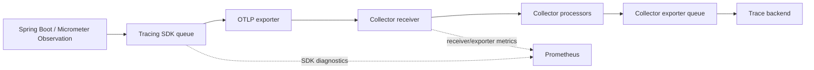

# Alerting on Exporter Failures in Spring Boot

A Spring Boot application may keep handling requests normally while traces or metrics fail to reach the backend. The Collector may be unavailable, DNS/TLS may fail, exports may time out, queues may fill up, or credentials may expire. Monitoring business request errors alone can leave operations teams unaware that the telemetry pipeline is losing data. **Alerting on exporter failures** detects early when telemetry is not being sent, is getting dropped, or is backing up, enabling you to restore observability before another incident strikes.

Exporter failures belong to the observability pipeline; they are not always business service failures. Alerts must distinguish export failures, export timeouts, queue saturation, dropped telemetry, and Collector health. A useful alert identifies which signal is affected, the extent of data loss, instance scope, and the first investigation step. Avoid creating a single generic alert for every network error or every retry.

The lesson **Alerting on Exporter Failures** belongs to the **Dashboard and Alert** chapter of the **SPRING_BOOT_OBSERVABILITY** module. The module focuses on setting up observability for Spring Boot using Micrometer Observation, metrics, logs, and distributed tracing; learning context propagation, tags/cardinality, exporters, sampling, and correlating signals to investigate errors, latency, and application behavior in production environments.

## 1. Learning Objectives

After this lesson, you will be able to:

- Distinguish exporter failures from business request failures.
- Recognize export errors, timeouts, retries, dropped spans, and queue saturation.
- Monitor the exporter pipeline across both the application and the Collector.
- Write Prometheus alert rules using `rate()`, `increase()`, and `for` duration.
- Choose severity based on how much telemetry is impacted.
- Avoid noisy alerts when exporters perform transient retries.
- Design dashboards and runbooks for trace/metrics/logs exporters.
- Test alerts by making the Collector unavailable in a controlled manner.

## 2. What Is an Exporter Failure?

An exporter delivers telemetry from a process or Collector to the next hop. Depending on the architecture, the target may be an OpenTelemetry Collector over OTLP, a Prometheus scrape endpoint, or a telemetry backend directly.

Common failure modes include:

- **Connection failure:** DNS, routing, connection refused, or network policy.
- **TLS/authentication failure:** untrusted certificate, invalid/expired token, or mTLS mismatch.
- **Timeout:** Collector/backend responds slower than the export timeout.
- **Throttling/rejection:** receiver returns errors due to rate limits, invalid payloads, or overload.
- **Queue saturation:** telemetry production rate exceeds export rate for a sustained period.
- **Dropped telemetry:** SDK/Collector drops data when queues fill up or during shutdown.
- **Configuration failure:** wrong endpoint, protocol, port, or exporter pipeline.

### Exporter failures differ from business failures

Business requests can succeed while span exports fail because tracing is usually sent asynchronously. Conversely, the exporter can work fine even when business requests return 500. Monitor both groups independently and correlate them during investigations.

| Group | Example | Primary Impact |
| --- | --- | --- |
| Business signals | HTTP 5xx, latency, DB errors | Users and application functionality |
| Telemetry export | Export failures, timeouts, dropped spans | Observability and investigation capability |
| Collector/backend | Receiver refused, exporter queue full, backend unavailable | Scope spanning multiple services sending telemetry |

## 3. Map the Pipeline Before Creating Alerts

A pipeline may consist of the in-app SDK, a Collector, and a backend:



Each boundary has its own telemetry. A full SDK queue is not the same as a full Collector exporter queue. Successful export to the Collector only proves that hop accepted the request; the Collector can still drop or fail when forwarding onward to the backend.

Before writing queries, clarify:

1. Does the application use Micrometer Tracing with Brave or the OpenTelemetry bridge?
2. Is it using the OTel Java agent or the Spring Boot-managed SDK?
3. Does the exporter send directly to the backend or through a Collector?
4. Where does Prometheus scrape metrics from the application and the Collector?
5. Which exporter/queue metrics are actually enabled in the current version?

Metric names depend on the SDK, exporter, Collector distribution, and version. Check actual exposition instead of assuming fixed series names.

## 4. Signals to Monitor

### Export failures and timeouts

Track export failure counts and timeout counts by exporter, signal, and service. If the exporter emits counter metrics, use `rate()` to detect ongoing failures:

```promql
sum by (service_name) (
  rate(otel_exporter_send_failed_spans[5m])
)
```

The name `otel_exporter_send_failed_spans` is an illustrative example, not a guaranteed metric name across all SDKs. Replace it with the matching series from your actual telemetry. If metrics lack `service_name`, use labels provided by the scrape target or omit the grouping.

### Dropped spans

Dropped spans are a strong signal because data has already been lost before reaching the backend:

```promql
sum by (service_name) (
  increase(otel_sdk_span_dropped_total[10m])
)
```

This is also an illustrative conceptual name. SDKs may expose dropped counts via internal metrics, logs, or not expose them by default; enable/bridge appropriate diagnostic metrics. Distinguish drops due to full queues, processor shutdown, and sampling: intentional sampling is not necessarily an exporter failure.

### Queue utilization

If the SDK/Collector provides queue size and capacity:

```promql
max by (service_name) (
  otel_exporter_queue_size
  /
  clamp_min(otel_exporter_queue_capacity, 1)
)
```

The query above expresses queue utilization as a ratio. Series names may vary; Collector exporter queue metrics also differ from SDK span processor queue metrics. Build separate dashboard panels or labels clearly distinguishing the two locations.

### Collector health and exporter queues

The Collector must be monitored as an independent service. Track receiver accepted/refused telemetry, exporter send failures, queue size/capacity, process memory/CPU, and scrape target health. If multiple application exporters fail simultaneously, the cause likely lies in the shared Collector or backend.

## 5. Writing Prometheus Alert Rules

An alert rule typically has four parts:

- **Expression:** condition measuring failure.
- **For duration:** how long the condition must hold continuously before firing.
- **Labels:** severity, team, service, or environment.
- **Annotations:** summary, impact, and runbook link.

Example alert for sustained export failures:

```yaml
groups:
  - name: telemetry-export
    rules:
      - alert: TelemetryExportFailures
        expr: |
          sum by (service_name) (
            rate(otel_exporter_send_failed_spans[5m])
          ) > 0
        for: 5m
        labels:
          severity: warning
        annotations:
          summary: Trace export is failing for service {{ $labels.service_name }}
          description: Check exporter connectivity, Collector receiver and authentication.
```

This is a rule template. Replace metrics and labels according to actual instrumentation; if the exporter does not expose this counter, pick an available diagnostic signal. `for: 5m` skips brief glitches, though the duration should align with retry/backoff settings and acceptable telemetry loss.

### Alerting on rising dropped spans

```yaml
groups:
  - name: telemetry-export
    rules:
      - alert: TelemetrySpansDropped
        expr: |
          sum by (service_name) (
            increase(otel_sdk_span_dropped_total[10m])
          ) > 0
        for: 2m
        labels:
          severity: critical
        annotations:
          summary: Spans are being dropped by the telemetry pipeline
          description: Inspect SDK queue saturation, Collector health and export throughput.
```

Dropped spans confirm telemetry loss; severity can be higher than transient retries. Still, weigh volume and scope: a few spans dropped during shutdown carry different impact than thousands of spans/sec lost continuously.

### Alerting on queue saturation

```yaml
groups:
  - name: telemetry-export
    rules:
      - alert: TelemetryExporterQueueNearCapacity
        expr: |
          max by (service_name) (
            otel_exporter_queue_size
            /
            clamp_min(otel_exporter_queue_capacity, 1)
          ) > 0.8
        for: 10m
        labels:
          severity: warning
        annotations:
          summary: Telemetry exporter queue is near capacity
          description: Export throughput may be lower than telemetry production rate.
```

The 80% threshold is only a starting point. Tune thresholds based on queue capacity, burst patterns, and drain rate after Collector recovery. Without a capacity metric, utilization cannot be reliably computed from queue size alone.

## 6. Severity and Alert Fatigue

Not every export failure needs an immediate page. Severity should reflect data loss, duration, and blast radius:

| Severity | Suggested Condition | Action |
| --- | --- | --- |
| Info | A few transient retries, no drops yet | Record, do not page |
| Warning | Sustained export failures or continuously growing queue | Investigate during on-call shift |
| Critical | Rapidly rising dropped telemetry, persistently full queue, or total trace loss | Page telemetry/on-call owner |
| Resolved | Exports stabilized, queue drained, and drops stopped | Confirm recovery |

Do not mark an alert critical just because of a single export timeout. Retries may recover automatically. Conversely, prolonged high queue utilization can warn of impending data loss even before dropped spans occur.

### Combining `for` and rate windows properly

The rate window calculates the failure rate from counters; `for` requires the condition to persist continuously before firing. For instance, `rate(...[5m])` combined with `for: 5m` can take significant time before alerting. Choose them based on detection objectives, scrape interval, and exporter retry/backoff behavior.

## 7. Separating Alerts by Signal

Traces, metrics, and logs have distinct pipelines. A trace exporter failure does not necessarily break the metrics exporter. Separate alerts by signal:

| Signal | What to Monitor |
| --- | --- |
| Traces | Failed span exports, dropped spans, BatchSpanProcessor queue, OTLP exporter latency |
| Metrics | Push failures, scrape target down, registry/export errors, Collector metrics pipeline |
| Logs | Async appender queue, log processor drops, log exporter failures |

If all three signals vanish simultaneously, inspect the network, Collector, DNS, TLS, credentials, and shared backend. If only one signal disappears, focus on its dedicated exporter/processor.

## 8. Dashboard for Exporter Failures

The dashboard should help locate whether the failure is in the application, Collector, or backend:

1. Export failure rate by service and signal.
2. Dropped spans/logs/metrics over time.
3. SDK queue utilization and Collector exporter queue utilization.
4. Export duration/timeouts and retry rate.
5. Collector receiver accepted/refused rate.
6. Collector exporter success/failure rate.
7. Collector CPU, memory, restarts, and scrape target health.

Add annotations for deployments, Collector config changes, and backend maintenance. When an alert fires, on-call engineers can correlate when queues began filling with the latest change.

### Avoiding high cardinality in alert labels

Alert labels should use stable dimensions such as `service`, `environment`, `exporter`, and `signal`. Do not add trace ID, span ID, request ID, raw endpoint URL, or exception message as labels. Those values spawn unbounded alert instances and make routing hard to manage.

## 9. Runbook for Exporter Failures

When an alert fires:

1. Identify which signal is impacted: traces, metrics, or logs.
2. Identify the scope: one instance, one service, or multiple services.
3. Check exporter endpoint, protocol, DNS, network route, TLS, and credentials.
4. Check the application SDK queue and dropped telemetry.
5. Check Collector receiver accepted/refused metrics.
6. Check Collector exporter queues, retries, and downstream backend health.
7. Cross-reference recent deployment/configuration changes.
8. After recovery, verify queues drain, failure rates return to baseline, and new telemetry is queryable.

Do not enlarge queues indefinitely as a band-aid fix. If long-term export throughput is below the telemetry arrival rate, queues will fill up again. You can intentionally reduce sampling, scale Collector/exporter capacity, or fix backend bottlenecks.

## 10. Testing Alerts and Failure Scenarios

Alert rules should be tested before production deployment:

- Unit-test Prometheus rules with `promtool test rules`.
- Use test fixtures to verify firing/resolved transitions.
- Induce a controlled Collector outage in a test environment.
- Simulate TLS/auth failures and network timeouts.
- Generate enough traffic so queue saturation is reproducible.
- Verify alert labels/annotations and routing to the right team.

Example rule test structure:

```yaml
rule_files:
  - exporter-alerts.yml

evaluation_interval: 1m

tests:
  - interval: 1m
    input_series:
      - series: 'otel_exporter_send_failed_spans{service_name="orders"}'
        values: '0 1 2 3 4 5 6 7'
    alert_rule_test:
      - eval_time: 7m
        alertname: TelemetryExportFailures
        exp_alerts:
          - exp_labels:
              service_name: orders
              severity: warning
```

This illustrates the test structure; synchronize rule expressions, evaluation timing, labels, and `promtool` syntax with your Prometheus version. Counter values must reflect an accurate sample sequence so the rate window has sufficient data.

## 11. Troubleshooting

| Symptom | Possible Cause | How to Check |
| --- | --- | --- |
| Export failures rise across all services | Shared Collector/backend or network failure | Check Collector targets, receivers, and backend |
| Only one service fails exports | Service-specific endpoint/auth/config | Compare environment variables and exporter config |
| Timeouts without drops | Retries still coping; queue not yet full | Monitor queue trend and retry recovery |
| Dropped spans rise | SDK queue full or processor shutdown | Check arrival/export throughput and lifecycle |
| Collector receives data, backend has no traces | Collector processor/exporter failure | Check downstream exporter queue and backend |
| High queue with zero failure counter | Exporter is slow without returning errors yet | Monitor export duration and queue slope |
| Alert fires too frequently | Short `for`, transient retries, or low threshold | Adjust window/`for` and severity |
| Missing exporter diagnostic metrics | SDK/Collector internal telemetry disabled | Enable telemetry endpoint/metrics per version |
| Alert does not fire despite export errors | Wrong metric name, label, or scrape target | Check Prometheus queries and actual series |
| Alert does not resolve after recovery | Queue not yet drained or condition still true | Check throughput and rule evaluation |
| Queue fills again after enlarging capacity | Long-term throughput still below arrival rate | Increase export capacity or lower span rate |
| Only traces lost while metrics remain | Tracing processor/exporter specifically broken | Check `BatchSpanProcessor` and OTLP traces pipeline |

### Post-recovery checklist

1. Export failure rate returns to baseline.
2. Dropped telemetry stops increasing.
3. Queue utilization decreases and stabilizes.
4. Collector receivers/exporters show no abnormal refusals/failures.
5. New traces/metrics/logs appear in the backend.
6. Alert transitions to resolved and the runbook records the root cause.

## 12. Hands-on: Alerting When the OTLP Trace Exporter Fails

**Context:** `order-service` sends spans via OTLP to a Collector. When the Collector restarts, export timeouts rise, the queue builds up, and spans eventually drop. The team needs an alert before data loss becomes severe.

### Part A — Preparation

1. Identify the SDK/exporter implementation and version.
2. Enable diagnostic metrics for export failures, queues, and dropped spans if supported.
3. Enable Prometheus scraping for both application and Collector telemetry endpoints.
4. Record baseline export latency, queue utilization, and span arrival rate.
5. Write alert rules matching actual metric names/labels.

### Part B — Verification

| Case | Action | Expected Observation |
| --- | --- | --- |
| A — Normal | Send steady traffic | Low queue, exporter failure rate is 0 |
| B — Transient timeout | Induce brief network delay | Retries increase, but paging alert does not fire prematurely |
| C — Collector restart | Restart Collector in test | Export failures/queues rise as expected |
| D — Queue pressure | Increase spans in a controlled way | Queue warning alert fires before data loss |
| E — Drop | Exceed capacity in test | Dropped-span alert fires |
| F — Recovery | Restore Collector | Queue drains, errors drop, alert resolves |
| G — Auth failure | Use invalid test credentials | Authentication/export failure is detected |
| H — Signal isolation | Keep metrics exporter working while traces fail | Only the trace pipeline alert fires |

### Part C — Self-Assessment Questions

1. Why can business requests succeed while span export fails?
2. How does an exporter failure differ from a Collector downstream failure?
3. Why should you monitor both queue utilization and dropped spans?
4. Which counter types are `rate()` and `increase()` suited for?
5. When should an exporter timeout only trigger a warning?
6. Why can a queue saturation alert warn ahead of dropped telemetry?
7. Why should alerts be separated across traces, metrics, and logs?
8. How do you distinguish a full SDK queue from a full Collector exporter queue?
9. Why doesn't enlarging queues solve a long-term throughput deficit?
10. Which conditions confirm the pipeline has recovered?

## 13. Key Takeaways

**Alerting on exporter failures** protects observability by detecting export errors, timeouts, queue saturation, and dropped telemetry. Verify the pipeline and actual metric names before writing PromQL; diagnostic metric names vary by SDK, exporter, and Collector version. Monitor application SDK and Collector queues separately, and distinguish transient retries from actual data loss.

Design alerts by signal, severity, rate window, and `for` duration aligned with retry/backoff behavior. Use dashboards to locate the failure boundary, low-cardinality labels, and runbooks detailing checks for network, TLS/auth, queues, and backends. Test rules using fixtures and failure injection before production. When exporters recover, confirm queues drain, drops cease, and fresh telemetry is queryable. This approach detects telemetry loss early without turning every temporary glitch into an emergency page.
