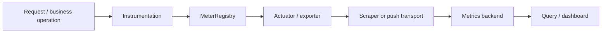

# Missing Metrics in Spring Boot

A Spring Boot application may still process requests normally while dashboards fail to display the expected metrics. For example, an endpoint returns HTTP 200 but `http.server.requests` is nowhere to be found, a custom counter does not increment, or a Prometheus target is `UP` yet queries return no series. These situations usually stem from one of the layers in the pipeline: instrumentation does not create the meter, `MeterRegistry` does not receive the meter, Actuator does not expose the endpoint, the scraper does not collect it, or the query is looking for the wrong name/tag.

**Missing metrics** refers to situations where metric telemetry does not appear where expected, appears with a delay, is missing certain dimensions, or has an unchanging value. An effective diagnostic approach is to follow the data path from the operation to the backend: code/framework instrumentation → `MeterRegistry` → Actuator/exporter → scrape/publish → storage → query/dashboard. Inspecting each boundary helps pinpoint exactly where the data is lost.

In Spring Boot, Micrometer provides the abstraction for meters and `MeterRegistry`; Actuator can expose meter lists/measurements via the metrics endpoint; registries such as Prometheus or OTLP push or expose metrics to the backend via their own mechanisms. Observation and tracing are related pipelines, but they do not automatically guarantee that a metric will exist. This lesson belongs to the **Troubleshooting** chapter of the **SPRING_BOOT_OBSERVABILITY** module and focuses on investigating why metrics do not appear in the observability system.

## Learning Objectives

1. Describe the path of metrics from instrumentation to the dashboard.
2. Distinguish between a meter not being created and a meter not being exported/scraped.
3. Inspect the Actuator metrics endpoint and Prometheus exposition.
4. Verify `MeterRegistry`, auto-configuration, and custom binders.
5. Diagnose wrong meter names, tags, filters, and cardinality issues.
6. Distinguish a pull registry from a push/export pipeline.
7. Check security, endpoint exposure, and management port settings.
8. Understand timing, lazy registration, counter behavior, and scrape intervals.
9. Use test registries and integration tests to reproduce issues.
10. Establish an ordered diagnostic workflow, from application to backend.

## 1. Following the Entire Metrics Pipeline

Metrics travel through multiple layers. If one layer fails to work, the dashboard may have no series even though the application is running.



Checkpoints:

| Layer | Question | Symptom of Failure |
|---|---|---|
| Instrumentation | Does the operation create a meter? | No meter in registry |
| Registry | Is the meter registered in the right registry? | Custom registry is empty |
| Actuator/exporter | Is the meter exposed? | Endpoint missing meter or 404 |
| Scraper/transport | Can the backend fetch the data? | Target down, scrape error |
| Storage | Is the series ingested? | Scrape succeeds but no samples |
| Query/dashboard | Does the query use the right name/labels/time range? | Series exists but panel is empty |

Do not start by fixing the dashboard before verifying that the meter exists in the application.

## 2. Inspecting the Actuator Metrics Endpoint

With Spring Boot Actuator, the metrics endpoint is typically accessed via `/actuator/metrics`. First, confirm that the Actuator dependency is present in the application runtime and that the endpoint is exposed.

Example:

```yaml
management:
  endpoints:
    web:
      exposure:
        include: health,info,metrics,prometheus
```

The Prometheus endpoint requires a suitable Prometheus registry on the classpath. The exposure list does not automatically add the registry dependency. If the endpoint is disabled or blocked by a security policy, requests may return 404, 401, or 403.

### 2.1. Listing Meters

Call:

```http
GET /actuator/metrics
```

The response lists the meter names present in the registry. Look for the meter under investigation, such as `http.server.requests`, `jvm.memory.used`, or a custom meter.

Then query the specific meter:

```http
GET /actuator/metrics/http.server.requests
```

The endpoint can return available tags and measurements. You can filter by tag:

```http
GET /actuator/metrics/http.server.requests?tag=method:GET
```

Meter names and tag values depend on the Spring Boot/Micrometer version, web stack, and instrumentation. Use the actual response as the source of truth instead of guessing names.

### 2.2. Distinguishing 404, 401, and 403

- **404:** the endpoint is not exposed, not enabled, uses the wrong base path/port, or does not exist in the runtime.
- **401:** authentication was not provided or is invalid.
- **403:** the caller is authenticated but lacks permission.
- **200 but meter not present:** the registry does not yet have that meter, the meter has not been created yet, or you are looking up the wrong name.

Read the response and security logs before changing configuration.

## 3. Verifying That MeterRegistry Is Configured

Spring Boot auto-configures `MeterRegistry` based on the registry implementation present on the classpath. If no backend-specific registry is present, the application may still have another registry or a composite registry depending on dependencies/configuration.

In a test or during debugging, check the bean:

```java
@Autowired
MeterRegistry meterRegistry;
```

Having a `MeterRegistry` bean does not mean all meters have been bound. Check the registry name and type, then inspect the meters:

```java
meterRegistry.getMeters().forEach(meter ->
        log.debug("Registered meter: {}", meter.getId()));
```

This debug snippet should only be used in controlled test or debug environments; avoid dumping full tag values if they might contain sensitive data.

### 3.1. Custom Registry Detached from the Main Registry

A common mistake is manually creating a `SimpleMeterRegistry` or a new registry and recording meters into it, while Actuator/Prometheus scrapes a different registry. The meter exists in the custom object but does not appear on the endpoint.

Prefer injecting the `MeterRegistry` managed by Spring Boot. Only create a separate registry for tests or intentional use cases.

### 3.2. CompositeMeterRegistry

If using `CompositeMeterRegistry`, verify that child registries have been added and that a registry matching the exporter exists. A meter may appear in the composite registry but fail to be published if a child registry is not configured or not attached.

### 3.3. Registry Filters

`MeterFilter` can deny, rename, or transform meter IDs/tags. If a meter does not appear, inspect the filters registered in the application context and the order in which they are applied. A deny filter matching a prefix or tag can exclude the expected meter.

## 4. Checking Whether Instrumentation Created the Meter

Not every operation automatically gets a metric. Spring Boot typically instruments certain framework boundaries such as the HTTP server, datasource, JVM, and executors when the appropriate dependencies/configuration are present. Custom business logic requires explicit meter or `Observation` instrumentation.

Custom counter example:

```java
@Component
class PaymentMetrics {
    private final Counter acceptedPayments;

    PaymentMetrics(MeterRegistry registry) {
        this.acceptedPayments = Counter.builder("payments.accepted")
                .description("Accepted payment operations")
                .register(registry);
    }

    void recordAccepted() {
        acceptedPayments.increment();
    }
}
```

If the counter does not increment, verify that `recordAccepted` is actually called, the bean is created, and it uses the registry being exported.

### 4.1. Lazy Meter Registration

Some meters are created when code registers the meter or when the first operation occurs. If no matching request/operation has happened yet, the meter may not appear in the list. Trigger a controlled operation and check again.

### 4.2. Timer and Counter Semantics

A timer count usually increments only when the sample is stopped/recorded. If code starts a `Timer.Sample` without stopping it, the measurement is never recorded. A counter increments only when `increment` is called. A gauge reads an object's value at scrape time; if the object is not updated or gets garbage-collected depending on how it was registered, the value may not behave as expected.

### 4.3. Observation Does Not Automatically Create Every Business Metric

`Observation` can produce timers/spans through handlers and conventions. If there is no metrics observation handler or the observation does not run on the right registry, the corresponding metric will not appear. An observation with only a tracing handler can produce a span without producing a meter.

## 5. Checking Meter Names and Naming Conventions

Meter names can differ between Actuator and the backend. For example, the Micrometer meter `http.server.requests` can be converted by the Prometheus registry into `http_server_requests_seconds` with suffixes `_count`, `_sum`, or histogram buckets depending on configuration.

| Where Observed | Example Name |
|---|---|
| Actuator metrics | http.server.requests |
| Prometheus exposition | http_server_requests_seconds_count |
| Prometheus histogram bucket | http_server_requests_seconds_bucket |

Do not copy a name from one backend into an Actuator query or vice versa. Inspect the exposition directly:

```http
GET /actuator/prometheus
```

Find the metric name in the raw output before writing PromQL.

### 5.1. Suffixes and Units

A timer can export count, sum, and buckets; distribution statistics may not be enabled. If a query looks for `_bucket` while histograms are not configured, that series will not exist even though timer count/sum are present.

### 5.2. Normalized Tags

Tag/label names can be converted according to the registry. The `uri` tag may contain a route template; some stacks use a different name or the value `UNKNOWN`. Inspect the raw series and label set.

## 6. Checking Tags and Filters

A meter may exist, yet queries filtering by tag fail to match. For instance, a dashboard filters `uri="/orders/{id}"` while the actual runtime tag is `"/orders/{orderId}"` or `UNKNOWN`.

Common causes:
- Wrong tag key.
- Wrong tag value casing or route template.
- A filter stripping the meter/tag.
- The meter was registered with a different set of tags.
- The query requires all labels to match, but the series is missing one label.
- Environment/service labels are attached in the scrape config rather than on the application meter.

Do not use raw paths/request IDs as metric tags just to "make the query find it." That creates high cardinality and can overload the backend.

### 6.1. Cardinality Limits

Some registries/configurations can limit meter cardinality or reject values exceeding a policy. If a meter appears on one route but not another, check the tag values and cardinality limits. Normalize dimensions using an allowlist.

### 6.2. Common Tags

`management.metrics.tags` or registry common tags can add service/environment labels. If a dashboard filters by `environment=prod` while the app exports `env=production`, the query returns no series. Verify labels after scraping, not just in application config.

## 7. Prometheus Scrape and Service Discovery

If `/actuator/prometheus` returns metrics but Prometheus has no series, the problem lies in scraping/discovery or ingestion.

Check:
1. Does the target appear in Prometheus Targets?
2. Is the target state `UP` or `DOWN`?
3. Is the scrape URL/path correct?
4. Do ports and network policies allow Prometheus access?
5. Are the scrape interval and timeout reasonable?
6. Is Prometheus scraping the right replica/service?
7. Are scrape errors or sample limits occurring?
8. Is metric relabeling dropping the series?

An `UP` target only proves that the scrape endpoint returned successfully; it does not prove that the query is looking for the right metric/labels.

### 7.1. Kubernetes Discovery

Check service annotations, `ServiceMonitor`/`PodMonitor`, or the scrape configuration depending on how the cluster is deployed. Wrong pod port name, namespace selector, label selector, or endpoint path can prevent the target from being discovered.

### 7.2. Relabeling

Prometheus `relabel_configs` and `metric_relabel_configs` can drop or rename targets or samples. If a metric is present on the raw endpoint but missing in the TSDB, check relabel rules and sample limits.

### 7.3. Push Pipelines

If using OTLP or a push registry, check the endpoint, protocol, auth, TLS, exporter errors, and Collector receiver. Do not use Prometheus scrape diagnostics to conclude that a push pipeline is working.

## 8. Checking Management Port, Security, and Network

Actuator can run on a separate management port or separate base path. For example, the application server is on `8080` while the management server is on `8081`; a scraper still calling `8080` will not find the endpoint.

Check these settings:
- `management.server.port`
- `management.endpoints.web.base-path`
- `management.endpoints.web.exposure.include`
- `management.endpoint.metrics.access` or the enablement property corresponding to your version
- Spring Security rules for `/actuator/**`
- NetworkPolicy, firewall, ingress, and service ports

Do not expose all Actuator endpoints just to troubleshoot metrics. Only open the endpoints required by the scraper and protect them with network/auth controls.

## 9. Metrics Not Appearing Immediately: Timing and Scrape Interval

Metrics do not necessarily appear instantaneously in every backend:
- A timer only records when the operation finishes.
- A counter has no series until it is incremented.
- Prometheus only sees data on the next scrape.
- Push registries have a step interval; publishing occurs periodically.
- Exporters/Collectors have batching/queuing and network delay.
- The dashboard time range might not include the newest sample.

When testing, trigger a controlled operation, wait at least one appropriate scrape/publish interval, and then check the raw data. Do not use fixed `Thread.sleep` calls in unit tests; use the registry directly or synchronize the test/exporter.

## 10. Metrics from Observation and Tracing

`Observation` can emit metrics and spans via separate handlers. If traces exist but metrics do not:
- Check the metrics observation handler.
- Check which `ObservationRegistry` is being used.
- Check the observation convention and meter filters.
- Verify that the operation completes so the timer gets recorded.

If metrics exist but traces do not:
- Check the tracing bridge/handler.
- Check the sampler.
- Check the span processor/exporter.
- Verify that the span is ended and flushed.
- Check the trace backend query separately.

Do not assume that the presence of one signal guarantees the remaining signals must also appear.

## 11. Verifying with Tests

Use `SimpleMeterRegistry` to verify that a meter is created and updated in a unit test:

```java
@Test
void recordsAcceptedPayment() {
    SimpleMeterRegistry registry = new SimpleMeterRegistry();
    PaymentMetrics metrics = new PaymentMetrics(registry);

    metrics.recordAccepted();

    assertThat(registry.get("payments.accepted")
            .counter()
            .count()).isEqualTo(1.0);
}
```

This is a conceptual example; test class structure depends on the codebase. For a Spring Boot integration test, inject the real `MeterRegistry` from the test context, invoke the operation, and assert on the meter. For the Prometheus exporter, call the exposition endpoint and verify names/labels.

### 11.1. Testing Auto-Instrumentation

Send a test HTTP request and inspect the `http.server.requests` meter in the registry. Ensure the request has completed before making assertions. For database metrics, open and close a connection so pool state has a chance to update.

### 11.2. Testing Endpoint Security

Test `/actuator/metrics` and `/actuator/prometheus` against the security policy: scraper credentials have access, while anonymous callers are restricted as intended.

### 11.3. Do Not Depend on Production Backends

Unit/integration tests should use an in-memory registry or mock receiver. Test real OTLP/Prometheus backends in separate smoke/staging environments rather than making every test depend on production networks or credentials.

## 12. Diagnosing by Symptom

| Symptom | Possible Cause | How to Check |
|---|---|---|
| `/actuator/metrics` returns 404 | Endpoint not exposed/enabled or wrong port | Actuator config and management path |
| `/actuator/metrics` returns 401/403 | Security policy | Credentials/roles |
| Meter missing from Actuator list | Instrumentation didn't create it or different registry | `MeterRegistry` and operation path |
| Meter in Actuator but not Prometheus | Registry dependency/exposure/scrape | `/actuator/prometheus` and Targets |
| Raw Prometheus has series but query is empty | Wrong metric name/labels/time range | Raw exposition and PromQL |
| Trace exists but metric is missing | Metrics handler/filter/registry | `ObservationRegistry` wiring |
| Metric exists but trace is missing | Sampler/tracing handler/exporter | Tracing pipeline |
| Custom counter stays at 0 | Increment path not executed | Business code and tests |
| Timer has no count | Sample not stopped/recorded | Timer lifecycle |
| Gauge does not change | Object state not updated or gauge reference | Gauge source lifecycle |
| Metric missing some tag values | Filter/cardinality cap | `MeterFilter` and tag values |
| Only one replica missing metrics | Differing config/dependencies | Per-pod endpoint and effective config |
| Prometheus target `DOWN` | Network/path/auth/TLS | Target error and scrape config |
| Target `UP` but missing series | Relabeling or no operation yet | Scrape output and raw series |
| Metrics arrive slowly at backend | Scrape/step/batch interval | Effective publishing interval |

### Investigation Workflow

1. Call `/actuator/metrics` and look for the meter name.
2. If missing, check whether the operation runs and whether instrumentation registers the meter.
3. Verify that the injected `MeterRegistry` is the same registry used by Actuator/exporter.
4. Check `MeterFilter`, common tags, and cardinality limits.
5. Call the specific meter endpoint and inspect available tags/measurements.
6. For Prometheus, inspect the `/actuator/prometheus` raw exposition.
7. Check Prometheus target state, scrape errors, and relabeling.
8. Compare metric name, labels, and query time range.
9. Check security, management port/base path, and network access.
10. If using push/OTLP, check exporter/Collector errors and its separate pipeline.
11. Trigger a test operation and wait for a scrape/publish cycle.
12. Compare across replicas to detect config drift.

## 13. Anti-Patterns to Avoid

| Anti-Pattern | Consequence | Proper Approach |
|---|---|---|
| Checking only the dashboard | Cannot tell which layer lost the data | Trace from `MeterRegistry` to backend |
| Manually creating `SimpleMeterRegistry` in a production bean | Meters never reach Actuator's registry | Inject the Boot-managed `MeterRegistry` |
| Exposing all Actuator endpoints | Increases attack surface | Allowlist needed metrics/prometheus endpoints |
| Guessing Prometheus names from Actuator | Queries look for the wrong meter | Inspect raw exposition |
| Using raw URL/ID as a tag | High cardinality explosion | Route templates and bounded labels |
| Registering handlers twice | Duplicate meter counts/durations | Check auto-configuration |
| Assuming a trace means the metric must exist | Confuses signal handlers | Inspect the metrics pipeline separately |
| Assuming an `UP` target means all queries are right | Misses name/label mismatches | Inspect raw series |
| Using long sleeps in unit tests | Slow and flaky tests | In-memory registry/flush/latch |
| Ignoring `MeterFilter` | Meters get denied/renamed | Inspect filter configuration |
| Testing only one replica | Misses config drift | Inspect individual instances |
| Increasing scrape interval to fix a missing metric | Makes data even slower | Fix endpoint/discovery/export |

## 14. Production Checklist

1. **Instrumentation:** are the operations to be measured instrumented?
2. **Registry:** does the code use the application's `MeterRegistry`?
3. **Handlers:** are metrics observation handlers/binders configured?
4. **Endpoint:** are `metrics`/`prometheus` enabled and exposed properly?
5. **Security:** does the scraper have access, and are endpoints not overly exposed?
6. **Port/path:** are management port and base path correct?
7. **Naming:** are Actuator meter names and Prometheus exposition names distinguished?
8. **Tags:** do keys/values match queries and stay low-cardinality?
9. **Filters:** are there any unintended `MeterFilter` deny/rename rules?
10. **Scrape:** is the target `UP`, and are scrape interval/timeout and discovery correct?
11. **Relabeling:** are required samples not being dropped?
12. **Timing:** has the operation completed and has a scrape/publish cycle run?
13. **Signals:** are metrics and traces diagnosed independently?
14. **Replicas:** is the effective config consistent across instances?
15. **Testing:** do unit/integration/scrape smoke tests cover the meters?
16. **Privacy:** do tags avoid containing credentials, PII, or dynamic IDs?
17. **Runbook:** is there an ordered verification procedure from registry to backend?

## 15. Self-Assessment Questions

**Question 1.** What are the layers in the metrics pipeline?

**Hint:** Instrumentation, `MeterRegistry`, Actuator/exporter, scraper/publisher, backend storage, and query/dashboard.

**Question 2.** What does it mean when `/actuator/metrics` returns 200 but does not list the meter you are looking for?

**Hint:** The endpoint works, but the meter has not been created yet, a different registry is being used, or the meter name is wrong.

**Question 3.** Why can manually creating a `SimpleMeterRegistry` inside an application bean cause metrics to disappear?

**Hint:** Meters are recorded into a separate registry that is not exported by Actuator/Prometheus.

**Question 4.** What is the difference between an Actuator meter name and a Prometheus metric name?

**Hint:** The registry may normalize names and add suffixes/units for exposition, such as timer count.

**Question 5.** What could cause a Prometheus target to be `UP` while queries return empty results?

**Hint:** The query uses the wrong name/labels/time range, relabeling drops the series, or the operation has not emitted any samples yet.

**Question 6.** Why does a timer count not increment as soon as an operation starts?

**Hint:** A timer usually records its sample when the operation finishes or `record` is called.

**Question 7.** What can cause an `Observation` to create a span without creating a metric?

**Hint:** Missing metrics handler, wrong registry, or a filter excluding the meter; tracing and metrics handlers are independent.

**Question 8.** How can `MeterFilter` cause missing metrics?

**Hint:** A filter can deny, rename, or transform meter IDs/tags.

**Question 9.** Why should raw paths not be used as tags?

**Hint:** Paths containing dynamic IDs create high cardinality and can consume excessive backend resources.

**Question 10.** What is the investigation order when a dashboard is empty?

**Hint:** Check the meter in the Actuator registry, raw exposition, scrape target, storage series, and then query/labels/dashboard.

## Conclusion

**When metrics are missing, determine whether data is lost at instrumentation, the registry, the endpoint, scraping/export, or the query.** Spring Boot Actuator helps inspect meters inside `MeterRegistry`; Prometheus exposition shows the actual names and labels received by the scraper. Verify the right registry, handlers, `MeterFilter`s, management port, security, scrape discovery, and publishing interval before editing the dashboard. Use an in-memory registry for unit tests, mock/scrape tests for integration, and inspect individual replicas to uncover config drift. Metrics, traces, and logs have separate pipelines, so each signal must be diagnosed at its own boundaries.
