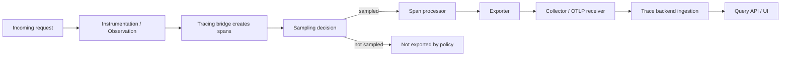

# Missing Traces in Spring Boot: Troubleshooting Workflow

## 1. Objectives and Context

When a request traverses multiple services yet no trace appears in the tracing UI, the root cause can lie at any stage: the application does not create spans, the observation is not bridged to tracing, sampling drops the trace, the exporter does not send data, the collector does not receive it, the backend rejects it, or the UI queries the wrong time range/service. Simply staring at an empty search page is not enough to conclude that the application is uninstrumented.

This lesson walks through investigating along the trace's path from Spring Boot to the backend, while distinguishing three scenarios: no trace at all, trace present but missing spans, and trace exported yet not found in the UI.

This lesson belongs to the **Troubleshooting** chapter of the **SPRING_BOOT_OBSERVABILITY** module. The module teaches how to set up observability for Spring Boot using Micrometer Observation, metrics, logs, and distributed tracing; covering context propagation, tags/cardinality, exporters, sampling, and signal correlation to investigate errors, latency, and application behavior in production environments.

After this lesson, you will be able to:
1. Trace the tracing pipeline from instrumentation to the trace backend.
2. Confirm that Spring Boot created an `Observation` and span.
3. Inspect the tracing bridge, exporter, endpoint, and sampling.
4. Distinguish propagation failures from export/ingestion failures.
5. Diagnose traces that are missing spans or appear only partially.
6. Check collector configuration, authentication, TLS, resource attributes, and UI filters.
7. Use metrics/logs and integration tests to isolate the issue.

**Baseline:** Spring Boot 3.5.x, Java 17+, Micrometer Observation/Tracing, and a bridge such as OpenTelemetry or Brave. Exporters, protocols, and properties must match the actual backend and dependency versions.

## 2. Which Stages Does a Trace Pass Through?

A trace appears in the UI only if the entire pipeline works:



Each stage has a distinct failure mode. For example:
- No span created: instrumentation is inactive or the request does not pass through an instrumented client/server.
- Span dropped: sampling policy or processor discards the span.
- Export failed: wrong endpoint/protocol, timeout, TLS, or authentication.
- Collector receives but backend has nothing: pipeline processor/exporter or backend ingestion failure.
- Backend has data but UI is empty: wrong time range, service filter, tenant/project, or query.

## 3. Start with a Reproducible Request

Pick a specific request and record:
- Request timestamp, timezone, and search time window.
- HTTP route/method and the handling service instance.
- Resulting HTTP status and response time.
- Trace ID if provided by the client or present in the response/logs.
- Deployment/version and environment.

Prefer a fresh request generated after the tracing configuration has taken effect. Do not rely on old traces to evaluate a recent restart or configuration change.

If the UI supports lookup by trace ID, use that trace ID. Otherwise, search by service name, operation/route, and a narrow time range. Verify clock synchronization across the application, collector, and backend; clock skew can place the trace outside the search window.

## 4. Confirm Spring Boot Has Tracing Dependencies

Micrometer Observation and Micrometer Tracing are related layers, not identical ones. Having an `ObservationRegistry` does not mean the application has a tracing bridge and exporter.

Check the application's dependency graph:
- Spring Boot Actuator/observability infrastructure.
- Matching Micrometer Tracing bridge: Brave or OpenTelemetry.
- Appropriate exporter: OTLP or Zipkin, depending on the architecture.
- Logging correlation integration if trace/span IDs are needed in logs.

Example Maven dependencies for OpenTelemetry/OTLP, using versions managed by the Spring Boot BOM:

```xml
<dependency>
    <groupId>org.springframework.boot</groupId>
    <artifactId>spring-boot-starter-actuator</artifactId>
</dependency>
<dependency>
    <groupId>io.micrometer</groupId>
    <artifactId>micrometer-tracing-bridge-otel</artifactId>
</dependency>
<dependency>
    <groupId>io.opentelemetry</groupId>
    <artifactId>opentelemetry-exporter-otlp</artifactId>
</dependency>
```

Specific artifacts/versions depend on the Spring Boot release and exporter choice. Avoid mixing the Brave bridge with an OpenTelemetry exporter or pulling in incompatible standalone Micrometer/OpenTelemetry versions.

## 5. Confirm Instrumentation Creates Spans

### 5.1. HTTP Server

Spring Boot can instrument incoming HTTP requests when observability auto-configuration and the appropriate server instrumentation are active. Check:
- Whether the request passes through Spring MVC/WebFlux server instrumentation.
- Whether the endpoint is excluded by configuration or a custom `ObservationPredicate`.
- Whether `ObservationRegistry` has a tracing handler/bridge or only a metrics handler.
- Whether a custom filter/interceptor alters the execution boundary or context.

### 5.2. HTTP Client

For `RestClient`, `RestTemplate`, or `WebClient`, use the builder auto-configured by Spring Boot to preserve observation/tracing customizers:

```java
@Component
class CatalogClient {
    private final RestClient client;

    CatalogClient(RestClient.Builder builder) {
        this.client = builder
                .baseUrl("https://catalog.internal")
                .build();
    }

    CatalogItem find(String id) {
        return client.get()
                .uri("/items/{id}", id)
                .retrieve()
                .body(CatalogItem.class);
    }
}
```

Creating a client via its own constructor or replacing the builder with an uninstrumented instance can lose client observations. Verify how the client is constructed and which connector it uses.

### 5.3. Custom Business Spans

For internal methods, use `@Observed` or the appropriate Observation API. If using `@Observed`, confirm that annotation processing is enabled, Spring AOP is present, and the method is invoked through a proxy. Self-invocation (`this.someMethod()`) does not normally go through the proxy and therefore may not create an observation.

## 6. Check Sampling

Sampling decides which traces/spans are kept and exported. A successful request can legitimately be absent under a valid sampling policy, especially when the sampling rate is low.

Check:
- Current sampling probability/rate.
- Parent-based behavior and sampling flags received from upstream.
- Whether there is a custom sampler per service/route/error.
- Whether collector tail-sampling drops the trace due to policy or decision timeout.
- Whether queue/batch processor limits drop spans under load.

For diagnosis, use a test environment with 100% sampling for a short period or configure an explicit test sampler. Do not raise sampling across all of production without evaluating ingest/storage cost.

Head sampling usually makes its decision early in the application SDK; tail sampling decides after the collector observes additional spans of the trace. If the head sampler already dropped the trace before export, the collector cannot recover it.

## 7. Check Exporter and OTLP Endpoint

For OTLP, verify the following:
- The exporter dependency is on the runtime classpath.
- The endpoint has the right host, port, and path for the protocol (OTLP/gRPC or OTLP/HTTP).
- The exporter protocol matches the receiver; do not confuse gRPC with HTTP/protobuf.
- TLS certificates/truststore and hostname verification are valid.
- Authentication headers/tokens are correct and not expired.
- DNS/network policy/firewall allow connectivity.
- The batch processor flushes on shutdown and its queue is not full.

Example OTLP endpoint configuration using the Spring Boot property for the matching version:

```yaml
management:
  otlp:
    tracing:
      endpoint: http://otel-collector:4318/v1/traces
```

The example endpoint uses the OTLP/HTTP receiver. If using gRPC, port/protocol and properties must match the exporter configuration. Check the Spring Boot documentation for your exact version instead of copying configuration verbatim across protocols.

Do not assume an HTTP 200 from a collector health endpoint proves trace ingestion works. You need to confirm that the receiver accepts spans and the exporter pipeline processes them successfully.

## 8. Check the Collector Pipeline

If the application exporter sends successfully yet traces do not reach the backend, check the collector:
- The receiver is enabled on the right protocol/port.
- The `traces` pipeline includes the required receiver, processor, and exporter.
- Processors are not dropping spans due to filters, tail sampling, or memory limiter.
- The batch processor is not holding data indefinitely or hitting queue full.
- The backend exporter has valid DNS/TLS/auth.
- Collector logs/metrics do not report refused, retry, throttling, or rejected spans.

Conceptual OpenTelemetry Collector pipeline example:

```yaml
receivers:
  otlp:
    protocols:
      grpc:
        endpoint: 0.0.0.0:4317
      http:
        endpoint: 0.0.0.0:4318

processors:
  batch:

exporters:
  otlp:
    endpoint: tracing-backend:4317
    tls:
      insecure: true

service:
  pipelines:
    traces:
      receivers: [otlp]
      processors: [batch]
      exporters: [otlp]
```

This is an illustrative configuration for a lab/private network; do not enable insecure TLS on untrusted networks. Production requires proper TLS/auth and secret management.

## 9. Trace Present but Missing Spans

If the root span appears but child spans are missing, the trace export pipeline may still be working. Investigate instrumentation and context propagation:

- Was the downstream HTTP client built from the auto-configured builder?
- Does the database/client library have corresponding instrumentation?
- Is trace context propagated across executors/`CompletableFuture`?
- Does the reactive pipeline preserve Reactor context across scheduler switches?
- Is custom code starting a new root trace instead of a child span in the current context?
- Is sampling or a collector filter dropping certain spans?

Inspect trace IDs across services and log correlation. If an inbound request creates trace A but the outbound request does not carry trace context, downstream may start a new trace or create an unlinked span.

Do not rely on manual `ThreadLocal`/MDC as the sole mechanism for async/reactive propagation. Use the proper context propagation integration.

## 10. Check Propagation Headers

Trace context is commonly passed via W3C Trace Context headers, such as `traceparent` and optionally `tracestate` depending on configuration. Baggage is a separate header and does not replace trace context.

Verify using a mock server or test service:
1. Send an inbound request with a valid trace context.
2. Have the application make an outbound HTTP request.
3. Assert that the outbound request contains `traceparent` per the propagation policy.
4. Confirm the downstream span belongs to the same trace with a valid parent relationship.
5. Send a request without a trace header; confirm the application creates a new trace when sampling allows.
6. Send a malformed header; confirm it is handled safely without failing the request outside policy.

Do not hardcode a trace ID in tests as though every request must use the same ID. Verify the format, parent-child relationship, and presence of context per request.

## 11. Resource Attributes and Searching in the UI

A trace may already be stored yet remain unfindable due to unexpected service/resource attributes. Check:
- Is `service.name` accurate and stable?
- Are environment/namespace/version attributes attached?
- Is the UI querying the right project/tenant/datasource?
- Does the time range cover the trace timestamp?
- Do search filters use the exact service name, operation, and status?
- Does the trace backend have ingest delay or short retention?

Service names should not vary by pod ID, request ID, or deployment timestamp. Use a stable service identity; instance/pod identity belongs in a separate attribute.

## 12. Use Metrics and Logs to Narrow Down the Fault

When a trace has not been found yet, other signals still help pinpoint the failing stage:

| Signal | What to Check | Diagnostic Hint |
| --- | --- | --- |
| HTTP request metrics | Request count/latency/error | Did the application receive the request? |
| Observation metrics | Operation count/duration | Was the method instrumented? |
| Exporter/collector metrics | Sent, failed, dropped spans, queue | Are there export/ingest failures? |
| Application logs | Startup config, exporter errors, trace IDs | Did the bridge/exporter initialize? |
| Collector logs | Receiver/exporter retries, rejected spans | Did the collector receive and forward? |

Logs missing `traceId` can indicate that context correlation is not working yet, though it does not prove the trace does not exist. Sampling might retain the trace while the logging correlation field is missing due to another setting.

## 13. Ordered Quick-Check Procedure

1. Send a new request and record timestamp, route, instance, and status.
2. Check Actuator/application metrics to confirm the request reached the service.
3. Confirm tracing bridge and exporter dependencies are present at runtime.
4. Inspect server observation and custom `ObservationPredicate`/exclusions.
5. Temporarily use 100% sampling in a test environment.
6. Check logs for exporter errors, endpoint, protocol, TLS, and auth.
7. Check collector receiver, processor, queue, and backend exporter.
8. Search for the trace using a wider time range and the exact service/resource attributes.
9. If the root trace exists but spans are missing, check client instrumentation and async/reactive propagation.
10. Restore sampling/security settings to baseline after troubleshooting.

## 14. Minimal Integration Test

An end-to-end test should have an inbound endpoint calling an outbound mock service:

```java
@SpringBootTest(webEnvironment = SpringBootTest.WebEnvironment.RANDOM_PORT)
class TracePropagationIntegrationTest {
    // Start a mock downstream server on a dynamic port.
    // Inject the application HTTP client and test server port.

    @Test
    void propagatesTraceContextToDownstream() {
        // Send an inbound request with a valid traceparent header.
        // Capture the outbound request at the mock server.
        // Assert traceparent is present and valid.
        // Assert the downstream span shares the trace ID.
    }
}
```

This is a skeleton describing the test contract; the mock server and tracing test exporter need to be wired according to your project stack. Add test cases:
- Exporter endpoint unavailable: whether business requests continue per policy.
- Sampling disabled/low probability: tests do not assume traces always appear.
- Collector drop/filter: verify metrics/logs report dropped spans.
- Async/reactive call: verify parent-child relationship is preserved.
- Error request: verify exception/status is recorded on the span when policy requires it.

In unit/integration tests, use an in-memory span exporter/test `ObservationHandler` if supported by the bridge to assert span name, parent, attributes, and errors without requiring an external backend.

## 15. Troubleshooting

| Symptom | Possible Cause | Resolution |
| --- | --- | --- |
| No traces from service at all | Missing tracing bridge/exporter or instrumentation disabled | Check runtime dependencies and auto-configuration |
| Metrics present but no spans | Only meter registry/observation metrics handler present | Add the appropriate tracing bridge and exporter |
| Traces appear inconsistently | Low sampling rate or parent sampling flags | Check sampler and test with 100% in a test environment |
| Exporter reports connection refused | Wrong host/port or collector not listening | Verify endpoint from the application's network |
| OTLP export protocol error | Client uses gRPC while receiver/path is HTTP or vice versa | Align protocol, port, and endpoint |
| TLS/authentication failure | Wrong certificate, hostname, or token | Check trust chain, auth headers, and secret expiry |
| Collector receives but backend has no trace | Processor/filter/exporter drops or backend rejects | Inspect collector pipeline logs/metrics |
| Root span present but missing client span | Client does not use auto-configured builder | Check how `RestClient`/`WebClient`/`RestTemplate` is built |
| Downstream starts a new trace | Trace context not injected/propagated | Check `traceparent` and context propagation |
| Async span split into separate trace | Context lost across executor/future/reactor | Use context-aware executor/Reactor integration |
| Trace exists but UI search is empty | Wrong time range/service/project/tenant filter | Check resource attributes and query scope |
| Only some spans disappear | Tail sampling, collector filters, or queue overflow | Check sampling decisions and dropped counters |
| Logs missing `traceId` | Logging correlation not enabled or context not reaching MDC | Check correlation fields and propagation |
| Abnormal trace latency/time ordering | Clock skew across hosts | Synchronize clocks and check source timestamps |

## 16. Production Checklist

- [ ] Tracing bridge and exporter dependencies have compatible versions and implementations.
- [ ] HTTP server/client instrumentation creates spans as expected.
- [ ] Custom `@Observed` methods are invoked through Spring AOP proxies.
- [ ] Sampling policy is understood and drop decisions are observable via metrics.
- [ ] OTLP protocol, endpoint, TLS, and authentication match the collector.
- [ ] Collector `traces` pipeline has working receiver/processor/exporter.
- [ ] Queue, retry, and rejected/dropped spans are monitored.
- [ ] `service.name` and resource attributes are stable and searchable.
- [ ] Trace context propagates across HTTP, executors, and reactive flows.
- [ ] UI time range, project/tenant, and service filters are correct.
- [ ] Integration tests exist with a mock downstream and test span exporter.
- [ ] Temporary sampling/config changes are reverted after troubleshooting.

## 17. Self-Practice Questions

1. Which stages must work for a trace to appear in the UI?
2. Why can an application have an `ObservationRegistry` yet produce no spans?
3. At which stages can sampling cause a trace to disappear?
4. How does head sampling differ from tail sampling?
5. Why is using the auto-configured `WebClient.Builder` important?
6. How do OTLP/gRPC and OTLP/HTTP differ in configuration?
7. What should you check when the collector receives spans but the backend does not have them?
8. What failure does having a root span without child spans usually suggest?
9. How does trace context differ from baggage?
10. How do resource attributes affect trace search in the UI?
11. Why does a log without `traceId` not prove that no trace exists?
12. What should end-to-end tests assert beyond the mere presence of a header?

## References

- [Spring Boot 3.5 — Tracing](https://docs.spring.io/spring-boot/3.5/reference/actuator/tracing.html)
- [Spring Boot 3.5 — Observability](https://docs.spring.io/spring-boot/3.5/reference/actuator/observability.html)
- [Micrometer Tracing — Reference](https://docs.micrometer.io/tracing/reference/)
- [Micrometer Observation — Concepts](https://docs.micrometer.io/micrometer/reference/observation.html)
- [OpenTelemetry — OTLP Specification](https://opentelemetry.io/docs/specs/otlp/)
- [OpenTelemetry Collector — Configuration](https://opentelemetry.io/docs/collector/configuration/)
- [W3C — Trace Context](https://www.w3.org/TR/trace-context/)
