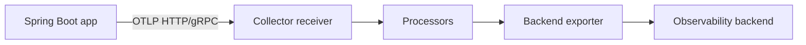
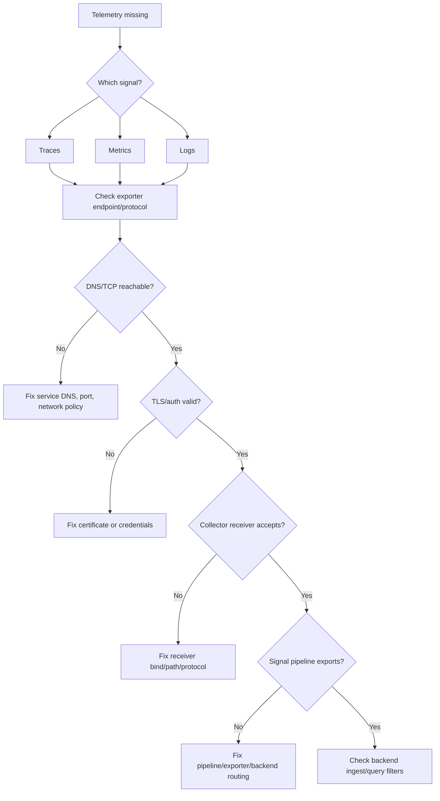

# Wrong Exporter Endpoint in Spring Boot

When configuring Micrometer or OpenTelemetry to send metrics, traces, and logs, the exporter must point to the right receiver, protocol, and network address. A wrong endpoint can prevent telemetry from being sent, cause it to be rejected, or route it into the wrong pipeline. The application may still process requests normally because export usually happens asynchronously; therefore, endpoint errors are easily missed if you only check business service health.

This lesson, **"Wrong Exporter Endpoint"**, belongs to the **Troubleshooting** chapter of the **SPRING_BOOT_OBSERVABILITY** module. The module teaches how to set up observability for Spring Boot using Micrometer Observation, metrics, logs, and distributed tracing; covering context propagation, tags/cardinality, exporters, sampling, and signal correlation to investigate errors, latency, and application behavior in production environments.

## 1. Identify the Right Signal and Exporter

Before changing any URL, identify which kind of telemetry is not reaching the backend:

| Signal | Common Delivery Path | What to Check |
| --- | --- | --- |
| Traces | OTLP exporter via HTTP or gRPC | Receiver protocol, port, path, TLS |
| Metrics | Micrometer registry exporter or OTLP metrics | Registry type, endpoint, temporality |
| Logs | Logging appender/agent or OTLP logs exporter | Appender/provider, receiver logs pipeline |
| Prometheus scrape | Prometheus actively calls the application | Scrape target, port, metrics path |

A working traces endpoint does not prove metrics/logs are configured properly. Different signals may use different exporters, ports, paths, and pipelines.

## 2. Understanding OTLP HTTP and gRPC Endpoints

OTLP supports HTTP/protobuf and gRPC. Their URLs cannot be swapped arbitrarily.

| Transport | Example Base Endpoint | Notes |
| --- | --- | --- |
| OTLP/gRPC | `http://otel-collector:4317` | Uses gRPC receiver |
| OTLP/HTTP | `http://otel-collector:4318` | Uses HTTP receiver |
| OTLP/HTTP traces | `http://otel-collector:4318/v1/traces` | Per-signal path |
| OTLP/HTTP metrics | `http://otel-collector:4318/v1/metrics` | Per-signal path |
| OTLP/HTTP logs | `http://otel-collector:4318/v1/logs` | Per-signal path |

Ports `4317` and `4318` are common conventions, not a guarantee that the receiver is listening there. Check your actual Collector config and deployment.

With OTLP HTTP, some SDKs take a base endpoint and append signal paths automatically; other configurations allow per-signal endpoints. Avoid manually appending `/v1/traces` to a property expecting a base URL, as this can create a duplicated path. Read the documentation for your exact exporter/version.

## 3. Distinguishing the Application Exporter Endpoint from the Collector Receiver

In the common setup, the Spring Boot application sends telemetry to the OpenTelemetry Collector. The Collector receives data via a receiver, runs processors, and forwards it to a backend exporter.



The endpoint configured in the application must be the Collector's receiver address, not the backend exporter endpoint—unless the backend natively supports direct OTLP ingestion and is intended to receive directly from workloads.

The Collector has two independent sides:

- Receiver endpoint: where applications/agents send data to.
- Exporter endpoint: where the Collector forwards data to the backend.

Confusing these two addresses is a common configuration error. Check the receiver and exporter in the pipeline matching traces, metrics, or logs.

## 4. Common Endpoint Errors

| Error | Symptom |
| --- | --- |
| Wrong hostname/service name | DNS resolution failure or connection refused |
| Wrong port | Connection refused or timeout |
| Wrong protocol | HTTP sent to gRPC port or vice versa |
| Wrong path | HTTP 404/405 or receiver fails to parse request |
| Using `localhost` in a container | App calls its own container instead of the Collector |
| Wrong TLS scheme | Handshake failure or plaintext/TLS mismatch |
| Untrusted certificate | Unknown CA/hostname verification failure |
| Wrong auth header | HTTP 401/403 |
| Collector receiver not enabled | Connection refused |
| Receiver enabled but pipeline missing signal | Request accepted but not exported onward |
| Wrong endpoint per signal | Traces arrive while metrics/logs are lost |

Do not conclude the endpoint is wrong merely from an "exporter failed" message. Distinguish DNS, TCP, TLS, HTTP/gRPC status, and post-receiver pipeline errors.

## 5. Checking Network Namespace and DNS

If Spring Boot runs in Docker/Kubernetes, `localhost` points only to the container/pod's own network namespace.

Example misconfiguration when the app and Collector are separate containers:

```yaml
management:
  otlp:
    tracing:
      endpoint: http://localhost:4318/v1/traces
```

In Docker Compose, use the service DNS name, e.g., `otel-collector`. In Kubernetes, use the Service DNS name and corresponding namespace, e.g., `otel-collector.observability.svc.cluster.local`.

From inside the application's actual container/pod, test DNS and TCP connectivity using tools present in the image or an ephemeral debug container. Also check egress `NetworkPolicy`, firewalls, service ports, and `targetPort`. A test from a developer laptop does not prove a production pod can connect.

## 6. Checking the Collector Receiver and Pipeline

Verify that the Collector actually declares the corresponding receiver and that a `service` pipeline uses it.

Illustrative configuration example:

```yaml
receivers:
  otlp:
    protocols:
      grpc:
        endpoint: 0.0.0.0:4317
      http:
        endpoint: 0.0.0.0:4318

processors:
  batch: {}

exporters:
  debug:
    verbosity: basic

service:
  pipelines:
    traces:
      receivers: [otlp]
      processors: [batch]
      exporters: [debug]
    metrics:
      receivers: [otlp]
      processors: [batch]
      exporters: [debug]
    logs:
      receivers: [otlp]
      processors: [batch]
      exporters: [debug]
```

This configuration is for illustration/debugging only; the actual exporter must be replaced with the appropriate backend exporter. A receiver may be listening, yet if the signal is not wired into a service pipeline, data will not flow onward as expected.

Check Collector startup logs, config validation, receiver bind addresses, and exporter health. If the Collector runs in a container, binding to `127.0.0.1` can block connections from other containers; the bind address must match your network/security design.

## 7. Exporter Configuration in Spring Boot

Property names depend on the Spring Boot version, Micrometer registry, and tracing bridge in use. Do not copy a property from another version's docs without checking the dependency tree.

With Spring Boot OTLP tracing configuration, the endpoint may be set under the `management.otlp.tracing` property group depending on version. With the Micrometer OTLP metrics registry, the metrics endpoint may reside under its own registry configuration. OTLP logs may be sent by a separate logging provider/appender rather than Actuator.

Verification workflow:

1. Check the Spring Boot version and BOM-managed Micrometer versions.
2. Identify the actual exporter implementation on the classpath.
3. Look up the property prefix in reference documentation for your exact version.
4. Verify property binding using safe configuration diagnostics.
5. Check whether environment variables override YAML.
6. Ensure the endpoint is not overridden by profiles or deployment manifests.
7. Restart/redeploy when properties are only read at startup.

Do not print the full `Environment` or `configprops` publicly for debugging; they may contain secrets.

## 8. Distinguishing Connection, Protocol, and Authentication Errors

Use status codes and error classes to narrow down the cause:

| Evidence | Likelihood |
| --- | --- |
| `UnknownHostException` | DNS/service name failed to resolve |
| `ConnectException: refused` | Host is reachable but port has no listener or is rejected |
| `SocketTimeoutException` | Network path/receiver is slow or packets are dropped |
| `SSLHandshakeException` | TLS protocol, trust chain, or certificate mismatch |
| HTTP 404 | Wrong path or route does not exist |
| HTTP 401/403 | Credentials, token, or authorization |
| HTTP 415 | Content type/protocol mismatch |
| gRPC `UNAVAILABLE` | Receiver/network/service unavailable |
| gRPC `UNAUTHENTICATED`/`PERMISSION_DENIED` | AuthN/AuthZ |
| Export succeeds yet backend shows nothing | Collector pipeline/exporter/tenant routing/query |

Specific exceptions depend on the client library. Read the root cause and status code, not just the top-level log line.

## 9. Checking TLS and Authentication

If the endpoint uses HTTPS or gRPC TLS:

- Verify scheme and port match the receiver.
- Verify the certificate SAN includes the hostname the client uses.
- Verify the truststore contains the required CA.
- Check certificate expiry and rotation.
- For mTLS, verify client certificate/key are loaded properly.
- Check token/API key and header names expected by the backend/Collector extension.
- Never disable hostname verification or certificate validation just to "get it working."

If a gateway terminates TLS, verify that the hop from gateway to Collector is also within a protected trust boundary. Avoid sending credentials over plaintext HTTP on untrusted networks.

## 10. Why Does the App Keep Running When the Exporter Endpoint Is Wrong?

Exporters typically operate asynchronously or in batches. Business requests can finish while export retries or drops telemetry in the background. Consequently:

- Application HTTP endpoints still return 200.
- In-process observations/metrics are still created.
- Exporter logs may report errors periodically.
- The exporter queue may grow or telemetry may be dropped.
- The backend receives no new data.

Do not use business health endpoints as proof that the telemetry pipeline is healthy. Monitor exporter failures, queue sizes, dropped data, and Collector receiver/exporter metrics.

## 11. Distinguishing "Receiver Accepted" from "Backend Stored"

Telemetry passes through multiple steps: client exporter, network, receiver, processor, exporter, and backend ingestion/indexing.

If the client reports export success, that usually only confirms one protocol step was accepted; it does not guarantee data appears in dashboards. Continue checking:

1. Collector receiver accepted/refused counts.
2. Processor drop/filter/transform behavior.
3. Collector exporter send failures/retries.
4. Backend authentication/tenant routing.
5. Backend ingestion delay and retention/query time range.
6. Resource/service name filters in dashboards.

Use a `debug` exporter in local/staging to verify data reaches the Collector before investigating the backend. Do not enable verbose payload logging containing sensitive data in production.

## 12. Ordered Troubleshooting Steps

1. Identify the missing signal: traces, metrics, logs, or all three.
2. Identify the app exporter and protocol: OTLP HTTP, OTLP gRPC, Prometheus scrape, or registry-specific.
3. Read the effective endpoint from deployment config, profiles, and environment variables.
4. Test hostname/service DNS from inside the exact runtime network namespace.
5. Test port/listener and path.
6. Check TLS certificates, trust chain, and authentication.
7. Check Collector receiver and signal pipeline.
8. Check the Collector's exporter to the backend.
9. Check dropped/refused/retry metrics and exporter logs.
10. Send a test signal with a clear service name and no sensitive data.
11. Verify the data appears in the backend with matching time range/resource filters.



## 13. Prometheus Scrape Endpoint Is a Separate Case

Prometheus normally pulls metrics from the application; the application does not push metrics to Prometheus in a standard scrape setup.

Check:

- Prometheus target URL and port.
- Metrics path, typically `/actuator/prometheus` when exposed.
- Target health and last scrape error.
- Authentication/TLS between scraper and application.
- Network policy from Prometheus to pod/service.
- Relabeling/drop rules excluding the metric.
- Scrape interval and timeout.

If the target is `UP` yet a metric is missing, check meter registration, filters, tags, and query labels. Do not change the OTLP exporter endpoint to fix a Prometheus scrape failure.

## 14. Testing Endpoints and Pipelines

A useful test matrix:

| Test | Expected Verification |
| --- | --- |
| Wrong endpoint hostname | Clear DNS error, does not hang business requests |
| Wrong port/stopped receiver | Connect failure and exporter retry/drop observed |
| HTTP/gRPC mismatch | Protocol error clearly categorized |
| Wrong path | HTTP route error |
| Wrong certificate | TLS handshake fails |
| Wrong token | 401/403 or gRPC auth status |
| Right receiver, missing pipeline | Receiver accepts but nothing is exported onward |
| Wrong Collector backend | Exporter failure on Collector |
| Wrong Prometheus path | Target `DOWN` with scrape error |
| Correct endpoint | Test signal reaches backend |

Use a local Collector/test container or mock server. Test both success and failure cases, and confirm retry queues are bounded.

## 15. Things Not to Do While Debugging

- Do not change protocol, port, path, and TLS all at once; it makes root cause identification hard.
- Do not use `localhost` between different containers when network namespaces are separate.
- Do not disable TLS verification or authentication in production.
- Do not log tokens, API keys, certificate private keys, or sensitive telemetry payloads.
- Do not set infinite retries to mask a wrong endpoint.
- Do not assume export success means the backend has indexed the data.
- Do not test only from a laptop if the workload runs in Kubernetes.
- Do not modify both app endpoint and Collector receiver simultaneously without a test verifying each hop.

## 16. Practice Exercise: Fixing a Wrong Endpoint

Execute in local/staging:

1. Run an OpenTelemetry Collector with an OTLP HTTP receiver and a `debug` exporter.
2. Configure the Spring Boot exporter with the right hostname/port/path.
3. Send a test trace and verify the Collector receives it.
4. Change the hostname to a nonexistent service name; observe the DNS failure.
5. Restore the hostname, set an invalid port; observe the connection failure.
6. Point an HTTP exporter at the gRPC port and vice versa.
7. Try an invalid path for OTLP HTTP.
8. Enable TLS with a test certificate; try an invalid truststore and then fix it.
9. Test signal-specific pipelines for traces, metrics, and logs.
10. For Prometheus, test scrape target/path separately.
11. Verify exporter queue/drop/retry behavior when the Collector stops.
12. Restore the right endpoint and verify test signals appear in the backend.

Expected outcome: ability to classify DNS, TCP, protocol, path, TLS, auth, Collector pipeline, and backend ingest errors; knowing which layer to fix instead of guessing URLs.

## 17. Self-Check Questions

1. Why must you identify the signal before changing an exporter endpoint?
2. How do OTLP HTTP and OTLP gRPC differ in endpoint/protocol?
3. How does a receiver endpoint differ from a Collector exporter endpoint?
4. Why is `localhost` usually wrong when the app and Collector are in two containers?
5. How do a base endpoint and a signal-specific path differ?
6. Which failure layers do `UnknownHostException` and `ConnectException` indicate?
7. What issues do HTTP 404, 401, and 415 usually suggest?
8. Why must TLS certificate SANs and trust chains be checked?
9. Does Collector receiver acceptance guarantee the backend has stored the data?
10. Why can the business application stay healthy while telemetry export fails?
11. How does Prometheus scraping differ from OTLP push?
12. How do you verify effective configuration after environment variables override YAML?
13. Why do infinite retries not fix a wrong endpoint?
14. What should you check in the Collector pipeline if the receiver accepted data yet the backend is empty?
15. How do you test endpoint failures from the exact container/pod network?

## References

- [OpenTelemetry OTLP Specification](https://opentelemetry.io/docs/specs/otlp/): protocols, transports, and signal paths.
- [OpenTelemetry Collector Configuration](https://opentelemetry.io/docs/collector/configuration/): receivers, processors, exporters, and service pipelines.
- [Spring Boot — Tracing](https://docs.spring.io/spring-boot/reference/actuator/tracing.html): Micrometer Tracing and exporter configuration.
- [Spring Boot — Metrics](https://docs.spring.io/spring-boot/reference/actuator/metrics.html): `MeterRegistry` and metrics export.
- [Micrometer OTLP Registry](https://docs.micrometer.io/micrometer/reference/implementations/otlp.html): OTLP metrics registry configuration.
- [Prometheus — Configuration](https://prometheus.io/docs/prometheus/latest/configuration/configuration/): scrape targets, paths, and authentication.
- [OpenTelemetry Collector — Troubleshooting](https://opentelemetry.io/docs/collector/troubleshooting/): collector diagnostics and telemetry pipelines.

## Conclusion

**A wrong exporter endpoint should be diagnosed hop-by-hop from the application to the receiver, pipeline, and backend.** Identify the signal and protocol first, then check hostname, port, path, network namespace, TLS/authentication, and the Collector pipeline. For Prometheus, inspect the scrape target/path separately since it uses a pull model rather than OTLP push.

Use error classes/status codes and receiver/exporter metrics to pinpoint the exact failing layer. Test from inside the actual container/pod, keep retries and queues bounded, and never disable security or log secrets while debugging. When each hop is verified independently, telemetry recovery is fast and avoids unintended impact on the application.
