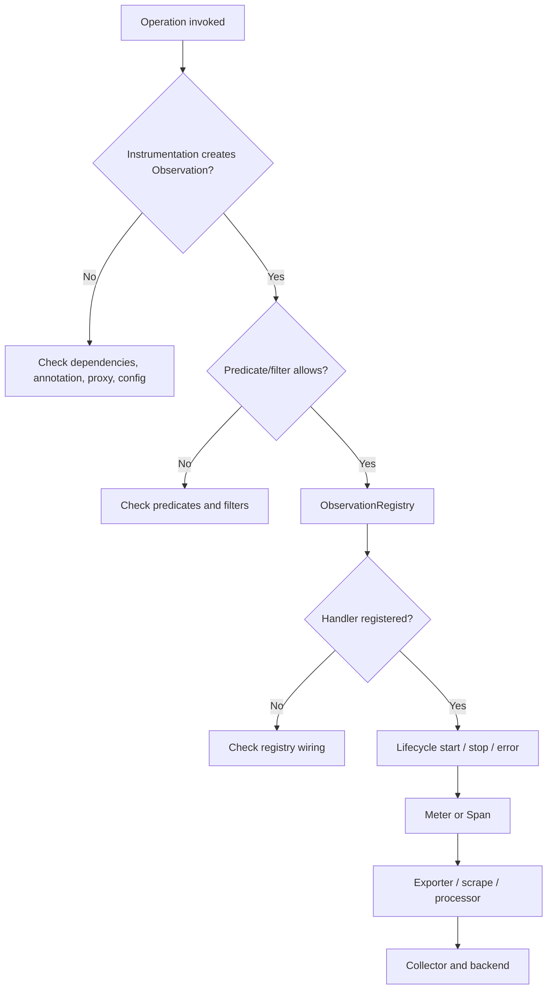

# Observation Not Recorded in Spring Boot

When an **Observation is not recorded**, you need to determine whether the observation was never created, was skipped before starting, was not processed by any handler, or was recorded in-process yet failed to appear in the metrics/tracing backend. These are distinct stages in the Micrometer Observation pipeline; checking the wrong layer often leads to configuration changes that do not solve the root cause.

In the **SPRING_BOOT_OBSERVABILITY** module, Micrometer Observation connects Spring Boot instrumentation to metrics and distributed tracing through `ObservationRegistry` and its handlers. This lesson belongs to the **Troubleshooting** chapter and focuses on tracing the lifecycle from instrumentation point to registry, handlers, meter/span processors, and exporters; checking filters/predicates, AOP/proxies, sampling, async context, and backends.

## 1. Identifying Which Layer Is Missing the Observation

An observation can be absent for several reasons:
1. Instrumentation does not create the observation.
2. The observation is created but skipped by a predicate or condition.
3. The observation does not go through the `ObservationRegistry` the application is observing.
4. The corresponding handler is not registered or does not support that context.
5. The observation has not finished yet, so the timer/span is not recorded completely.
6. The meter/span was created, but the exporter or scrape pipeline did not transfer the data.
7. Sampling excluded the span from trace export.
8. The backend received the data, but the query/dashboard filters it incorrectly.



Identify which signal is missing: metrics, traces, or both. If metrics are present but spans are missing, instrumentation almost certainly ran and the problem lies in the tracing handler, sampler, or exporter. If both are missing, inspect observation creation and the registry first.

## 2. Confirming the Operation Is Actually Instrumented

Start from the concrete operation: an HTTP server request, outbound HTTP client call, database query, message publish/consume, annotated method, or custom business operation using the Observation API.

Confirm that the exact code path is being executed and that the corresponding instrumentation supports that API/client/version. Some integrations only instrument specific abstractions; calling a native client directly can bypass the instrumented wrapper.

Example: an application has the dependency for WebClient instrumentation, yet the actual code instantiates an HTTP client directly without going through the configured bean. The dashboard has no client observation even though requests succeed.

### 2.1. Framework Observations and Custom Observations

Not every method automatically creates an observation. A regular business method only produces an observation if supported by an annotation/interceptor or explicitly instrumented in code.

Do not infer that adding Actuator gives every method metrics/traces. Actuator exposes existing telemetry; it does not automatically instrument every code path.

## 3. Checking Dependencies and Version Compatibility

Observation support depends on Spring Boot, Micrometer, Spring integrations, and client library versions.

Check:
- Spring Boot version and dependency management/BOM.
- The actually resolved Micrometer Observation version.
- Micrometer Tracing bridge if spans are needed.
- Registry/exporter matching the backend.
- Integration modules for Kafka, RabbitMQ, HTTP clients, or databases.
- Whether any dependency is excluded or has an incompatible version override.

Do not inspect only the build file; inspect the dependency tree/runtime classpath to see which versions are actually loaded. A dependency present only in test scope will not work in the running application.

## 4. Checking ObservationRegistry

`ObservationRegistry` is the central hub where observations are created and handlers are applied. A common mistake is custom code using a different registry from the one managed by Spring Boot.

In Spring Boot, prefer injecting the registry from the application context:

```java
@Service
class InventoryLookup {

    private final ObservationRegistry observationRegistry;

    InventoryLookup(ObservationRegistry observationRegistry) {
        this.observationRegistry = observationRegistry;
    }

    InventoryItem find(String sku) {
        return Observation.createNotStarted(
                        "inventory.lookup", observationRegistry)
                .observe(() -> load(sku));
    }

    private InventoryItem load(String sku) {
        return new InventoryItem(sku);
    }
}
```

This example illustrates a synchronous custom observation. Ensure the injected registry is the one with configured handlers. Avoid calling `ObservationRegistry.create()` inside services if you want to use Spring Boot's auto-configured handlers.

### 4.1. Registry Without Handlers

The Observation API can be used in a configuration with no matching handlers. In that case the operation runs normally without producing the expected meters/spans.

Check whether the registry has handlers; whether a meter handler is registered when `MeterRegistry` is present; whether a tracing handler is configured when a tracing bridge is present; and whether a custom registry has been wired to the right handlers.

## 5. Checking ObservationPredicate and ObservationFilter

`ObservationPredicate` can decide whether an observation is created/recorded based on name and context. An overly broad predicate can unintentionally drop needed operations.

`ObservationFilter` modifies context metadata. Filters should not be confused with predicates: filters typically transform context, whereas predicates decide whether to proceed with the observation per the API contract.

Review:
- Does any predicate return `false` for this observation name?
- Does a context-based condition depend on a field that is not yet populated at evaluation time?
- Does a filter remove a key-value pair that the dashboard uses to filter?
- Is a filter/predicate registered twice or in an unexpected order?
- Does a custom convention generate an observation name different from what the dashboard queries?

Write tests for each predicate branch. In a lab, use a known stable observation name to validate the pipeline.

## 6. Checking the Observation Lifecycle

Timers and spans usually require the observation to complete in order to record duration and outcome. If code starts an observation without stopping it on every execution path, data can be missing or incomplete.

Use lifecycle-safe APIs:

```java
Observation observation = Observation.start(
        "inventory.lookup", observationRegistry);
try {
    return loadInventory();
}
catch (RuntimeException ex) {
    observation.error(ex);
    throw ex;
}
finally {
    observation.stop();
}
```

This is a synchronous lifecycle example. In new code, `observe(...)` usually reduces the risk of forgetting `stop` for synchronous operations. For async/reactive code, a method returning a future/publisher does not mean the work is done; you need integrations that support async lifecycles or callbacks handling completion/error/cancel properly.

### 6.1. Unclosed Scopes

If opening `Observation.Scope` manually, always close the scope inside `try-with-resources`/`finally`. An unclosed scope can leak context into subsequent operations or corrupt trace correlation.

Do not hold a scope across thread boundaries arbitrarily. `ThreadLocal` context does not automatically cross executors, Reactor schedulers, or brokers.

## 7. Observation Annotation Not Running

If using `@Observed` or a similar annotation, check:
- The annotation API is on the runtime classpath.
- Your Spring Boot/Micrometer version supports the integration.
- The required aspect/interceptor is configured.
- The bean is managed by Spring.
- The method invocation goes through a proxy.
- Self-invocation does not bypass the proxy.
- Method visibility and proxy strategy fit the integration.
- The annotation is not placed on an unintercepted method.

Self-invocation example:

```java
@Service
class ReportService {

    public void generate() {
        this.buildReport();
    }

    @Observed(name = "report.build")
    public void buildReport() {
        // generate report
    }
}
```

In proxy-based AOP, calling `this.buildReport()` typically bypasses the proxy, so the interceptor may not run. Move the method to another bean or design invocations to go through a framework-supported proxy.

Annotation enablement properties depend on the Spring Boot version. Check the configuration metadata/reference docs for your project's version; do not guess property names from examples for another release.

## 8. Checking MeterRegistry and Metrics Handlers

If the observation exists yet no metrics appear:
- Is `MeterRegistry` present in the application context?
- Is it the right registry type, e.g., a Prometheus registry when Prometheus scraping is expected?
- Is the observation metrics handler registered?
- Does the actual meter name differ from the dashboard query?
- Is the timer/counter only recorded after stop/completion?
- Does a `MeterFilter` deny the meter or limit tags?
- Is the Actuator metrics endpoint exposed and does the caller have permission to access it?

Inspect meters inside the process before checking the backend:

```http
GET /actuator/metrics
GET /actuator/metrics/inventory.lookup
```

These are illustrative URLs; actual meter names may be normalized or converted by the registry. The Actuator metrics endpoint is an in-process inspection tool, not proof that Prometheus scraped successfully.

### 8.1. MeterFilter and Naming

`MeterFilter` can deny or transform meter IDs/tags. A dashboard might query the raw name before the registry applies naming conventions or export mappings.

List the actual meter names/tags in the registry and compare with the query. Do not assume a metric name and conclude instrumentation is broken without checking.

## 9. Checking Tracing Handlers and Sampling

If metrics appear yet traces do not:
- Is an appropriate Micrometer Tracing bridge present?
- Are the tracer and tracing `ObservationHandler` configured?
- Is the sampler dropping this trace?
- Is the span processor receiving completed spans?
- Are the exporter endpoint/protocol correct?
- Are the Collector/backend receiving data?

Sampling may retain only a fraction of traces. When sampling probability is `0` or the parent sampled decision is `false` per policy, seeing no spans in the backend can be expected behavior.

Sampling affects trace export; it should not be used to explain disappearing metric timers/counters.

### 9.1. Parent-Based Sampling

If a service receives an unsampled parent context, a parent-based sampler may skip recording child spans even if local probability is high. Check `traceparent` flags and sampler policies across services.

### 9.2. Unfinished Spans

An open span is not exported until it ends per the processor lifecycle. Check exception paths, callbacks, and shutdown handling if spans go missing at the end of operations.

## 10. Checking Exporter, Collector, and Backend

If meters/spans exist in-process yet are absent in the backend, check each hop:
1. Exporter is configured and enabled.
2. Endpoint/host/port are correct.
3. Protocol matches the receiver.
4. TLS/authentication and credentials are valid.
5. Network/DNS/firewall allow connectivity.
6. Export timeouts/retries are not continuously failing.
7. Collector receiver accepts the signal.
8. Processors do not filter/drop the data.
9. Collector exporter forwards successfully.
10. Backend ingests/indexes and queries the right service/environment.

Pull metrics like Prometheus need the right scrape target and path. OTLP push needs a compatible exporter endpoint/protocol. Do not apply push exporter checks to a scrape pipeline or vice versa.

## 11. Async, Reactor, and Context Propagation

With asynchronous code, observations can be lost or ended prematurely if context/lifecycle is not propagated properly.

Check:
- Do `CompletableFuture` callbacks restore context?
- Does the Reactor pipeline preserve Reactor `Context` across operator/scheduler switches?
- Is the executor instrumented/context-propagated per your setup?
- Does the messaging consumer extract trace context before processing?
- Is the observation stopped on complete/error/cancel rather than when creating the publisher?
- Is `ThreadLocal` accidentally accessed directly across thread boundaries?

Do not confuse lost trace context with lost observation metrics. An operation might still record a timer while its span lacks a parent, or a span gets created while a log callback misses the trace ID.

## 12. Observation Names, Tags, and Dashboard Queries

Observations may be recorded under a different name than the one you are searching for. Conventions or naming conventions can normalize names; registries can map meter names during export.

Check the actual created observation name, the meter name after naming conventions, tag keys/values, whether URI uses a route template or raw path, whether the query filters out the service/environment/instance/outcome by mistake, and whether the dashboard time range/scrape interval covers the operation timestamp.

Do not use dynamic IDs as tags just to find a single observation. Use traces/log correlation for per-request details.

## 13. Symptom-Based Troubleshooting

| Symptom | Possible Cause | First Check |
| --- | --- | --- |
| Neither metrics nor traces | Instrumentation didn't run or wrong registry | Verify operation and `ObservationRegistry` |
| Metrics present, no traces | Tracing bridge, sampler, or exporter | Check tracing handler/sampling |
| Traces present, no timer | Meter handler/registry/filter | Check `MeterRegistry` and `MeterFilter` |
| Observation exists but duration missing | Not stopped or broken async lifecycle | Check completion/`finally` |
| Annotation creates no observation | AOP/proxy/dependency/property | Check Spring bean and interception |
| HTTP observation missing | Server instrumentation or registry wiring | Send request via embedded server |
| Outbound call missing | Client bypassed integration | Check client instance/dependencies |
| Missing only in production | Profile/override/network/credentials | Compare effective config and exporter |
| Missing only one operation | Predicate/filter/name mismatch | Check observation name and conditions |
| Span dropped by sampling | Parent/sample policy | Check trace flags and sampler |
| Process has meter, backend does not | Scrape/export/Collector/query | Inspect each pipeline hop |
| Async span loses parent | Broken context propagation | Check executor/Reactor/message headers |
| Data dropped | Queue full, timeout, or processor filter | Check exporter/Collector diagnostics |
| Dashboard shows no data | Wrong metric name/labels/time range | Query the actual meter |

### Sequential Investigation Workflow

1. Pick a reproducible request/operation.
2. Confirm the instrumented code path is actually executed.
3. Inspect the `ObservationRegistry` used by the operation.
4. Check predicates/filters and the observation name.
5. Verify lifecycle start/stop/error handling.
6. Check handlers: metrics and tracing separately.
7. Confirm the meter/span appears in-process or in a test exporter.
8. Check sampling, exporter, Collector, and backend.
9. Check dashboard queries, labels, and time range.
10. Add a regression test at the layer that caused the failure.

## 14. Practice Exercise: Restoring a Missing Observation

The goal is to distinguish creation, handler, and export failures using one reproducible operation.

### Preparation

- Spring Boot application with Actuator.
- Spring-managed `ObservationRegistry`.
- `SimpleMeterRegistry` or test registry.
- Tracing bridge/test exporter if testing spans.
- A service method with a custom observation or known integration.
- A test client capable of invoking the operation.

### Step 1 — Establish a Baseline Operation

Invoke the operation once and record the observation name, expected meter/span, and timestamp.

### Step 2 — Check the Registry

Inject `ObservationRegistry` from the Spring context. Confirm custom instrumentation uses this registry instead of a manually created one.

### Step 3 — Check Predicates/Filters

Use a known test operation name. Confirm predicates do not reject the observation and filters do not strip identifying metadata.

### Step 4 — Check the Lifecycle

Ensure the observation stops when the operation completes and errors are recorded when exceptions occur. For async paths, verify completion callbacks.

### Step 5 — Check the Metrics Handler

Use `SimpleMeterRegistry`/a test handler to confirm the meter appears after the observation stops. Inspect the actual meter name and tags.

### Step 6 — Check the Tracing Handler

Use a test span exporter. Confirm the span appears when the sampler allows and carries the right trace/parent context.

### Step 7 — Check Framework Integration

If the failure is in annotation or HTTP/client instrumentation, invoke the method through a Spring proxy or send an HTTP request through an embedded server rather than calling a manually instantiated object.

### Step 8 — Simulate Export Failure

Temporarily point to a wrong Collector endpoint in the lab. Confirm the observation/meter is created in-process while exports fail to reach the backend; read exporter diagnostics.

### Step 9 — Restore Endpoint and Verify

Fix the endpoint/protocol/credentials in the lab, trigger a new operation, and confirm the backend receives the data.

### Step 10 — Write a Regression Test

Place the test at the exact layer where the bug occurred: filter unit test, registry wiring, AOP integration, async lifecycle, or exporter integration.

### Acceptance Checklist

| What to Prove | Expected Result |
| --- | --- |
| Instrumentation | Operation actually passes through instrumented code |
| Registry | Uses the right `ObservationRegistry` |
| Predicate/filter | Does not mistakenly drop the observation |
| Lifecycle | Start/stop/error executed properly |
| Metrics | Meter recorded by handler |
| Tracing | Span created when sampling permits |
| Async | Context and completion preserved |
| Export | Distinguishes in-process data from backend ingest |
| Query | Meter name/tags/time range are accurate |
| Regression | Test prevents the issue from recurring |

## 15. Principles to Remember

1. **Identify the missing layer before fixing.** Creation, registry, handler, lifecycle, exporter, and backend are distinct checkpoints.
2. **Use the right `ObservationRegistry`.** A manually created registry may lack Spring Boot's handlers.
3. **Inspect predicates and filters.** Predicates can drop observations; filters primarily adjust context metadata.
4. **Observations must complete their lifecycle properly.** Especially with futures, Reactor, and callbacks.
5. **Metrics and tracing have separate handlers/pipelines.** Having metrics does not prove tracing export works.
6. **Sampling only explains trace visibility.** It is not a general explanation for disappearing metric data.
7. **Annotations require real interception.** Bean/proxy/self-invocation determines whether the aspect runs.
8. **Verify in-process data before checking the backend.** Separate instrumentation from exporter/Collector/query issues.
9. **Verify actual meter names and tags.** Assumed dashboard queries can cause "no data."
10. **Write regression tests at the exact failing layer.** Testing only business outcomes does not prove observations are recorded.

When an observation fails to appear, trace the operation from instrumentation to `ObservationRegistry`, predicates/filters, lifecycle, handlers, and exporter. Separating metrics from tracing and verifying in-process telemetry before inspecting the Collector/backend pinpoints the exact point of signal loss. With a stable reproducible test and the right registry, observation issues can usually be isolated without randomly tweaking multiple configuration settings.
