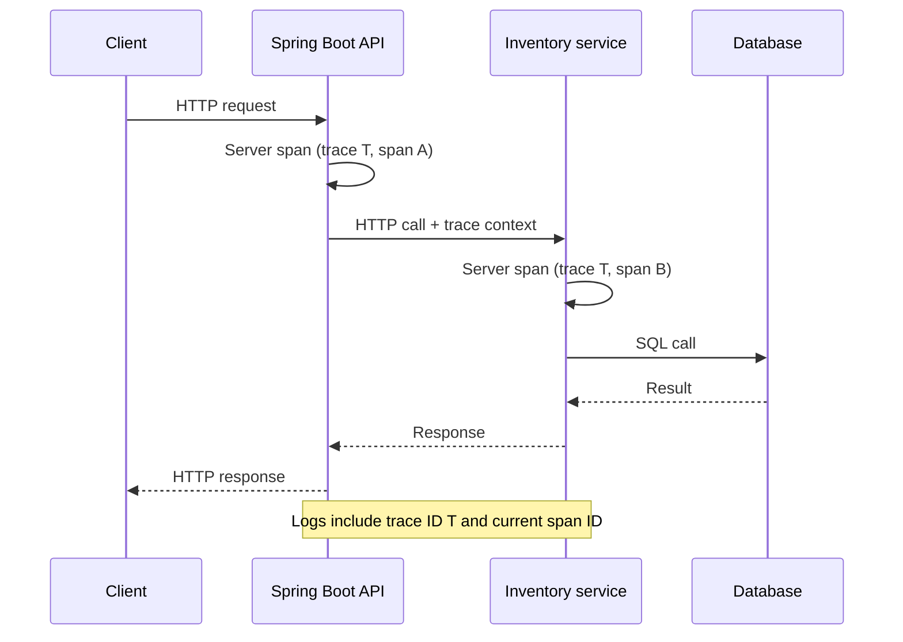
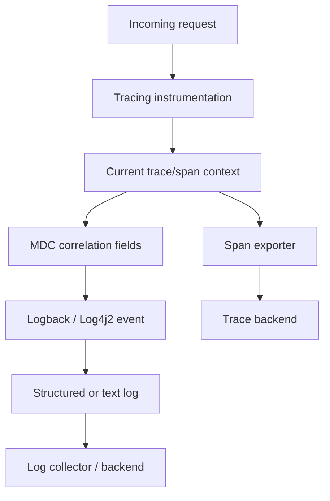
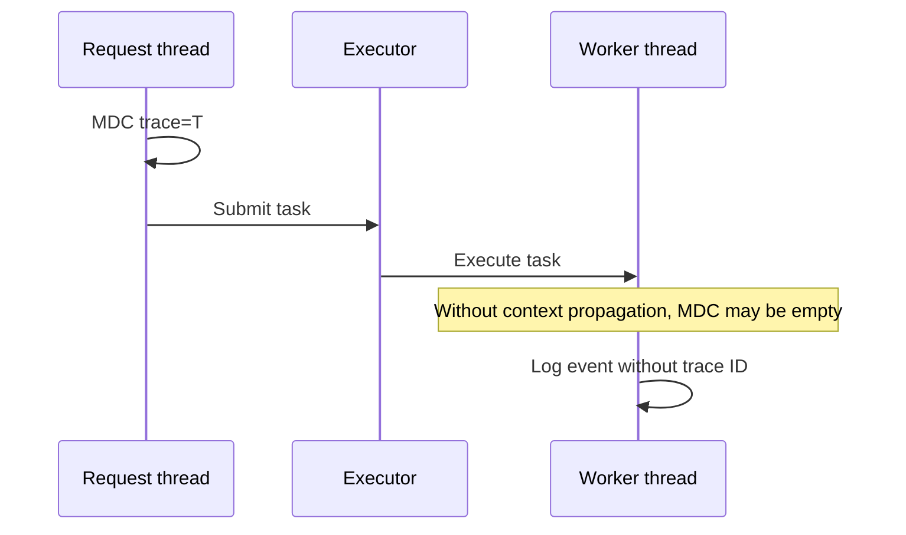

# Logs Missing Correlation ID in Spring Boot

When a request passes through a gateway, a Spring Boot service, a database, and a downstream service, logs from each component often end up in different places. If each log line lacks linking metadata, operators must search by timestamp, message, and hostname—which easily confuses concurrent requests and makes reconstructing the execution flow difficult. A correlation ID or trace ID links log events belonging to the same request/trace so you can pivot from logs to distributed traces.

**Logs missing correlation ID** refers to situations where log records lack the identifier needed to link to a request or trace, or where the identifier appears inconsistently across threads/services. In Spring Boot, correlation can be supplied by the tracing context and placed into MDC via the Micrometer Tracing bridge, logging integration, or a custom filter. You must clearly determine which ID is used, who creates it, how it propagates, and when MDC is cleaned up.

Correlation ID and trace ID are related, though not entirely identical. A trace ID identifies a distributed trace; a span ID identifies an operation within that trace. A correlation ID is an application- or organization-defined identifier for linking events, which may equal the trace ID or be a separate value. Avoid creating multiple parallel IDs unless there is a clear need.

This lesson belongs to the **Troubleshooting** chapter of the **SPRING_BOOT_OBSERVABILITY** module. The module teaches how to set up observability for Spring Boot using Micrometer Observation, metrics, logs, and distributed tracing; covering context propagation, tags/cardinality, exporters, sampling, and signal correlation to investigate errors, latency, and application behavior in production environments. This lesson focuses on why logs lack correlation IDs, how to configure log/trace correlation, and how to verify context propagation.

## Learning Objectives

1. Distinguish correlation ID, trace ID, and span ID.
2. Understand how Micrometer Tracing puts trace context into logging MDC.
3. Verify that logging patterns/structured encoders render MDC fields properly.
4. Identify why correlation is lost across HTTP, executor, Reactor, or message boundaries.
5. Distinguish missing IDs caused by inactive tracing from log formatting bugs.
6. Propagate trace context across HTTP clients and messaging integrations.
7. Generate a correlation ID for requests without a distributed trace when truly needed.
8. Prevent spoofing, log injection, and data leakage via request headers.
9. Test MDC lifecycle, async propagation, and log correlation.
10. Diagnose from inbound request to log backend using an ordered procedure.

## 1. Correlation ID, Trace ID, and Span ID

The three identifiers serve different purposes:

| Identifier | Meaning | Scope |
|---|---|---|
| Trace ID | Identifies the entire distributed trace | Across services in the same trace |
| Span ID | Identifies a single operation/span | One operation within the trace |
| Correlation ID | Identifies a business flow/request per application policy | Scope defined by the system |

One request can produce a trace consisting of multiple spans. Each log line inside a span typically carries the same trace ID and current span ID. When the request calls another service, the trace ID remains the same while the span ID changes for the new operation.



### 1.1. When to Use Trace ID as the Correlation ID?

If the goal is to link logs with distributed traces, the trace ID is usually sufficient and avoids adding another identifier. If a business workflow spans multiple traces or asynchronous events, a separate correlation ID can help tie the entire workflow together.

Do not put a separate correlation ID into the trace ID field. Use distinct field names like `correlation_id` and `trace_id` to avoid mixing semantics.

### 1.2. Do Not Use Span ID as a Global Request ID

Span IDs change across server/client/internal operations. Using span ID to search for an entire multi-service request fragments results. Use trace ID for distributed traces; use span ID to pinpoint logs belonging to a specific operation.

## 2. Micrometer Tracing and Logging Correlation

Spring Boot can integrate Micrometer Tracing with a tracing bridge such as OpenTelemetry or Brave. When tracing and logging correlation are configured, `traceId`/`spanId` can be placed in MDC so the logging framework includes them in log records.

Conceptual pipeline:



MDC is a per-execution-context/thread map in the logging framework. Tracing integrations update and restore MDC when scopes open/close. MDC key names and logging patterns depend on bridge/version/configuration; verify runtime output rather than assuming key names.

### 2.1. Working Tracing Does Not Guarantee Logs Render IDs

Tracing may create spans and export traces successfully while the log pattern does not print MDC. If the trace backend has data yet logs lack trace IDs, check logging configuration and MDC fields before altering the tracing setup.

### 2.2. IDs in Logs Do Not Guarantee Traces Exist

A custom correlation filter can place a request ID into MDC while tracing is disabled or a sampler drops the trace. In that case the correlation ID exists, yet the trace ID has no corresponding span. Distinguish the two cases in your log schema.

## 3. Checking Dependencies and the Tracing Bridge

For Spring Boot to create trace context, you need dependencies matching your version and stack. A Micrometer Tracing setup typically combines a bridge and its corresponding exporter/registry. Adding only a logging pattern does not generate trace IDs; adding only an exporter without a tracer/bridge does not instrument requests either.

Check:
- Spring Boot Actuator/observation integration.
- Micrometer Tracing API.
- An appropriate tracing bridge, such as OpenTelemetry or Brave.
- Corresponding exporter/transport if sending to a trace backend.
- HTTP server/client instrumentation.
- Sampler and tracing configuration.
- Java Agent if used in production.

Do not combine two bridges or two instrumentation owners for the same boundary unintentionally; doing so can create duplicate spans or confusing context behavior.

### 3.1. Auto-Configuration

Spring Boot auto-configuration can create the tracer, handlers, and correlation integration when dependencies/configuration are right. If the application defines its own `ObservationRegistry` or `Tracer` bean, verify that custom beans do not unintentionally replace default configuration.

### 3.2. Inspecting Runtime Beans

In an integration test or debug context, verify `Tracer`/`ObservationRegistry` are present and that a server request creates an observation/span. Do not merely check that the bean exists; execute a request and observe trace context inside a handler or exporter.

## 4. Logging Patterns and MDC Fields

If using Logback, the pattern must render MDC values. Exact syntax depends on the logging backend. An illustrative pattern:

```text
%d{yyyy-MM-dd'T'HH:mm:ss.SSS} %-5level
[trace=%X{traceId:-}, span=%X{spanId:-}]
[%thread] %logger{36} - %msg%n
```

The Micrometer Tracing bridge may use MDC key names like `traceId`/`spanId` or other names depending on config/version. Verify the actual keys in MDC. If a key does not exist, the pattern merely prints an empty value; patterns do not create correlation on their own.

### 4.1. Structured Logging

For JSON logs, expose `trace_id` and `span_id` as top-level fields so the log backend can filter/index them. Example:

```json
{
  "timestamp": "2026-11-22T08:15:30.123+07:00",
  "level": "INFO",
  "message": "Order accepted",
  "trace_id": "4bf92f3577b34da6a3ce929d0e0e4736",
  "span_id": "00f067aa0ba902b7",
  "correlation_id": "checkout-flow-72"
}
```

IDs are illustrative. Pick field names consistent with your log platform schema; avoid mixing `traceId` in one place and `trace_id` in another without a mapping.

### 4.2. Empty MDC Values

When no span is active, `traceId`/`spanId` may be empty or absent. This is valid behavior for startup logs, scheduled tasks without a root observation, or code running outside a request. If all request logs are empty, investigate tracing instrumentation/propagation.

### 4.3. Log Format and Collector Parsing

A log line having the ID locally while the backend lacks the field can be caused by multiline parsing, JSON parsers, field renames, or ingestion pipelines. Compare raw stdout/file output with the parsed document in the backend. Avoid modifying the application when the data is already in raw logs but a parser drops the field.

## 5. Inbound Requests and Correlation IDs

With distributed tracing, server instrumentation normally reads trace context from a standard header such as W3C `traceparent` and creates a server span. Outbound clients continue forwarding context via outbound instrumentation.

If the system also needs a separate correlation ID, it can accept a header issued by the gateway or generate one at a trusted edge. Do not trust an arbitrary client-supplied value as a security identity.

### 5.1. Client-Supplied Headers

A client might send a correlation ID header containing newlines or an extremely long string. Logging that value directly can cause log injection or cardinality/storage abuse. Validate length and allowed characters and canonicalize; never use this header for authorization.

### 5.2. Generating IDs at the Edge

If a separate ID is needed, the gateway or first filter can generate an ID when the request lacks a valid value. Echo the normalized value in a response header if the API contract allows. Do not generate a fresh ID in every service, as that breaks cross-service linking.

### 5.3. Do Not Log Raw Request Headers

Log only allowlisted correlation headers. Never dump all headers, as they can contain `Authorization`, `Cookie`, or credentials. Correlation IDs must never carry user data or secrets.

## 6. Propagation Across HTTP Services

W3C Trace Context typically uses `traceparent` and `tracestate`. HTTP client instrumentation injects the current trace context into outbound requests; receiving server instrumentation extracts context to continue the trace.

```text
traceparent: 00-4bf92f3577b34da6a3ce929d0e0e4736-00f067aa0ba902b7-01
```

Do not manually copy `traceparent` from inbound requests to every outbound request via string manipulation if the tracing library already manages propagation. Use instrumented clients and configured propagators to preserve accurate parent/span relationships.

### 6.1. Uninstrumented Clients

If using a manually constructed HTTP client or an uninstrumented library, trace context may not be injected. Check client beans/customizers and corresponding instrumentation; test against a mock server to confirm requests carry trace headers.

### 6.2. Gateways and Proxies

A gateway can initiate or continue a trace. If the gateway strips trace headers, alters headers, or starts a new trace, downstream logs can show a different trace ID. Compare incoming/outgoing `traceparent` at the gateway and service without logging sensitive values.

### 6.3. Separate Correlation ID

If a separate correlation ID needs to traverse HTTP, inject a standardized allowlisted header. Do not put it into baggage by default; baggage has its own propagation semantics and may be exported as span attributes.

## 7. MDC and Asynchronous Execution

MDC is normally bound to thread execution. When a request submits work to another executor, the worker thread does not automatically inherit the calling thread's MDC. Consequently, logs in the worker lack trace/correlation IDs even though logs before submission had them.



### 7.1. Micrometer Context Propagation

Micrometer Context Propagation provides mechanisms to capture/restore context across execution boundaries when configured. Spring Boot can integrate context propagation with executors/framework paths depending on version and configuration. Inspect the actual executor bean and its decorators/customizations.

Do not manually copy the entire MDC map if it may contain sensitive data or stale context. Propagate only the required fields/contexts and ensure restore/cleanup after the worker completes.

### 7.2. TaskDecorator

With `ThreadPoolTaskExecutor`, a `TaskDecorator` can capture context at submission time and restore it on the worker. If tracing/context propagation integration is already configured, prefer the framework's unified mechanism to avoid double wrapping or context leaks.

Conceptual example:

```java
@Bean
ThreadPoolTaskExecutor applicationExecutor() {
    ThreadPoolTaskExecutor executor = new ThreadPoolTaskExecutor();
    executor.setCorePoolSize(4);
    executor.setTaskDecorator(new ContextPropagatingTaskDecorator());
    return executor;
}
```

Class/API availability depends on the Spring Framework/Spring Boot version. Verify dependencies before use; do not write a custom decorator that copies only the `traceId` string if full tracing context must be propagated.

### 7.3. Context Cleanup

Thread pools reuse worker threads. Context must be restored to its prior state or cleared after a task; otherwise, logs for the next request may carry the previous request's IDs. Test two consecutive tasks with two distinct trace contexts followed by a task with no context.

## 8. Reactor and Reactive Pipelines

In WebFlux/Reactor, execution can hop threads and context is typically stored in Reactor `Context`. MDC `ThreadLocal` does not automatically reflect every operator boundary unless context propagation is integrated.

Check:
- Micrometer `context-propagation` dependency/integration.
- Reactor automatic/context propagation mode for your version.
- WebFlux observation/tracing instrumentation.
- Whether logging occurs inside the reactive chain or in a callback outside the chain.
- Subscription and terminal signals.

Do not create a `Mono`/`Flux` and forget to subscribe; unexecuted code has no operation context to log. In reactive pipelines, test log fields inside `onNext`/`onError`/`doOnEach` or matching hooks according to how the application actually runs.

## 9. Scheduled Tasks and Message Consumers

Scheduled tasks typically have no inbound HTTP parent span. If you want correlation in logs, create a root observation/span per execution; logs inside the task will carry their own trace ID. Do not expect startup logs or all background logs to have a request trace ID.

Message consumers can continue trace context from message headers if producer/consumer instrumentation supports propagation. If a message carries no context, the consumer can start a new root trace and use an approved business correlation ID to link the workflow.

### 9.1. Retries and Redelivery

Each attempt can have its own span while sharing the same business correlation ID. Record the attempt number as a controlled trace/log attribute; never use attempt ID as a metric tag. Verify broker headers are not stripped during retry/dead-letter handling.

### 9.2. Batch Processing

A batch can contain multiple message contexts. Do not arbitrarily assign the first message's trace ID to the entire batch. Use span links or correlation fields per framework semantics to represent multi-source relationships.

## 10. Sampling and Correlation

Sampling decides which traces are recorded/exported, not necessarily whether logs have a trace ID. When a request has an active trace context, log correlation fields can still appear even if the sampler does not export the span; the backend will simply have no matching trace.

This is a common reason operators see a trace ID in logs yet cannot look up the trace:
- Head sampler dropped the trace.
- Tail sampling at the collector/backend dropped the trace.
- Exporter/collector lost the data.
- Trace retention expired.
- Query uses the wrong tenant/time range.

Do not remove the trace ID from logs merely because of sampling; it still ties together log records from the same request. If rare errors must be investigated, consider error-aware sampling/tail sampling per policy and telemetry volume limits.

## 11. Securing Correlation Fields

A correlation ID is not a secret, yet it remains untrusted input if supplied by a client. You must:
- Validate length/character set.
- Strip CR/LF and control characters.
- Never use it as an authorization principal.
- Never include email, account number, or personal data.
- Never place it into metric tags.
- Never log raw `Authorization`/`Cookie` headers.
- Bound baggage propagation and attribute capture.

Standard-format trace IDs should be parsed/validated by the tracing library. Do not accept an arbitrary trace ID and trust the caller based on it.

## 12. Testing Log Correlation

A useful integration test sends a request through the application, performs an outbound call, and captures both logs and spans.

Scenarios:
1. Request without `traceparent`: server creates a new trace when tracing is enabled.
2. Request with valid `traceparent`: service continues the trace per policy.
3. Outbound HTTP call: client injects context.
4. Async executor: worker logs retain expected context.
5. Executor reuse: subsequent requests do not pick up stale MDC.
6. Exception: error logs include the right trace/span IDs.
7. Tracing disabled: separate correlation ID still works if required by policy.
8. Sampling drop: log ID can still appear even if backend has no trace.
9. Malformed correlation header: invalid value is rejected/regenerated.
10. Security: `Authorization`/`Cookie` never appear in logs.

### 12.1. Capturing Logs

Use a test appender or output capture to read structured fields/MDC. Assert field values on the log event rather than merely substring-searching console output if your logging framework supports structured access.

### 12.2. Asserting Trace Relationships

Use an in-memory span exporter to retrieve trace IDs/span IDs and match them against log records. With a batch processor, flush before asserting; use a deterministic sampler in tests.

### 12.3. Do Not Use Thread.sleep

Use latches/futures to wait for workers/logs/exporters to finish with a bounded timeout. Fixed sleeps are flaky on CI and slow tests down.

## 13. Diagnosing Logs Missing Correlation IDs

| Symptom | Possible Cause | How to Check |
|---|---|---|
| All request logs lack trace ID | Tracing bridge/auto-config not active | Dependencies, tracer, and server instrumentation |
| Trace backend has spans, logs are blank | Logging pattern does not render MDC | Inspect MDC keys and encoder |
| Controller has ID, async worker does not | Context does not propagate across executor | `TaskDecorator`/context propagation |
| Worker carries previous request's ID | MDC not cleaned up/restored | Thread reuse test and scope lifecycle |
| Downstream HTTP starts new trace | Client doesn't inject or gateway alters headers | Outbound `traceparent` and client instrumentation |
| Trace ID in logs, missing in trace backend | Sampling/drop/export/retention | Sampler, collector, exporter, and query range |
| Only one replica lacks ID | Config/dependency drift | Per-pod dependencies and effective config |
| JSON log has field, backend can't filter | Parser/field mapping | Raw log vs indexed document |
| Scheduled task lacks ID | No root observation/span created | Task instrumentation |
| Message consumer loses context | Missing broker header propagation | Producer/consumer instrumentation |
| Correlation ID changes on every service | Each service generates a new ID | Header/trace propagation policy |
| ID contains newlines or is oversized | Untrusted header unvalidated | Input validation and log injection controls |

### Investigation Workflow

1. Send a test request and record the inbound `traceparent` if any.
2. Verify server instrumentation creates a current span.
3. Check trace/span values in MDC at controller/service boundaries.
4. Compare raw application logs against the parsed backend document.
5. Verify outbound HTTP requests carry trace context headers.
6. Check executor/Reactor/message context propagation.
7. Check MDC cleanup when threads are reused.
8. Check sampler, exporter, collector, and trace retention.
9. Compare effective config/dependencies across replicas.
10. Run an integration test with log capture and an in-memory span exporter.

## 14. Anti-Patterns to Avoid

| Anti-Pattern | Consequence | Proper Approach |
|---|---|---|
| Only adding `%X{traceId}` to pattern | Pattern does not populate MDC fields | Configure tracing correlation |
| Creating a new correlation ID per service | Cannot link across services | Propagate one ID per policy |
| Using span ID as request ID | Logs fragment by operation | Use trace ID |
| Manually copying MDC without cleanup | Stale context across tasks | Context capture/restore |
| Dumping all inbound headers | Exposes credentials and sensitive data | Header allowlist |
| Using correlation ID for authorization | Caller can spoof identifiers | Independent security identity |
| Putting correlation ID in metric tags | High cardinality | Logs/traces only |
| Expecting every background log to have a request ID | Background tasks have no parent request | Create a root observation when appropriate |
| Disabling sampling to fix missing log IDs | Unnecessary volume increase | Separate logging correlation from trace retention |
| Logging raw client-sent `traceparent` | Untrusted input/log injection | Parse/validate via tracing library |
| Fixing parser before inspecting raw logs | Masks application bugs | Compare raw and indexed events |
| Using `Thread.sleep` in tests | Flaky tests | Latch/future/flush |

## 15. Production Checklist

1. **Identifier policy:** do trace ID, span ID, and correlation ID have clear semantics?
2. **Tracing:** are server instrumentation and tracing bridge configured?
3. **MDC:** does logging integration place the right keys into MDC?
4. **Format:** do text/JSON encoders render `trace_id`/`span_id` consistently?
5. **HTTP:** is trace context extracted/injected across client/server?
6. **Gateway:** does the proxy avoid stripping or rewriting trace headers?
7. **Async:** do executors capture/restore context?
8. **Reactive:** does Reactor context propagation match the version?
9. **Messaging:** do producer/consumer propagate context via headers?
10. **Background:** do scheduled tasks create root observations when needed?
11. **Cleanup:** is MDC/context restored after tasks?
12. **Sampling:** do operators understand log IDs can exist even when traces are dropped?
13. **Security:** are correlation headers validated and free of PII/secrets?
14. **Cardinality:** are IDs excluded from metric labels?
15. **Testing:** are logs cross-checked against exported spans?
16. **Backend:** do parsers/index mappings preserve fields?
17. **Replicas:** are dependencies/configuration consistent?
18. **Runbook:** is there a check procedure from inbound context to log backend?

## 16. Self-Assessment Questions

**Question 1.** How do trace ID and span ID differ?

**Hint:** Trace ID identifies the distributed trace; span ID identifies a single operation within the trace.

**Question 2.** Must a correlation ID differ from a trace ID?

**Hint:** No. Trace ID is usually enough for request linking; a separate correlation ID is useful when a workflow spans multiple traces.

**Question 3.** Why can a logging pattern include a `traceId` field yet still print empty output?

**Hint:** The MDC key is not populated, the tracing bridge is not active, or the key name differs.

**Question 4.** Why do async workers lose correlation IDs?

**Hint:** MDC/thread-local context does not automatically transfer to executor threads; context capture/restore is required.

**Question 5.** Why can a thread pool cause logs to carry an old request's ID?

**Hint:** MDC was not cleaned up/restored after a task and the worker thread was reused.

**Question 6.** What can cause a trace ID to appear in logs while no trace is found in the backend?

**Hint:** Sampling, tail sampling, exporter/collector failure, retention, or a wrong query.

**Question 7.** Should you manually copy `traceparent` to every HTTP client request?

**Hint:** No, if client instrumentation already injects context; use standard propagators to establish proper span relationships.

**Question 8.** Where does a scheduled task get its correlation ID?

**Hint:** Create a root observation/span per execution or use a defined workflow correlation ID.

**Question 9.** Is a client-supplied correlation ID trustworthy for authorization?

**Hint:** No. It is a telemetry linking identifier, not a security identity.

**Question 10.** What should you test to verify log correlation?

**Hint:** Request context, MDC fields, outbound propagation, async cleanup, structured parser, and cross-checking log IDs against exported spans.

## Conclusion

**Log correlation requires a consistent identifier and context properly propagated across every execution boundary.** In Spring Boot, Micrometer Tracing can populate `traceId`/`spanId` into MDC; logging patterns or structured encoders must render those fields. Inspect tracing instrumentation, MDC integration, HTTP propagation, executor/Reactor context, and backend parsing independently to pinpoint where IDs are lost. Use trace ID for distributed request correlation, create a separate correlation ID only when business workflows demand broader semantics, validate all client-supplied IDs, and always clean up context on thread pools. Test logs alongside exported spans to ensure correlation works for both synchronous requests and async/background processing.
