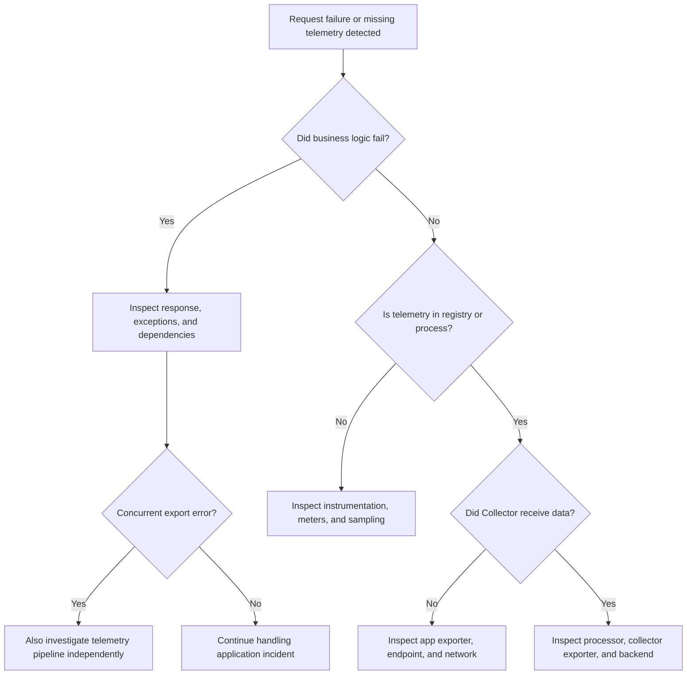

# Distinguishing Application Errors from Exporter Errors

When dashboards lack data, traces are missing, or the system emits numerous error logs, it is easy to conclude that the application is failing. In reality, the fault may lie in two different places: **the application's business processing path** or **the observability data collection and delivery pipeline**. Both types of errors can appear independently or simultaneously, yet their investigation and remediation workflows differ.

The goal of this lesson is to pinpoint where the fault lies before changing code, configuration, or infrastructure. A key rule is to verify business outcomes independently of whether telemetry reached the backend.

## 1. Two Paths to Distinguish

### 1.1. The Application Processing Path

The application path starts when a request enters Spring MVC or WebFlux, then passes through controller, service, repository, and dependencies such as databases, caches, or other HTTP services. Failures along this path can fail the request, return incorrect business results, or prevent a background task from completing.

Examples:

- A controller or service throws an exception due to invalid input.
- A database query times out or violates a constraint.
- A downstream dependency returns HTTP 5xx.
- Business logic computes the wrong result and returns an incorrect payload despite HTTP status 200.

These are application errors or errors in dependencies used by the application. You must inspect stack traces, business logs, request outcomes, and dependency state to find the root cause.

### 1.2. The Telemetry Collection and Export Path

Spring Boot can produce telemetry through Micrometer Observation and matching instrumentation. Observations are processed by handlers to generate metrics, traces, or logging correlation. Registries and exporters then forward the data to a collector or observability backend.

A typical path looks like:

```text
Request / background task
        |
        v
Controller -> Service -> Repository -> Dependency
        |
        v
Micrometer Observation / instrumentation
        |
        +----> MeterRegistry ----> Metrics exporter ----+
        |                                               |
        +----> Tracer ---------> Trace exporter --------+--> Collector --> Backend
        |                                               |
        +----> Logging / correlation ------------------+
```

An exporter error occurs when telemetry data is not forwarded successfully—for example due to a wrong endpoint, DNS failure, TLS, authentication, timeout, full queue, or rejection by the collector/backend. Such errors can lose or delay metrics, traces, or logs while business requests keep succeeding.

In practice, exporters can live inside the application process or inside the collector. Therefore, when saying "exporter error," clarify which component is sending data: the exporter inside Spring Boot or the exporter inside the OpenTelemetry Collector.

### 1.3. One Error Can Mask the Other

An application can return HTTP 500 and fail to export traces at the same time. In that case there are two issues to investigate independently: why the request failed and why traces did not reach the backend. Never assume an exporter error caused the business error, and never assume every exporter error log is the root cause of an HTTP 5xx.

## 2. Initial Diagnostic Clues

The table below helps classify symptoms before diving deep into configuration.

| Symptom | First Possibility to Check | Evidence to Look For |
|---|---|---|
| Request returns 5xx, stack trace has exception | Application or dependency | Request logs, exceptions, error span if present, database or dependency logs |
| Business requests/tasks succeed yet traces do not appear | Tracing pipeline | Sampling, instrumentation, trace exporter, collector receiver, and backend |
| Metrics exist in app registry yet not on dashboard | Metrics export pipeline | Registry/exporter config, collector connectivity, ingest errors, and backend filters |
| Only metrics missing, traces still present | Metrics pipeline | Metrics exporter, scrape/export interval, registry, and collector metrics config |
| Only traces missing, metrics still present | Tracing pipeline | Sampling, tracer bridge, trace exporter, collector, and retention |
| Exporter logs report timeout, 401, 403, or TLS errors while requests are normal | Exporter or collector/backend | Endpoint, credentials, certificate, DNS, network, and receiver-side logs |
| Request 5xx alongside telemetry send errors | Likely two independent errors | Investigate request and telemetry in two separate tracks |

An HTTP status reflects the outcome at only one layer of the request. A proxy, gateway, or load balancer can also generate 4xx/5xx responses. Identify which component returned that status before concluding Spring Boot code failed.

## 3. Ordered Investigation Workflow

### Step 1: Confirm Whether the Application Actually Failed

Pick a specific request or time window and record timestamp, route, HTTP status, and request ID or trace ID if available. Cross-check the client response with gateway access logs and application logs.

Check these questions:

1. Did the request reach the Spring Boot instance?
2. Did the application return the error response, or did the gateway generate it?
3. Did the business task complete? For background jobs, check job status or message acknowledgements rather than looking only at HTTP status.
4. Were there exceptions or dependency errors at the same timestamp?

If the business operation failed, investigate exceptions and dependencies as an application incident. Still note any telemetry errors if present, without letting them replace finding why the request failed.

### Step 2: Read Application Logs and Exceptions

Find the full stack trace, the throwing class, and the cause chain (`Caused by`). Separate exceptions originating in business code from exceptions thrown while sending telemetry. Package names, thread names, and timestamps usually distinguish these two groups.

For instance, database query failures normally occur on a request-handling thread with causes tied to JDBC, transactions, or drivers. OTLP send errors mention exporters, gRPC/HTTP clients, connections, TLS, authentication, or collectors. Logger names depend on libraries and versions, so do not filter by a single hardcoded logger name alone.

A WARN or ERROR exporter log line is not proof that a request failed. Correlate logs by request ID, thread, timestamp, and HTTP status to determine whether it happened inside or outside the business processing path.

### Step 3: Inspect Telemetry Inside the Application Process

If Actuator is enabled and the endpoint is exposed, you can inspect meters held by the application via the metrics endpoint. Example:

```yaml
management:
  endpoints:
    web:
      exposure:
        include: health,info,metrics
```

After configuring the endpoint appropriately for the environment, query a specific meter, such as:

```http
GET /actuator/metrics/http.server.requests
```

Actual meter names depend on instrumentation and library versions. You can call `/actuator/metrics` to list available meters, then query the specific meter under investigation.

Output at `/actuator/metrics` shows that the meter exists in the process's registry. It **does not prove** the exporter successfully sent data to the collector or backend. If the meter has data inside the app while dashboards are empty, shift focus to the export and ingest path.

Similarly, `/actuator/health` primarily reflects configured health indicators. This endpoint does not implicitly confirm that the metrics exporter or trace exporter is sending data successfully. Do not use an `UP` health endpoint as sole proof for the entire telemetry pipeline.

In production, expose only necessary endpoints, restrict access, and follow internal security policies. Never open management endpoints publicly just for temporary debugging.

### Step 4: Inspect Exporter Configuration in Spring Boot

For exporters running inside the application, check in sequence:

- **Endpoint and protocol:** do host, port, path, and HTTP/gRPC protocol match the collector's receiver? OTLP/gRPC commonly uses port `4317`, OTLP/HTTP commonly uses `4318`; actual configurations may vary.
- **Authentication:** are tokens, API keys, headers, tenant IDs, or credentials accurate and unexpired?
- **TLS:** are certificate chains, hostnames, truststores, and certificate expiry valid?
- **Network:** does DNS resolve, do routes/firewalls allow connectivity, and are connections being reset?
- **Timeouts and retries:** are timeouts too short, do retries behave properly, and do prolonged failures build up queues?
- **Batching and export cadence:** are batch size, export interval, and queue limits appropriate for traffic volume?
- **Resources and filters:** do resource attributes, processors, or filters drop the expected data?

Property names and exporter configuration vary by Spring Boot, Micrometer, and registry library versions. Cross-check against your project's actual version and the documentation for the installed exporter; do not copy properties from another version without verifying.

### Step 5: Inspect the Collector and Backend

If the application connects successfully to the collector, inspect the receiving side next:

1. Does the receiver accept the right protocol and port?
2. Does the collector accept data or reject it due to payload, authentication, or pipeline config?
3. Do processors filter, sample, rate-limit, or drop data?
4. Does the collector's exporter send successfully to the backend?
5. Does the backend reject data due to quotas, tenants, schemas, timestamps, retention, or ingest limits?

Monitor collector logs alongside internal metrics for accepted, sent, failed, enqueue-failed, and dropped counts. Exact metric names depend on the OpenTelemetry Collector and exporter versions. If the collector receives data yet cannot forward it, investigate the collector's exporter and target backend. If the collector receives nothing, return to inspecting the application's exporter, network, and receiver.

### Step 6: Compare Across Signal Types

Metrics, traces, and logs may use different exporters, queues, processors, and retention policies. Do not conclude that all observability is broken just because one signal type is missing.

Examples:

- Metrics keep incrementing while traces disappear: check sampling, tracer bridge, trace exporter, and trace pipeline.
- Traces exist while metrics fail to update: check meter registry, metrics exporter, export interval, or scrape target.
- Logs contain application exceptions without linked traces: check trace context propagation, correlation, and logging config.
- All three signals are missing: check shared connectivity, collector, authentication, backend, or observability infrastructure outages.

### Step 7: Assess Impact on Requests

Exporters can send data in asynchronous batches, yet the specific implementation dictates how much impact occurs when the backend is slow or unreachable. Check queues, threads, CPU, memory, shutdown time, and request latency while the exporter retries.

A custom exporter sending synchronously on the request path can increase latency or fail requests if exceptions go unhandled. Therefore, never claim exporters are always independent of business logic. Inspect how the exporter is wired and determine whether export failures can propagate back into the processing flow.

## 4. Quick Decision Flow



This diagram provides an isolation order. In distributed systems, you may need to investigate multiple branches in parallel when evidence points to simultaneous failures.

## 5. Common Scenarios

### Scenario A: Request Returns 500 Yet Trace Still Appears

An endpoint returns HTTP 500. The tracing backend still contains the matching trace, where the service span has an error status and database call duration spiked.

**Assessment:** the telemetry pipeline is working well enough to record the request. Focus on stack traces, database spans, transactions, and dependencies. There is no need to change exporter endpoints simply because the request returned 500.

**Action:** identify the first exception, inspect the failing query or dependency, and verify request success on retry. Keep the error trace for root-cause analysis.

### Scenario B: Request Returns 200 Yet Dashboard Has No Metrics

The application processes requests normally. Querying `/actuator/metrics/http.server.requests` shows meter data, yet dashboards do not update.

**Assessment:** in-app instrumentation is likely creating meters. Next checkpoints are registry/exporter, collector connectivity, ingestion config, and dashboard queries.

**Action:** cross-check exporter logs, OTLP endpoint, receiver status, collector internal metrics, and backend filters. If the collector already received data, inspect the collector exporter and dashboard queries next.

### Scenario C: App Returns 500 and Reports OTLP Timeout Simultaneously

Within the same window, application logs show a service exception and exporter logs show timeouts sending traces.

**Assessment:** these are likely two concurrent errors. The service exception explains why the request failed; the OTLP timeout explains why traces may not reach the backend. There is no evidence yet that one caused the other.

**Action:** use local logs and remaining working signals to investigate the service error. Simultaneously inspect network, collector, and the trace exporter's queue. After remediation, verify both request error rate and export failure rate.

### Scenario D: Metrics Exist Yet Traces Do Not

Dashboards still show JVM metrics and HTTP request metrics, yet no trace is found for a route.

**Assessment:** a working metrics pipeline does not imply a working tracing pipeline. Before blaming the exporter, check sampling, route instrumentation, propagation, and trace search filters.

**Action:** verify whether the route creates spans, whether sampling retains those traces, whether trace IDs propagate across services, and whether the trace exporter sends to the right backend/tenant.

## 6. Causes Easily Mistaken for Exporter Errors

| Symptom | Why Easily Mistaken | How to Verify |
|---|---|---|
| Traces absent due to sampling | No traces retained so UI is empty | Check sampler, sampling probability, and tail-sampling policies |
| Filter or processor drops data | Exporter succeeds yet data is dropped before storage | Check filter/processor config and dropped record counters |
| Dashboard queries wrong | Data exists yet query, label, or time range mismatches | Search directly by service, resource attributes, and wider time range |
| Wrong resource attribute | Data sits under another service name, environment, or tenant | Check actual resource attributes at collector/backend |
| Retention or ingest quota | Backend accepts then drops/deletes per policy | Check ingest responses, quotas, and retention policies |
| Delayed data | Batching, retries, or backlog delay dashboard updates | Compare event timestamp with ingest timestamp and queue depth |
| Clock skew | Trace falls outside viewed time window | Verify time sync across application, collector, and backend |
| Only one route or span type missing | Instrumentation or propagation skips that code path | Check instrumentation and context propagation for that route/service |

These cases can coexist with exporter errors. Rely on evidence at each stage rather than merely whether a dashboard shows data.

## 7. Remediation by Fault Location

### When the Fault Is in the Application or Dependency

- Fix the root cause in the controller, service, repository, or dependency.
- Preserve exceptions and necessary context for investigation; never turn failures into success responses just to make dashboards look cleaner.
- Inspect dependency timeouts, retries, and circuit breakers to prevent cascading failures.
- Use available traces and metrics to identify latency, retry counts, and failing components.

### When the Fault Is in the Application Exporter

- Fix endpoint, protocol, port, path, authentication, or TLS to match the actual receiver config.
- Restore DNS and network connectivity; inspect firewalls, proxies, and connection limits.
- Tune batching, queues, timeouts, and retries to match traffic and collector capacity.
- Monitor dropped data when queues fill up or retries are exhausted.
- Check whether the exporter runs synchronously on the request path; handle errors so business requests are not disrupted unintentionally.

### When the Fault Is in the Collector or Backend

- Fix receivers and pipelines to accept the right protocols, signals, and resources.
- Check collector processors, memory limiters, queues, and exporters.
- Address quotas, authentication, schemas, retention, or ingest limits at the backend.
- Monitor accepted, successfully sent, and failed counts to catch backlogs or data loss.

Do not disable all instrumentation just to silence exporter error logs. Doing so destroys telemetry needed for the next incident. If emergency load shedding is needed, adjust sampling or export scope in a controlled way, document what data is reduced, and monitor the impact.

## 8. Incident Handling Checklist

- [ ] Record timestamp, service, instance, route, status, and request/trace ID if available.
- [ ] Confirm whether the error response came from a gateway or the application.
- [ ] Check the first exception and dependency errors at the same timestamp.
- [ ] Inspect in-process meters via Actuator if endpoints are enabled and authorized.
- [ ] Identify which signal is missing: metrics, traces, logs, or multiple.
- [ ] Inspect exporter logs and configuration inside the application.
- [ ] Verify whether the collector receiver is receiving data.
- [ ] If the collector receives data, check processors, collector exporter, and backend.
- [ ] Check sampling, filters, resource attributes, retention, and time range.
- [ ] Assess queues, retries, latency, and whether the exporter affects the request path.
- [ ] Post-remediation, verify business outcomes and telemetry export capability separately.

## 9. Recording and Prevention Principles

Build separate alerts for application health and telemetry pipeline health. Application alerts can monitor request error rates, latency, dependency errors, and job states. Pipeline alerts can monitor export failures, dropped records, queue depth, collector receivers/exporters, and ingest lag. Separating these two alert groups tells operations immediately whether the business logic is degraded or observability visibility is impaired.

During design, ensure telemetry delivery failures cannot easily cascade into business failures. Favor properly bounded batching and retries, monitor queues, and establish well-defined degradation behavior. At the same time, never assume every exporter is asynchronous: verify how your specific libraries and configurations behave in the running version.

A thorough investigation always answers two separate questions: **did the application complete its work properly**, and **was telemetry generated, forwarded, received, and stored successfully**. Once both questions are answered, fault boundaries become clear and remediation causes fewer unintended side effects.
