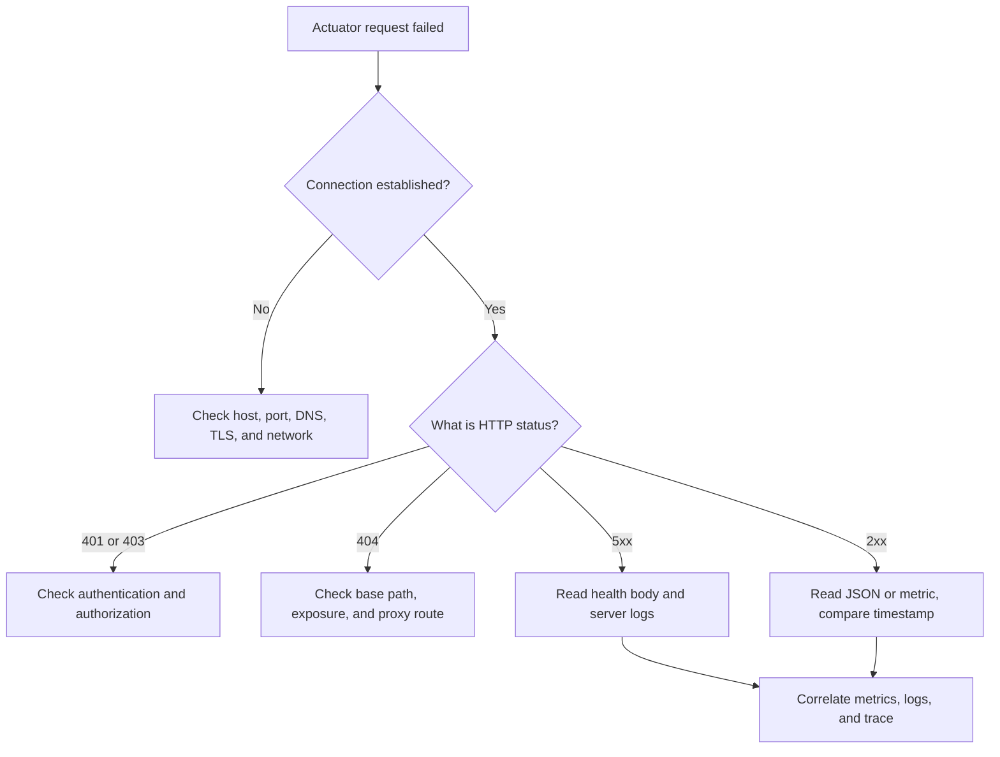

# Troubleshooting with curl and Actuator

In the **Troubleshooting** chapter of the `SPRING_BOOT_OBSERVABILITY` module, this lesson shows how to use `curl` to call Spring Boot Actuator endpoints, read health checks and metrics, inspect logging configuration, and correlate results with logs and distributed traces. This is a hands-on step in Spring Boot's observability workflow: Micrometer Observation creates the observation context, metrics describe trends and latency, logs record events, and distributed tracing shows which components a request traversed.

Actuator provides operational data over HTTP; `curl` sends requests and shows exact status codes, response headers, bodies, and response times. Together these two tools speed up incident isolation, though they only return data the application has enabled, configured, and authorized the caller to access.

## 1. Objectives and Scope of Inspection

After this lesson, you will be able to:

- Determine the Actuator address and verify whether endpoints are enabled, exposed, and properly protected.
- Distinguish overall application health from liveness and readiness states.
- List metrics, read measurements, and filter metrics by tag.
- Inspect runtime log levels and temporarily raise log levels during an investigation.
- Use status codes, response times, trace context, and timestamps to link a request to metrics, logs, and traces.
- Recognize common failures such as connection refused, timeout, 401, 403, 404, and 503.

`curl` is an HTTP client; it does not create telemetry on its own. Nor does Actuator replace log and trace storage and analysis backends. To obtain complete telemetry, the application must be instrumented with Micrometer, configured with an appropriate registry or tracing bridge, and emit signals to the corresponding observability backends.

## 2. Identifying Actuator Address and Access Permissions

Under common defaults, Actuator uses the base path `/actuator` on the same HTTP port as the application. For instance, if the application runs at `http://localhost:8080`, the health URL is `http://localhost:8080/actuator/health`.

Addresses can change via configuration:

```yaml
management:
  endpoints:
    web:
      base-path: /actuator
      exposure:
        include: health,info,metrics,prometheus,loggers
```

`exposure.include` determines which endpoints are exposed over the web. Having an endpoint on the classpath or enabled does not automatically make it accessible over HTTP. The `prometheus` endpoint also requires a matching Prometheus registry, typically the `micrometer-registry-prometheus` dependency.

To separate the management port from the request-serving port, you can configure:

```yaml
management:
  server:
    port: 8081
```

In that case, the Actuator URL in the example becomes `http://localhost:8081/actuator`. Verify the exact host, port, scheme (`http` or `https`), and base path for the environment under investigation. If Actuator sits behind a reverse proxy or ingress, the external URL may differ from the internal URL.

The examples below use the `BASE_URL` variable for the Actuator address:

```bash
BASE_URL="http://localhost:8080"
curl -i "$BASE_URL/actuator"
```

The root endpoint may return a discovery document with links to exposed endpoints. If discovery is disabled or blocked, call a known endpoint directly:

```bash
curl -i "$BASE_URL/actuator/health"
```

Common `curl` options used during diagnostics:

| Option | Meaning |
| --- | --- |
| `-i` | Display both HTTP response headers and body. |
| `-v` | Display connection details and request/response headers. |
| `-sS` | Hide the progress bar while still showing `curl` errors. |
| `-G` | Send `--data-urlencode` data as GET query string parameters. |
| `-u user:password` | Send HTTP Basic Authentication. |
| `-H 'Header: value'` | Add an HTTP header, such as `Authorization` or `traceparent`. |
| `-w '...'` | Print summary details such as HTTP status and request timing. |

On Windows PowerShell, call `curl.exe` explicitly to ensure you invoke the real `curl` binary rather than PowerShell's alias. The commands below use POSIX shell syntax; in PowerShell, adapt variables and quoting to PowerShell syntax.

If the endpoint requires authentication, use the mechanism configured in that environment. For example, with Basic Authentication:

```bash
curl -i -u "$ACTUATOR_USER:$ACTUATOR_PASSWORD" \
  "$BASE_URL/actuator/health"
```

Or with a bearer token:

```bash
curl -i -H "Authorization: Bearer $ACTUATOR_TOKEN" \
  "$BASE_URL/actuator/health"
```

Never place real passwords or tokens into documentation, shared logs, or commands saved in shell history. Use a secret store or the environment's credential issuance mechanism, and query only endpoints your account is authorized to access.

## 3. Checking Health, Liveness, and Readiness

The health endpoint shows what the application and its health contributors report:

```bash
curl -i "$BASE_URL/actuator/health"
```

A minimal response may look like:

```json
{
  "status": "UP"
}
```

When authorized to view details, the response may include component statuses such as database, disk space, or custom application health indicators. When details are hidden, seeing only `status` is normal behavior—not proof that contributors do not exist.

To expose details in a controlled manner, you can configure:

```yaml
management:
  endpoint:
    health:
      show-details: when-authorized
```

The application needs appropriate authorization controls so only permitted operators see details. Do not enable `always` on publicly reachable endpoints, because health contributors can disclose service names, infrastructure state, or internal metadata.

### 3.1. Liveness and Readiness

When health probes are enabled, Spring Boot provides health groups for liveness and readiness:

```yaml
management:
  endpoint:
    health:
      probes:
        enabled: true
```

Check each group:

```bash
curl -i "$BASE_URL/actuator/health/liveness"
curl -i "$BASE_URL/actuator/health/readiness"
```

- **Liveness** answers whether the process is still alive enough to keep running. If liveness fails, the orchestrator may restart the container or process.
- **Readiness** answers whether the instance is ready to accept traffic. An application still starting up or unable to reach an essential dependency may not be ready yet.

Do not include every external dependency in liveness. For instance, a temporary database disconnect usually does not mean the JVM is dead; if liveness depends on the database, the orchestrator may continuously restart instances and worsen the outage. Only include a dependency in readiness when it is genuinely required for the instance to serve requests.

Under default status mappings, `UP` typically returns HTTP 200; `DOWN` or `OUT_OF_SERVICE` typically return HTTP 503. Applications can customize mappings, so read both the HTTP status and the JSON `status` field. Do not conclude from only one of the two values.

## 4. Reading and Filtering Metrics

The metrics endpoint lists metric names published by the application:

```bash
curl -sS "$BASE_URL/actuator/metrics"
```

The response returns a list of metric names such as `jvm.memory.used`, `process.uptime`, `system.cpu.usage`, or `http.server.requests`, depending on dependencies, versions, and instrumentation in use. If an expected metric is missing, inspect instrumentation, the registry, and whether the metric has been created in the current process yet.

Read a specific metric by appending its name to the path:

```bash
curl -sS "$BASE_URL/actuator/metrics/http.server.requests"
```

A `Timer` response may include `measurements` such as `COUNT`, `TOTAL_TIME`, and `MAX`, along with `availableTags`. Measurement names and units depend on metric type. For a `Timer`, check `baseUnit` and the meaning of each measurement before comparing. `COUNT` is the number of recordings, `TOTAL_TIME` is total elapsed time, and `MAX` is the maximum value within the meter's tracking window; `MAX` does not represent the entire lifetime of the application.

### 4.1. Filtering by Tag

Metrics often carry multiple analysis dimensions. For `http.server.requests`, common tags include `method`, `uri`, `status`, `outcome`, and `exception`; the actual list depends on instrumentation. The `availableTags` field shows tag keys and currently available values.

You can filter by multiple tags by passing multiple `tag` parameters:

```bash
curl -G -sS "$BASE_URL/actuator/metrics/http.server.requests" \
  --data-urlencode 'tag=method:GET' \
  --data-urlencode 'tag=status:500'
```

The example above looks up GET requests with status 500 if both tags and values exist on the metric. Use exact values shown in `availableTags`; if the query fails to match tags, the response may omit the corresponding measurements.

The `uri` tag should use a route template like `/api/orders/{id}` rather than a URL containing concrete ID values. Attaching user IDs, order IDs, emails, or random strings as metric tags creates very high cardinality, driving up memory and storage costs in the metrics backend. For per-request identifiers, use controlled traces or logs rather than creating a time series per identifier.

### 4.2. Inspecting the Prometheus Endpoint

If the application includes a Prometheus registry and exposes the matching endpoint:

```bash
curl -sS "$BASE_URL/actuator/prometheus"
```

The response is plain text in Prometheus exposition format, not JSON. You can quickly filter a metric with `grep` on Linux/macOS:

```bash
curl -sS "$BASE_URL/actuator/prometheus" | grep 'http_server_requests'
```

In PowerShell, use `curl.exe` and `Select-String`:

```powershell
curl.exe -sS "$BASE_URL/actuator/prometheus" | Select-String 'http_server_requests'
```

Prometheus metric names may be normalized from Micrometer names—for example, dots become underscores and `Timer`s produce count or sum series. Therefore, names shown in `/actuator/metrics` and `/actuator/prometheus` do not necessarily match verbatim. This endpoint lets Prometheus scrape data; it does not store history or render dashboards itself.

## 5. Inspecting Loggers at Runtime

Actuator `loggers` shows the log level currently applied to a logger. Example:

```bash
curl -sS "$BASE_URL/actuator/loggers/com.example.orders"
```

The response may include `configuredLevel` and `effectiveLevel`. `configuredLevel` indicates the level explicitly configured on that logger; `effectiveLevel` is the effective level after inheriting from parent loggers.

During an authorized investigation session, you can temporarily raise a package's log level to `DEBUG`:

```bash
curl -i -X POST "$BASE_URL/actuator/loggers/com.example.orders" \
  -H 'Content-Type: application/json' \
  -d '{"configuredLevel":"DEBUG"}'
```

Once enough evidence has been collected, restore the configured log level. Send `null` to clear the logger's explicit setting and revert to its inherited level:

```bash
curl -i -X POST "$BASE_URL/actuator/loggers/com.example.orders" \
  -H 'Content-Type: application/json' \
  -d '{"configuredLevel":null}'
```

Changes via this endpoint affect runtime state; do not treat them as permanent changes in configuration files. `DEBUG` log levels can increase log volume, I/O load, and the risk of logging sensitive data. Scope the package, duration, and access permissions tightly, and restore the appropriate level after investigating.

## 6. Using curl to Measure Responses and Inspect Failing Requests

When an API exhibits slowness or errors, record status code and response time first:

```bash
curl -sS -o /dev/null \
  -w 'http=%{http_code} total=%{time_total}s connect=%{time_connect}s\n' \
  --connect-timeout 3 \
  --max-time 10 \
  "$BASE_URL/api/orders/42"
```

`time_connect` measures connection setup time; `time_total` is total elapsed time from start to completion. The command above discards the body for concise output. When you need the body and headers to analyze an error, use:

```bash
curl -i "$BASE_URL/api/orders/42"
```

To inspect TLS, DNS, connection, and header details, use `-v`. Headers or bodies can contain cookies, tokens, or business data; review output before sharing it:

```bash
curl -v "$BASE_URL/api/orders/42"
```

`curl` measures timing from the client side. This duration can include DNS lookup, TCP handshake, TLS handshake, server processing time, and network latency. To identify which part is slow, cross-check with server-side metrics and trace spans rather than treating `time_total` as pure application processing time.

## 7. Correlating Requests with Logs and Distributed Traces

Actuator metrics show overall trends; to find the root cause of a specific request, correlate the request with logs and traces. In configurations with Micrometer Tracing and matching propagation, the application can accept W3C Trace Context via the `traceparent` header and pass that context along to downstream services.

Example sending a valid W3C-formatted trace context:

```bash
curl -i "$BASE_URL/api/orders/42" \
  -H 'traceparent: 00-4bf92f3577b34da6a3ce929d0e0e4736-00f067aa0ba902b7-01'
```

This is a sample trace context to demonstrate passing the header, not an identifier to reuse in production. When tracing is properly configured and the request is sampled, the trace ID can appear in logs via MDC and in the tracing backend. Field names or formatting depend on logging patterns, bridges, and exporters. If a request is dropped by sampling, the trace may not appear in the backend even though the application processed the request.

Actuator `/metrics` is not an endpoint for reading full logs or looking up traces by ID. Use your log storage tool to search for `traceId`/`spanId`, and your tracing backend to open the trace and its spans. A typical investigation flow:

1. Send a request with `curl`, recording timestamp, URL, HTTP status, and `time_total`.
2. Check `/actuator/health` and `/actuator/health/readiness` to determine whether the instance is healthy and ready for traffic.
3. Check `/actuator/metrics/http.server.requests`, filtering by `uri`, `method`, and `status` to inspect recorded request counts and durations.
4. Search logs by time window and trace ID if available. Read errors, exceptions, and dependency details around the request timestamp.
5. Open the trace in the backend to see which span took time, which service threw errors, and whether context propagated across service boundaries.

If metrics show rising latency without a specific trace, narrow down the time window, route, and status first. If a trace stops at one service, check instrumentation and propagation at the next outbound boundary. If logs lack a trace ID, inspect tracing configuration, logging MDC, and sampling; do not infer that the request was never processed.

## 8. Diagnosing Common Errors When Calling Actuator

| Result | Common Cause | Next Check |
| --- | --- | --- |
| Cannot connect or HTTP code `000` | Wrong host/port, service not running, DNS/TCP failure, management port closed, or timeout. | Check address, port, process status, network policy, and `--connect-timeout`/`--max-time`. |
| `301` or `302` | Reverse proxy redirects HTTP to HTTPS, or base path changed. | Inspect `Location` in response headers via `-i`; call the exact scheme and path. |
| `401 Unauthorized` | Missing or wrong credentials. | Check authentication type, token expiration, and sent headers. |
| `403 Forbidden` | Authenticated, yet principal lacks permission for the endpoint. | Check authorization rules and operator account permissions. |
| `404 Not Found` | Wrong base path, endpoint not exposed, endpoint absent in running version/dependencies, or proxy fails to route to management port. | Call a known health endpoint, check exposure config and proxy routing. |
| `405 Method Not Allowed` | Wrong HTTP method for endpoint. | Use GET for reads; use POST only for supported mutating actions such as changing log levels. |
| `429 Too Many Requests` | Rate limiting at proxy, gateway, or protection layer. | Reduce polling frequency and check request limit policies. |
| `500 Internal Server Error` | Error inside endpoint, health contributor, or application. | Correlate server logs at request timestamp and check the relevant contributor. |
| `503 Service Unavailable` | Health status may be `DOWN`/`OUT_OF_SERVICE`, or management service is not ready yet. | Read health body if permitted; check readiness and essential dependencies. |

HTTP status is only a starting point. For example, 404 may stem from a misrouted proxy rather than Actuator being disabled; 503 may come from health status or an upstream infrastructure layer. Always cross-check response headers, body, server logs, and environment configuration.

### Quick Decision Flowchart



## 9. Endpoints That Support Deeper Investigation

Depending on Spring Boot version, dependencies, and exposure config, several other endpoints can be helpful:

| Endpoint | Purpose | Notes |
| --- | --- | --- |
| `/actuator/info` | Build info, version, or application-supplied metadata. | Body may be empty if no info contributors are configured. |
| `/actuator/conditions` | View auto-configuration condition evaluation results. | Useful when beans or auto-config do not apply as expected. |
| `/actuator/mappings` | View registered HTTP handler mappings. | Can disclose internal API structure. |
| `/actuator/env` | Inspect property sources and resolved configuration values. | Sensitive data must be protected and sanitization verified. |
| `/actuator/configprops` | Inspect bound `@ConfigurationProperties` beans. | Can disclose internal configuration. |
| `/actuator/threaddump` | View thread states when suspecting deadlocks or thread pool exhaustion. | Large output; requires careful analysis and proper permissions. |
| `/actuator/heapdump` | Generate a heap dump for memory analysis. | Can be huge and contain sensitive data; perform only under controlled ops procedures. |

Do not expose endpoints indiscriminately just for debugging convenience. Endpoints like `env`, `configprops`, `mappings`, `threaddump`, and `heapdump` can disclose sensitive information or consume substantial resources. Enable only truly needed endpoints, restrict network access, enforce TLS, and apply proper authentication/authorization. In production, typically expose only a minimal set such as `health` and metrics endpoints needed for monitoring.

## 10. End-to-End Practice Workflow

Suppose the order-creation API responds slowly and occasionally returns HTTP 500. You can follow this sequence:

**Step 1 — Verify the management endpoint is reachable.**

```bash
curl -i "$BASE_URL/actuator/health"
```

If the request cannot connect, resolve host/port/network first. If it returns 401 or 403, use the right account and permissions. If it returns 404, verify base path and exposure.

**Step 2 — Check instance readiness.**

```bash
curl -i "$BASE_URL/actuator/health/readiness"
```

If readiness fails, read details when authorized and identify which contributor is failing. Check that dependency before concluding the business API logic is faulty.

**Step 3 — Send a request reproducing the issue and record timing.**

```bash
curl -sS -o /dev/null \
  -w 'http=%{http_code} total=%{time_total}s\n' \
  "$BASE_URL/api/orders"
```

Record timestamp, method, route, and status. If the endpoint requires a payload or authentication, add headers and body matching the real API.

**Step 4 — Check metrics by route and status.**

```bash
curl -sS "$BASE_URL/actuator/metrics/http.server.requests"
```

Read `availableTags`, then filter by real values such as `method:POST`, `uri:/api/orders`, and `status:500`. Compare `COUNT` and timing measurements within the same observation window; do not compare cumulative totals at two timestamps as though they were single-request latency.

**Step 5 — Find the root cause in logs and traces.**

Search for exceptions and trace IDs around the recorded timestamp. If a trace exists, inspect database, HTTP client, or message broker spans to see where time was spent. If no trace exists yet, verify the tracing bridge, exporter, sampling, and propagation before treating trace absence as evidence.

**Step 6 — Restore investigation configuration.**

If you raised log levels through Actuator, reset the logger back to its inherited or baseline operational level. Remove debug endpoints from exposure if they were enabled temporarily, and verify management access permissions remain tight.

## 11. Checklist for Troubleshooting with curl and Actuator

- [ ] Verified exact host, port, scheme, and management base path.
- [ ] Verified endpoint is exposed and the account has access permission.
- [ ] Read both HTTP status and body of the health response.
- [ ] Checked readiness/liveness if the application uses health probes.
- [ ] Inspected metric name, measurements, base unit, and `availableTags` before filtering.
- [ ] Avoided high-cardinality tags such as user ID or order ID.
- [ ] Recorded timestamp, HTTP status, and request duration for correlation.
- [ ] Correlated logs and traces via trace context when tracing is configured.
- [ ] Restored temporary log levels and endpoint exposure after investigating.

When combined properly, `curl` lets you reproduce and time requests; Actuator provides runtime health and metrics; logs provide events and exceptions; and distributed traces reveal request paths and timing across services. Cross-referencing signals by shared timestamp, route, and trace context narrows down root causes without guessing from a single isolated metric.
