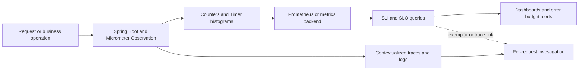

# Selecting Metrics for SLIs in Spring Boot Observability

A metric used for an SLI must reflect what users actually experience from the service. An application with low CPU usage and a healthy JVM can still return errors or respond too slowly. Conversely, higher CPU usage does not necessarily degrade user experience. Therefore, when designing observability for Spring Boot, start from service behavior and commitments, and only then choose meters, tags, and queries.

This article belongs to the **Architecture Design** chapter of the **SPRING_BOOT_OBSERVABILITY** module. The module guides setting up observability for Spring Boot using Micrometer Observation, metrics, logs, and distributed tracing; covering context propagation, tags and cardinality, exporters, sampling, and signal correlation to investigate errors, latency, and application behavior in production. The focus here is selecting the right metrics to compute a Service Level Indicator (SLI), configuring Micrometer, and validating measurements.

## 1. Distinguishing SLI, SLO, and Error Budget

These three concepts are closely related but serve different roles:

- **SLI (Service Level Indicator):** an indicator measuring actual service quality, such as the success rate of requests or the percentage of requests completing within 300 ms.
- **SLO (Service Level Objective):** the target set for an SLI over a period of time, such as 99.9% of valid requests succeeding over 30 days.
- **Error budget:** the allowable degradation in quality under the SLO. With a 99.9% SLO, the allowable failure rate is 0.1% within the measurement window.

An SLI requires a clear measurement definition: which events are counted, which events are good, what constitutes the denominator, what window is measured, and where the data comes from. If teams use different definitions for the same SLI, dashboards and alerts cannot be compared reliably.

### 1.1. Event-Based Formula

For a request-processing service, a common definition is:

\[
SLI = \frac{\text{good events}}{\text{total eligible events}} \times 100\%
\]

For example, if there are 100,000 valid requests and 99,920 requests are processed successfully, the availability SLI is 99.92%. If the SLO is 99.9%, the service is meeting its target within that measurement window.

Do not let the denominator change arbitrarily. Decide in advance how to handle health checks, internal requests, canceled requests, invalid requests, and client errors. For HTTP, 4xx responses are often the valid result of an invalid request, whereas 429 may reflect service capacity limits. The rules must align with the service contract and be applied consistently.

### 1.2. Time-Based vs. Event-Based SLIs

Event-based SLIs are calculated per request or per unit of work processed. Time-based SLIs calculate the fraction of time a service meets a condition, typically used for uptime or synthetic probes. These two measurement approaches answer different questions.

For example, request success rate is traffic-weighted: an endpoint receiving more requests has a greater impact than an endpoint with fewer requests. A per-minute uptime check gives every time interval equal weight. Choose the measurement approach based on user commitments, and do not mix two denominators in the same formula.

## 2. Starting from the User Journey

Choose SLIs by identifying the critical operations users need to complete. For `orders-service`, the journey might include creating an order, viewing order status, and checkout. An endpoint returning HTTP 200 does not necessarily mean the order was created successfully; business logic may fail after the request has been accepted.

The design process should follow these steps:

1. Identify the users or systems depending on the service and the operations they need to complete.
2. Define the event boundary: an HTTP request, a business transaction, a message, or a synthetic check.
3. Describe the conditions for an event to be considered good, including correctness, success status, and latency bounds.
4. Define the denominator and exclusions, especially retries, canceled requests, and client errors.
5. Select metrics that can count those events accurately at an acceptable cost and cardinality.
6. Cross-check metrics against logs, traces, and business data to confirm measurements reflect reality.

Example for the order creation operation:

| SLI | Good Event | Denominator |
|---|---|---|
| Availability | Order is accepted by the service according to the business contract | Total valid order creation submissions |
| Latency | Order creation request is processed successfully within 500 ms | Total valid order creation submissions |
| Correctness | Order is saved with status and data satisfying business rules | Total processed order creations |
| Freshness for asynchronous flows | Message is processed within 2 minutes of emission | Total eligible messages for processing |

Each SLI should have its own definition and target. Do not combine availability, latency, and correctness into a single ratio if the operations team cannot explain the cause when the indicator drops.

## 3. Choosing the Appropriate Metric Type

Micrometer provides different types of meters. Choosing the right type for how the SLI is computed preserves the necessary data and avoids drawing false conclusions from diagnostic metrics.

| Meter Type | Used to Measure | Role in SLI |
|---|---|---|
| `Counter` | Cumulative event count, monotonically increasing | Counting total requests, successful requests, completed or failed jobs |
| `Timer` | Execution count and total duration; can export histograms | Measuring latency and calculating the percentage of events below a threshold |
| `DistributionSummary` | Distribution of a numeric value not necessarily time | Measuring payload size, record count, or processing volume if it is a service objective |
| `Gauge` | Current value at a point in time | Tracking queue depth, active connections, or current state; usually a diagnostic signal |

### 3.1. Counter for Success Rate

Counters fit ratio-based SLIs because they store counts of good events and total events. For example, the `orders.submissions` metric has a `result` tag with a bounded set of values such as `accepted` and `rejected`:

```java
import io.micrometer.core.instrument.MeterRegistry;
import org.springframework.stereotype.Component;

@Component
class OrderSubmissionMetrics {
    private final MeterRegistry registry;

    OrderSubmissionMetrics(MeterRegistry registry) {
        this.registry = registry;
    }

    void record(String result) {
        registry.counter("orders.submissions", "result", result).increment();
    }
}
```

At the call site of `record`, pass only predefined values, such as `accepted` or `rejected`. Do not pass error messages, order IDs, or usernames into tags. In a real application, place the recording at the agreed business boundary so that one order creation is counted exactly once.

If the SLI is calculated per HTTP request, Spring Boot Actuator together with Micrometer usually already provides the `http.server.requests` timer. You can leverage this meter instead of creating a duplicate counter, provided the tags and request boundary match the SLI definition.

### 3.2. Timer and Histogram for Latency

`Timer` is the right choice for measuring processing duration. A histogram stores observation counts across time buckets; this makes it possible to compute the percentage of requests completing below a specific threshold.

For an SLI requiring "completing within 300 ms", a bucket must exist at the exact 300 ms threshold. Then:

\[
SLI_{latency} = \frac{\text{good requests with duration} \leq 300\text{ ms}}{\text{total eligible requests}} \times 100\%
\]

Histograms are also useful for investigating latency distributions. Percentiles such as p95 or p99 answer questions about quantile points, but they do not replace the percentage of events meeting an SLO threshold. In particular, never average p95 across multiple instances to produce a service-wide p95; aggregate buckets first and then compute the distribution at the service level.

### 3.3. Gauges and Infrastructure Metrics

CPU, heap, garbage collection, thread pools, connection pools, and queue depth are very useful for finding the root cause of increased latency or errors. However, they are typically diagnostic metrics or saturation indicators rather than direct descriptions of the quality users experience.

For example, a queue depth of 0 does not prove messages are processed on time; an increasing queue depth does not necessarily violate an SLO if processing throughput still meets commitments. If queue freshness is an SLI, measure the duration from message creation to processing completion or the percentage of messages completed within the threshold. Use queue depth to explain the cause when the freshness SLI degrades.

## 4. Using Spring Boot Default HTTP Metrics

For Spring MVC or WebFlux applications with Actuator and appropriate Micrometer setup, Spring Boot typically records server-side requests using the `http.server.requests` meter. This is a useful starting point for HTTP API availability and latency.

Common tags include:

- `method`: HTTP method such as `GET` or `POST`.
- `uri`: normalized route or URI, usually a route template such as `/api/orders/{id}`.
- `status`: HTTP status code.
- `outcome`: response outcome group.
- `exception`: exception type if present.

Actual tags may differ depending on Spring Boot version, web framework, conventions, and configuration. Inspect the exported data instead of assuming every application has the exact same tag set. With Prometheus, the `/actuator/prometheus` endpoint lets you inspect the converted metric names and labels.

To expose endpoints for inspection in a development environment, the configuration might include:

```yaml
management:
  endpoints:
    web:
      exposure:
        include: health,metrics,prometheus
```

Endpoints must be secured according to the environment's access policy. Expose only necessary endpoints and do not expose sensitive diagnostic endpoints to the Internet.

### 4.1. Configuring Buckets for SLO Thresholds

Suppose the latency SLI requires good requests to complete within 300 ms. You can configure histograms and SLO buckets for the HTTP timer:

```yaml
management:
  metrics:
    distribution:
      percentiles-histogram:
        "http.server.requests": true
      slo:
        "http.server.requests":
          - 100ms
          - 300ms
          - 1s
```

The buckets must include the threshold used in the SLI formula. If the SLO threshold is 300 ms but the histogram has no corresponding bucket, querying the percentage of requests under the threshold cannot be calculated accurately from the exported buckets. Distribution settings must be verified against the Spring Boot version and registry in use.

## 5. Computing SLIs from Prometheus Histograms

With a Prometheus registry, the `http.server.requests` timer is typically normalized into metrics like `http_server_requests_seconds_count`, `http_server_requests_seconds_sum`, and `http_server_requests_seconds_bucket`. Final names and labels depend on the registry and version; verify them at `/actuator/prometheus`.

The examples below assume the route is exported with label `uri="/api/orders"`, the HTTP status code is in the `status` label, and the histogram has a `le="0.3"` bucket. Adjust labels according to your application's actual data.

### 5.1. Availability SLI

If the API convention treats 5xx responses as service errors and remaining responses as valid outcomes, a query for the ratio of requests not returning 5xx could be:

```promql
sum(rate(http_server_requests_seconds_count{
  uri="/api/orders",
  status!~"5.."
}[5m]))
/
sum(rate(http_server_requests_seconds_count{
  uri="/api/orders"
}[5m]))
```

This query illustrates a 5-minute window for short-term monitoring. Before using it as an official SLI, clearly define how to classify 4xx, 429, canceled requests, and internal requests. If `status` is absent from the metric or the tag name differs, adjust the filter to match the exported data.

### 5.2. Latency SLI

If a good event must both not return 5xx and complete within 300 ms, the ratio can be calculated as:

```promql
sum(rate(http_server_requests_seconds_bucket{
  uri="/api/orders",
  status!~"5..",
  le="0.3"
}[5m]))
/
sum(rate(http_server_requests_seconds_count{
  uri="/api/orders"
}[5m]))
```

Histogram buckets are cumulative: `le="0.3"` counts observations with duration not exceeding 0.3 seconds. The numerator in this example counts only requests whose responses are considered good and fast enough; the denominator is all eligible requests within the route scope. Response classification rules must match the published SLI definition.

### 5.3. Longer-Window SLIs

To view results over 30 days, `rate(...[5m])` can be replaced with `increase(...[30d])` in both numerator and denominator. `increase` calculates how much a counter increases over a time range and handles counter resets appropriately for Prometheus queries.

Do not use a short window to conclude whether a 30-day SLO has been met. Dashboards can display both short-term SLIs for incident detection and SLO-window SLIs for commitment evaluation. Burn rate alerts can combine multiple short and long windows to detect abnormal error budget consumption.

## 6. Choosing Scope and Tags to Avoid Bias

### 6.1. Selecting the Right Event Set

Not every request represents user experience. Typically, consider excluding:

- Health checks, readiness probes, liveness probes, and metric scrape requests.
- Internal routes outside the service commitment.
- Test requests or synthetic traffic, if the SLI is defined specifically for real user traffic.
- Requests canceled before the service assumes responsibility for processing, if the SLI contract specifies exclusion.

Do not exclude failed requests simply because they lower the SLI. The denominator must include the events the service committed to serving. If there are no requests during a window, the event ratio has no denominator and cannot be interpreted as 100%; define how to display a no-data state or supplement with synthetic probes.

### 6.2. Using Low-Cardinality Tags

Tags help break down SLIs by route, method, or outcome. However, each tag combination creates an additional time series. Avoid using per-request varying values such as:

- `userId`, email, session ID, or full IP address.
- `orderId`, `paymentId`, request ID, or trace ID.
- Raw URLs containing dynamic IDs or query strings.
- Exception messages or arbitrary error text.

Prefer route templates, status codes, HTTP methods, outcomes, and business categories with bounded value sets. Use logs and traces to inspect per-request details; metrics should maintain stable labels for long-term aggregation.

`service.name`, `service.namespace`, and deployment environment are useful identifying attributes at the Resource level or standardized labels in the metrics system. Avoid attaching unnecessary instance information to every aggregate query when the goal is a service-wide SLI; `service.instance.id` can still be kept for per-replica investigation.

### 6.3. Distinguishing SLI Metrics from Diagnostic Metrics

| Metric | Should Be Used For | Reason |
|---|---|---|
| Request success rate | Availability SLI | Reflects whether requests are processed per contract |
| Percentage of good requests below latency threshold | Latency SLI | Directly measures the speed users experience |
| Percentage of messages processed within age threshold | Freshness SLI | Reflects data or job freshness |
| CPU, heap, GC pause | Diagnostics | Explains causes of degradation, does not directly measure user outcomes |
| Queue depth, thread pool usage | Diagnostics/saturation | Warns of pressure before or during SLI degradation |
| Request rate | Load context | Helps understand traffic and denominator; only an SLI if the contract requires specific throughput |

## 7. Combining Metrics, Logs, and Distributed Tracing

Metrics are suited for computing SLIs because they aggregate large volumes of events at low cost. Logs and traces add context to explain why an SLI changed.

A typical observation flow:



When the latency SLI drops, metrics dashboards show which route and time window are affected. Traces help locate slow spans in services or dependencies; logs with `traceId` and `spanId` help inspect specific errors. If the backend supports exemplars, histograms can attach some observations to a trace ID to jump from a data point to a sample trace.

Do not compute overall SLIs by counting collected traces if the system is sampling. Trace sampling may drop most requests or favor certain request types, so the trace set does not represent total traffic. Use counter and histogram metrics to measure ratios; use traces to investigate root causes. Tail sampling or head sampling remains useful for diagnostics, but does not turn a sampled trace set into a reliable SLI denominator.

## 8. Cases Requiring Custom SLI Design

### 8.1. APIs with Retries

An HTTP request may be retried multiple times in a client or gateway. If the goal is the quality of each individual service call, each attempt can be an event. If the goal is the user's ability to complete an operation, measure once for the entire logical transaction and include retry duration. Document the measurement boundary clearly so one operation is not unintentionally counted as multiple events.

### 8.2. Asynchronous Processing

For consumers, measure successfully completed messages and total eligible messages. For freshness, record the message creation timestamp and completion timestamp; compute the ratio of messages completed within the chosen threshold. Queue depth is a supporting signal, but cannot replace message age or actual wait time.

### 8.3. Services Depending on Multiple Systems

A request may call databases, caches, and other services. The SLI at the service boundary should reflect the final outcome the caller receives. Dependency metrics such as connection timeouts, pool exhaustion, and downstream latency help pinpoint failing components. Do not simply sum dependency latencies if they run in parallel or involve retries; use traces to understand the actual execution path.

## 9. Example SLI Design for `orders-service`

Suppose the service provides an order creation API and the product goal is for valid orders to be accepted quickly and reliably. An initial design could look like this:

| Component | Definition |
|---|---|
| Event boundary | A valid order creation request at the business API |
| Availability SLI | Percentage of requests accepted per the business contract |
| Latency SLI | Percentage of requests accepted within 500 ms |
| SLO window | 30 days |
| Technical metrics | Counter by business outcome and Timer histogram for processing duration |
| Allowed tags | `operation`, `result`, `method`, route template, environment |
| Prohibited tags | `orderId`, `userId`, email, request ID, and exception message |
| Diagnostic metrics | DB connection pool, downstream latency, queue age, JVM GC, and thread pool |

For example, the team might set initial targets of 99.9% of requests accepted and 99% of requests accepted within 500 ms. These numbers are only examples illustrating how to translate product commitments into SLOs; actual targets should be based on user needs, current data, and operational capability.

With a 99.9% availability SLO, the error budget allows 0.1% of eligible events to be bad events over a 30-day window. If the actual error rate is 1%, the error budget burn rate is approximately 10 times the allowable rate. Burn rate can be used to decide alert urgency and whether to pause rollouts.

## 10. Pre-Production SLI Checklist

- [ ] The SLI describes a behavior or outcome that users care about.
- [ ] Event boundary, good condition, and denominator are explicitly documented.
- [ ] Health checks, internal traffic, 4xx, 429, retries, and canceled requests have consistent handling rules.
- [ ] Meter types are appropriate: Counter for events, Timer/histogram for latency, or business metrics for specialized outcomes.
- [ ] Histograms have buckets matching the exact SLO latency thresholds.
- [ ] Tags use bounded value sets and routes are normalized.
- [ ] SLI queries are verified against real data and results are reconciled with business records.
- [ ] Short-term SLIs, SLO windows, and no-data handling are defined.
- [ ] Traces and logs support investigation but are not used as denominators instead of metrics when trace sampling is enabled.
- [ ] Dashboards, alerts, and error budgets use the same SLI definition.

A good metric for an SLI measures the right event, has a clear denominator, and preserves accuracy when aggregated across the entire service. In Spring Boot, Micrometer Counters and Timer histograms are usually the right foundation for request-based SLIs; business metrics are necessary when HTTP outcomes do not fully reflect user operations. Keep metrics as the source of truth for overall quality, then correlate logs and traces to find root causes when an SLI degrades.
